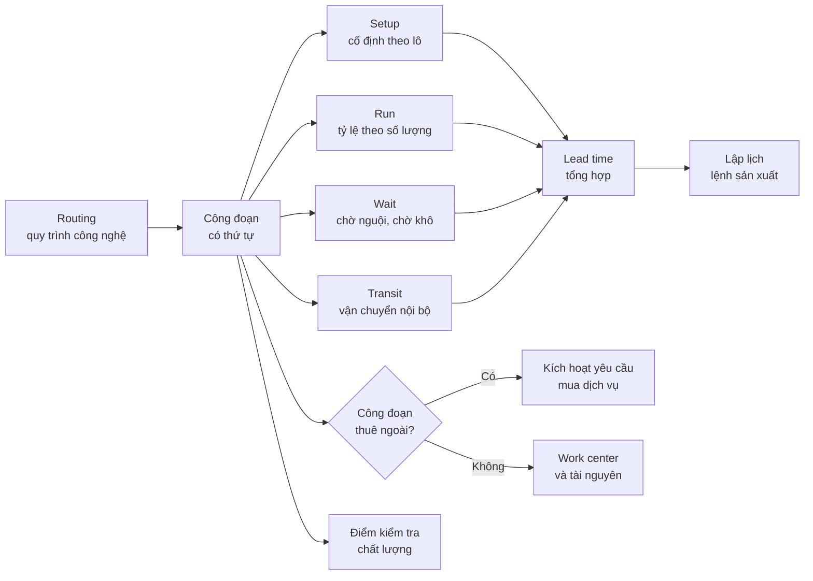

# Routing & công đoạn

BOM nói sản phẩm **cần gì**; Routing nói sản phẩm **được làm thế nào và mất bao lâu**. Sai ở Routing thì hoặc hứa ngày giao không thực hiện được, hoặc giá thành thiếu giờ công và giờ máy.

## Nguyên lý (áp dụng mọi ERP)

1. **Tổng thời gian sản xuất không chỉ là thời gian máy chạy.** Có bốn loại thời gian trên mỗi công đoạn: **chuẩn bị máy (setup)**, **gia công (run)**, **chờ (wait)**, và **vận chuyển (transit)**. Bỏ ba loại sau, lead time trên hệ thống ngắn hơn thực tế rất nhiều.
2. **Setup cố định theo lô, Run tỷ lệ theo số lượng.** Gá đặt máy mất 2 giờ dù làm 1 cái hay 1.000 cái; gia công mất 0,02 giờ mỗi cái. Gộp hai loại này làm sai cả lập lịch lẫn giá thành khi quy mô lô thay đổi.
3. **Công đoạn có thứ tự và phải tuần tự.** Không thể sơn trước khi lắp ráp. Hệ thống phải kiểm tra thứ tự, không chỉ lưu số công đoạn.
4. **Gia công ngoài là một loại công đoạn, không phải một đơn mua riêng.** Nó phải nằm trong routing để lệnh sản xuất tự kích hoạt yêu cầu mua khi chạy tới bước đó, và giá trị gia công phải cộng vào giá thành bán thành phẩm.
5. **Điểm kiểm tra chất lượng là công đoạn, không phải ghi chú.** Đặt IQC/IPQC như một bước trong routing cho phép chặn hàng đi tiếp khi chưa kiểm, và tính được thời gian chờ kiểm vào lead time.
6. **Routing thay thế là công cụ xử lý sự cố, không phải tùy chọn cho vui.** Khi máy chính hỏng, routing dự phòng cho phép lệnh tiếp tục chạy. Không có nó, mọi sự cố thiết bị đều dừng sản xuất.

## 1. Luồng vận hành



## 2. Ai làm gì ở module nào

| Việc | Kỹ thuật sản xuất | Sản xuất (điều độ) | Kho | Mua hàng | Kế toán |
|---|---|---|---|---|---|
| Thiết lập routing và công đoạn | ✅ sở hữu | — | — | — | — |
| Khai định mức thời gian | ✅ sở hữu | Cung cấp dữ liệu thực tế | — | — | — |
| Gán work center cho công đoạn | ✅ sở hữu | — | — |
| Đánh dấu công đoạn gia công ngoài | ✅ sở hữu | Duyệt gửi đi | ✅ xuất hàng gửi gia công | ✅ nhận yêu cầu và đặt | — |
| Đặt điểm kiểm tra chất lượng | ✅ phối hợp | — | Đưa vào khu chờ kiểm | — | — |
| Khai routing thay thế | ✅ sở hữu | ✅ quyết định dùng khi sự cố | — | — | — |
| Chọn routing cho lệnh sản xuất | — | ✅ thực hiện | — | — | — |
| Giờ công và giờ máy định mức vào giá thành | Cung cấp định mức | Báo cáo thực tế | — | — | ✅ hạch toán |

**Ranh giới cốt lõi:** kỹ thuật sở hữu **định mức**, điều độ sở hữu **thứ tự chạy thực tế**. Không ai được sửa routing của lệnh đang sản xuất.

## 3. Hạch toán

Routing là **công thức tính chi phí chuyển đổi** (conversion cost):

- **Giờ máy định mức × đơn giá giờ máy** → chi phí máy trong giá thành định mức.
- **Giờ công định mức × đơn giá giờ công** → chi phí nhân công trực tiếp.
- **Thời gian chờ và vận chuyển không sinh chi phí trực tiếp**, nhưng kéo dài thời gian sản xuất dở dang → ảnh hưởng dòng tiền và vốn lưu động.
- **Công đoạn gia công ngoài** cộng giá trị dịch vụ vào bán thành phẩm tại điểm nhập lại kho.

Chênh lệch giữa giờ định mức và giờ thực tế là **chênh lệch hiệu suất** (labor efficiency variance) — phải phân tích riêng, không gộp vào chi phí chung. Bản đồ tài khoản ở [Hạch toán & tài khoản trung gian](../5-ke-toan/ke-toan-tong-hop/1000-hach-toan-va-tai-khoan-trung-gian.md); phân tích chênh lệch ở [Giá thành sản xuất](./2020-gia-thanh-san-xuat.md).

## 4. Điểm chạm & rủi ro

- **Work center và năng lực dùng trong công đoạn**: [Work Center & năng lực](./1000-work-center-va-nang-luc.md)
- **Vật tư tiêu hao gắn vào công đoạn**: [BOM & định mức](./1010-bom-va-dinh-muc.md)
- **Ghép routing với BOM thành phiên bản sản xuất**: [Phiên bản sản xuất & quy mô lô](./1030-phien-ban-san-xuat-va-lo.md)
- **Giao dịch gửi và nhận gia công ngoài**: [Gia công ngoài](./2010-gia-cong-ngoai.md)
- **Yêu cầu mua dịch vụ gia công**: [Mô hình mua đặc thù](../2-mua-hang/2030-mo-hinh-mua-dac-thu.md)

**Rủi ro chính:**

- **Chỉ khai thời gian máy chạy** — lead time ngắn hơn thực tế, mọi đơn trễ.
- **Gộp setup vào run** — lô nhỏ bị tính giá thành quá thấp, lô lớn quá cao.
- **Công đoạn không kiểm tra thứ tự** — lệnh có thể nhảy bước, ra sản phẩm lỗi.
- **Gia công ngoài khai ngoài routing** — lệnh không tự sinh yêu cầu mua, dừng ở công đoạn đó.
- **Không có routing thay thế** — một máy hỏng là dừng cả đơn.
- **Sửa routing của lệnh đang chạy** — thay đổi định mức giữa đường, giá thành không truy được.

## 5. Triển khai tham chiếu ERP

### A. Ánh xạ bốn loại thời gian

| Thời gian | Oracle EBS | Epicor ERP | SAP S/4HANA | Odoo |
|---|---|---|---|---|
| Setup | `usage_rate_or_amount` với type `1` (Lot) | `PartOpr.EstSetHours` | `VGW01` (Standard Value Key) | `mrp.routing.workcenter.time_start` |
| Run | `usage_rate_or_amount` với type `2` (Item) | `PartOpr.ProdStandard` | `VGW02` | `mrp.routing.workcenter.time_cycle` |
| Queue | Không có cột cố định | `PartOpr.QueueHours` | `PLPO.WARTE` | Không mặc định |
| Transit/Move | `minimum_delay` | `PartOpr.MoveHours` | `PLPO.TRAZE` | Lead time of routes |
| Wait | Cấu hình gián tiếp | Gộp vào `MoveHours` hoặc setup công đoạn sau | `PLPO.LIEGE` | `time_stop` (cleanup/wait) |

### B. Ánh xạ khái niệm khác

| Khái niệm | Oracle EBS | Epicor ERP | SAP S/4HANA | Odoo |
|---|---|---|---|---|
| Routing header | `BOM_OPERATIONAL_ROUTINGS` | `Erp.PartOpr` (gắn theo `PartRev`) | `PLKO` | `mrp.routing` |
| Dòng công đoạn | `BOM_OPERATION_SEQUENCES` | `Erp.PartOpr` | `PLPO` | `mrp.routing.workcenter` |
| Tài nguyên của công đoạn | `BOM_OPERATION_RESOURCES` | `PartOpr.ResourceGrpID` | `PLPO.ARBID` → `CRHD` | `workcenter_id` |
| Công đoạn gia công ngoài | Resource loại `resource_type = 4` (OSP) | `PartOpr.SubContract = 1` + `PartOpr.VendorNum` | Control Key `STEUS` = `PP02` + `PLPO.LIFNR` | `mrp.bom.type = 'subcontract'` |
| Điểm kiểm tra chất lượng | Operation đặc biệt + Inspection | Inspection Processing gắn Operation | Control Key có inspection | Quality point trên operation |

**Ví dụ thực tế Oracle EBS** — khai định mức cho tổ dập:
1. `BOM > Routings > Routings` → chọn công đoạn → nút `Resources`.
2. Dòng 1: Resource `STAMP`, `Basis = Lot`, `Value = 0.5` → **setup 0,5 giờ cho cả lô**.
3. Dòng 2: Resource `STAMP`, `Basis = Item`, `Value = 0.02` → **0,02 giờ mỗi sản phẩm**.

Đây là cách tách setup và run mà không cần hai trường riêng — hệ thống hiểu qua `Basis`.

### C. Hệ thống tự xây — thiết kế tối thiểu

```sql
CREATE TABLE Routing_Header (
    Routing_ID       BIGINT IDENTITY PRIMARY KEY,
    Parent_Item      VARCHAR(50) NOT NULL,
    Version          INT NOT NULL DEFAULT 1,
    Status           VARCHAR(20) NOT NULL,  -- DRAFT | APPROVED | SUPERSEDED
    Effective_From   DATE NOT NULL,
    Is_Alternative   BIT NOT NULL DEFAULT 0,
    UNIQUE (Parent_Item, Version)
);

CREATE TABLE Routing_Operation (
    Routing_ID       BIGINT NOT NULL,
    Op_Seq           INT NOT NULL,
    WC_ID            VARCHAR(50) NOT NULL,
    Setup_Hours      DECIMAL(9,4) NOT NULL DEFAULT 0,
    Run_Hours_Per    DECIMAL(9,6) NOT NULL DEFAULT 0,
    Wait_Hours       DECIMAL(9,4) NOT NULL DEFAULT 0,
    Transit_Hours    DECIMAL(9,4) NOT NULL DEFAULT 0,
    Is_Subcontract   BIT NOT NULL DEFAULT 0,
    Subcontract_Vendor VARCHAR(50) NULL,
    Is_Inspection    BIT NOT NULL DEFAULT 0,
    PRIMARY KEY (Routing_ID, Op_Seq),
    CONSTRAINT CK_OSP_Vendor CHECK (Is_Subcontract = 0 OR Subcontract_Vendor IS NOT NULL)
);
```

Bốn ràng buộc bắt buộc:

1. **`Op_Seq` phải tăng dần và duy nhất** trong một routing — thứ tự công đoạn là dữ liệu, không phải gợi ý.
2. **`Is_Subcontract = 1` bắt buộc có `Subcontract_Vendor`** — nếu không, lệnh không biết gửi cho ai.
3. **Công đoạn gia công ngoài phải liên kết được mã dịch vụ mua** — để hệ thống tự sinh yêu cầu mua.
4. **Không sửa routing `APPROVED`** — thay đổi tạo `Version + 1`.

### D. Truy vấn kiểm soát

**Công đoạn gia công ngoài thiếu nhà cung cấp — lệnh sẽ dừng ở bước này:**

```sql
SELECT r.Parent_Item, r.Version, o.Op_Seq, o.WC_ID
FROM Routing_Header r
JOIN Routing_Operation o ON o.Routing_ID = r.Routing_ID
WHERE r.Status = 'APPROVED'
  AND o.Is_Subcontract = 1
  AND o.Subcontract_Vendor IS NULL;
```

**Công đoạn không có thời gian gia công — lead time bị thiếu:**

```sql
SELECT r.Parent_Item, o.Op_Seq, o.WC_ID, o.Setup_Hours, o.Run_Hours_Per
FROM Routing_Header r
JOIN Routing_Operation o ON o.Routing_ID = r.Routing_ID
WHERE r.Status = 'APPROVED'
  AND o.Setup_Hours = 0 AND o.Run_Hours_Per = 0;
```

**Tổng thời gian định mức so với lead time khai báo trên mã hàng — phát hiện lệch:**

```sql
SELECT r.Parent_Item,
       SUM(o.Setup_Hours + o.Run_Hours_Per * i.Lot_Size
           + o.Wait_Hours + o.Transit_Hours) AS Total_Routing_Hours,
       i.Lead_Time_Days * 8 AS Declared_Hours
FROM Routing_Header r
JOIN Routing_Operation o ON o.Routing_ID = r.Routing_ID
JOIN Item_Inventory_Attribute i ON i.Item_ID = r.Parent_Item
WHERE r.Status = 'APPROVED'
GROUP BY r.Parent_Item, i.Lead_Time_Days
HAVING ABS(SUM(o.Setup_Hours + o.Run_Hours_Per * i.Lot_Size
               + o.Wait_Hours + o.Transit_Hours) - i.Lead_Time_Days * 8) > 8;
```

**Routing thứ tự công đoạn bị trùng hoặc nhảy cóc:**

```sql
SELECT Routing_ID, Op_Seq, COUNT(*) AS So_Dong
FROM Routing_Operation
GROUP BY Routing_ID, Op_Seq
HAVING COUNT(*) > 1;
```

**Epicor — công đoạn gia công ngoài chưa có vendor mặc định:**

```sql
SELECT po.PartNum, po.RevisionNum, po.OprSeq, po.OpCode, po.SubContract
FROM Erp.PartOpr po
WHERE po.Company = 'YOUR_COMPANY_CODE'
  AND po.SubContract = 1
  AND (po.VendorNum IS NULL OR po.VendorNum = 0);
```

## 6. Bẫy thực chiến & Checklist

| # | Bẫy | Triệu chứng | Cách phòng tránh |
|---|---|---|---|
| 1 | Chỉ khai run time | Lead time ngắn hơn thực tế, mọi đơn trễ | Khai đủ 4 loại thời gian |
| 2 | Gộp setup vào run | Lô nhỏ lỗ, lô lớn lãi giả | Tách hai trường, setup theo lô |
| 3 | Không khai wait/transit | Sơn cần khô 24h nhưng hệ thống cho chạy tiếp ngay | `Wait_Hours`, `Transit_Hours` bắt buộc khi cần |
| 4 | Công đoạn không kiểm thứ tự | Lệnh nhảy bước, ra sản phẩm lỗi | `Op_Seq` tăng dần, kiểm tra ở tầng dịch vụ |
| 5 | Gia công ngoài ngoài routing | Lệnh dừng ở công đoạn, không ai biết phải mua dịch vụ | Đánh dấu `Is_Subcontract` ngay trong routing |
| 6 | Gia công ngoài thiếu vendor | Lệnh không biết gửi cho ai | Ràng buộc `Subcontract_Vendor` bắt buộc |
| 7 | Sửa routing đang chạy | Giờ định mức đổi giữa đường, giá thành không truy được | Version mới, không sửa bản APPROVED |
| 8 | Không có routing thay thế | Máy hỏng là dừng cả đơn | Khai `Is_Alternative` cho dòng máy dự phòng |
| 9 | Điểm QC không nằm trong routing | Hàng đi tiếp khi chưa kiểm, không tính thời gian chờ kiểm | `Is_Inspection` như một công đoạn thật |
| 10 | Định mức không cập nhật từ dữ liệu thực | Định mức lạc hậu nhiều năm, giá thành sai | Rà soát định mức theo quý từ báo cáo thực tế |

**Checklist trước go-live:**

- [ ] Mọi routing APPROVED có đủ setup và run time (đã test).
- [ ] Setup tách khỏi run, tính theo lô (đã test 2 quy mô lô khác nhau).
- [ ] Thời gian chờ và vận chuyển khai ở các công đoạn cần thiết.
- [ ] `Op_Seq` tăng dần, không trùng (đã test).
- [ ] Công đoạn gia công ngoài có vendor và mã dịch vụ mua.
- [ ] Đã test lệnh sản xuất tự sinh yêu cầu mua tại công đoạn gia công ngoài.
- [ ] Không sửa được routing APPROVED (đã test).
- [ ] Có routing thay thế cho dòng máy trọng yếu.
- [ ] Điểm QC nằm trong routing, chặn hàng đi tiếp khi chưa kiểm.
- [ ] Định mức được rà soát lại từ dữ liệu thực tế ít nhất mỗi quý.

## Xem thêm

- [Tổng quan Sản xuất](./0000-tong-quan-san-xuat.md)
- [Work Center & năng lực](./1000-work-center-va-nang-luc.md)
- [BOM & định mức](./1010-bom-va-dinh-muc.md)
- [Phiên bản sản xuất & quy mô lô](./1030-phien-ban-san-xuat-va-lo.md)
- [Gia công ngoài](./2010-gia-cong-ngoai.md)

<div align="center" style={{color: 'var(--ifm-color-primary)'}}>
  <strong>Chúc các bạn thành công và vui vẻ!</strong>
</div>
