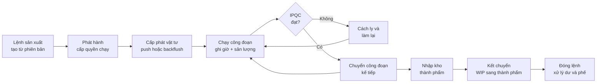

# Lệnh sản xuất & WIP

Tầng kỹ thuật định nghĩa **cách làm**; tầng thực thi ghi nhận **đã làm được bao nhiêu và tốn bao nhiêu**. Mọi con số giá thành đến từ đây — sai ở bước này thì sổ sách đúng cũng vô nghĩa vì dữ liệu gốc đã sai.

Bài này gộp toàn bộ vòng đời một lệnh sản xuất: phát hành → cấp liệu → chạy máy → kiểm tra → nhập kho → đóng lệnh.

## Nguyên lý (áp dụng mọi ERP)

1. **WIP là tài khoản trung gian có thật, phải luôn được theo dõi.** Nguyên vật liệu xuất ra sản xuất chưa phải chi phí — nó đang chuyển từ kho sang dở dang. Chỉ khi nhập thành phẩm hoặc đóng lệnh mới thành chi phí thật.
2. **Một lệnh sản xuất phải có trạng thái rõ ràng, không nhập nhằng.** Nháp → đã phát hành → đang chạy → hoàn thành một phần → hoàn thành → đóng. Trộn trạng thái làm không biết lệnh nào đang tiêu chi phí.
3. **Cấp liệu có hai cách: đẩy (push) và kéo (backflush).** Push là thủ kho xuất theo phiếu; backflush là hệ thống tự trừ khi báo cáo hoàn thành công đoạn. Backflush nhanh nhưng nguy hiểm nếu định mức sai.
4. **Sản lượng thực tế và phế phẩm là hai con số khác nhau.** Báo cáo "hoàn thành 100" mà không nói phế 5 nghĩa là 100 cái đạt từ 105 lần chạy — hoặc 100 lần chạy được 95 đạt. Không tách hai số này thì không tính được hiệu suất.
5. **Giờ công và giờ máy phải ghi theo công đoạn, không phải theo lệnh.** Chỉ có ghi theo công đoạn mới biết công đoạn nào là nút cổ chai, công đoạn nào lãng phí.
6. **Đóng lệnh là một hành động có nghiệp vụ, không phải thao tác dọn màn hình.** Đóng lệnh phải kiểm tra: còn nguyên vật liệu dư không, còn WIP treo không, còn phế phẩm chưa xử lý không. Đóng sai sẽ làm WIP treo vĩnh viễn trên sổ cái.

## 1. Luồng vận hành



## 2. Ai làm gì ở module nào

| Bước | Điều độ sản xuất | Tổ trưởng / công nhân | Kho | QC | Kế toán |
|---|---|---|---|---|---|
| Tạo lệnh từ phiên bản sản xuất | ✅ sở hữu | — | — |
| Phát hành lệnh | ✅ duyệt | — | Nhận thông báo | — | — |
| Cấp phát vật tư | — | Yêu cầu cấp liệu | ✅ ghi giao dịch | — | Nhận bút toán vào WIP |
| Backflush khi hoàn thành công đoạn | — | ✅ báo cáo hoàn thành | Tự động trừ | — | Nhận bút toán WIP |
| Ghi giờ công, giờ máy | — | ✅ sở hữu | — | — | Nhận chi phí nhân công |
| Kiểm tra IPQC | — | Đưa hàng vào khu kiểm | Ghi trạng thái bin | ✅ quyết định đạt/lỗi | — |
| Xử lý phế phẩm | Đọc báo cáo | ✅ báo cáo phế | ✅ ghi giao dịch xuất phế | ✅ nguyên nhân | Nhận chi phí hàng hỏng |
| Nhập kho thành phẩm | — | ✅ báo cáo hoàn thành | ✅ ghi giao dịch nhập | Xác nhận đạt | Nhận bút toán WIP → thành phẩm |
| Đóng lệnh | ✅ chủ trì | Báo cáo dư vật tư | Xác nhận nhập lại | — | ✅ xử lý chênh lệch cuối cùng |

**Ranh giới cốt lõi:** **chỉ kho được ghi giao dịch kho**, chỉ công nhân/tổ trưởng báo cáo sản lượng, chỉ kế toán quyết định xử lý WIP cuối cùng.

## 3. Hạch toán

Lệnh sản xuất là **sổ chi tiết của tài khoản WIP**. Vòng đời của chi phí:

```
Xuất nguyên vật liệu  → Nợ WIP / Có kho
Ghi giờ công, giờ máy → Nợ WIP / Có chi phí nhân công, chi phí SX chung
Nhập thành phẩm        → Nợ thành phẩm / Có WIP
Đóng lệnh, chênh lệch  → Nợ/Có chênh lệch giá thành
```

Bốn điều phải chốt trước khi go-live:

1. **WIP luôn phải cân.** Tổng phát sinh WIP = tổng xuất vật tư + nhân công + chi phí chung. Nếu không cân, có giao dịch ghi thiếu giá trị.
2. **Nhập thành phẩm theo giá thành định mức** hoặc theo chi phí thực tế tích lũy — phải chọn một quy tắc, không trộn.
3. **Phế phẩm là chi phí, không phải mất mát vô hình.** Nó phải được ghi nhận, có mã lý do, và vào giá thành (hoặc chi phí kỳ) theo chính sách rõ ràng.
4. **Lệnh đóng phải có WIP bằng 0.** Đây là điều kiện bắt buộc trước khi chốt sổ.

Bản đồ tài khoản ở [Hạch toán & tài khoản trung gian](../5-ke-toan/ke-toan-tong-hop/1000-hach-toan-va-tai-khoan-trung-gian.md); giá thành và chênh lệch ở [Giá thành sản xuất](./2020-gia-thanh-san-xuat.md).

## 4. Điểm chạm & rủi ro

- **Giao dịch kho do lệnh sinh ra**: [Giao dịch nhập, xuất & chuyển](../1-kho/2000-giao-dich-nhap-xuat-chuyen.md)
- **Định mức vật tư dùng để cấp phát**: [BOM & định mức](./1010-bom-va-dinh-muc.md)
- **Định mức giờ và công đoạn**: [Routing & công đoạn](./1020-routing-va-cong-doan.md)
- **Phiên bản sản xuất chọn khi tạo lệnh**: [Phiên bản sản xuất & quy mô lô](./1030-phien-ban-san-xuat-va-lo.md)
- **Gia công ngoài trong lệnh**: [Gia công ngoài](./2010-gia-cong-ngoai.md)
- **Chênh lệch giá thành khi đóng lệnh**: [Giá thành sản xuất](./2020-gia-thanh-san-xuat.md)

**Rủi ro chính:**

- **Backflush với định mức sai** — trừ kho sai số lượng, tồn kho lệch dần mà không ai thấy.
- **Không tách sản lượng đạt và phế** — không tính được hiệu suất, không biết công đoạn nào hỏng.
- **WIP treo do lệnh không đóng** — chi phí nằm mãi trên tài khoản dở dang, lãi lỗ sai.
- **Ghi giờ công ở cấp lệnh thay vì cấp công đoạn** — không xác định được nút cổ chai.
- **Nhập thành phẩm không qua QC** — hàng lỗi vào kho khả dụng, giao cho khách.
- **Đóng lệnh khi còn vật tư dư chưa nhập lại** — vật tư biến mất khỏi sổ, kho mất hàng.

## 5. Triển khai tham chiếu ERP

### A. Ánh xạ khái niệm

| Khái niệm | Oracle EBS | Epicor ERP | SAP S/4HANA | Odoo |
|---|---|---|---|---|
| Lệnh sản xuất | `WIP_DISCRETE_JOBS` | `Erp.JobHead` | `AUFK` + `AFKO` | `mrp.production` |
| Công đoạn của lệnh | `WIP_OPERATIONS` | `Erp.JobOper` | `AFVC` | `mrp.workorder` |
| Cấp vật tư (push) | `WIP_MATERIAL_TRANSACTIONS` (Issue) | `Erp.PartTran` loại `STK-MTL` | Movement `261` | `stock.move` → Production |
| Cấp vật tư tự động (backflush) | `WIP_MOVE_TRANSACTIONS` (Assembly Pull) | `PartTran` loại `STK-MTL` tự sinh khi báo cáo | Movement `261` với backflush indicator trên BOM | `consumption = 'flexible'` trên `mrp.bom.line` |
| Báo cáo hoàn thành công đoạn | `WIP_MOVE_TRANSACTIONS` | `Erp.LaborDtl` + `JobOper` | `AFRU` (Order Confirmation) | `mrp.workcenter.productivity` |
| Ghi giờ công | `WIP_LABOR_ACTUALS` | `Erp.LaborDtl` | `AFRU` (Labor time) | `mrp.workcenter.productivity` |
| Phế phẩm | `WIP_SCRAP_VAL` | `PartTran` loại `MFG-CUS` / scrap | Movement `551` | `mrp.production` scrap |
| Nhập thành phẩm | `WIP_MOVE_TRANSACTIONS` (Completion) | `PartTran` loại `MFG-STK` | Movement `101` (từ lệnh SX) | `stock.move` Production → Stock |
| Đóng lệnh | `WIP_CLOSE_DISCRETE_JOBS` | `Job Closing` | `CO02` TECO | `mrp.production` state `done` |

### B. Hệ thống tự xây — thiết kế tối thiểu

```sql
CREATE TABLE Work_Order (
    WO_ID            BIGINT IDENTITY PRIMARY KEY,
    WO_No            VARCHAR(30) NOT NULL UNIQUE,
    Item_ID          VARCHAR(50) NOT NULL,
    PV_ID            BIGINT NOT NULL,        -- phiên bản sản xuất đã chọn
    Qty_Ordered      DECIMAL(18,4) NOT NULL,
    Qty_Completed    DECIMAL(18,4) NOT NULL DEFAULT 0,
    Qty_Scrapped     DECIMAL(18,4) NOT NULL DEFAULT 0,
    Status           VARCHAR(20) NOT NULL,
    -- DRAFT | RELEASED | IN_PROGRESS | PARTIAL | COMPLETED | CLOSED
    Planned_Start    DATE NOT NULL,
    Planned_End      DATE NOT NULL,
    Closed_At        DATETIME NULL
);

CREATE TABLE WO_Operation (
    WO_ID            BIGINT NOT NULL,
    Op_Seq           INT NOT NULL,
    Status           VARCHAR(20) NOT NULL,   -- PENDING | RUNNING | DONE | SKIPPED
    Setup_Hours_Act  DECIMAL(9,4) NOT NULL DEFAULT 0,
    Run_Hours_Act    DECIMAL(9,4) NOT NULL DEFAULT 0,
    Qty_Done         DECIMAL(18,4) NOT NULL DEFAULT 0,
    Qty_Scrap        DECIMAL(18,4) NOT NULL DEFAULT 0,
    PRIMARY KEY (WO_ID, Op_Seq)
);

CREATE TABLE WO_Material_Txn (
    Txn_ID           BIGINT IDENTITY PRIMARY KEY,
    WO_ID            BIGINT NOT NULL,
    Op_Seq           INT NULL,
    Item_ID          VARCHAR(50) NOT NULL,
    Qty_Issued       DECIMAL(18,4) NOT NULL,
    Issue_Method     VARCHAR(20) NOT NULL,   -- PUSH | BACKFLUSH
    Inventory_Trx_ID BIGINT NOT NULL,        -- liên kết giao dịch kho
    Txn_At           DATETIME NOT NULL DEFAULT GETDATE()
);
```

Bốn ràng buộc bắt buộc:

1. **`Qty_Completed + Qty_Scrapped ≤ Qty_Ordered`**, trừ khi có duyệt over-completion.
2. **Mọi dòng `WO_Material_Txn` phải có `Inventory_Trx_ID`** — không có xuất kho "ngoài sổ".
3. **Không đóng lệnh nếu WIP ≠ 0** hoặc còn vật tư dư chưa nhập lại.
4. **Backflush chỉ chạy khi định mức BOM có `Scrap_Pct` khai** — nếu không, hệ thống trừ thiếu.

### C. Truy vấn kiểm soát

**Lệnh có WIP treo — chi phí nằm trên tài khoản dở dang quá lâu:**

```sql
SELECT w.WO_No, w.Item_ID, w.Status, w.Closed_At,
       DATEDIFF(DAY, w.Planned_End, GETDATE()) AS Days_Overdue,
       (SELECT ISNULL(SUM(m.Qty_Issued * i.Unit_Cost), 0)
        FROM WO_Material_Txn m
        JOIN Item_Inventory_Attribute i ON i.Item_ID = m.Item_ID
        WHERE m.WO_ID = w.WO_ID) AS WIP_Value
FROM Work_Order w
WHERE w.Status IN ('RELEASED', 'IN_PROGRESS', 'PARTIAL')
  AND DATEDIFF(DAY, w.Planned_End, GETDATE()) > 30
ORDER BY Days_Overdue DESC;
```

**Lệnh nhập thành phẩm nhưng chưa xuất đủ vật tư — WIP sẽ lệch:**

```sql
SELECT w.WO_No, w.Item_ID, w.Qty_Completed,
       b.Component_Item,
       b.Qty_Per * w.Qty_Completed AS Qty_Required,
       ISNULL((SELECT SUM(m.Qty_Issued) FROM WO_Material_Txn m
               WHERE m.WO_ID = w.WO_ID AND m.Item_ID = b.Component_Item), 0) AS Qty_Issued
FROM Work_Order w
JOIN BOM_Header h  ON h.BOM_ID = (SELECT BOM_ID FROM Production_Version WHERE PV_ID = w.PV_ID)
JOIN BOM_Line b    ON b.BOM_ID = h.BOM_ID
WHERE w.Qty_Completed > 0
  AND ISNULL((SELECT SUM(m.Qty_Issued) FROM WO_Material_Txn m
              WHERE m.WO_ID = w.WO_ID AND m.Item_ID = b.Component_Item), 0)
      < b.Qty_Per * w.Qty_Completed;
```

**Lệnh đóng nhưng còn vật tư đã xuất chưa dùng và chưa nhập lại:**

```sql
SELECT w.WO_No, m.Item_ID, SUM(m.Qty_Issued) AS Qty_Issued,
       ISNULL((SELECT SUM(r.Qty_Returned) FROM WO_Material_Return r
               WHERE r.WO_ID = w.WO_ID AND r.Item_ID = m.Item_ID), 0) AS Qty_Returned
FROM Work_Order w
JOIN WO_Material_Txn m ON m.WO_ID = w.WO_ID
WHERE w.Status = 'CLOSED'
GROUP BY w.WO_No, m.Item_ID
HAVING SUM(m.Qty_Issued) > ISNULL((SELECT SUM(r.Qty_Returned) FROM WO_Material_Return r
        WHERE r.WO_ID = w.WO_ID AND r.Item_ID = m.Item_ID), 0)
   AND SUM(m.Qty_Issued) > (SELECT h.Base_Qty FROM Production_Version pv
                            JOIN BOM_Header h ON h.BOM_ID = pv.BOM_ID
                            WHERE pv.PV_ID = MAX(w.PV_ID)) * MAX(w.Qty_Completed);
```

**Tỷ lệ phế theo công đoạn — tìm nút cổ chai chất lượng:**

```sql
SELECT o.Op_Seq, SUM(o.Qty_Scrap) AS Tong_Phe,
       SUM(o.Qty_Done + o.Qty_Scrap) AS Tong_Chay,
       CAST(SUM(o.Qty_Scrap) AS DECIMAL) * 100 / NULLIF(SUM(o.Qty_Done + o.Qty_Scrap), 0) AS Scrap_Pct
FROM WO_Operation o
JOIN Work_Order w ON w.WO_ID = o.WO_ID
WHERE w.Planned_Start >= DATEADD(MONTH, -3, GETDATE())
GROUP BY o.Op_Seq
ORDER BY Scrap_Pct DESC;
```

**Epicor — lệnh đã hoàn thành nhưng chưa đóng, WIP còn treo:**

```sql
SELECT j.JobNum, j.PartNum, j.QtyCompleted, j.JobClosed
FROM Erp.JobHead j
WHERE j.Company = 'YOUR_COMPANY_CODE'
  AND j.JobComplete = 1
  AND j.JobClosed = 0
ORDER BY j.JobNum;
```

## 6. Bẫy thực chiến & Checklist

| # | Bẫy | Triệu chứng | Cách phòng tránh |
|---|---|---|---|
| 1 | Backflush với định mức sai hoặc thiếu scrap | Trừ kho sai số lượng, tồn lệch dần | Bắt buộc `Scrap_Pct` trước khi bật backflush |
| 2 | Không tách sản lượng đạt và phế | Không tính được hiệu suất, không biết công đoạn nào hỏng | `Qty_Done` và `Qty_Scrap` là hai trường riêng |
| 3 | WIP treo do không đóng lệnh | Chi phí nằm mãi trên dở dang, lãi lỗ sai | Job đóng lệnh quá hạn + báo cáo WIP aging |
| 4 | Ghi giờ ở cấp lệnh, không theo công đoạn | Không xác định được nút cổ chai | Ghi giờ trên `WO_Operation` |
| 5 | Nhập thành phẩm không qua QC | Hàng lỗi vào tồn khả dụng, giao cho khách | Bắt buộc IPQC trước khi nhập |
| 6 | Đóng lệnh khi còn vật tư dư | Vật tư biến mất khỏi sổ, kho mất hàng | Chặn đóng nếu chưa có `WO_Material_Return` |
| 7 | Lệnh đóng với WIP khác 0 | Sổ cái có số dư dở dang vĩnh viễn | Kiểm tra WIP = 0 trước khi cho đóng |
| 8 | Cho nhập quá `Qty_Ordered` không duyệt | Thành phẩm nhiều hơn kế hoạch, vật tư vượt định mức | Ngưỡng over-completion có duyệt |
| 9 | Xuất vật tư không ghi `Inventory_Trx_ID` | Kho và WIP lệch nhau, không đối chiếu được | Mọi xuất vật tư phải có giao dịch kho tương ứng |
| 10 | Báo cáo hoàn thành trước khi chạy công đoạn cuối | Hàng chưa qua công đoạn cuối đã tính là thành phẩm | Chặn nếu `WO_Operation` còn `PENDING` |

**Checklist trước go-live:**

- [ ] `Scrap_Pct` khai đủ trên BOM trước khi bật backflush.
- [ ] `Qty_Done` và `Qty_Scrap` là hai trường riêng, báo cáo tách được.
- [ ] Giờ công/máy ghi theo công đoạn (đã test báo cáo nút cổ chai).
- [ ] IPQC là điều kiện bắt buộc trước khi nhập kho thành phẩm.
- [ ] Chặn đóng lệnh khi còn vật tư dư (đã test).
- [ ] Chặn đóng lệnh khi WIP ≠ 0 (đã test).
- [ ] Over-completion có ngưỡng và cần duyệt.
- [ ] Mọi xuất vật tư có `Inventory_Trx_ID` (đã test đối chiếu).
- [ ] Có báo cáo WIP aging theo lệnh quá hạn.
- [ ] Đã test toàn luồng: phát hành → cấp liệu → chạy 3 công đoạn → phế 2 cái → nhập kho → đóng lệnh, WIP về 0.

## Xem thêm

- [Tổng quan Sản xuất](./0000-tong-quan-san-xuat.md)
- [Gia công ngoài](./2010-gia-cong-ngoai.md)
- [Giá thành sản xuất](./2020-gia-thanh-san-xuat.md)
- [BOM & định mức](./1010-bom-va-dinh-muc.md)
- [Giao dịch nhập, xuất & chuyển](../1-kho/2000-giao-dich-nhap-xuat-chuyen.md)

<div align="center" style={{color: 'var(--ifm-color-primary)'}}>
  <strong>Chúc các bạn thành công và vui vẻ!</strong>
</div>
