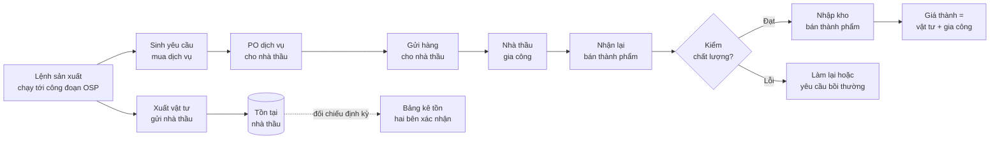

# 2010 Gia công ngoài

Có những công đoạn nhà máy không tự làm: nhiệt luyện, xi mạ, sơn tĩnh điện, đúc áp lực. Vật tư rời kho doanh nghiệp, đi qua nhà thầu, quay về với giá trị cao hơn. Trong khoảng giữa đó, **tài sản vẫn là của doanh nghiệp** nhưng nằm ngoài tầm kiểm soát vật lý — đây là vùng rủi ro lớn nhất của mô hình này.

Bài này nhìn từ góc **sản xuất**: gửi gì, theo dõi thế nào, nhận về ra sao. Góc mua hàng (PO dịch vụ, đối soát hóa đơn gia công) ở [Mô hình mua đặc thù](../2-mua-hang/2030-mo-hinh-mua-dac-thu.md).

## 0. Nguyên lý (áp dụng mọi ERP)

1. **Vật tư gửi đi vẫn là tài sản của doanh nghiệp.** Không phải xuất bán. Khi gửi, giá trị chuyển từ kho sang **tồn tại nhà thầu** — không được giảm tài sản, không được ghi chi phí.
2. **Giá trị nhập về = giá trị vật tư gửi đi + phí gia công.** Đây là công thức quan trọng nhất của bài. Chỉ ghi phí gia công là làm mất giá trị vật tư gốc.
3. **Nhà thầu phải bị đối chiếu tồn định kỳ.** Hàng nằm ở nhà thầu không ai đếm là hàng dễ biến mất nhất. Cần bảng kê tồn tại nhà thầu, có xác nhận hai bên.
4. **Hao hụt tại nhà thầu phải nằm trong định mức.** Gửi 100 kg, nhận về 98 kg thành phẩm — 2 kg hao hụt phải có tỷ lệ định mức, không được coi là "không giải thích được".
5. **Chất lượng nhận về phải kiểm như hàng mua.** Nhà thầu làm hỏng thì doanh nghiệp chịu, không phải khách. Không kiểm ở cửa nhận là giao hàng lỗi cho khách ở cửa xuất.
6. **Chi phí gia công chỉ được ghi nhận khi đã có đủ ba yếu tố:** hàng gửi đi, hàng nhận về, và hóa đơn nhà thầu. Thiếu một trong ba, khoản phải trả chưa xác lập.

## 1. Luồng vận hành



## 2. Ai làm gì ở module nào

| Bước | Sản xuất | Kho | Mua hàng | QC | Kế toán |
|---|---|---|---|---|---|
| Chạy tới công đoạn gia công ngoài | ✅ hệ thống sinh yêu cầu | — |
| Đặt PO dịch vụ gia công | Cung cấp thông số kỹ thuật | — | ✅ sở hữu | — | — |
| Xuất vật tư gửi nhà thầu | — | ✅ ghi giao dịch xuất | — | — | Nhận bút toán chuyển sang tồn tại nhà thầu |
| Theo dõi tồn tại nhà thầu | Đọc để biết tiến độ | ✅ sở hữu | — | — | Đối chiếu giá trị |
| Nhận bán thành phẩm về | ✅ báo cáo nhận | ✅ ghi giao dịch nhập | Ghi nhận theo PO | ✅ kiểm | Nhận bút toán nhập |
| Xử lý hàng lỗi từ nhà thầu | ✅ quyết định làm lại | ✅ ghi xuất trả lại | ✅ yêu cầu bồi thường | ✅ kết luận | ✅ ghi chi phí |
| Đối soát chi phí gia công | — | Cung cấp số lượng | ✅ đối soát hóa đơn | — | ✅ hạch toán |
| Đối chiếu tồn tại nhà thầu | Chủ trì phối hợp | ✅ thực hiện | Hỗ trợ | — | Đối chiếu giá trị |

## 3. Hạch toán

Bốn điểm cốt lõi, bản đồ tài khoản đầy đủ ở [Hạch toán & tài khoản trung gian](../5-ke-toan/ke-toan-tong-hop/1000-hach-toan-va-tai-khoan-trung-gian.md):

1. **Gửi vật tư cho nhà thầu:** chuyển giá trị từ tồn kho sang **tồn tại nhà thầu** (hàng đi gia công). Không giảm tổng tài sản.
2. **Nhận bán thành phẩm về:** nhập lại kho với giá trị = **vật tư đã gửi + phí gia công**. Đây là chỗ hay sai nhất.
3. **Hao hụt tại nhà thầu:** phần gửi đi nhưng không quay về phải ghi vào chi phí hao hụt hoặc cộng vào giá thành bán thành phẩm theo chính sách.
4. **Hóa đơn nhà thầu:** ghi công nợ phải trả chỉ khi đã có đủ hàng gửi, hàng nhận và hóa đơn — khớp lệnh ba đầu.

**Công thức giá thành bán thành phẩm sau gia công:**
$$\text{Giá trị nhập về} = \text{Giá trị vật tư gửi đi} + \text{Phí gia công} + \text{Chi phí vận chuyển}$$

## 4. Điểm chạm & rủi ro

- **Công đoạn gia công ngoài trong routing**: [Routing & công đoạn](./1020-routing-va-cong-doan.md)
- **Lệnh sản xuất sinh yêu cầu mua**: [Lệnh sản xuất & WIP](./2000-lenh-san-xuat-va-wip.md)
- **Giao dịch xuất và nhập kho**: [Giao dịch nhập, xuất & chuyển](../1-kho/2000-giao-dich-nhap-xuat-chuyen.md)
- **PO dịch vụ và đối soát hóa đơn**: [Mô hình mua đặc thù](../2-mua-hang/2030-mo-hinh-mua-dac-thu.md)
- **Giá trị nhập vào giá thành**: [Giá thành sản xuất](./2020-gia-thanh-san-xuat.md)

**Rủi ro chính:**

- **Ghi nhận như xuất bán** — tài sản giảm, doanh thu không có, sổ sách sai.
- **Chỉ cộng phí gia công vào giá thành** — mất giá trị vật tư gốc, thành phẩm định giá thấp giả.
- **Không đối chiếu tồn tại nhà thầu** — hàng biến mất, phát hiện khi kiểm kê năm.
- **Không khai hao hụt định mức** — 2% hao hụt thành "không giải thích được".
- **Không kiểm QC hàng nhận về** — hàng nhà thầu làm lỗi vào kho khả dụng.
- **Nhà thầu giao trễ không ai theo dõi** — lệnh sản xuất dừng mà không có cảnh báo.

## 5. Triển khai tham chiếu ERP

### A. Ánh xạ khái niệm

| Khái niệm | Oracle EBS | Epicor ERP | SAP S/4HANA | Odoo |
|---|---|---|---|---|
| Công đoạn gia công ngoài | Resource loại `resource_type = 4` (OSP) trên routing | `PartOpr.SubContract = 1` + `VendorNum` | Control Key `PP02` + `PLPO.LIFNR` | `mrp.bom.type = 'subcontract'` |
| Mã dịch vụ mua | `BOM_RESOURCES.osp_item_id` | Operation Code làm mã dịch vụ | Purchasing Info Record (`EINA`/`EINE`) | Dịch vụ gán trên PO |
| Vị trí tồn tại nhà thầu | Subinventory `OSP` / Vendor Location | Warehouse gán theo Vendor | Special Stock `O` (vendor) / `LIFO` | Location với `owner_id` = vendor |
| Xuất vật tư gửi | `MTL_MATERIAL_TRANSACTIONS` (OSP Issue) | `PartTran` loại `STK-ASM` hoặc `STK-MTL` sang vendor | Movement `541` (gửi gia công) | `stock.move` → Production/Subcontract |
| Nhận bán thành phẩm | `WIP_MOVE_TRANSACTIONS` (OSP Receipt) | `PartTran` loại `MFG-STK` từ OSP | Movement `101` với subcontract indicator | `stock.move` Subcontract → Stock |
| Hao hụt tại nhà thầu | Điều chỉnh trên location OSP | Scrap `MFG-CUS` | Movement `551` / `543` | Scrap trên picking |
| Yêu cầu mua tự động | OSP Requisition từ WIP | PO Suggestion khi đến OSP operation | PO từ `PLPO.LIFNR` | RFQ/PO từ subcontract route |

### B. Hệ thống tự xây — thiết kế tối thiểu

```sql
CREATE TABLE Subcontract_Send (
    Send_ID          BIGINT IDENTITY PRIMARY KEY,
    WO_ID            BIGINT NOT NULL,
    Op_Seq           INT NOT NULL,
    Vendor_ID        VARCHAR(50) NOT NULL,
    Send_Date        DATE NOT NULL,
    Expected_Return  DATE NOT NULL,
    Status           VARCHAR(20) NOT NULL  -- SENT | PARTIAL_RETURN | CLOSED
);

CREATE TABLE Subcontract_Send_Line (
    Send_ID          BIGINT NOT NULL,
    Line_No          INT NOT NULL,
    Item_ID          VARCHAR(50) NOT NULL,
    Qty_Sent         DECIMAL(18,4) NOT NULL,
    Unit_Cost_Sent   DECIMAL(18,4) NOT NULL,  -- giá trị vật tư gửi đi
    Qty_Returned     DECIMAL(18,4) NOT NULL DEFAULT 0,
    Qty_Scrapped     DECIMAL(18,4) NOT NULL DEFAULT 0,
    PRIMARY KEY (Send_ID, Line_No)
);

CREATE TABLE Subcontract_Return (
    Return_ID        BIGINT IDENTITY PRIMARY KEY,
    Send_ID          BIGINT NOT NULL,
    Return_Date      DATE NOT NULL,
    Qty_Good         DECIMAL(18,4) NOT NULL,
    Qty_Rejected     DECIMAL(18,4) NOT NULL DEFAULT 0,
    Process_Fee      DECIMAL(18,2) NOT NULL,   -- phí gia công
    Inventory_Trx_ID BIGINT NOT NULL
);
```

Bốn ràng buộc bắt buộc:

1. **`Qty_Returned + Qty_Scrapped ≤ Qty_Sent`** — không nhận về nhiều hơn đã gửi.
2. **Phần chênh lệch phải được giải trình** bằng `Qty_Scrapped` hoặc điều chỉnh hao hụt có duyệt.
3. **Giá trị nhập về tính đủ `Unit_Cost_Sent` + `Process_Fee`** — không được chỉ lấy phí gia công.
4. **`Inventory_Trx_ID` bắt buộc** trên mọi lần nhận — không có nhập kho ngoài sổ.

### C. Truy vấn kiểm soát

**Hàng gửi nhà thầu quá hạn chưa nhận về:**

```sql
SELECT s.Send_ID, s.WO_ID, s.Op_Seq, s.Vendor_ID, s.Expected_Return,
       DATEDIFF(DAY, s.Expected_Return, GETDATE()) AS Days_Overdue,
       l.Item_ID, l.Qty_Sent - l.Qty_Returned - l.Qty_Scrapped AS Qty_Open
FROM Subcontract_Send s
JOIN Subcontract_Send_Line l ON l.Send_ID = s.Send_ID
WHERE s.Status <> 'CLOSED'
  AND s.Expected_Return < GETDATE()
  AND l.Qty_Sent > l.Qty_Returned + l.Qty_Scrapped
ORDER BY Days_Overdue DESC;
```

**Tồn tại nhà thầu theo từng nhà thầu — cần đối chiếu định kỳ:**

```sql
SELECT s.Vendor_ID, l.Item_ID,
       SUM(l.Qty_Sent - l.Qty_Returned - l.Qty_Scrapped) AS Qty_At_Vendor,
       SUM((l.Qty_Sent - l.Qty_Returned - l.Qty_Scrapped) * l.Unit_Cost_Sent) AS Value_At_Vendor
FROM Subcontract_Send s
JOIN Subcontract_Send_Line l ON l.Send_ID = s.Send_ID
WHERE s.Status <> 'CLOSED'
GROUP BY s.Vendor_ID, l.Item_ID
HAVING SUM(l.Qty_Sent - l.Qty_Returned - l.Qty_Scrapped) <> 0;
```

**Hao hụt tại nhà thầu vượt định mức cho phép:**

```sql
SELECT s.Vendor_ID, l.Item_ID,
       SUM(l.Qty_Sent) AS Qty_Sent,
       SUM(l.Qty_Scrapped) AS Qty_Scrap,
       CAST(SUM(l.Qty_Scrapped) AS DECIMAL) * 100 / NULLIF(SUM(l.Qty_Sent), 0) AS Scrap_Pct
FROM Subcontract_Send s
JOIN Subcontract_Send_Line l ON l.Send_ID = s.Send_ID
GROUP BY s.Vendor_ID, l.Item_ID
HAVING CAST(SUM(l.Qty_Scrapped) AS DECIMAL) * 100 / NULLIF(SUM(l.Qty_Sent), 0) > 3
ORDER BY Scrap_Pct DESC;
```

**Nhận về nhưng không có PO dịch vụ tương ứng — không đối soát được hóa đơn:**

```sql
SELECT r.Return_ID, s.WO_ID, s.Vendor_ID, r.Qty_Good, r.Process_Fee
FROM Subcontract_Return r
JOIN Subcontract_Send s ON s.Send_ID = r.Send_ID
WHERE NOT EXISTS (
    SELECT 1 FROM Purchase_Order_Line pol
    WHERE pol.Vendor_ID = s.Vendor_ID AND pol.WO_ID = s.WO_ID
      AND pol.Op_Seq = s.Op_Seq);
```

**Epicor — công đoạn OSP còn tồn tại nhà thầu lâu ngày:**

```sql
SELECT pt.VendorNum, pt.PartNum, SUM(pt.TranQty) AS Qty_At_Vendor
FROM Erp.PartTran pt
WHERE pt.Company = 'YOUR_COMPANY_CODE'
  AND pt.TranType = 'STK-ASM'   -- cần đối chiếu tên tran type thực tế
GROUP BY pt.VendorNum, pt.PartNum
HAVING SUM(pt.TranQty) <> 0;
```

## 6. Bẫy thực chiến & Checklist

| # | Bẫy | Triệu chứng | Cách phòng tránh |
|---|---|---|---|
| 1 | Ghi xuất bán khi gửi nhà thầu | Tài sản giảm, không có doanh thu, sổ sách sai | Ghi chuyển sang tồn tại nhà thầu, không giảm tài sản |
| 2 | Chỉ cộng phí gia công vào giá thành | Bán thành phẩm định giá thấp giả, lãi ảo | Giá trị nhập = vật tư gửi + phí gia công |
| 3 | Không đối chiếu tồn tại nhà thầu | Hàng biến mất, phát hiện khi kiểm kê năm | Bảng kê tồn gửi nhà thầu, xác nhận hai bên hàng tháng |
| 4 | Không khai hao hụt định mức | Chênh lệch không giải thích được | Tỷ lệ hao hụt trên `Subcontract_Send_Line` |
| 5 | Nhận về không kiểm QC | Hàng nhà thầu lỗi vào kho khả dụng | QC bắt buộc trước khi nhập kho |
| 6 | Không có PO dịch vụ | Không đối soát được hóa đơn nhà thầu | Mọi lần gửi phải gắn PO dịch vụ |
| 7 | Hàng gửi quá hạn không cảnh báo | Lệnh sản xuất dừng, không ai biết vì sao | Báo cáo gửi quá hạn chưa nhận |
| 8 | Cho nhận về nhiều hơn đã gửi | Bán thành phẩm từ trên trời | Ràng buộc `Qty_Returned + Qty_Scrapped ≤ Qty_Sent` |
| 9 | Nhập kho không có giao dịch kho | Kho và WIP lệch nhau | `Inventory_Trx_ID` bắt buộc |
| 10 | Không phân biệt lỗi do nhà thầu và lỗi vật tư | Bồi thường sai bên | Mã lý do lỗi tách riêng khi QC |

**Checklist trước go-live:**

- [ ] Gửi vật tư chuyển sang tồn tại nhà thầu, không giảm tài sản (đã test).
- [ ] Giá trị nhập về = vật tư gửi + phí gia công (đã đối chiếu tay).
- [ ] Có bảng kê tồn tại nhà thầu theo vendor + item.
- [ ] Có quy trình đối chiếu tồn tại nhà thầu hàng tháng có xác nhận hai bên.
- [ ] Tỷ lệ hao hụt định mức đã khai, có báo cáo vượt ngưỡng.
- [ ] QC bắt buộc trước khi nhập bán thành phẩm (đã test).
- [ ] Mỗi lần gửi gắn PO dịch vụ (đã test truy vấn không có PO).
- [ ] Có báo cáo gửi quá hạn chưa nhận.
- [ ] Ràng buộc nhận về ≤ gửi đi (đã test).
- [ ] Đã test toàn luồng: WO → OSP → gửi → nhận → nhập → giá thành đúng.

## Xem thêm

- [Tổng quan Sản xuất](./0000-tong-quan-san-xuat.md)
- [Lệnh sản xuất & WIP](./2000-lenh-san-xuat-va-wip.md)
- [Giá thành sản xuất](./2020-gia-thanh-san-xuat.md)
- [Routing & công đoạn](./1020-routing-va-cong-doan.md)
- [Mô hình mua đặc thù](../2-mua-hang/2030-mo-hinh-mua-dac-thu.md)

<div align="center" style={{color: 'var(--ifm-color-primary)'}}>
  <strong>Chúc các bạn thành công và vui vẻ!</strong>
</div>
