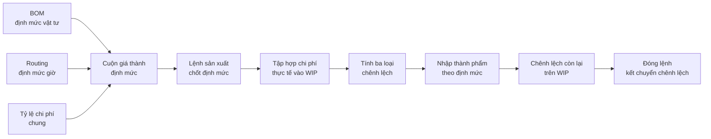

# Giá thành sản xuất

Giá thành là **nơi mọi sai sót của sản xuất đổ về**. Định mức BOM sai → chênh lệch vật tư. Routing sai → chênh lệch giờ công. Thiếu phân bổ chi phí chung → thành phẩm rẻ giả, lãi ảo. Bài này nói cách tập hợp chi phí, tính ba loại chênh lệch và kết chuyển thành phẩm đúng.

## Nguyên lý (áp dụng mọi ERP)

1. **Có hai mô hình giá thành, và phải chọn một: giá thực tế hoặc giá tiêu chuẩn.** Không có mô hình thứ ba, và không trộn hai mô hình trong cùng một mã hàng.
2. **Giá thành có ba thành phần, không phải một.** Nguyên vật liệu trực tiếp, nhân công trực tiếp, chi phí sản xuất chung. Thiếu chi phí chung là lỗi phổ biến nhất — thành phẩm rẻ giả, lãi báo cáo cao hơn thực.
3. **Chênh lệch phải tách thành ba loại riêng.** Chênh lệch giá (mua đắt/rẻ), chênh lệch lượng (dùng nhiều/ít), chênh lệch hiệu suất (nhiều/ít giờ). Gộp lại thì không cải thiện được gì.
4. **Chênh lệch không tự động là xấu.** Mua rẻ hơn định mức là chênh lệch có lợi, nhưng có thể do mua chất lượng kém — phải đọc kèm dữ liệu chất lượng.
5. **Chi phí chung chưa phân bổ phải được xử lý dứt điểm.** Số dư này treo trên tài khoản chi phí sản xuất chung qua kỳ là dấu hiệu hệ thống phân bổ có lỗi.
6. **WIP cuối kỳ là tài sản, không phải chi phí.** Lệnh chưa xong vẫn có giá trị dở dang trên sổ cái. Đóng lệnh bừa để "cho gọn" là làm mất tài sản.

## 1. Luồng vận hành



## 2. Ai làm gì ở module nào

| Việc | Kế toán giá thành | Sản xuất | Kho | Mua hàng |
|---|---|---|---|---|
| Cuộn giá thành định mức | ✅ chủ trì | Cung cấp BOM/Routing | Cung cấp đơn giá vật tư | Cung cấp giá mua |
| Chốt định mức khi tạo lệnh | Đọc | ✅ tạo lệnh theo phiên bản | — | — |
| Tập hợp chi phí thực tế | ✅ hạch toán | ✅ báo cáo sản lượng, giờ, phế | ✅ ghi giao dịch | — |
| Phân bổ chi phí chung | ✅ sở hữu | Cung cấp giờ máy thực tế | — | — |
| Phân tích chênh lệch | ✅ sở hữu | ✅ giải trình nguyên nhân | Cung cấp dữ liệu hao hụt | Giải trình chênh lệch giá |
| Quyết định phân bổ chênh lệch | ✅ quyết định | Đề xuất | — | — |
| Đóng lệnh và kết chuyển | ✅ thực hiện | Xác nhận lệnh xong | Xác nhận nhập lại vật tư | — |

**Ranh giới cốt lõi:** **kế toán sở hữu mô hình giá thành**, sản xuất chịu trách nhiệm **giải trình chênh lệch**. Nếu kế toán tự sửa số để chênh lệch về 0, không ai học được gì.

## 3. Hạch toán

Ba thành phần của giá thành và bút toán tương ứng:

| Thành phần | Nguồn dữ liệu | Khi nào vào WIP |
|---|---|---|
| Nguyên vật liệu trực tiếp | Giao dịch xuất kho cho lệnh | Khi cấp liệu hoặc backflush |
| Nhân công trực tiếp | Báo cáo giờ công × đơn giá giờ | Khi báo cáo hoàn thành công đoạn |
| Chi phí sản xuất chung | Giờ máy × tỷ lệ phân bổ, hoặc tỷ lệ phân bổ theo giờ công | Cuối kỳ hoặc theo kỳ phân bổ |

**Ba loại chênh lệch cần tính:**

$$\text{Chênh lệch giá} = (\text{Đơn giá thực tế} - \text{Đơn giá định mức}) \times \text{Lượng thực tế}$$

$$\text{Chênh lệch lượng} = (\text{Lượng thực tế} - \text{Lượng định mức}) \times \text{Đơn giá định mức}$$

$$\text{Chênh lệch hiệu suất} = (\text{Giờ thực tế} - \text{Giờ định mức}) \times \text{Đơn giá giờ định mức}$$

Bốn điều phải chốt với kế toán trước khi go-live:

1. **Mô hình giá thành:** thực tế hay tiêu chuẩn, cho từng nhóm hàng.
2. **Cách nhập thành phẩm:** theo định mức (sinh chênh lệch) hay theo chi phí thực tế tích lũy (chênh lệch chỉ còn do làm tròn).
3. **Chính sách phân bổ chênh lệch cuối kỳ:** vào giá vốn hàng bán, vào tồn kho, hay vào chi phí kỳ.
4. **Kỳ tính giá thành:** theo tháng, theo lô, hay theo từng lệnh.

Bản đồ tài khoản ở [Hạch toán & tài khoản trung gian](../5-ke-toan/ke-toan-tong-hop/1000-hach-toan-va-tai-khoan-trung-gian.md); giá vốn hàng bán ở [Giá vốn & định giá tồn kho](../5-ke-toan/ke-toan-tong-hop/1010-gia-von-va-dinh-gia-ton-kho.md).

## 4. Điểm chạm & rủi ro

- **Định mức vật tư nguồn**: [BOM & định mức](./1010-bom-va-dinh-muc.md)
- **Định mức giờ nguồn**: [Routing & công đoạn](./1020-routing-va-cong-doan.md)
- **Chi phí thực tế tập hợp**: [Lệnh sản xuất & WIP](./2000-lenh-san-xuat-va-wip.md)
- **Giá trị gia công ngoài**: [Gia công ngoài](./2010-gia-cong-ngoai.md)
- **Kết chuyển giá vốn khi bán**: [AR - Nguyên lý & tài khoản](../5-ke-toan/cong-no/2000-ar-nguyen-ly-va-tai-khoan.md)

**Rủi ro chính:**

- **Thiếu chi phí sản xuất chung** — thành phẩm rẻ giả, lãi ảo, quyết định giá sai.
- **Gộp ba loại chênh lệch** — không biết là mua đắt, dùng nhiều, hay làm chậm.
- **Không tách chênh lệch giá và chênh lệch tỷ giá** — báo cáo sai bản chất.
- **Nhập thành phẩm theo giá bán** — giá thành phụ thuộc doanh thu, vô nghĩa.
- **Chi phí chung chưa phân bổ treo** — số dư vĩnh viễn trên tài khoản 627.
- **Đóng lệnh bừa để chênh lệch về 0** — mất tài sản WIP, không ai học được gì.

## 5. Triển khai tham chiếu ERP

### A. Ánh xạ khái niệm

| Khái niệm | Oracle EBS | Epicor ERP | SAP S/4HANA | Odoo |
|---|---|---|---|---|
| Cuộn giá thành định mức | `CST_ITEM_COSTS` (Cost Rollup) | `Cost Rollup` trên `Part` (`StdCost`) | Cost Estimate (`CK11N`) → Mark/Release (`CK24`) | `stock.valuation.layer` (AVCO/FIFO), standard cost tùy biến |
| Chi phí thực tế của lệnh | `WIP_TRANSACTIONS` | `Erp.JobAsmbl` + `LaborDtl` | `AFRU` + `MSEG` | `mrp.production` cost lines |
| WIP balance | `WIP_DISCRETE_JOBS` (WIP value) | `JobHead` cost fields | `AUFK` + `ACDOCA` (WIP) | `mrp.production` remaining cost |
| Chênh lệch vật tư | Material Usage Variance | `PartTran` vs `PartMtl` | Price/Usage variance (`PRD`) | Variance report tùy biến |
| Chênh lệch nhân công | Labor Efficiency Variance | `LaborDtl` vs `PartOpr` | Labor variance | `mrp.workcenter.productivity` vs routing |
| Chi phí chung | Overhead applied qua `CST_` rates | `JCDept` burden rate | Activity Type (`COKL`) + rate (`CSLA`) | Work center cost |
| Dịch chuyển chênh lệch | `CST_VARIANCES` | `Variance` trên Job Closing | WIP settlement (`KO88`) | Tùy biến |

### B. Hệ thống tự xây — thiết kế tối thiểu

```sql
CREATE TABLE Item_Std_Cost (
    Item_ID          VARCHAR(50) NOT NULL,
    Cost_Version     VARCHAR(20) NOT NULL,   -- ví dụ: 2026-Q1
    Material_Cost    DECIMAL(18,4) NOT NULL,
    Labor_Cost       DECIMAL(18,4) NOT NULL,
    Overhead_Cost    DECIMAL(18,4) NOT NULL,
    Effective_From   DATE NOT NULL,
    PRIMARY KEY (Item_ID, Cost_Version)
);

CREATE TABLE WO_Cost_Actual (
    WO_ID            BIGINT NOT NULL,
    Cost_Type        VARCHAR(20) NOT NULL,   -- MATERIAL | LABOR | OVERHEAD
    Amount_Actual    DECIMAL(18,2) NOT NULL,
    Amount_Std       DECIMAL(18,2) NOT NULL,
    PRIMARY KEY (WO_ID, Cost_Type)
);

CREATE TABLE Cost_Variance (
    WO_ID            BIGINT NOT NULL,
    Variance_Type    VARCHAR(20) NOT NULL,   -- PRICE | USAGE | EFFICIENCY
    Amount           DECIMAL(18,2) NOT NULL, -- dương = bất lợi
    Account_ID       VARCHAR(20) NOT NULL,
    PRIMARY KEY (WO_ID, Variance_Type)
);
```

Bốn ràng buộc bắt buộc:

1. **`Material_Cost + Labor_Cost + Overhead_Cost` phải bằng giá chuẩn của mã hàng** — kiểm tra khi release cost version.
2. **Mỗi lệnh có đúng một bộ chênh lệch ba loại** — không gộp, không nhân bản.
3. **Chênh lệch chỉ được kết chuyển một lần** — chặn đóng lệnh nếu `Cost_Variance` đã chuyển.
4. **Chi phí chung phải có tỷ lệ phân bổ khai báo** — không để tồn dư tài khoản 627 cuối kỳ.

### C. Truy vấn kiểm soát

**Giá chuẩn không khớp tổng ba thành phần — cuộn giá lỗi:**

```sql
SELECT i.Item_ID, i.Cost_Version,
       i.Material_Cost, i.Labor_Cost, i.Overhead_Cost,
       (i.Material_Cost + i.Labor_Cost + i.Overhead_Cost) AS Sum_Component,
       p.Std_Cost AS Declared_Std
FROM Item_Std_Cost i
JOIN Item_Inventory_Attribute p ON p.Item_ID = i.Item_ID
WHERE ABS((i.Material_Cost + i.Labor_Cost + i.Overhead_Cost) - p.Std_Cost) > 0.01;
```

**Lệnh có chênh lệch bất lợi lớn — cần giải trình:**

```sql
SELECT WO_ID, Variance_Type, Amount,
       CAST(Amount AS DECIMAL) * 100 / NULLIF((SELECT SUM(Amount_Std)
           FROM WO_Cost_Actual a WHERE a.WO_ID = v.WO_ID), 0) AS Variance_Pct
FROM Cost_Variance v
WHERE Amount > 0
ORDER BY Amount DESC;
```

**Lệnh đã đóng nhưng chênh lệch chưa kết chuyển:**

```sql
SELECT w.WO_No, w.Closed_At, v.Variance_Type, v.Amount
FROM Work_Order w
JOIN Cost_Variance v ON v.WO_ID = w.WO_ID
WHERE w.Status = 'CLOSED'
  AND NOT EXISTS (SELECT 1 FROM GL_Journal g
                  WHERE g.Source_Doc = w.WO_No AND g.Account_Type = 'VARIANCE');
```

**Số dư chi phí sản xuất chung chưa phân bổ cuối kỳ:**

```sql
SELECT Period_ID, SUM(Debit) - SUM(Credit) AS Overhead_Unallocated
FROM GL_Journal
WHERE Account_ID = '627'
GROUP BY Period_ID
HAVING ABS(SUM(Debit) - SUM(Credit)) > 1000
ORDER BY Period_ID DESC;
```

**Epicor — lệnh đã đóng nhưng chênh lệch còn trên Job:**

```sql
SELECT j.JobNum, j.PartNum, j.JobClosed,
       j.TLAMaterial, j.TLALabor, j.TLABurden, j.TLAProdBurden
FROM Erp.JobHead j
WHERE j.Company = 'YOUR_COMPANY_CODE'
  AND j.JobClosed = 1
  AND (j.TLAMaterial <> 0 OR j.TLALabor <> 0)
ORDER BY j.JobNum;
```

## 6. Bẫy thực chiến & Checklist

| # | Bẫy | Triệu chứng | Cách phòng tránh |
|---|---|---|---|
| 1 | Bỏ chi phí sản xuất chung | Thành phẩm rẻ giả, lãi ảo, giá bán đặt sai | Giá chuẩn phải gồm đủ 3 thành phần |
| 2 | Gộp ba loại chênh lệch | Không biết do mua đắt, dùng nhiều hay làm chậm | `Cost_Variance` tách `PRICE`, `USAGE`, `EFFICIENCY` |
| 3 | Gộp chênh lệch giá với chênh lệch tỷ giá | Báo cáo sai bản chất chi phí | Tách tài khoản lãi/lỗ tỷ giá |
| 4 | Nhập thành phẩm theo giá bán | Giá thành phụ thuộc doanh thu | Nhập theo định mức hoặc chi phí thực tế tích lũy |
| 5 | Chi phí chung treo cuối kỳ | Số dư tài khoản 627 qua nhiều kỳ | Báo cáo chưa phân bổ, xử lý trước khi khóa sổ |
| 6 | Đóng lệnh để chênh lệch về 0 | Mất tài sản WIP, không ai học được gì | Phân tích trước, điều chỉnh sau có lý do |
| 7 | Chuyển chênh lệch hai lần | Chi phí bị tính đôi | Ràng buộc chuyển một lần |
| 8 | Định mức lạc hậu | Chênh lệch luôn bất lợi, không ai tin báo cáo | Rà soát giá chuẩn định kỳ (quý hoặc nửa năm) |
| 9 | Không phân bổ chênh lệch cuối kỳ | Tồn kho và giá vốn lệch sổ cái | Chính sách phân bổ rõ: giá vốn, tồn kho hoặc chi phí kỳ |
| 10 | Không có chênh lệch do giá mua tăng | Chênh lệch giá bị đẩy hết vào chênh lệch lượng | Tách hai nguồn dữ liệu rõ ràng |

**Checklist trước go-live:**

- [ ] Giá chuẩn gồm đủ vật tư + nhân công + chi phí chung (đã đối chiếu).
- [ ] Ba loại chênh lệch được tính và lưu riêng.
- [ ] Chênh lệch tỷ giá tách khỏi chênh lệch giá mua (đã test ngoại tệ).
- [ ] Nhập thành phẩm theo định mức hoặc thực tế tích lũy — đã chọn và ghi rõ.
- [ ] Có báo cáo chi phí chung chưa phân bổ, xử lý trước khóa sổ.
- [ ] Chặn đóng lệnh khi chưa phân tích chênh lệch.
- [ ] Chặn kết chuyển chênh lệch hai lần (đã test).
- [ ] Giá chuẩn được rà soát định kỳ (đã có lịch).
- [ ] Chính sách phân bổ chênh lệch cuối kỳ đã thống nhất với kiểm toán.
- [ ] Đã test toàn luồng: tạo lệnh → tập hợp chi phí → nhập thành phẩm → đóng lệnh → phân bổ chênh lệch.

## Xem thêm

- [Tổng quan Sản xuất](./0000-tong-quan-san-xuat.md)
- [Lệnh sản xuất & WIP](./2000-lenh-san-xuat-va-wip.md)
- [Gia công ngoài](./2010-gia-cong-ngoai.md)
- [Giá vốn & định giá tồn kho](../5-ke-toan/ke-toan-tong-hop/1010-gia-von-va-dinh-gia-ton-kho.md)
- [BOM & định mức](./1010-bom-va-dinh-muc.md)

<div align="center" style={{color: 'var(--ifm-color-primary)'}}>
  <strong>Chúc các bạn thành công và vui vẻ!</strong>
</div>
