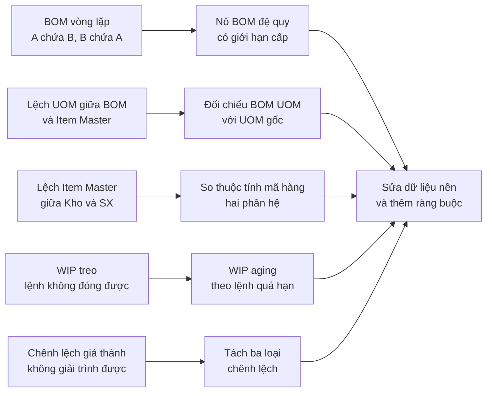

# 9000 Bẫy thực chiến sản xuất

Các lỗi trong bài này đều có chung đặc điểm: **hệ thống chạy bình thường, không báo lỗi**, nhưng số liệu sai. Chỉ khi chênh lệch giá thành cuối kỳ hoặc kiểm kê mới phát hiện — và khi đó đã tích lũy nhiều kỳ.

## 0. Nguyên lý (áp dụng mọi ERP)

1. **Lỗi sản xuất thường bắt nguồn từ dữ liệu nền, không phải từ giao dịch.** BOM sai, routing sai, đơn vị tính sai → mọi lệnh sinh ra đều sai theo. Sửa giao dịch không cứu được dữ liệu nền.
2. **Ba gốc lỗi phổ biến nhất:** vòng lặp cấu trúc, lệch đơn vị tính, và chứng từ mở không đóng.
3. **WIP treo là triệu chứng, không phải bệnh.** Câu hỏi đúng là "vì sao lệnh này không đóng được" — thường do vật tư dư chưa nhập lại hoặc sản lượng chưa báo cáo.
4. **Mỗi bẫy phải có truy vấn phát hiện.** Mô tả lỗi mà không tìm được nó trong dữ liệu thật thì không dùng được.

## 1. Luồng vận hành



## 2. Ai làm gì ở module nào

| Bẫy | Kỹ thuật sản xuất | Sản xuất | Kho | Kế toán | Người phát hiện sớm nhất |
|---|---|---|---|---|---|
| BOM vòng lặp | ✅ sở hữu (chặn khi lưu) | ✅ phát hiện khi chạy MRP | — | — | Sản xuất / MRP |
| Lệch UOM BOM | ✅ sửa BOM | ✅ phát hiện khi cấp liệu | ✅ báo thiếu/thừa | Đối chiếu giá trị | Kho |
| Lệch Item Master | — | ✅ sở hữu phía SX | ✅ sở hữu phía kho | — | Cả hai |
| WIP treo | Đọc | ✅ chủ trì đóng lệnh | Xác nhận vật tư dư | ✅ hạch toán chênh lệch | Kế toán cuối kỳ |
| Chênh lệch giá thành | Giải trình định mức | Giải trình sản lượng, giờ | Cung cấp hao hụt | ✅ sở hữu phân tích | Kế toán giá thành |

## 3. Hạch toán

Các bẫy này gây hệ quả kế toán gián tiếp:

- **BOM vòng lặp** → MRP treo, không mua nguyên vật liệu, sản xuất dừng.
- **Lệch UOM** → giá trị tồn kho sai theo hệ số quy đổi hàng trăm lần.
- **Item Master lệch** → cùng một mã hàng có hai thuộc tính khác nhau ở hai phân hệ.
- **WIP treo** → chi phí nằm trên tài khoản dở dang, lãi kỳ sai.
- **Chênh lệch không giải trình** → mọi quyết định giá đều dựa trên số sai.

Bản đồ tài khoản ở [Hạch toán & tài khoản trung gian](../).

## 4. Điểm chạm & rủi ro

- **Đơn vị tính gốc của mã hàng** (bài gốc về UOM): [Nguyên lý quy đổi UOM](../)
- **Cấu trúc BOM và định mức**: [BOM & định mức](./ky-thuat/2000-bom-va-dinh-muc.md)
- **Thuộc tính mã hàng phía kho**: [Item Master & thuộc tính kho](../)
- **Vòng đời lệnh sản xuất**: [Lệnh sản xuất & WIP](./thuc-thi/6000-lenh-san-xuat-va-wip.md)
- **Phân tích chênh lệch**: [Giá thành sản xuất](./thuc-thi/8000-gia-thanh-san-xuat.md)

## 5. Triển khai tham chiếu ERP

### A. Năm bẫy lớn và cách phát hiện

**Bẫy 1 — BOM vòng lặp**

A chứa B, B chứa A. MRP nổ BOM vô hạn hoặc treo.

```sql
WITH RECURSIVE bom_tree AS (
    SELECT h.Parent_Item AS Root, l.Component_Item AS Node, 1 AS Lvl,
           CAST(h.Parent_Item + '>' + l.Component_Item AS VARCHAR(1000)) AS Path
    FROM BOM_Header h JOIN BOM_Line l ON l.BOM_ID = h.BOM_ID
    WHERE h.Status = 'APPROVED'
    UNION ALL
    SELECT t.Root, l2.Component_Item, t.Lvl + 1,
           CAST(t.Path + '>' + l2.Component_Item AS VARCHAR(1000))
    FROM bom_tree t
    JOIN BOM_Header h2 ON h2.Parent_Item = t.Node AND h2.Status = 'APPROVED'
    JOIN BOM_Line l2   ON l2.BOM_ID = h2.BOM_ID
    WHERE t.Lvl < 20
)
SELECT Root, Node AS Circular_Item, Path FROM bom_tree WHERE Node = Root;
```

**Bẫy 2 — Lệch đơn vị tính giữa BOM và Item Master**

BOM ghi theo Thùng, kho quản lý theo Cái, hệ số chưa khai → cấp liệu sai 100 lần.

```sql
SELECT h.Parent_Item, l.Component_Item, l.UOM AS Bom_UOM, i.Base_UOM
FROM BOM_Header h
JOIN BOM_Line l ON l.BOM_ID = h.BOM_ID
JOIN Item_Inventory_Attribute i ON i.Item_ID = l.Component_Item
WHERE h.Status = 'APPROVED'
  AND l.UOM <> i.Base_UOM
  AND NOT EXISTS (SELECT 1 FROM UOM_Conversion u
                  WHERE u.Item_ID = l.Component_Item AND u.From_UOM = l.UOM);
```

**Bẫy 3 — Item Master lệch giữa Kho và Sản xuất**

Cùng một mã hàng nhưng hai phân hệ lưu hai thuộc tính khác nhau (ví dụ: SX khai lot-controlled, Kho không).

```sql
SELECT k.Item_ID, k.Track_Lot AS Kho_Track_Lot, k.Base_UOM AS Kho_UOM,
       m.Track_Lot AS SX_Track_Lot,  m.Base_UOM AS SX_UOM
FROM Item_Inventory_Attribute k
JOIN MFG_Item_Attribute m ON m.Item_ID = k.Item_ID
WHERE k.Track_Lot <> m.Track_Lot OR k.Base_UOM <> m.Base_UOM;
```

**Bẫy 4 — WIP treo, lệnh không đóng được**

```sql
SELECT w.WO_No, w.Item_ID, w.Status, w.Qty_Ordered, w.Qty_Completed,
       DATEDIFF(DAY, w.Planned_End, GETDATE()) AS Days_Overdue,
       (SELECT ISNULL(SUM(Qty_Issued), 0) FROM WO_Material_Txn m WHERE m.WO_ID = w.WO_ID) AS Qty_Issued,
       (SELECT COUNT(*) FROM WO_Operation o WHERE o.WO_ID = w.WO_ID AND o.Status <> 'DONE') AS Open_Operations
FROM Work_Order w
WHERE w.Status IN ('RELEASED', 'IN_PROGRESS', 'PARTIAL')
  AND DATEDIFF(DAY, w.Planned_End, GETDATE()) > 30
ORDER BY Days_Overdue DESC;
```

**Bẫy 5 — Chênh lệch giá thành không giải trình được**

```sql
SELECT v.WO_ID, v.Variance_Type, v.Amount,
       CAST(v.Amount AS DECIMAL) * 100 / NULLIF(a.Amount_Std, 0) AS Variance_Pct
FROM Cost_Variance v
JOIN WO_Cost_Actual a ON a.WO_ID = v.WO_ID AND a.Cost_Type =
     CASE v.Variance_Type WHEN 'PRICE' THEN 'MATERIAL'
                          WHEN 'USAGE' THEN 'MATERIAL'
                          ELSE 'LABOR' END
WHERE v.Amount > 0
ORDER BY Variance_Pct DESC;
```

**Epicor — lệnh đã hoàn thành nhưng chưa đóng (WIP treo):**

```sql
SELECT j.JobNum, j.PartNum, j.QtyCompleted, j.JobComplete, j.JobClosed
FROM Erp.JobHead j
WHERE j.Company = 'YOUR_COMPANY_CODE'
  AND j.JobComplete = 1
  AND j.JobClosed = 0
ORDER BY j.JobNum;
```

### B. Nhịp chạy kiểm soát

| Truy vấn | Tần suất | Người chịu trách nhiệm |
|---|---|---|
| BOM vòng lặp | Trước mỗi lần chạy MRP | Kỹ thuật sản xuất |
| Lệch UOM BOM | Trước mỗi kỳ sản xuất | Kỹ thuật + Kho |
| Lệch Item Master | Hằng tháng | Kho + Sản xuất |
| WIP aging quá 30 ngày | Hằng tuần | Sản xuất + Kế toán |
| Chênh lệch giá thành lớn | Cuối mỗi kỳ | Kế toán giá thành |

## 6. Bẫy thực chiến & Checklist

| # | Bẫy | Triệu chứng | Cách phòng tránh |
|---|---|---|---|
| 1 | BOM vòng lặp | MRP treo, không mua vật tư, sản xuất dừng | Kiểm tra đệ quy khi lưu BOM |
| 2 | Lệch UOM giữa BOM và Item Master | Cấp liệu sai hệ số, tồn kho lệch hàng trăm lần | Chặn lưu dòng BOM nếu UOM không quy đổi được |
| 3 | Lệch Item Master Kho và Sản xuất | Cùng mã hàng hai bộ thuộc tính khác nhau | Một nguồn dữ liệu gốc duy nhất |
| 4 | WIP treo do lệnh không đóng | Chi phí nằm trên dở dang, lãi kỳ sai | Báo cáo WIP aging, chặn đóng khi còn vật tư dư |
| 5 | Chênh lệch gộp không phân loại | Không biết do mua đắt, dùng nhiều hay làm chậm | Tách `PRICE`/`USAGE`/`EFFICIENCY` |
| 6 | Định mức lạc hậu nhiều năm | Chênh lệch luôn bất lợi, báo cáo mất uy tín | Rà soát định mức định kỳ |
| 7 | Không có báo cáo phế theo công đoạn | Không biết công đoạn nào hỏng nhiều | `Scrap_Pct` theo từng công đoạn |
| 8 | Test BOM chỉ với mã đơn giản | BOM nhiều cấp mới lộ lỗi | Test với BOM 4–5 cấp có mã thay thế |
| 9 | Không khoá sửa BOM đang hiệu lực | Lệnh đang chạy bị đổi công thức | Chỉ sửa qua ECO, version mới |
| 10 | Tin báo cáo "trông hợp lý" | Lỗi tồn tại nhiều quý, phát hiện khi kiểm toán | Truy vấn kiểm soát theo lịch ở §5.B |

**Checklist trước go-live:**

- [ ] Đã chạy truy vấn BOM vòng lặp, 0 dòng.
- [ ] 100% dòng BOM có UOM quy đổi được về UOM gốc (đã kiểm).
- [ ] Có một nguồn dữ liệu gốc duy nhất cho Item Master (không hai bảng song song).
- [ ] Có báo cáo WIP aging, chặn đóng lệnh khi còn vật tư dư.
- [ ] Ba loại chênh lệch được tính và báo cáo riêng.
- [ ] Định mức có lịch rà soát định kỳ.
- [ ] Có báo cáo phế phẩm theo công đoạn.
- [ ] Đã test BOM 5 cấp có mã thay thế (không chỉ test BOM 1 cấp).
- [ ] Không sửa được BOM đang hiệu lực nếu không qua ECO (đã test).
- [ ] 5 truy vấn ở §5.A có lịch chạy và người chịu trách nhiệm.

## Xem thêm

- [Tổng quan Sản xuất](./0000-tong-quan-san-xuat.md)
- [BOM & định mức](./ky-thuat/2000-bom-va-dinh-muc.md)
- [Lệnh sản xuất & WIP](./thuc-thi/6000-lenh-san-xuat-va-wip.md)
- [Giá thành sản xuất](./thuc-thi/8000-gia-thanh-san-xuat.md)
- [Nguyên lý quy đổi UOM](../)

<div align="center" style={{color: 'var(--ifm-color-primary)'}}>
  <strong>Chúc các bạn thành công và vui vẻ!</strong>
</div>
