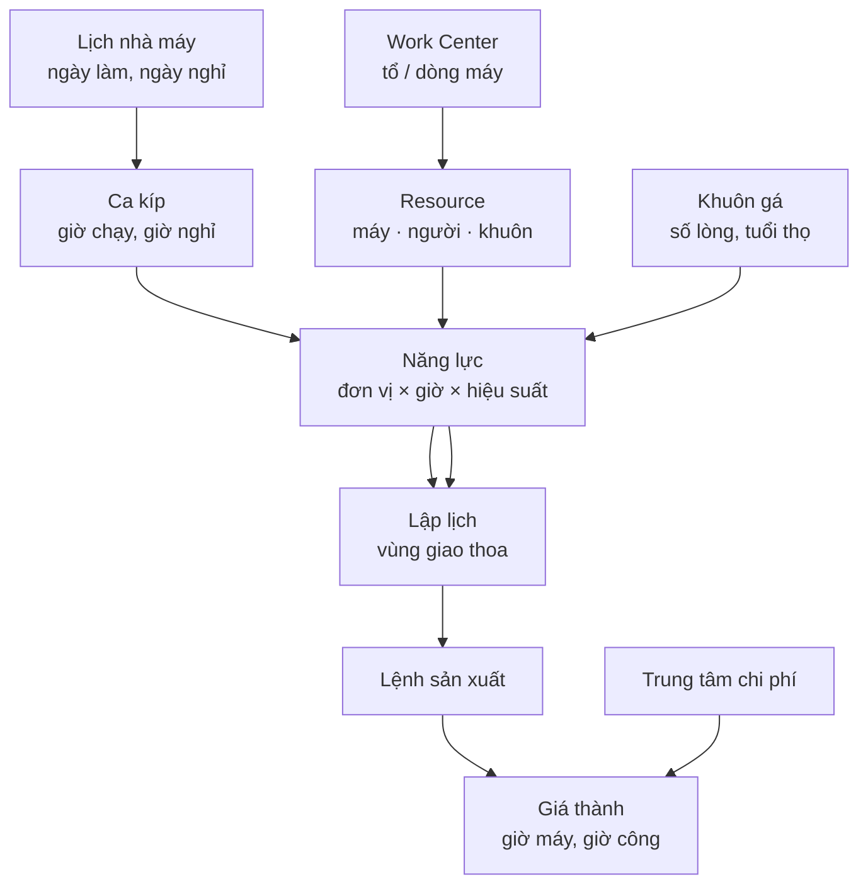

# 1000 Work Center & năng lực

Mọi lệnh sản xuất đều cần **ba thứ cùng lúc**: một máy chạy được, một người đứng máy, và — với nhiều ngành — một bộ khuôn gá đi kèm. Thiếu một trong ba, lệnh không chạy, dù trên hệ thống lịch vẫn hiện đẹp.

Bài này nói về cách số hóa năng lực nhà xưởng: work center, ca kíp, và công cụ phụ trợ.

## 0. Nguyên lý (áp dụng mọi ERP)

1. **Work Center là đơn vị năng lực, không phải một cái máy.** Nó gom các tài nguyên có cùng tính chất (dòng máy ép, tổ lắp ráp) và trả lời câu hỏi "mỗi giờ làm được bao nhiêu". Một máy cụ thể chỉ là một *resource* bên trong work center đó.
2. **Năng lực = (số đơn vị song song) × (giờ khả dụng theo ca) × (hiệu suất).** Bỏ sót bất kỳ thừa số nào, lịch sản xuất sẽ hứa nhiều hơn thực tế làm được.
3. **Ca kíp và ngày làm việc là hai trục khác nhau.** Lịch nhà máy trả lời "ngày này có làm không"; ca kíp trả lời "làm từ mấy giờ đến mấy giờ, nghỉ giữa ca lúc nào". Gộp hai thứ vào một bảng là nguồn gốc của lỗi lịch.
4. **Khuôn gá là tài nguyên ràng buộc thứ hai.** Máy rảnh chưa đủ để chạy — phải có khuôn đúng loại, còn tuổi thọ, và đang không bị lệnh khác dùng. Đây là lý do nhiều ngành phải dùng lập lịch ràng buộc kép.
5. **Work Center phải gắn với trung tâm chi phí.** Năng lực sản xuất tiêu tốn chi phí; nếu work center không map được tới cost center, giờ máy chạy sẽ không vào được giá thành.
6. **Hiệu suất phải dựa trên dữ liệu thực, không trên khát vọng.** Đặt hiệu suất 100% cho đẹp báo cáo sẽ làm mọi kế hoạch sản xuất đều trễ.

## 1. Luồng vận hành



**Điểm cốt lõi:** năng lực chỉ có nghĩa khi tính đủ **ba nguồn** (máy, người, khuôn) và **hai trục thời gian** (ngày làm việc, khung ca).

## 2. Ai làm gì ở module nào

| Việc | Sản xuất (MFG) | Kho | Kế toán | Bảo trì |
|---|---|---|---|---|
| Khai báo work center | ✅ sở hữu | — | — | — |
| Khai báo máy và công cụ phụ trợ | ✅ sở hữu | — | — | ✅ duyệt lịch bảo trì |
| Khai báo ca kíp và lịch nhà máy | ✅ sở hữu | — | — | — |
| Đặt hiệu suất thiết kế | ✅ sở hữu | — | — | Cung cấp dữ liệu độ tin cậy thiết bị |
| Gắn work center với trung tâm chi phí | Đề xuất | — | ✅ sở hữu | — |
| Gán khuôn vào công đoạn | ✅ sở hữu | — | — | — |
| Theo dõi tuổi thọ khuôn | ✅ nhận cảnh báo | — | — | ✅ sở hữu bảo dưỡng |
| Chặn lịch khi khuôn hết tuổi thọ | ✅ thực thi | — | — | Cung cấp ngưỡng an toàn |

**Ranh giới cốt lõi:** sản xuất khai năng lực, nhưng **kế toán mới quyết định chi phí mỗi giờ** — hai bên phải khớp thì giá thành mới tin được.

## 3. Hạch toán

Work center tự nó không sinh bút toán, nhưng nó là **đơn vị tính chi phí sản xuất**:

- Mỗi giờ máy chạy được tính vào WIP với **đơn giá giờ máy** gắn với work center.
- Mỗi giờ công được tính với **đơn giá giờ công**, thường khác nhau theo ca (ca đêm có phụ cấp).
- Nếu work center không gắn cost center, chi phí này không quy được về đâu và giá thành thiếu một mảng.

Bản đồ tài khoản ở [Hạch toán & tài khoản trung gian](../../6-ke-toan-chung/1000-hach-toan-va-tai-khoan-trung-gian.md); giá thành chi tiết ở [Giá thành sản xuất](../thuc-thi/8000-gia-thanh-san-xuat.md).

## 4. Điểm chạm & rủi ro

- **Dùng work center trong routing**: [Routing & công đoạn](./3000-routing-va-cong-doan.md)
- **Khuôn gá và công cụ phụ trợ** gắn vào công đoạn
- **Chi phí giờ máy vào giá thành**: [Giá thành sản xuất](../thuc-thi/8000-gia-thanh-san-xuat.md)
- **Lịch sản xuất và năng lực khả dụng**: [Lệnh sản xuất & WIP](../thuc-thi/6000-lenh-san-xuat-va-wip.md)
- **Trung tâm chi phí**: [Tổ chức & Pháp nhân](../../0-nen-tang/1000-to-chuc-va-phap-nhan.md)

**Rủi ro chính:**

- **Đặt hiệu suất 100%** — lịch hứa nhiều hơn thực tế, mọi đơn đều trễ.
- **Không quản lý khuôn** — máy rảnh nhưng không có khuôn, lệnh nằm chờ.
- **Khuôn hết tuổi thọ vẫn lên lịch** — khuôn gãy giữa ca, hỏng hàng loạt.
- **Gộp ngày làm việc và ca kíp vào một bảng** — lịch sai khi có ngày lễ rơi vào ca đêm.
- **Work center không gắn cost center** — giờ máy không vào giá thành.
- **Nhân lực và máy tách rời không khai đồng thời** — lịch xếp máy chạy khi không có người đứng.

## 5. Triển khai tham chiếu ERP

### A. Ánh xạ khái niệm

| Khái niệm | Oracle EBS | Epicor ERP | SAP S/4HANA | Odoo |
|---|---|---|---|---|
| Work center (header) | `BOM_DEPARTMENTS` | `Erp.ResourceGroup` | `CRHD` | `mrp.workcenter` |
| Resource chi tiết | `BOM_RESOURCES` | `Erp.Resource` | Nằm trong `CRHD` | Cột `capacity` trên work center |
| Liên kết work center ↔ resource | `BOM_DEPARTMENT_RESOURCES` | `ResourceGroup.GroupSeq` | `CRCA` (Capacity Allocation) | 1-1 |
| Lịch nhà máy | `BOM_CALENDAR_DATES` | `Erp.ProdCal` | `TFACS` (Factory Calendar) | `resource.calendar` |
| Ca kíp | `BOM_RESOURCE_SHIFTS` | `Erp.JCShift` (master độc lập) | `TPROG` (Shift Definition) | `resource.calendar.attendance` |
| Nghỉ giữa ca | Trừ trực tiếp khung giờ trong `BOM_SHIFT_TIMES` | `Erp.ShiftBrk` | `TC30` / `TPAUS` | Nhiều dòng attendance |
| Nhân lực | `BOM_RESOURCES` (`resource_type = 2`) | `Erp.Resource` (`ResourceType = 'L'`) | `CRHD` (`Category = 0002`) | `mrp.workcenter` (`resource_type = 'human'`) |
| Đơn giá giờ công | `CST_RESOURCE_COSTS` | `ResourceGroup` + `JCShift.DiffRate` | `CSLA` / `COKL` (Activity Type Rates) | Trên work center hoặc `hr.contract` |
| Hồ sơ công nhân | `PER_ALL_PEOPLE_F` | `Erp.EmpBasic` | `PA0001` | `hr.employee` |
| **Khuôn gá (tooling)** | `BOM_RESOURCES` loại `Machine`/`Misc` + `BOM_OPERATION_RESOURCES` | **`Erp.Equip`** (Maintenance) + UD fields `Cavity_c`, `MaxShots_c` | `CRFH` (PRT Master) + `AFFH` | `maintenance.equipment` gắn `workcenter_id` |
| Đếm tuổi thọ khuôn | Không có bảng chuyên dụng (dùng EAM) | `Erp.Equip_UD` (shot count) | `S061` / `S062` (Measuring Points) | `maintenance.request` |

### B. Ví dụ thực tế: quản lý khuôn trong Epicor

Đây là cách làm phổ biến ở doanh nghiệp ép nhựa/dập kim loại dùng Epicor — **khuôn không phải resource mà là Equipment**:

1. `Production Management > Maintenance Management > Setup > Equipment` → tạo mã khuôn (ví dụ `MOLD-PLASTIC-01`).
2. Bổ sung trường tùy biến (UD fields) trên bảng `Erp.Equip_UD`:
   - `Cavity_c` — số lòng khuôn (quyết định năng suất mỗi lượt ép)
   - `MaxShots_c` — tuổi thọ thiết kế (số lượt ép tối đa)
   - `CurrentShots_c` — số lượt đã ép tích lũy
3. Khi tạo Job, gán khuôn vào công đoạn (`JobOpDtl`) cùng với máy (`JobOpOpr`) — đó chính là **ràng buộc kép**.
4. Cảnh báo khi `CurrentShots_c ≥ 90% × MaxShots_c` để lên lịch bảo dưỡng trước khi khuôn hỏng.

**Điểm đáng chú ý:** khuôn có **số lòng** (`Cavity_c`) — năng suất thực của một lượt ép là *số lòng × chu kỳ*, không phải 1 sản phẩm/lượt. Bỏ qua trường này thì định mức thời gian trong routing sai theo bội số.

### C. Hệ thống tự xây — thiết kế tối thiểu

```sql
CREATE TABLE Work_Center (
    WC_ID            VARCHAR(50) PRIMARY KEY,
    WC_Name          NVARCHAR(200) NOT NULL,
    Cost_Center      VARCHAR(20) NOT NULL,     -- bắt buộc
    Units_Parallel   DECIMAL(9,2) NOT NULL DEFAULT 1,
    Efficiency_Pct   DECIMAL(5,2) NOT NULL DEFAULT 100,
    Calendar_ID      VARCHAR(30) NOT NULL,
    Machine_Rate     DECIMAL(18,4) NOT NULL,   -- đơn giá giờ máy
    Labor_Rate       DECIMAL(18,4) NOT NULL    -- đơn giá giờ công
);

CREATE TABLE Work_Center_Shift (
    WC_ID            VARCHAR(50) NOT NULL,
    Shift_No         INT NOT NULL,
    Start_Time       TIME NOT NULL,
    End_Time         TIME NOT NULL,
    Break_Minutes    INT NOT NULL DEFAULT 0,
    Rate_Multiplier  DECIMAL(5,2) NOT NULL DEFAULT 1,
    PRIMARY KEY (WC_ID, Shift_No)
);

CREATE TABLE Tooling (
    Tool_ID          VARCHAR(50) PRIMARY KEY,
    WC_ID            VARCHAR(50) NOT NULL,
    Cavity_Count     INT NOT NULL DEFAULT 1,
    Max_Shots        INT NOT NULL,
    Current_Shots    INT NOT NULL DEFAULT 0,
    Status           VARCHAR(20) NOT NULL  -- AVAILABLE | IN_USE | MAINTENANCE | RETIRED
);
```

Bốn ràng buộc bắt buộc:

1. **`Cost_Center` NOT NULL** trên work center — không có ngoại lệ.
2. **Năng lực tính đủ ba thừa số** `Units_Parallel × giờ khả dụng × Efficiency_Pct` — không được chỉ lấy một.
3. **Không cho lên lịch khuôn có `Current_Shots ≥ Max_Shots` hoặc `Status <> 'AVAILABLE'`**.
4. **Khuôn đang `IN_USE` không được gán cho lệnh khác cùng khung giờ**.

### D. Truy vấn kiểm soát

**Work center thiếu trung tâm chi phí — giờ máy không vào giá thành:**

```sql
SELECT WC_ID, WC_Name, Machine_Rate, Labor_Rate
FROM Work_Center
WHERE Cost_Center IS NULL OR Cost_Center = '';
```

**Work center không có ca kíp nào — năng lực bằng 0 ngoài dự kiến:**

```sql
SELECT w.WC_ID, w.WC_Name
FROM Work_Center w
WHERE NOT EXISTS (SELECT 1 FROM Work_Center_Shift s WHERE s.WC_ID = w.WC_ID);
```

**Khuôn sắp hết tuổi thọ nhưng vẫn đang xếp lịch:**

```sql
SELECT Tool_ID, WC_ID, Current_Shots, Max_Shots,
       CAST(Current_Shots AS DECIMAL) * 100 / Max_Shots AS Used_Pct
FROM Tooling
WHERE Status IN ('AVAILABLE', 'IN_USE')
  AND Current_Shots >= Max_Shots * 0.9
ORDER BY Used_Pct DESC;
```

**Khuôn bị gán cho hai lệnh cùng khung giờ:**

```sql
SELECT t1.Tool_ID, t1.Job_No, t1.Start_Time, t2.Job_No, t2.Start_Time
FROM Job_Tooling t1
JOIN Job_Tooling t2
  ON t2.Tool_ID = t1.Tool_ID AND t2.Job_No > t1.Job_No
 AND t2.Start_Time < t1.End_Time AND t2.End_Time > t1.Start_Time;
```

**Epicor — khuôn vượt 90% tuổi thọ thiết kế:**

```sql
SELECT e.EquipmentID, e.Description,
       CAST(ud.CurrentShots_c AS INT)  AS Current_Shots,
       CAST(ud.MaxShots_c AS INT)      AS Max_Shots
FROM Erp.Equip e
JOIN Erp.Equip_UD ud ON ud.Company = e.Company AND ud.SysRowID = e.SysRowID
WHERE e.Company = 'YOUR_COMPANY_CODE'
  AND ud.MaxShots_c > 0
  AND ud.CurrentShots_c >= ud.MaxShots_c * 0.9
ORDER BY ud.CurrentShots_c DESC;
```

> Lưu ý: tên trường UD (`Cavity_c`, `MaxShots_c`, `CurrentShots_c`) là **tuỳ biến theo từng doanh nghiệp** — cần đối chiếu với `Erp.Equip_UD` trong môi trường thật trước khi dùng.

## 6. Bẫy thực chiến & Checklist

| # | Bẫy | Triệu chứng | Cách phòng tránh |
|---|---|---|---|
| 1 | Đặt hiệu suất 100% | Kế hoạch đẹp, thực tế trễ triền miên | Hiệu suất theo dữ liệu thực, rà soát theo quý |
| 2 | Quên số đơn vị song song | Năng lực thấp hơn thực tế, từ chối đơn oan | `Units_Parallel` bắt buộc, kiểm tra khi khai mới |
| 3 | Gộp ngày làm việc và ca kíp | Ngày lễ rơi vào ca đêm tính sai năng lực | Hai bảng tách biệt, calendar gán vào work center |
| 4 | Không quản lý khuôn | Máy rảnh nhưng không có khuôn, lệnh nằm chờ | Bảng `Tooling` riêng + ràng buộc lịch |
| 5 | Không đếm tuổi thọ khuôn | Khuôn gãy giữa ca, hỏng cả lô hàng | `Current_Shots` tăng sau mỗi lần chạy, cảnh báo 90% |
| 6 | Bỏ qua số lòng khuôn | Định mức thời gian sai theo bội số | `Cavity_Count` phải vào công thức năng suất |
| 7 | Work center không gắn cost center | Giờ máy không vào giá thành | `Cost_Center` NOT NULL |
| 8 | Khai máy nhưng không khai nhân lực | Lịch xếp máy chạy khi không có người đứng | Nhân lực là resource bắt buộc của work center |
| 9 | Giờ nghỉ giữa ca không trừ | Năng lực cao giả, mọi lệnh trễ 30–60 phút/ca | `Break_Minutes` trừ vào năng lực khả dụng |
| 10 | Phụ cấp ca không vào đơn giá | Giá thành thiếu chi phí ca đêm | `Rate_Multiplier` theo từng ca |

**Checklist trước go-live:**

- [ ] Mọi work center có `Cost_Center` (đã test chặn lưu khi trống).
- [ ] Năng lực tính đủ `Units_Parallel × giờ khả dụng × Efficiency`.
- [ ] Lịch nhà máy và ca kíp là hai bảng tách biệt (đã test ngày lễ).
- [ ] Giờ nghỉ giữa ca được trừ khỏi năng lực.
- [ ] Phụ cấp ca đêm vào đơn giá giờ.
- [ ] Nhân lực là resource bắt buộc song song với máy.
- [ ] Khuôn có `Cavity_Count`, `Max_Shots`, `Current_Shots`.
- [ ] Chặn lên lịch khuôn hết tuổi thọ hoặc đang bảo dưỡng (đã test).
- [ ] Chặn gán một khuôn cho hai lệnh cùng khung giờ (đã test).
- [ ] Có cảnh báo khi khuôn đạt 90% tuổi thọ.

## Xem thêm

- [Tổng quan Sản xuất](../0000-tong-quan-san-xuat.md)
- [BOM & định mức](./2000-bom-va-dinh-muc.md)
- [Routing & công đoạn](./3000-routing-va-cong-doan.md)
- [Lệnh sản xuất & WIP](../thuc-thi/6000-lenh-san-xuat-va-wip.md)
- [Giá thành sản xuất](../thuc-thi/8000-gia-thanh-san-xuat.md)

<div align="center" style={{color: 'var(--ifm-color-primary)'}}>
  <strong>Chúc các bạn thành công và vui vẻ!</strong>
</div>
