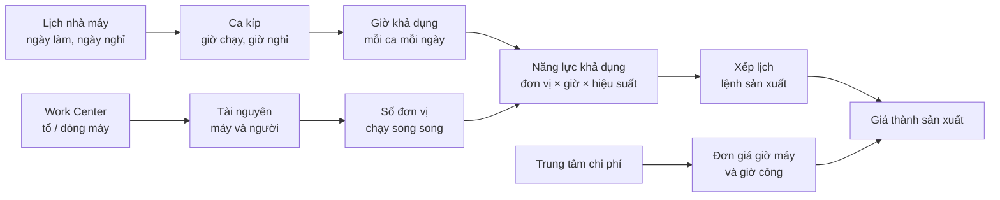

# 1000 Work Center & năng lực

Work Center là nơi nhà xưởng vật lý được số hóa thành **năng lực đo được**: mỗi giờ làm được bao nhiêu, vào lúc nào, với chi phí bao nhiêu. Mọi kế hoạch sản xuất đúng hay sai đều bắt nguồn từ con số này.

Nếu khai năng lực cao hơn thực tế, lịch sản xuất hứa những ngày giao không thực hiện được. Nếu khai thấp hơn, doanh nghiệp từ chối đơn lẽ ra vẫn đáp ứng được.

## 0. Nguyên lý (áp dụng mọi ERP)

1. **Work Center là đơn vị năng lực, không phải một cái máy.** Nó gom các tài nguyên có cùng tính chất (dòng máy ép, tổ lắp ráp) và trả lời câu hỏi "mỗi giờ làm được bao nhiêu". Một máy cụ thể chỉ là một **resource** bên trong work center.
2. **Năng lực = (số đơn vị song song) × (giờ khả dụng theo ca) × (hiệu suất).** Bỏ sót bất kỳ thừa số nào, lịch sản xuất sẽ hứa nhiều hơn thực tế làm được.
3. **Ca kíp và ngày làm việc là hai trục khác nhau.** Lịch nhà máy trả lời "ngày này có làm không"; ca kíp trả lời "làm từ mấy giờ đến mấy giờ, nghỉ giữa ca lúc nào". Gộp hai thứ vào một bảng là nguồn gốc của lỗi lịch khi có ngày lễ rơi vào ca đêm.
4. **Máy và người là hai resource độc lập, không thể thay thế nhau.** Máy rảnh nhưng không có người đứng máy thì lệnh vẫn không chạy. Khai một mà quên cái kia là khai năng lực giả.
5. **Work Center phải gắn với trung tâm chi phí.** Năng lực sản xuất tiêu tốn chi phí; nếu work center không map được tới cost center, giờ máy chạy sẽ không vào được giá thành.
6. **Hiệu suất phải dựa trên dữ liệu thực, không trên khát vọng.** Đặt hiệu suất 100% cho đẹp báo cáo sẽ làm mọi kế hoạch sản xuất đều trễ.

## 1. Luồng vận hành



**Điểm cốt lõi:** năng lực chỉ đúng khi tính đủ **ba nguồn** (đơn vị song song, giờ khả dụng, hiệu suất) và **hai trục thời gian** (ngày làm việc, khung ca).

## 2. Ai làm gì ở module nào

| Việc | Sản xuất (MFG) | Kho | Kế toán | Bảo trì | Nhân sự |
|---|---|---|---|---|---|
| Khai báo work center | ✅ sở hữu | — | — | — | — |
| Khai báo tài nguyên máy | ✅ sở hữu | — | — | Cung cấp lịch bảo trì | — |
| Khai báo tài nguyên nhân lực | ✅ sở hữu | — | — | — | ✅ cung cấp hồ sơ công nhân |
| Khai báo lịch nhà máy và ca kíp | ✅ sở hữu | — | — | — | Tham gia ca làm việc |
| Đặt hiệu suất thiết kế | ✅ sở hữu | — | — | Cung cấp độ tin cậy thiết bị | — |
| Gắn work center với trung tâm chi phí | Đề xuất | — | ✅ sở hữu | — | — |
| Đặt đơn giá giờ máy, giờ công | Cung cấp giờ thực tế | — | ✅ sở hữu | — | Cung cấp đơn giá lương |
| Chặn xếp lịch khi máy đang bảo trì | ✅ thực thi | — | — | ✅ sở hữu trạng thái | — |

**Ranh giới cốt lõi:** sản xuất khai **năng lực**, nhưng kế toán mới quyết định **chi phí mỗi giờ** — hai bên phải khớp thì giá thành mới tin được.

## 3. Hạch toán

Work center tự nó không sinh bút toán, nhưng nó là **đơn vị tính chi phí sản xuất**:

- Mỗi giờ máy chạy được tính vào WIP với **đơn giá giờ máy** gắn với work center.
- Mỗi giờ công được tính với **đơn giá giờ công**, thường khác nhau theo ca (ca đêm có phụ cấp).
- Nếu work center không gắn cost center, chi phí này không quy được về đâu và giá thành thiếu một mảng.

Bản đồ tài khoản ở [Hạch toán & tài khoản trung gian](../../6-ke-toan-chung/1000-hach-toan-va-tai-khoan-trung-gian.md); giá thành chi tiết ở [Giá thành sản xuất](../thuc-thi/8000-gia-thanh-san-xuat.md).

## 4. Điểm chạm & rủi ro

- **Dùng work center trong công đoạn**: [Routing & công đoạn](./3000-routing-va-cong-doan.md)
- **Chi phí giờ máy vào giá thành**: [Giá thành sản xuất](../thuc-thi/8000-gia-thanh-san-xuat.md)
- **Lịch sản xuất và năng lực khả dụng**: [Lệnh sản xuất & WIP](../thuc-thi/6000-lenh-san-xuat-va-wip.md)
- **Trung tâm chi phí**: [Tổ chức & Pháp nhân](../../0-nen-tang/1000-to-chuc-va-phap-nhan.md)

> Nếu nhà máy dùng **khuôn gá** làm tài nguyên ràng buộc thứ hai (ép nhựa, dập, đúc), xem [Triển khai Epicor: đếm số shot của khuôn](../thuc-thi/9100-trien-khai-epicor-shot-count-khuon.md) — bài này không trình bày khuôn.

**Rủi ro chính:**

- **Đặt hiệu suất 100%** — lịch hứa nhiều hơn thực tế, mọi đơn đều trễ.
- **Quên số đơn vị song song** — năng lực thấp hơn thực tế, từ chối đơn oan.
- **Gộp ngày làm việc và ca kíp vào một bảng** — lịch sai khi có ngày lễ rơi vào ca đêm.
- **Work center không gắn cost center** — giờ máy không vào giá thành.
- **Khai máy nhưng quên nhân lực** — lịch xếp máy chạy khi không có người đứng.
- **Giờ nghỉ giữa ca không trừ** — năng lực cao giả, mọi lệnh trễ 30–60 phút mỗi ca.

## 5. Triển khai tham chiếu ERP

### A. Ánh xạ khái niệm

| Khái niệm | Oracle EBS | Epicor ERP | SAP S/4HANA | Odoo |
|---|---|---|---|---|
| Work center (header) | `BOM_DEPARTMENTS` | `Erp.ResourceGroup` | `CRHD` | `mrp.workcenter` |
| Resource chi tiết | `BOM_RESOURCES` | `Erp.Resource` | Nằm trong `CRHD` | Cột `capacity` trên work center |
| Liên kết work center ↔ resource | `BOM_DEPARTMENT_RESOURCES` | `ResourceGroup.GroupSeq` | `CRCA` (Capacity Allocation) | Quan hệ 1-1 |
| Lịch nhà máy | `BOM_CALENDAR_DATES` | `Erp.ProdCal` | `TFACS` (Factory Calendar) | `resource.calendar` |
| Ca kíp | `BOM_RESOURCE_SHIFTS` | `Erp.JCShift` (master độc lập) | `TPROG` (Shift Definition) | `resource.calendar.attendance` |
| Nghỉ giữa ca | Trừ trực tiếp khung giờ trong `BOM_SHIFT_TIMES` | `Erp.ShiftBrk` | `TC30` / `TPAUS` | Nhiều dòng attendance |
| Nhân lực | `BOM_RESOURCES` (`resource_type = 2`) | `Erp.Resource` (`ResourceType = 'L'`) | `CRHD` (`Category = 0002`) | `mrp.workcenter` (`resource_type = 'human'`) |
| Đơn giá giờ công | `CST_RESOURCE_COSTS` | `ResourceGroup` + `JCShift.DiffRate` | `CSLA` / `COKL` (Activity Type Rates) | Trên work center hoặc `hr.contract` |
| Hồ sơ công nhân | `PER_ALL_PEOPLE_F` | `Erp.EmpBasic` | `PA0001` | `hr.employee` |

**Hai khác biệt kiến trúc cần nhớ:**

- **Epicor tách hai trục:** `Erp.JCShift` là **master ca độc lập** dùng chung toàn nhà máy; `Erp.ProdCal` chỉ trả lời "ngày này có làm việc không". Hai trục gán riêng vào resource, không lồng vào nhau.
- **Oracle EBS tách Department và Resource:** `Department` là đơn vị hành chính/tổ chức, `Resource` là công cụ tạo ra năng suất. Năng lực nằm ở bảng liên kết `BOM_DEPARTMENT_RESOURCES` với trường số đơn vị gán.

### B. Ví dụ thực tế Oracle EBS — tách setup và run qua `Basis`

Khi khai tài nguyên cho công đoạn, Oracle dùng một trường `Basis` để phân biệt hai loại thời gian, thay vì hai cột riêng:

- `Basis = Lot` → thời gian **cố định cho cả lô** (chuẩn bị máy).
- `Basis = Item` → thời gian **tỷ lệ theo sản phẩm** (gia công).

Cùng một resource `STAMP` có thể có hai dòng: `0.5` giờ với `Basis = Lot` và `0.02` giờ với `Basis = Item`. Hệ thống hiểu dòng thứ nhất là setup, dòng thứ hai là run — đây là cách mô hình hóa năng lực mà không cần thêm cột. Chi tiết cách tính tổng thời gian ở [Routing & công đoạn](./3000-routing-va-cong-doan.md).

### C. Hệ thống tự xây — thiết kế tối thiểu

```sql
CREATE TABLE Work_Center (
    WC_ID            VARCHAR(50) PRIMARY KEY,
    WC_Name          NVARCHAR(200) NOT NULL,
    Cost_Center      VARCHAR(20) NOT NULL,     -- bắt buộc
    Units_Parallel   DECIMAL(9,2) NOT NULL DEFAULT 1,
    Efficiency_Pct   DECIMAL(5,2) NOT NULL DEFAULT 100,
    Calendar_ID      VARCHAR(30) NOT NULL,
    Machine_Rate     DECIMAL(18,4) NOT NULL,   -- đơn giá giờ máy
    Labor_Rate       DECIMAL(18,4) NOT NULL    -- đơn giá giờ công
);

CREATE TABLE Work_Center_Shift (
    WC_ID            VARCHAR(50) NOT NULL,
    Shift_No         INT NOT NULL,
    Start_Time       TIME NOT NULL,
    End_Time         TIME NOT NULL,
    Break_Minutes    INT NOT NULL DEFAULT 0,
    Rate_Multiplier  DECIMAL(5,2) NOT NULL DEFAULT 1,
    PRIMARY KEY (WC_ID, Shift_No)
);

CREATE TABLE Work_Center_Resource (
    WC_ID            VARCHAR(50) NOT NULL,
    Resource_ID      VARCHAR(50) NOT NULL,
    Resource_Type    VARCHAR(10) NOT NULL,   -- MACHINE | LABOR
    Capacity_Units   DECIMAL(9,2) NOT NULL DEFAULT 1,
    PRIMARY KEY (WC_ID, Resource_ID)
);
```

Bốn ràng buộc bắt buộc:

1. **`Cost_Center` NOT NULL** trên work center — không có ngoại lệ.
2. **Mỗi work center phải có ít nhất một resource `MACHINE` và một resource `LABOR`** (nếu cả hai cùng cần để chạy).
3. **Tổng giờ ca trừ giờ nghỉ phải khác 0** cho mỗi ca đang hoạt động.
4. **`Efficiency_Pct` phải dựa trên dữ liệu thực**, có ngày hiệu lực và người duyệt.

### D. Truy vấn kiểm soát

**Work center thiếu trung tâm chi phí — giờ máy không vào giá thành:**

```sql
SELECT WC_ID, WC_Name, Machine_Rate, Labor_Rate
FROM Work_Center
WHERE Cost_Center IS NULL OR Cost_Center = '';
```

**Work center không có ca kíp — năng lực bằng 0 ngoài dự kiến:**

```sql
SELECT w.WC_ID, w.WC_Name
FROM Work_Center w
WHERE NOT EXISTS (SELECT 1 FROM Work_Center_Shift s WHERE s.WC_ID = w.WC_ID);
```

**Work center thiếu một loại tài nguyên — lịch sẽ xếp máy chạy mà không có người:**

```sql
SELECT w.WC_ID, w.WC_Name,
       SUM(CASE WHEN r.Resource_Type = 'MACHINE' THEN 1 ELSE 0 END) AS May,
       SUM(CASE WHEN r.Resource_Type = 'LABOR'   THEN 1 ELSE 0 END) AS Nguoi
FROM Work_Center w
LEFT JOIN Work_Center_Resource r ON r.WC_ID = w.WC_ID
GROUP BY w.WC_ID, w.WC_Name
HAVING SUM(CASE WHEN r.Resource_Type = 'MACHINE' THEN 1 ELSE 0 END) = 0
    OR SUM(CASE WHEN r.Resource_Type = 'LABOR'   THEN 1 ELSE 0 END) = 0;
```

**Ca kíp có giờ nghỉ lớn hơn hoặc bằng tổng thời lượng — năng lực âm:**

```sql
SELECT WC_ID, Shift_No, Start_Time, End_Time, Break_Minutes,
       DATEDIFF(MINUTE, Start_Time, End_Time) AS Total_Min,
       DATEDIFF(MINUTE, Start_Time, End_Time) - Break_Minutes AS Available_Min
FROM Work_Center_Shift
WHERE DATEDIFF(MINUTE, Start_Time, End_Time) - Break_Minutes <= 0;
```

**Năng lực khả dụng mỗi work center mỗi tuần (đối chiếu với tải thực tế):**

```sql
SELECT w.WC_ID, w.WC_Name,
       SUM((DATEDIFF(MINUTE, s.Start_Time, s.End_Time) - s.Break_Minutes) / 60.0) AS Hours_Per_Day,
       SUM((DATEDIFF(MINUTE, s.Start_Time, s.End_Time) - s.Break_Minutes) / 60.0)
           * w.Units_Parallel * (w.Efficiency_Pct / 100.0) * 5 AS Weekly_Capacity_Hours
FROM Work_Center w
JOIN Work_Center_Shift s ON s.WC_ID = w.WC_ID
GROUP BY w.WC_ID, w.WC_Name, w.Units_Parallel, w.Efficiency_Pct
ORDER BY Weekly_Capacity_Hours DESC;
```

**Epicor — resource của work center và ca đang gán:**

```sql
SELECT rg.ResourceGrpID, rg.Description AS WorkCenter,
       r.ResourceID, r.ResourceType, r.QtyPer AS Units
FROM Erp.ResourceGroup rg
LEFT JOIN Erp.Resource r ON r.Company = rg.Company AND r.ResourceGrpID = rg.ResourceGrpID
WHERE rg.Company = 'YOUR_COMPANY_CODE'
ORDER BY rg.ResourceGrpID, r.ResourceID;
```

## 6. Bẫy thực chiến & Checklist

| # | Bẫy | Triệu chứng | Cách phòng tránh |
|---|---|---|---|
| 1 | Đặt hiệu suất 100% | Kế hoạch đẹp, thực tế trễ triền miên | Hiệu suất theo dữ liệu thực, rà soát mỗi quý |
| 2 | Quên số đơn vị song song | Năng lực thấp hơn thực tế, từ chối đơn oan | `Units_Parallel` bắt buộc, kiểm tra khi khai mới |
| 3 | Gộp ngày làm việc và ca kíp | Ngày lễ rơi vào ca đêm tính sai năng lực | Hai bảng tách biệt, calendar gán vào work center |
| 4 | Work center không gắn cost center | Giờ máy không vào giá thành | `Cost_Center` NOT NULL |
| 5 | Khai máy nhưng không khai nhân lực | Lịch xếp máy chạy khi không có người đứng | Bắt buộc cả hai loại resource |
| 6 | Giờ nghỉ giữa ca không trừ | Năng lực cao giả, mọi lệnh trễ 30–60 phút/ca | `Break_Minutes` trừ vào năng lực khả dụng |
| 7 | Phụ cấp ca không vào đơn giá | Giá thành thiếu chi phí ca đêm | `Rate_Multiplier` theo từng ca |
| 8 | Hiệu suất khai một lần rồi quên | Năng lực lạc hậu nhiều năm, kế hoạch luôn lệch | Có ngày hiệu lực và lịch rà soát |
| 9 | Không tính thời gian bảo trì vào năng lực | Lịch xếp lệnh vào ngày máy đang bảo dưỡng | Liên kết lịch bảo trì với năng lực khả dụng |
| 10 | Khai work center theo máy lẻ | Số work center phình to, báo cáo năng lực không đọc được | Gom theo tính chất công việc, máy lẻ là resource |

**Checklist trước go-live:**

- [ ] Mọi work center có `Cost_Center` (đã test chặn lưu khi trống).
- [ ] Năng lực tính đủ `Units_Parallel × giờ khả dụng × Efficiency`.
- [ ] Lịch nhà máy và ca kíp là hai bảng tách biệt (đã test ngày lễ).
- [ ] Giờ nghỉ giữa ca được trừ khỏi năng lực (đã test ca có nghỉ dài).
- [ ] Phụ cấp ca đêm vào đơn giá giờ.
- [ ] Mọi work center có cả tài nguyên máy và nhân lực (đã chạy truy vấn, 0 dòng).
- [ ] Hiệu suất có ngày hiệu lực và người duyệt.
- [ ] Lịch bảo trì thiết bị được trừ khỏi năng lực khả dụng.
- [ ] Có báo cáo năng lực tuần đối chiếu với tải thực tế.
- [ ] Đã test một work center có 3 máy chạy song song → năng lực gấp 3 lần.

## Xem thêm

- [Tổng quan Sản xuất](../0000-tong-quan-san-xuat.md)
- [BOM & định mức](./2000-bom-va-dinh-muc.md)
- [Routing & công đoạn](./3000-routing-va-cong-doan.md)
- [Lệnh sản xuất & WIP](../thuc-thi/6000-lenh-san-xuat-va-wip.md)
- [Giá thành sản xuất](../thuc-thi/8000-gia-thanh-san-xuat.md)

<div align="center" style={{color: 'var(--ifm-color-primary)'}}>
  <strong>Chúc các bạn thành công và vui vẻ!</strong>
</div>
