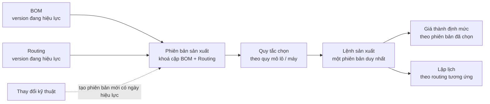

# 4000 Phiên bản sản xuất & quy mô lô

Một sản phẩm có thể có **nhiều cách sản xuất**: cùng một vỏ tủ điện, nhà máy có thể dùng sơn tĩnh điện với dây chuyền tự động, hoặc sơn phun tay với định mức khác. BOM khác nhau, Routing khác nhau, giá thành khác nhau.

Phiên bản sản xuất là **cầu nối khoá cặp** BOM và Routing đó lại, để hệ thống biết chính xác dùng công thức nào cho lệnh sản xuất này.

## 0. Nguyên lý (áp dụng mọi ERP)

1. **BOM và Routing là hai tài liệu độc lập — cần một khoá ghép.** Không có cầu nối, hệ thống có thể lấy BOM cách A ghép với Routing cách B, tạo ra công thức không ai thiết kế.
2. **Một sản phẩm có nhiều cách sản xuất là chuyện bình thường.** Khác máy, khác vật liệu thay thế, khác quy mô lô, khác nhà máy. Hệ thống phải mô hình hóa được sự đa dạng này, không ép về một công thức duy nhất.
3. **Quy mô lô quyết định chọn phiên bản nào.** Lô 100 cái chạy máy tự động, lô 5 cái chạy thủ công. Điều kiện chọn phải cấu hình được, không hard-code.
4. **Chỉ một phiên bản được chọn cho một lệnh, và phải truy được vì sao chọn.** Khi giá thành lệch, câu hỏi đầu tiên luôn là "lệnh này chạy theo phiên bản nào".
5. **Phiên bản có hiệu lực theo ngày.** Sản phẩm đang sản xuất dở theo bản cũ; đơn mới dùng bản mới. Cắt hiệu lực sai làm lệnh cũ đổi công thức giữa đường.
6. **Quy mô lô ảnh hưởng giá thành không tuyến tính.** Setup cố định chia cho số lượng → lô nhỏ có giá thành đơn vị cao hơn nhiều dù đơn giá vật tư như nhau.

## 1. Luồng vận hành



## 2. Ai làm gì ở module nào

| Việc | Kỹ thuật sản xuất | Điều độ sản xuất | Kế toán | Kho |
|---|---|---|---|---|
| Tạo phiên bản sản xuất | ✅ sở hữu | — | — | — |
| Đặt quy mô lô tối thiểu / tối đa | ✅ sở hữu | Đề xuất theo năng lực | — | — |
| Cấu hình quy tắc chọn phiên bản | ✅ sở hữu | ✅ duyệt | — | — |
| Chọn phiên bản khi tạo lệnh | — | ✅ thực hiện, có thể ghi đè có lý do | — | — |
| Xác nhận giá thành theo phiên bản | — | ✅ kiểm tra định mức | — |
| Đảm bảo vật tư đủ cho quy mô lô | — | Đọc nhu cầu | — | ✅ kiểm tra tồn |
| Duyệt phiên bản mới khi có ECO | ✅ sở hữu | — | — | — |

**Ranh giới cốt lõi:** kỹ thuật **khai** quy tắc chọn, điều độ **dùng** quy tắc. Nếu điều độ chọn tay tuỳ ý, quy tắc mất giá trị và giá thành không so sánh được giữa các lệnh.

## 3. Hạch toán

Phiên bản sản xuất quyết định **giá thành định mức của lệnh**:

- Mỗi phiên bản có định mức vật tư (từ BOM) và định mức giờ máy/giờ công (từ Routing) riêng → giá thành định mức khác nhau.
- Khi lệnh chọn phiên bản, hệ thống **chốt định mức ngay tại thời điểm tạo lệnh**. Sửa BOM sau đó không làm thay đổi định mức của lệnh đã tạo.
- Quy mô lô ảnh hưởng **chi phí setup trên mỗi đơn vị**: lô 10 với setup 2 giờ = 0,2 giờ/cái; lô 1.000 với setup 2 giờ = 0,002 giờ/cái.

Bản đồ tài khoản ở [Hạch toán & tài khoản trung gian](../../6-ke-toan-chung/1000-hach-toan-va-tai-khoan-trung-gian.md); phân tích chênh lệch ở [Giá thành sản xuất](../thuc-thi/8000-gia-thanh-san-xuat.md).

## 4. Điểm chạm & rủi ro

- **BOM dùng trong phiên bản**: [BOM & định mức](./2000-bom-va-dinh-muc.md)
- **Routing dùng trong phiên bản**: [Routing & công đoạn](./3000-routing-va-cong-doan.md)
- **Tạo lệnh sản xuất dùng phiên bản**: [Lệnh sản xuất & WIP](../thuc-thi/6000-lenh-san-xuat-va-wip.md)
- **Thay đổi phiên bản qua ECO**: [Thay đổi kỹ thuật & ECO](./5000-thay-doi-ky-thuat-va-eco.md)
- **Giá thành định mức**: [Giá thành sản xuất](../thuc-thi/8000-gia-thanh-san-xuat.md)

**Rủi ro chính:**

- **Ghép BOM cách A với Routing cách B** — công thức không ai thiết kế, giá thành vô nghĩa.
- **Không có quy tắc chọn** — hệ thống chọn ngẫu nhiên, mỗi lần chạy MRP cho kết quả khác.
- **Cắt hiệu lực sai** — lệnh đang sản xuất dở bị đổi công thức giữa đường.
- **Quy mô lô không khai** — lô 5 cái chạy theo định mức dây chuyền tự động, giá thành lỗ.
- **Chọn tay không ghi lý do** — không truy được vì sao lệnh này dùng phiên bản đó.
- **Không chốt định mức tại thời điểm tạo lệnh** — sửa BOM làm giá thành lệnh cũ đổi theo.

## 5. Triển khai tham chiếu ERP

### A. Ánh xạ khái niệm

| Khái niệm | Oracle EBS | Epicor ERP | SAP S/4HANA | Odoo |
|---|---|---|---|---|
| Bảng ghép BOM ↔ Routing | `GMD_RECIPES_B` (phân hệ OPM); Discrete dùng Alternate | Không cần — `Erp.PartRev` đại diện cả hai | **`MKAL`** (Production Version) | Không cần — `mrp.bom` chứa cả operations |
| Liên kết BOM | `GMD_RECIPES_B.formula_id` | `PartRev.RevisionNum` → `PartMtl` | `MKAL.STLAL` (BOM Alternative) | `mrp.bom.id` |
| Liên kết Routing | `GMD_RECIPES_B.routing_id` | `PartRev.AltMethod` → `PartOpr` | `MKAL.PLNAL` (Routing Group Counter) | Tab Operations trong `mrp.bom` |
| Quy mô lô tối thiểu / tối đa | Attributes trên Recipe | `PartRev` hoặc cờ trên `PartPlant` | `MKAL.MINLV` / `MKAL.MAXLV` | Cần tùy biến |
| Khoảng ngày hiệu lực | Attributes trên Recipe | `PartRev.EffectiveDate` | `MKAL.ADATU` / `MKAL.BDATU` | Version hoặc tùy biến |

**Điểm kiến trúc cần nhớ:** Epicor và Odoo **không cần bảng ghép** vì BOM và Routing gộp chung.
- Epicor gộp thành **MoM** gắn theo `PartRev` — mỗi revision là một công thức sản xuất hoàn chỉnh.
- Odoo đặt operations **trực tiếp trên BOM** — `mrp.bom.id` đã đại diện cho công thức duy nhất.
- SAP ngược lại: **buộc phải khai `MKAL`** để khoá cứng cặp BOM Alternative và Routing Group Counter. Thiếu `MKAL`, hệ thống không biết chạy theo cặp nào.

### B. Hệ thống tự xây — thiết kế tối thiểu

```sql
CREATE TABLE Production_Version (
    PV_ID            BIGINT IDENTITY PRIMARY KEY,
    Parent_Item      VARCHAR(50) NOT NULL,
    PV_Code          VARCHAR(20) NOT NULL,   -- ví dụ: AUTO | MANUAL | LINE-2
    BOM_ID           BIGINT NOT NULL,
    Routing_ID       BIGINT NOT NULL,
    Min_Lot_Size     DECIMAL(18,4) NOT NULL DEFAULT 0,
    Max_Lot_Size     DECIMAL(18,4) NOT NULL,
    Valid_From       DATE NOT NULL,
    Valid_To         DATE NULL,
    Priority         INT NOT NULL DEFAULT 5,
    Status           VARCHAR(20) NOT NULL,   -- DRAFT | ACTIVE | INACTIVE
    UNIQUE (Parent_Item, PV_Code)
);
```

Bốn ràng buộc bắt buộc:

1. **`BOM_ID` và `Routing_ID` cùng thuộc một `Parent_Item`** — chặn ghép lẫn.
2. **Khoảng `Min_Lot_Size..Max_Lot_Size` của các phiên bản ACTIVE không được chồng lấn** với cùng `Priority` — nếu chồng, hệ thống chọn không xác định.
3. **Chỉ một phiên bản được chọn cho một lệnh**, và lưu lại `PV_ID` trên lệnh để truy vết.
4. **Phiên bản không được xoá khi đã có lệnh dùng** — chuyển `INACTIVE`.

### C. Truy vấn kiểm soát

**Phiên bản có khoảng lô chồng lấn — chọn không xác định:**

```sql
SELECT a.Parent_Item, a.PV_Code, b.PV_Code,
       a.Min_Lot_Size, a.Max_Lot_Size, b.Min_Lot_Size, b.Max_Lot_Size
FROM Production_Version a
JOIN Production_Version b
  ON b.Parent_Item = a.Parent_Item AND b.PV_ID > a.PV_ID
 AND b.Priority = a.Priority
 AND b.Status = 'ACTIVE' AND a.Status = 'ACTIVE'
 AND a.Min_Lot_Size <= b.Max_Lot_Size
 AND b.Min_Lot_Size <= a.Max_Lot_Size;
```

**Phiên bản ghép BOM và Routing của hai mã hàng khác nhau:**

```sql
SELECT pv.PV_Code, pv.Parent_Item,
       bh.Parent_Item AS Bom_Parent, rh.Parent_Item AS Routing_Parent
FROM Production_Version pv
JOIN BOM_Header bh     ON bh.BOM_ID = pv.BOM_ID
JOIN Routing_Header rh ON rh.Routing_ID = pv.Routing_ID
WHERE bh.Parent_Item <> pv.Parent_Item OR rh.Parent_Item <> pv.Parent_Item;
```

**Sản phẩm có nhiều phiên bản ACTIVE nhưng không phiên bản nào phủ hết quy mô lô thường dùng:**

```sql
SELECT i.Item_ID, i.Typical_Lot_Size,
       ISNULL(MAX(pv.Max_Lot_Size), 0) AS Max_Covered,
       ISNULL(MIN(pv.Min_Lot_Size), 0) AS Min_Covered
FROM Item_Inventory_Attribute i
LEFT JOIN Production_Version pv
       ON pv.Parent_Item = i.Item_ID AND pv.Status = 'ACTIVE'
WHERE i.Typical_Lot_Size IS NOT NULL
GROUP BY i.Item_ID, i.Typical_Lot_Size
HAVING i.Typical_Lot_Size > ISNULL(MAX(pv.Max_Lot_Size), 0)
    OR i.Typical_Lot_Size < ISNULL(MIN(pv.Min_Lot_Size), 0);
```

**Lệnh sản xuất không lưu phiên bản đã dùng — không truy được giá thành:**

```sql
SELECT wo.WO_No, wo.Item_ID, wo.Qty_Ordered, wo.Created_At
FROM Work_Order wo
WHERE wo.PV_ID IS NULL
  AND wo.Status NOT IN ('CANCELLED', 'DRAFT');
```

**SAP — sản phẩm có BOM và Routing nhưng thiếu Production Version:**

```sql
SELECT m.MATNR AS Material, m.WERKS AS Plant,
       (SELECT COUNT(*) FROM MAST x WHERE x.MATNR = m.MATNR AND x.WERKS = m.WERKS) AS Bom_Count,
       (SELECT COUNT(*) FROM PLKO p WHERE p.MATNR = m.MATNR AND p.WERKS = m.WERKS) AS Routing_Count,
       (SELECT COUNT(*) FROM MKAL k WHERE k.MATNR = m.MATNR AND k.WERKS = m.WERKS) AS PV_Count
FROM MARA m
WHERE m.MTART IN ('FERT', 'HALB')
  AND m.WERKS = 'YOUR_PLANT'
  AND (SELECT COUNT(*) FROM PLKO p WHERE p.MATNR = m.MATNR AND p.WERKS = m.WERKS) > 0
  AND (SELECT COUNT(*) FROM MKAL k WHERE k.MATNR = m.MATNR AND k.WERKS = m.WERKS) = 0;
```

## 6. Bẫy thực chiến & Checklist

| # | Bẫy | Triệu chứng | Cách phòng tránh |
|---|---|---|---|
| 1 | Không có phiên bản sản xuất | BOM lấy cách A, Routing lấy cách B, công thức không ai thiết kế | Bảng ghép bắt buộc (SAP: `MKAL`; tự xây: `Production_Version`) |
| 2 | Khoảng lô chồng lấn | Cùng một quy mô lô chọn ra hai phiên bản khác nhau | Kiểm tra chồng lấn khi lưu |
| 3 | Không có quy tắc chọn | Mỗi lần chạy MRP kết quả khác | `Priority` + khoảng lô, cấu hình được |
| 4 | Chọn tay không ghi lý do | Lệnh lỗ giá thành nhưng không truy được vì sao | Lưu `PV_ID` + lý do khi ghi đè |
| 5 | Cắt hiệu lực sai | Lệnh đang chạy dở bị đổi công thức | Phiên bản có `Valid_From`/`Valid_To`, không sửa bản ACTIVE |
| 6 | Không khai quy mô lô | Lô 5 cái chạy định mức dây chuyền tự động | `Min_Lot_Size`/`Max_Lot_Size` bắt buộc |
| 7 | Xoá phiên bản đã dùng | Báo cáo giá thành mất tham chiếu | Chỉ `INACTIVE`, không xoá |
| 8 | Sửa BOM của phiên bản ACTIVE | Giá thành lệnh cũ đổi theo | Chốt định mức tại thời điểm tạo lệnh |
| 9 | Ghép BOM và Routing của hai mã khác nhau | Công thức vô nghĩa, MRP đặt mua vật tư không dùng | Ràng buộc cùng `Parent_Item` |
| 10 | Epicor/Odoo tưởng cần bảng ghép | Thiết kế thừa bảng không ai dùng | Với hai hệ này, `PartRev`/`mrp.bom` đã là phiên bản |

**Checklist trước go-live:**

- [ ] 100% mã hàng có Routing đều có ít nhất một phiên bản ACTIVE.
- [ ] Kiểm tra khoảng lô chồng lấn (đã chạy truy vấn, 0 dòng).
- [ ] Chặn ghép BOM và Routing khác `Parent_Item` (đã test).
- [ ] Lệnh sản xuất lưu `PV_ID` (đã test truy vết).
- [ ] Quy mô lô tối thiểu/tối đa đã khai cho mọi phiên bản.
- [ ] Không xoá được phiên bản đã có lệnh dùng (đã test).
- [ ] Định mức được chốt tại thời điểm tạo lệnh (đã test sửa BOM sau đó).
- [ ] Ghi đè chọn tay bắt buộc nhập lý do.
- [ ] Đã test hai quy mô lô khác nhau cho ra giá thành đơn vị khác nhau đúng kỳ vọng.

## Xem thêm

- [Tổng quan Sản xuất](../0000-tong-quan-san-xuat.md)
- [BOM & định mức](./2000-bom-va-dinh-muc.md)
- [Routing & công đoạn](./3000-routing-va-cong-doan.md)
- [Thay đổi kỹ thuật & ECO](./5000-thay-doi-ky-thuat-va-eco.md)
- [Lệnh sản xuất & WIP](../thuc-thi/6000-lenh-san-xuat-va-wip.md)

<div align="center" style={{color: 'var(--ifm-color-primary)'}}>
  <strong>Chúc các bạn thành công và vui vẻ!</strong>
</div>
