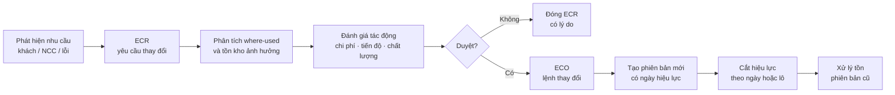

# 5000 Thay đổi kỹ thuật & ECO

Sản phẩm đang sản xuất không đứng yên. Khách đổi yêu cầu, nhà cung cấp ngừng bán linh kiện, phát hiện lỗi thiết kế, hoặc cần giảm chi phí. Mỗi thay đổi phải đi qua một quy trình có kiểm soát — nếu không, sẽ có người sửa BOM trực tiếp và hàng nghìn sản phẩm đang chạy bị đổi công thức mà không ai biết.

## 0. Nguyên lý (áp dụng mọi ERP)

1. **Sửa trực tiếp BOM/Routing đang chạy là lỗi nghiêm trọng nhất trong sản xuất.** Lệnh đang sản xuất dở sẽ đổi định mức giữa đường; không truy được lô nào làm theo thiết kế nào; và khi khách khiếu nại không biết hàng đó thuộc phiên bản nào.
2. **Phân biệt yêu cầu và lệnh.** ECR (Engineering Change Request) là *đề nghị* thay đổi — có thể bị từ chối. ECO (Engineering Change Order) là *lệnh* thay đổi đã được duyệt — phải được thực thi. Gộp hai bước làm mất khả năng từ chối.
3. **Ngày hiệu lực là trái tim của quản lý thay đổi.** Phiên bản mới có ngày hiệu lực; lệnh sản xuất trước ngày đó dùng bản cũ, sau đó dùng bản mới. Không có ngày hiệu lực, thay đổi áp dụng hồi tố — điều không thể làm trong sản xuất thật.
4. **Phải phân tích where-used trước khi sửa.** Một linh kiện có thể nằm trong 30 sản phẩm khác nhau. Đổi nó mà không biết đang dùng ở đâu là thay đổi ngoài tầm kiểm soát.
5. **Thay đổi có hiệu lực tạo ra hai bài toán tồn kho:** hàng tồn của phiên bản cũ xử lý thế nào, và nguyên vật liệu của phiên bản cũ còn trong kho xử lý ra sao. ECO tốt phải trả lời được cả hai.
6. **Ai duyệt ECO là quyết định tổ chức, không phải kỹ thuật.** Cùng một thay đổi, mức độ ảnh hưởng chi phí khác nhau cần cấp duyệt khác nhau.

## 1. Luồng vận hành



## 2. Ai làm gì ở module nào

| Bước | Kỹ thuật (R&D) | Kỹ thuật sản xuất | Sản xuất | Kho | Kế toán |
|---|---|---|---|---|---|
| Đề xuất ECR | ✅ chủ trì | ✅ đề xuất khi thấy vướng sản xuất | ✅ đề xuất khi lỗi | — | — |
| Phân tích where-used | ✅ thực hiện | Hỗ trợ | — | — | — |
| Đánh giá tác động tồn kho | — | Phối hợp | — | ✅ cung cấp tồn cũ | — |
| Đánh giá tác động chi phí | — | Tính giá thành mới | — | — | ✅ duyệt thay đổi chi phí lớn |
| Duyệt ECO | ✅ duyệt kỹ thuật | ✅ duyệt sản xuất | ✅ nhận thông báo | — | ✅ khi vượt ngưỡng |
| Tạo phiên bản mới BOM/Routing | ✅ R&D cho EBOM | ✅ sở hữu MBOM | — | — | — |
| Cắt hiệu lực | — | ✅ chủ trì | ✅ áp dụng vào lệnh | — | — |
| Xử lý tồn hàng phiên bản cũ | — | Đề xuất phương án | — | ✅ thực hiện | ✅ xử lý dự phòng/huỷ |

## 3. Hạch toán

Thay đổi kỹ thuật không sinh bút toán ngay, nhưng nó tạo ra **ba hệ quả tài chính** phải được định nghĩa trước:

1. **Hàng thành phẩm tồn của phiên bản cũ** — bán tiếp, giảm giá, hay dự phòng giảm giá. Phải quyết trước khi sản xuất bản mới, nếu không sẽ nằm tồn mãi.
2. **Nguyên vật liệu của phiên bản cũ còn trong kho** — tiếp tục dùng, dùng thay thế, hay thanh lý. Đây là nguồn tồn kho chết lớn nhất sau mỗi thay đổi.
3. **Giá thành định mức mới** — phiên bản mới có định mức khác; nếu không cập nhật giá chuẩn kịp thời, giá thành lệch toàn kỳ.

Bản đồ tài khoản ở [Hạch toán & tài khoản trung gian](../../6-ke-toan-chung/1000-hach-toan-va-tai-khoan-trung-gian.md); giá thành và chênh lệch ở [Giá thành sản xuất](../thuc-thi/8000-gia-thanh-san-xuat.md).

## 4. Điểm chạm & rủi ro

- **BOM là đối tượng bị thay đổi**: [BOM & định mức](./2000-bom-va-dinh-muc.md)
- **Routing là đối tượng bị thay đổi**: [Routing & công đoạn](./3000-routing-va-cong-doan.md)
- **Phiên bản sản xuất sinh ra từ ECO**: [Phiên bản sản xuất & quy mô lô](./4000-phien-ban-san-xuat-va-lo.md)
- **Tồn kho của phiên bản cũ**: [Kiểm kê & điều chỉnh](../../1-kho/5000-kiem-ke-va-dieu-chinh.md)
- **Ảnh hưởng giá thành**: [Giá thành sản xuất](../thuc-thi/8000-gia-thanh-san-xuat.md)

**Rủi ro chính:**

- **Sửa trực tiếp BOM đang chạy** — lệnh đang sản xuất bị đổi công thức giữa đường, không truy vết được.
- **Không phân tích where-used** — đổi linh kiện ảnh hưởng 30 sản phẩm, không ai biết.
- **Áp dụng hồi tố** — hàng đã bán bị đổi công thức ngược thời gian.
- **Không xử lý tồn phiên bản cũ** — thành phẩm cũ và nguyên vật liệu cũ thành tồn kho chết.
- **Duyệt ECO không có người sản xuất** — thay đổi không khả thi khi chạy thực tế.
- **Không cập nhật giá chuẩn sau ECO** — giá thành định mức lạc hậu cả quý.

## 5. Triển khai tham chiếu ERP

### A. Ánh xạ khái niệm

| Khái niệm | Oracle EBS | Epicor ERP | SAP S/4HANA | Odoo |
|---|---|---|---|---|
| Yêu cầu thay đổi | Change Request (`ENG_CHANGE_ORDERS` type Request) | `Erp.ECRHead` (Engineering Change Request) | Engineering Change Request (`CC01`/QM) | `mrp.eco` stage `new` |
| Lệnh thay đổi | `ENG_CHANGE_ORDERS` (ECO) | `Erp.ECOHead` / `ECODtl` | Engineering Change Master (`CC31`) | `mrp.eco` stage `approved` |
| Ngày hiệu lực | `effectivity_date` trên dòng BOM | `PartRev.EffectiveDate` | `DATUV` trên dòng BOM + ECN | `mrp.eco.effective_date` |
| Phiên bản mới | Revision trên `BOM_BILL_OF_MATERIALS` | `PartRev.RevisionNum` | BOM Alternative + `DATUV` | `mrp.bom` version |
| Where-used | `BOM_WHERE_USED_V` / BOM Inquiry | `Part Where-Used` | `CS15` / `CS12` | `mrp.bom.line` reverse lookup |
| Lock khi đang sửa | — | `Engineering Workbench` checkout | Change number lock | PLM checkout |

**Điểm cần lưu ý theo hệ thống:**
- **Oracle EBS** tách phân hệ **Engineering** khỏi **BOM** — ECO duyệt trong Engineering rồi mới phát hành sang BOM/WIP.
- **Epicor** dùng **Engineering Workbench** với cơ chế checkout/checkin — khoá bản ghi trong lúc sửa.
- **SAP** dùng **Change Number** (`CC31`): mọi thay đổi BOM gắn số ECN, cho phép truy vết tới từng thay đổi.
- **Odoo** dùng **PLM app** riêng (`mrp.eco`); duyệt xong mới ghi đè BOM chính.

### B. Hệ thống tự xây — thiết kế tối thiểu

```sql
CREATE TABLE Change_Request (
    ECR_ID           BIGINT IDENTITY PRIMARY KEY,
    ECR_No           VARCHAR(30) NOT NULL UNIQUE,
    Requested_By     VARCHAR(50) NOT NULL,
    Reason_Code      VARCHAR(20) NOT NULL,
    -- CUSTOMER_DEMAND | SUPPLIER_OBSOLETE | QUALITY_ISSUE | COST_REDUCTION
    Status           VARCHAR(20) NOT NULL,  -- OPEN | IMPACT_ASSESSED | REJECTED | CONVERTED
    Reject_Reason    NVARCHAR(500) NULL
);

CREATE TABLE Change_Order (
    ECO_ID           BIGINT IDENTITY PRIMARY KEY,
    ECO_No           VARCHAR(30) NOT NULL UNIQUE,
    ECR_ID           BIGINT NULL,
    Parent_Item      VARCHAR(50) NOT NULL,
    New_Version      INT NOT NULL,
    Effective_Date   DATE NOT NULL,
    Apply_Method     VARCHAR(20) NOT NULL,  -- BY_DATE | BY_LOT
    Status           VARCHAR(20) NOT NULL,  -- DRAFT | APPROVED | APPLIED | CLOSED
    Approved_By      VARCHAR(50) NULL
);

CREATE TABLE Change_Impact (
    ECO_ID           BIGINT NOT NULL,
    Impact_Type      VARCHAR(20) NOT NULL,  -- WHERE_USED | ONHAND_FG | ONHAND_RAW
    Item_ID          VARCHAR(50) NOT NULL,
    Qty_Affected     DECIMAL(18,4) NULL,
    Resolution       VARCHAR(20) NULL,      -- CONTINUE | REPLACE | DISCOUNT | SCRAP
    PRIMARY KEY (ECO_ID, Impact_Type, Item_ID)
);
```

Bốn ràng buộc bắt buộc:

1. **Không cập nhật BOM/Routing nếu không có `ECO_ID`** — chặn ở tầng dịch vụ.
2. **`Effective_Date` bắt buộc**, không được nhỏ hơn ngày duyệt (trừ trường hợp ghi đè có lý do).
3. **`Change_Impact` phải có ít nhất một dòng `WHERE_USED`** trước khi ECO được duyệt.
4. **Không cho ECO chuyển `CLOSED` nếu chưa có `Resolution`** cho mọi dòng tồn kho ảnh hưởng.

### C. Truy vấn kiểm soát

**BOM/Routing bị sửa không qua ECO — vi phạm quy trình:**

```sql
SELECT h.Parent_Item, h.Version, h.Modified_At, h.Modified_By, h.Last_ECO
FROM BOM_Header h
WHERE h.Modified_At > h.Approved_At
  AND (h.Last_ECO IS NULL OR h.Last_ECO = '');
```

**ECO sắp có hiệu lực trong 7 ngày nhưng chưa có phương án xử lý tồn:**

```sql
SELECT c.ECO_No, c.Parent_Item, c.Effective_Date,
       (SELECT COUNT(*) FROM Change_Impact i
        WHERE i.ECO_ID = c.ECO_ID AND i.Resolution IS NULL) AS Unresolved_Impacts
FROM Change_Order c
WHERE c.Status = 'APPROVED'
  AND c.Effective_Date BETWEEN GETDATE() AND DATEADD(DAY, 7, GETDATE())
  AND EXISTS (SELECT 1 FROM Change_Impact i
              WHERE i.ECO_ID = c.ECO_ID AND i.Resolution IS NULL);
```

**Linh kiện bị thay thế nhưng còn tồn kho lớn — nguy cơ tồn chết:**

```sql
SELECT i.Item_ID, i.Qty_Affected, i.Resolution,
       (SELECT SUM(Qty) FROM Inventory_Transaction t WHERE t.Item_ID = i.Item_ID) AS Qty_Onhand
FROM Change_Impact i
WHERE i.Impact_Type = 'ONHAND_RAW'
  AND (i.Resolution IS NULL OR i.Resolution = 'CONTINUE')
  AND (SELECT SUM(Qty) FROM Inventory_Transaction t WHERE t.Item_ID = i.Item_ID) > 0;
```

**Danh sách sản phẩm bị ảnh hưởng bởi một linh kiện (where-used):**

```sql
WITH RECURSIVE used AS (
    SELECT h.Parent_Item, l.Component_Item, 1 AS Lvl
    FROM BOM_Header h JOIN BOM_Line l ON l.BOM_ID = h.BOM_ID
    WHERE h.Status = 'APPROVED' AND l.Component_Item = @Component_Item
    UNION ALL
    SELECT h2.Parent_Item, u.Component_Item, u.Lvl + 1
    FROM used u
    JOIN BOM_Header h2 ON h2.Parent_Item = u.Parent_Item AND h2.Status = 'APPROVED'
    JOIN BOM_Line l2   ON l2.BOM_ID = h2.BOM_ID
    WHERE u.Lvl < 10
)
SELECT DISTINCT Component_Item, Parent_Item, Lvl FROM used ORDER BY Lvl;
```

**Epicor — revision chưa duyệt đang là revision mới nhất:**

```sql
SELECT p.PartNum, p.RevisionNum, pr.Approved, pr.EffectiveDate
FROM Erp.Part p
JOIN Erp.PartRev pr ON pr.Company = p.Company AND pr.PartNum = p.PartNum
WHERE p.Company = 'YOUR_COMPANY_CODE'
  AND pr.Approved = 0
  AND pr.EffectiveDate <= GETDATE();
```

## 6. Bẫy thực chiến & Checklist

| # | Bẫy | Triệu chứng | Cách phòng tránh |
|---|---|---|---|
| 1 | Sửa BOM trực tiếp không qua ECO | Không truy được ai đổi, khi nào, vì sao | Chặn cập nhật BOM nếu thiếu `ECO_ID` |
| 2 | Gộp ECR và ECO | Mọi yêu cầu đều thành thay đổi, không từ chối được | Tách hai chứng từ, ECR có thể bị đóng |
| 3 | Không phân tích where-used | Đổi linh kiện ảnh hưởng sản phẩm không ai nghĩ tới | Bắt buộc có `WHERE_USED` trước khi duyệt |
| 4 | Áp dụng hồi tố | Hàng đã bán bị đổi công thức ngược thời gian | `Effective_Date` ≥ ngày duyệt |
| 5 | Không xử lý tồn phiên bản cũ | Thành phẩm và nguyên vật liệu cũ nằm tồn vĩnh viễn | `Change_Impact` + `Resolution` bắt buộc |
| 6 | Duyệt ECO không có sản xuất | Thay đổi không khả thi khi chạy máy thật | Sản xuất là bên duyệt bắt buộc |
| 7 | Không cập nhật giá chuẩn | Giá thành định mức lạc hậu, chênh lệch lớn cuối kỳ | Cập nhật giá chuẩn trong cùng đợt ECO |
| 8 | Không khoá khi đang sửa | Hai người sửa cùng BOM, một người mất việc | Checkout/checkin (Epicor) hoặc khoá bản ghi |
| 9 | ECO không có ngày hiệu lực | Thay đổi áp dụng ngay, lệnh đang chạy bị đổi giữa đường | `Effective_Date` bắt buộc |
| 10 | Không đóng ECO sau khi áp dụng | ECO treo mãi, không biết cái nào đã thực thi | Quy tắc đóng: đã áp dụng + đã xử lý tồn |

**Checklist trước go-live:**

- [ ] Chặn sửa BOM/Routing nếu không có `ECO_ID` (đã test).
- [ ] Tách ECR và ECO, ECR có thể bị từ chối (đã test).
- [ ] Bắt buộc phân tích where-used trước khi duyệt (đã test).
- [ ] `Effective_Date` không nhỏ hơn ngày duyệt (đã test).
- [ ] Mọi dòng tồn kho ảnh hưởng có `Resolution` trước khi đóng ECO.
- [ ] Sản xuất là bên duyệt bắt buộc của ECO.
- [ ] Cập nhật giá chuẩn trong cùng đợt (đã test lệnh tạo sau ECO).
- [ ] Có cơ chế khoá khi đang sửa BOM (checkout hoặc row lock).
- [ ] Đã test lệnh trước và sau `Effective_Date` dùng đúng phiên bản.
- [ ] ECO đóng được và có báo cáo ECO đang mở.

## Xem thêm

- [Tổng quan Sản xuất](../0000-tong-quan-san-xuat.md)
- [BOM & định mức](./2000-bom-va-dinh-muc.md)
- [Routing & công đoạn](./3000-routing-va-cong-doan.md)
- [Phiên bản sản xuất & quy mô lô](./4000-phien-ban-san-xuat-va-lo.md)
- [Giá thành sản xuất](../thuc-thi/8000-gia-thanh-san-xuat.md)

<div align="center" style={{color: 'var(--ifm-color-primary)'}}>
  <strong>Chúc các bạn thành công và vui vẻ!</strong>
</div>
