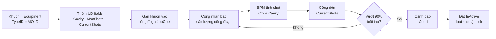

# 9100 Triển khai Epicor: đếm số shot của khuôn

> **Bài này là case study triển khai cụ thể trên Epicor 10.2**, không phải nguyên lý chung. Nguyên lý tính năng lực (máy, người, ca kíp, hiệu suất) nằm ở [Work Center & năng lực](../ky-thuat/1000-work-center-va-nang-luc.md); cách khai công đoạn và gán tài nguyên vào routing ở [Routing & công đoạn](../ky-thuat/3000-routing-va-cong-doan.md). Nếu bạn không dùng Epicor, đọc hai bài kia là đủ.

Khuôn ép nhựa có tuổi thọ tính bằng **số lần ép (shot)**, không phải số sản phẩm. Một khuôn 4 lòng ép 1 lần ra 4 sản phẩm — nên khuôn 50.000 shot làm ra 200.000 sản phẩm. Đếm sai đơn vị này thì hoặc khuôn gãy sớm, hoặc thay khuôn lãng phí.

Epicor chuẩn không tính shot. Bài này mô tả cách triển khai nó bằng cấu hình có sẵn và BPM.

## 0. Nguyên lý (áp dụng mọi ERP)

1. **Khuôn là thiết bị cần bảo trì, không phải resource năng lực.** Epicor, SAP, Odoo đều xếp nó vào phân hệ bảo trì — vì câu hỏi chính là "còn bao nhiêu shot trước khi phải bảo dưỡng", không phải "còn rảnh mấy giờ".
2. **Khuôn là ràng buộc thứ hai khi lập lịch.** Máy rảnh chưa đủ để chạy — phải có khuôn cùng rảnh. Lịch chỉ xếp được vào **vùng giao thoa** khi cả máy và khuôn cùng khả dụng.

```mermaid
gantt
    title Vùng giao thoa — máy và khuôn cùng rảnh
    dateFormat  HH:mm
    axisFormat  %H:%M

    section Máy ép 01
    Rảnh từ 08:00           :active, m1, 08:00, 4h

    section Khuôn A
    Đang chạy Job 10         :crit, t1, 08:00, 90m
    Rảnh từ 09:30           :active, t2, 09:30, 150m

    section Job 11
    Xếp lịch tại 09:30      :milestone, m2, 09:30, 0m
```

Máy rảnh suốt từ 08:00, nhưng Job 11 chỉ xếp được từ **09:30** — khi khuôn A xong Job 10. Bỏ qua ràng buộc này, kế hoạch sẽ xếp hai Job cùng dùng một khuôn vào cùng giờ.

3. **Đơn vị đếm là shot, không phải sản phẩm.** Phải quy đổi qua **số lòng khuôn**. Bỏ qua bước này là sai theo bội số.

   $$\text{Shot} = \frac{\text{Sản lượng hoàn thành}}{\text{Số lòng khuôn}}$$

4. **Đếm theo công đoạn, không theo lệnh sản xuất.** Một lệnh chạy qua nhiều công đoạn, mỗi công đoạn có thể dùng một bộ khuôn khác nhau. Cộng dồn ở cấp lệnh sẽ gán nhầm shot cho khuôn.
5. **Cộng dồn phải idempotent.** Công nhân báo sản lượng nhiều lần cho cùng một công đoạn, hoặc báo rồi huỷ — nếu không chống trùng, số shot tăng nhiều hơn thực tế.
6. **Khuôn đang bảo trì phải bị loại khỏi lập lịch tự động.** Không có ràng buộc này, bộ phận kế hoạch sẽ xếp lệnh vào khuôn đang nằm ở xưởng sửa.

## 1. Luồng vận hành



## 2. Ai làm gì ở module nào

| Việc | Kỹ thuật sản xuất | Bảo trì (Cơ điện) | Kế hoạch sản xuất | IT / Epicor Admin |
|---|---|---|---|---|
| Tạo mã Equipment cho khuôn | ✅ đề xuất | ✅ sở hữu hồ sơ thiết bị | — | — |
| Khai `Cavity`, `MaxShots` | ✅ sở hữu thông số kỹ thuật | Nhận bàn giao | — | Cấu hình UD fields |
| Gán khuôn vào công đoạn | ✅ sở hữu (routing) | — | ✅ thực hiện trên Job | Viết BPM tự gán |
| Báo sản lượng công đoạn | — | — | Tổ trưởng báo cáo | Viết BPM đếm shot |
| Kiểm tra tuổi thọ định kỳ | Đọc báo cáo | ✅ sở hữu | — | Viết báo cáo |
| Đưa khuôn đi bảo trì | Thông báo | ✅ quyết định | — | Viết BPM khoá lịch |
| Chặn lập lịch khi bảo trì | — | ✅ đặt `InActive` | ✅ nhận cảnh báo | Cấu hình APS |

## 3. Hạch toán

Bài này không đụng tới bút toán — nó chỉ tạo và duy trì **dữ liệu tuổi thọ tài sản**. Hệ quả tài chính gián tiếp: chi phí thay khuôn phải được dự báo trước, và nếu khuôn gãy giữa ca thì chi phí phế phẩm tăng đột biến.

Nếu doanh nghiệp quản lý khuôn như tài sản cố định, xem [Tài sản cố định](../../6-ke-toan-chung/3000-thue-va-tai-san-co-dinh.md).

## 4. Điểm chạm & rủi ro

- **Nguyên lý năng lực và khuôn gá**: [Work Center & năng lực](../ky-thuat/1000-work-center-va-nang-luc.md)
- **Công đoạn và gán resource**: [Routing & công đoạn](../ky-thuat/3000-routing-va-cong-doan.md)
- **Báo cáo sản lượng công đoạn**: [Lệnh sản xuất & WIP](./6000-lenh-san-xuat-va-wip.md)
- **Chặn lập lịch**: [Lệnh sản xuất & WIP](./6000-lenh-san-xuat-va-wip.md)

**Rủi ro chính:**

- **Đếm theo sản phẩm thay vì shot** — khuôn 4 lòng bị đếm gấp 4 lần, thay sớm lãng phí.
- **Cộng dồn ở cấp lệnh** — khuôn của công đoạn 1 bị cộng shot của công đoạn 3.
- **Không chống trùng** — báo sản lượng nhiều lần làm shot tăng sai.
- **`JobOper.PartNum` trống sau GetDetails** — BPM không biết khuôn nào chạy ở công đoạn nào.
- **Không khoá lịch khi bảo trì** — xếp lệnh vào khuôn đang sửa, trễ cả đơn hàng.

## 5. Triển khai Epicor 10.2

### A. Bảng và trường sử dụng

Kiểm chứng theo schema Epicor 10.2.400:

| Bảng | Trường | Ghi chú |
|---|---|---|
| `Erp.Equip` | `EquipID`, `Description`, `TypeID`, `InActive`, `SysRowID` | `TypeID = 'MOLD'` để lọc khuôn. **`InActive`** là cờ đảo nghĩa (1 = ngưng dùng) |
| `Erp.Equip_UD` | `Cavity_c`, `MaxShots_c`, `CurrentShots_c` | Bảng UD do doanh nghiệp tự tạo, khóa ngoại `ForeignSysRowID` → `Equip.SysRowID` |
| `Erp.JobOper` | `JobNum`, `AssemblySeq`, `OprSeq`, `OpCode`, `QtyCompleted`, `PartNum` | `PartNum` **có tồn tại** nhưng có thể trống sau `GetDetails` |
| `Erp.JobAsmbl` | `JobNum`, `AssemblySeq`, `PartNum` | Nguồn để tra `PartNum` còn thiếu |
| `Erp.LaborDtl` | `JobNum`, `OprSeq`, `OpCode`, `LaborQty` | Nguồn báo sản lượng theo công đoạn |
| `Erp.JobHead` | `JobNum`, `ProdQty`, `JobComplete`, `JobClosed` | Tổng sản lượng của cả lệnh |

> **Lưu ý về `InActive`:** tên trường là `InActive` (bit) — giá trị `1` nghĩa là **ngưng sử dụng**. Đây là điểm dễ viết ngược điều kiện nhất khi viết BPM hoặc báo cáo.

### B. Bước 1 — Tạo mã khuôn như Equipment

1. `Production Management > Maintenance Management > Setup > Equipment` → tạo bản ghi mới.
2. Điền `EquipID` (ví dụ `MOLD-PLASTIC-01`), `Description`, `TypeID = 'MOLD'`.
3. Vào `Extended Properties` của bảng `Equip_UD`, tạo ba trường:
   - `Cavity_c` — kiểu Decimal, số lòng khuôn.
   - `MaxShots_c` — kiểu Decimal, tuổi thọ thiết kế.
   - `CurrentShots_c` — kiểu Decimal, số shot tích lũy, mặc định 0.
4. Nhập giá trị ban đầu trên form Equipment.

### C. Bước 2 — Tự gán mã khuôn vào công đoạn

**Vấn đề:** khi chạy `GetDetails` từ `AssemblySeq`, các dòng `JobOper` được sinh ra nhưng trường `PartNum` (và các trường tùy biến như `ShortChar01` dùng làm `MoldingCode`) không được set.

**Giải pháp — BPM Data Directive trên `JobOper`:**

1. Tạo Data Directive cho bảng `Erp.JobOper`, loại **In-Transaction**, điều kiện: dòng vừa được thêm (`ttJobOper` với `RowMod = 'A'`) và `OpCode == "INJ"`.
2. Thêm khối **Set Field** với giá trị lấy từ LINQ:

```csharp
Db.JobAsmbl.With(LockHint.NoLock)
  .Where(a => a.Company  == ttJobOperRow.Company
           && a.JobNum   == ttJobOperRow.JobNum
           && a.AssemblySeq == ttJobOperRow.AssemblySeq)
  .Select(a => a.PartNum)
  .FirstOrDefault() ?? ""
```

3. Gán giá trị đó vào `ttJobOperRow["ShortChar01"]` (trường hiển thị là `MoldingCode (Equip)`).
4. Đặt **Enable / Disable** để BPM chỉ chạy khi `RowMod = 'A'`, tránh ghi đè khi người dùng sửa tay.

> Ưu tiên khối `Set Field` với LINQ thay vì `Execute Custom Code (C#)` — cách sau duyệt toàn bộ `JobOper` của lệnh, tốn tài nguyên và khó giới hạn phạm vi.

**Minh họa các bước cấu hình và kết quả**

*Bước 1 — BPM Data Directive thiết lập trên `JobOper`, và chi tiết điều kiện/hành động:*

<div align="center">
  
</div>
<div align="center">
  
</div>
*Bước 2 — Vấn đề: sau khi chạy `GetDetails` từ `AssemblySeq`, các dòng `JobOper` có `OpCode = "INJ"` vẫn không được set mã khuôn:*

<div align="center">
  
</div>
*Bước 3 — Debug: kiểm tra BPM có duyệt qua `JobAsmbl` để lấy dữ liệu Assembly hay không:*

<div align="center">
  
</div>
<div align="center">
  
</div>
*Bước 4 — Giải pháp: LINQ Query lấy `PartNum` từ `JobAsmbl` theo đúng `AssemblySeq`:*

<div align="center">
  
</div>
*Bước 5 — Gán `PartNum` vừa tra được xuống `MoldingCode (Equip)` của dòng `JobOper` có `OpCode = "INJ"`:*

<div align="center">
  
</div>
*Bước 6 — Kết quả: `MoldingCode (Equip)` trên `JobOper` đã được set đúng theo Assembly tương ứng, kiểm tra trên nhiều dòng khác nhau:*

<div align="center">
  
</div>
<div align="center">
  
</div>
<div align="center" style={{fontSize: '0.9em', color: 'var(--ifm-color-emphasis-700)'}}>
  Nguồn ảnh: <a href="https://www.epiusers.help/t/how-to-default-value-in-all-joboper-with-opcode-inj-when-executing-getdetails-method-in-assemblyseq-0-for-all-erp-jobentry-getdetails/105966" target="_blank" rel="noopener noreferrer">Epicor User Help Forum</a>
</div>
### D. Bước 3 — BPM đếm shot theo công đoạn

**Kích hoạt:** Data Directive trên `Erp.LaborDtl`, sự kiện **In-Transaction sau khi thêm dòng** (`RowMod = 'A'`) — không đợi đóng lệnh, để shot được tính theo thời gian thực.

**Logic:**

1. Nếu `LaborDtl.OpCode` không phải công đoạn dùng khuôn → thoát.
2. Tra `JobOper` tương ứng (`JobNum + AssemblySeq + OprSeq`) để lấy mã khuôn từ `ShortChar01`.
3. Tra `Equip_UD` theo `EquipID` để lấy `Cavity_c`.
4. Tính và cộng dồn:

```csharp
decimal cavity   = /* Equip_UD.Cavity_c */;
decimal qtyDelta = ttLaborDtlRow.LaborQty;
decimal shotDelta = cavity > 0 ? Math.Round(qtyDelta / cavity, 2) : 0;
// CurrentShots_c += shotDelta  (qua baqUpdate hoặc Set Field trên Equip_UD)
```

5. Nếu `CurrentShots_c > MaxShots_c × 0.9` → gửi cảnh báo cho bộ phận bảo trì.

**Chống cộng dồn trùng** — bảng phụ `Equip_Shot_Log` ghi `(LaborDtl.SysRowID, EquipmentID, ShotDelta)`, có khóa duy nhất trên `LaborDtl.SysRowID`. Nếu đã có dòng → bỏ qua. Đây là điều kiện bắt buộc vì công nhân có thể sửa hoặc huỷ báo cáo.

### E. Bước 4 — Chặn lập lịch khi khuôn đang bảo trì

1. Khi mở Maintenance Request/Job cho khuôn, BPM Data Directive trên bảng thiết bị đặt `Equip.InActive = 1`.
2. Khi đóng yêu cầu bảo trì → đặt `InActive = 0`.
3. Bộ lập lịch và các BAQ kiểm tra năng lực cần **lọc `InActive = 0`** — nếu báo cáo không lọc, khuôn đang sửa vẫn hiện là khả dụng.

### F. Truy vấn kiểm soát

**Tuổi thọ khuôn và tỷ lệ hao mòn:**

```sql
SELECT eq.Company, eq.EquipID AS Mold_Code, eq.Description AS Mold_Name,
       eq.TypeID AS Equipment_Type,
       equd.Cavity_c      AS Cavity_Count,
       equd.MaxShots_c    AS Max_Shots,
       equd.CurrentShots_c AS Current_Shots,
       equd.MaxShots_c - equd.CurrentShots_c AS Remaining_Shots,
       CASE WHEN equd.MaxShots_c > 0
            THEN ROUND(CAST(equd.CurrentShots_c AS FLOAT) * 100 / equd.MaxShots_c, 2)
            ELSE 0 END AS Wear_Pct,
       CASE WHEN equd.CurrentShots_c >= equd.MaxShots_c THEN 'QUA_HAN - KHOA_LICH'
            WHEN equd.CurrentShots_c >= equd.MaxShots_c * 0.9 THEN 'CANH_BAO - CAN_BAO_TRI'
            ELSE 'AN_TOAN' END AS Health_Status
FROM Erp.Equip eq
LEFT JOIN Erp.Equip_UD equd ON equd.ForeignSysRowID = eq.SysRowID
WHERE eq.Company = 'YOUR_COMPANY_CODE'
  AND eq.TypeID IN ('MOLD', 'TOOL', 'JIG')
  AND eq.InActive = 0            -- 0 = còn hoạt động (InActive là cờ ĐẢO)
ORDER BY Wear_Pct DESC;
```

**Khuôn đang bảo trì nhưng vẫn được gán vào lệnh mở — nguy cơ xếp lịch sai:**

```sql
SELECT DISTINCT jo.JobNum, jo.OprSeq, jo.OpCode,
       jo.ShortChar01 AS Mold_Code, eq.InActive
FROM Erp.JobOper jo
JOIN Erp.Equip eq ON eq.Company = jo.Company AND eq.EquipID = jo.ShortChar01
WHERE jo.Company = 'YOUR_COMPANY_CODE'
  AND jo.JobComplete = 0
  AND eq.InActive = 1            -- 1 = đang ngưng/bảo trì
ORDER BY jo.JobNum, jo.OprSeq;
```

**Công đoạn ép nhựa chưa được gán khuôn — BPM chưa chạy hoặc bị bỏ qua:**

```sql
SELECT jo.JobNum, jo.AssemblySeq, jo.OprSeq, jo.OpCode,
       jo.PartNum, jo.ShortChar01 AS Mold_Code
FROM Erp.JobOper jo
WHERE jo.Company = 'YOUR_COMPANY_CODE'
  AND jo.OpCode = 'INJ'
  AND jo.JobComplete = 0
  AND (jo.ShortChar01 IS NULL OR jo.ShortChar01 = '');
```

**Đối chiếu tổng shot đã đếm với tổng sản lượng báo cáo — phát hiện cộng dồn sai:**

```sql
SELECT ld.OpCode,
       SUM(ld.LaborQty) AS Tong_San_Luong,
       SUM(el.ShotDelta) AS Tong_Shot_Da_Cong
FROM Erp.LaborDtl ld
LEFT JOIN Equip_Shot_Log el ON el.LaborDtl_SysRowID = ld.SysRowID
WHERE ld.Company = 'YOUR_COMPANY_CODE'
  AND ld.TranDate >= DATEADD(MONTH, -3, GETDATE())
GROUP BY ld.OpCode
ORDER BY ld.OpCode;
```

### F. Đối chiếu cách tiếp cận ở các hệ thống khác

Cùng một bài toán "quản tuổi thọ khuôn", mỗi hệ thống đặt khuôn ở một nơi khác nhau — điều này quan trọng khi bạn chuyển đổi hoặc so sánh:

| | Oracle EBS | Epicor | SAP S/4HANA | Odoo |
|---|---|---|---|---|
| **Bản chất khuôn** | Resource đặc biệt (`BOM_RESOURCES`) | Equipment (`Erp.Equip`) | PRT (`CRFH`) | Equipment (`maintenance.equipment`) |
| **Gán vào công đoạn** | `BOM_OPERATION_RESOURCES` | `JobOpDtl` / `JobOpOpr` | `AFFH` | Gắn vào work center |
| **Đơn vị đếm tuổi thọ** | Không có sẵn — dùng EAM | UD field (`CurrentShots_c`) | Measuring Point (`S061`/`S062`) | `maintenance.request` |
| **Chặn khi hết tuổi thọ** | Đưa Capacity Units = 0 | BPM đặt `InActive = 1` | System Status `INAC`/`MSPT` | Trạng thái thiết bị |

**Oracle EBS — liệt kê khuôn đang gán vào công đoạn:**

```sql
SELECT ood.organization_code AS Org_Code,
       msib.segment1         AS Assembly_Item,
       bos.operation_seq_num AS Op_Seq,
       bd.department_code    AS Dept_Code,
       br.resource_code      AS Tooling_Code,
       br.description        AS Tooling_Desc,
       bor.assigned_units    AS Required_Units
FROM apps.bom_operation_resources bor
JOIN apps.bom_resources br             ON bor.resource_id = br.resource_id
JOIN apps.bom_operation_sequences bos  ON bor.operation_sequence_id = bos.operation_sequence_id
JOIN apps.bom_operational_routings broute ON bos.routing_sequence_id = broute.routing_sequence_id
JOIN apps.mtl_system_items_b msib      ON broute.assembly_item_id = msib.inventory_item_id
                                      AND broute.organization_id = msib.organization_id
JOIN apps.bom_departments bd           ON bos.department_id = bd.department_id
JOIN apps.org_organization_definitions ood ON broute.organization_id = ood.organization_id
WHERE (br.resource_code LIKE 'MOLD%' OR br.resource_code LIKE 'TOOL%')
  AND ood.organization_code = 'YOUR_ORG'
ORDER BY msib.segment1, bos.operation_seq_num;
```

**SAP S/4HANA — khuôn (PRT) đang gán vào lệnh sản xuất nào:**

```sql
SELECT f.MANDT   AS Client,
       f.AUFNR   AS Production_Order,
       f.VORNR   AS Operation,
       p.FHMNR   AS PRT_Equipment_ID,
       p.TXT01   AS PRT_Description
FROM saphanadb.AFFH f
JOIN saphanadb.CRFH p ON f.OBJTY = p.OBJTY AND f.OBJID = p.OBJID
WHERE f.MANDT = '100'
ORDER BY f.AUFNR, f.VORNR;
```

**Odoo — khuôn/đồ gá gắn với work center và lịch bảo trì:**

```sql
SELECT eq.name        AS Tool_Name,
       eq.serial_no   AS Tag_Number,
       wc.name        AS Work_Center,
       eq.next_action_date AS Next_Maintenance
FROM maintenance_equipment eq
LEFT JOIN mrp_workcenter wc ON eq.workcenter_id = wc.id
WHERE eq.active = true
  AND (eq.name ILIKE '%mold%' OR eq.name ILIKE '%khuôn%' OR eq.name ILIKE '%jig%')
ORDER BY eq.next_action_date ASC;
```

## 6. Bẫy thực chiến & Checklist

| # | Bẫy | Triệu chứng | Cách phòng tránh |
|---|---|---|---|
| 1 | Đếm shot bằng sản lượng | Khuôn 4 lòng bị đếm gấp 4 lần, thay sớm | Luôn chia cho `Cavity_c` |
| 2 | Cộng dồn ở cấp Job | Khuôn công đoạn 1 nhận shot của công đoạn 3 | Đếm ở cấp `LaborDtl` theo `OprSeq` |
| 3 | Không chống cộng dồn trùng | Shot tăng nhiều hơn thực tế khi sửa/huỷ báo cáo | Bảng log có khóa duy nhất trên `LaborDtl.SysRowID` |
| 4 | Dùng `Active` thay `InActive` | Điều kiện viết ngược, khuôn bảo trì vẫn lập lịch | Trường thật là `InActive` (1 = ngưng) |
| 5 | Dùng `EquipTypeID` thay `TypeID` | SQL lỗi "invalid column" | Trường thật là `TypeID` |
| 6 | `JobOper.PartNum` trống sau GetDetails | BPM không xác định được khuôn cho công đoạn | BPM tra ngược `JobAsmbl` theo `AssemblySeq` |
| 7 | `Execute Custom Code` duyệt toàn bộ JobOper | Chậm khi lệnh nhiều công đoạn | Dùng `Set Field` + LINQ, giới hạn theo dòng vừa thêm |
| 8 | Không lọc `InActive` trong BAQ năng lực | Khuôn đang sửa vẫn hiện là khả dụng | Mọi BAQ năng lực phải có `InActive = 0` |
| 9 | Đặt ngưỡng cảnh báo 100% | Khuôn gãy trước khi kịp bảo trì | Cảnh báo ở 90%, khoá ở 100% |
| 10 | Không có báo cáo đối chiếu shot | Cộng dồn sai tích lũy nhiều tháng | Báo cáo đối chiếu `LaborDtl` vs `Equip_Shot_Log` hàng tháng |

**Checklist trước go-live:**

- [ ] Đã tạo `Equip_UD` với ba trường `Cavity_c`, `MaxShots_c`, `CurrentShots_c` (đã test lưu/đọc).
- [ ] Khuôn có `TypeID` riêng (`MOLD`/`TOOL`/`JIG`) để lọc báo cáo.
- [ ] BPM gán khuôn vào `JobOper` chạy đúng khi `GetDetails` (đã test lệnh nhiều Assembly).
- [ ] BPM không ghi đè khi người dùng sửa tay (chỉ chạy `RowMod = 'A'`).
- [ ] Không có dòng `OpCode = 'INJ'` nào thiếu mã khuôn (đã chạy truy vấn, 0 dòng).
- [ ] BPM đếm shot chạy theo `LaborDtl`, có bảng log chống trùng (đã test báo cáo hai lần).
- [ ] Đã test chia `Cavity_c` đúng với khuôn nhiều lòng.
- [ ] Cảnh báo 90% và khoá 100% (đã test ngưỡng).
- [ ] Đặt `InActive = 1` khi mở bảo trì, `= 0` khi đóng (đã test vòng đời).
- [ ] Mọi BAQ/báo cáo năng lực lọc `InActive = 0`.
- [ ] Có báo cáo đối chiếu `LaborDtl` vs `Equip_Shot_Log` hàng tháng.

## Xem thêm

- [Work Center & năng lực](../ky-thuat/1000-work-center-va-nang-luc.md)
- [Routing & công đoạn](../ky-thuat/3000-routing-va-cong-doan.md)
- [Lệnh sản xuất & WIP](./6000-lenh-san-xuat-va-wip.md)
- [Bẫy thực chiến sản xuất](../9000-bay-san-xuat.md)

<div align="center" style={{color: 'var(--ifm-color-primary)'}}>
  <strong>Chúc các bạn thành công và vui vẻ!</strong>
</div>
