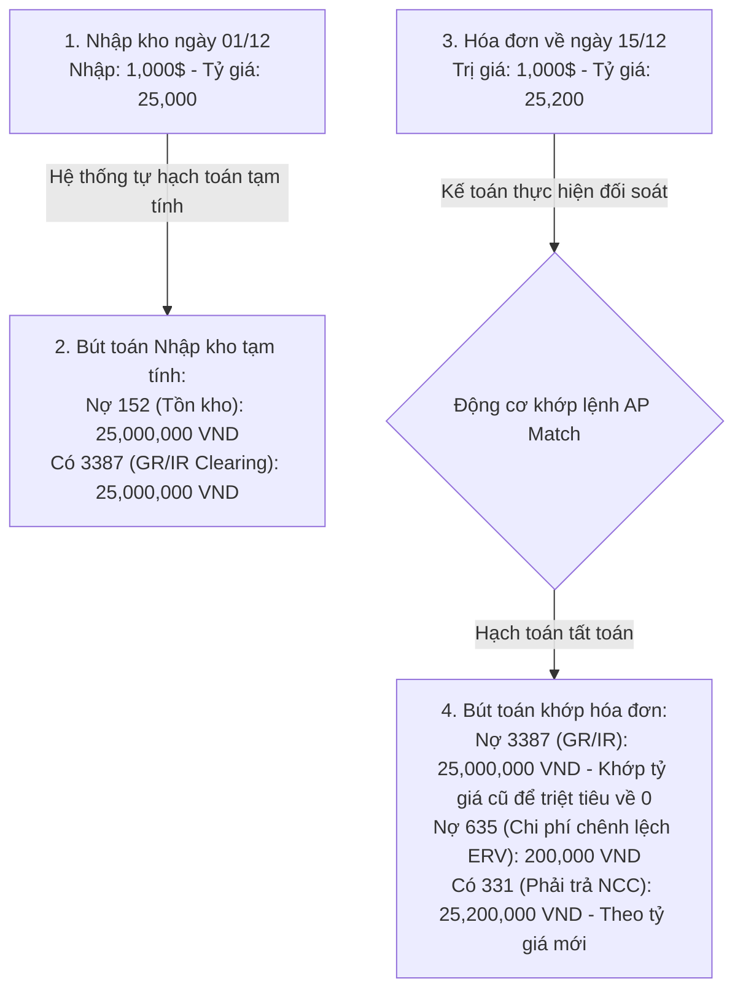

# 4040 Chênh lệch tỷ giá mua hàng đa tiền tệ (ERV)

Trong các doanh nghiệp có hoạt động mua sắm quốc tế đa tiền tệ, việc quản lý chênh lệch tỷ giá phát sinh trong kỳ mua sắm (Exchange Rate Variance - ERV) là một nghiệp vụ bắt buộc. ERV giải quyết sự biến động tỷ giá ngoại tệ phát sinh giữa hai mốc thời gian: thời điểm nhận hàng vật lý vào kho (Receipt Date) và thời điểm nhận hóa đơn của nhà cung cấp để khớp công nợ (AP Invoice Match Date). Nếu không xử lý chuẩn xác, tài khoản trung gian hạch toán kho (GR/IR) sẽ tích lũy số dư chênh lệch ngoại tệ vĩnh viễn trên Sổ cái kế toán.

---

## 1. Phân biệt rõ rệt giữa ERV và CLTG thanh toán thông thường

Nhiều lập trình viên và kế toán thường nhầm lẫn giữa hai loại chênh lệch tỷ giá này:

*   **Chênh lệch tỷ giá mua hàng (Exchange Rate Variance - ERV):** Phát sinh giữa **Ngày nhận hàng (Receipt)** và **Ngày nhận hóa đơn (Invoice)**. ERV giải quyết chênh lệch giá trị tài sản kho tạm tính và giá trị công nợ chính thức ghi nhận.
*   **Chênh lệch tỷ giá thanh toán (Realized/Unrealized FX Gain/Loss):** Phát sinh giữa **Ngày nhận hóa đơn (Invoice)** và **Ngày chi tiền thanh toán (Payment)**, hoặc do đánh giá lại số dư ngoại tệ cuối kỳ kế toán.

---

## 2. Quy trình xử lý hạch toán và triệt tiêu số dư GR/IR thông qua ERV

Dưới đây là sơ đồ luồng dữ liệu mô tả cách hệ thống ERP triệt tiêu hoàn toàn số dư tài khoản trung gian nhận hàng chưa có hóa đơn (GR/IR) khi có sự biến động tỷ giá ngoại tệ giữa hai thời điểm:



---

## 3. Điểm giao thoa & Tham chiếu chéo (Cross-linking) sang các phân hệ khác

*   **Định nghĩa tiền tệ giao dịch:** Loại ngoại tệ của đơn hàng được thiết lập ban đầu tại bài [4000 Khởi tạo Đơn mua hàng tiêu chuẩn (Standard PO)]().
*   **Căn cứ lấy tỷ giá nhận hàng:** Tỷ giá hạch toán ban đầu được xác định tại ngày thực hiện giao dịch tại bài [5010 Nhận hàng mua và Kiểm tra chất lượng (Receiving & IQC)]().
*   **Đối soát khớp lệnh AP:** Giao dịch tính toán ERV tự động kích hoạt khi kế toán chạy chương trình khớp hóa đơn tại bài [7000 Đối soát khớp lệnh 3 chiều và 2 chiều (PO Matching)]().
*   **Xử lý sai lệch hóa đơn:** ERV hoạt động song hành cùng động cơ xử lý sai lệch đơn giá và số lượng tại bài [7010 Xử lý chênh lệch giá/số lượng trên hóa đơn và quy trình mở khóa thanh toán (Invoice Variance & Block/Release)]().

---

## 4. Bảng so sánh và Ánh xạ giải pháp giữa các hệ thống

Khi chuyển đổi giữa các hệ thống ERP hoặc tự thiết kế hệ thống (In-house), bạn có thể dễ dàng ánh xạ các tính năng tương đương dựa trên bảng sau:

| Nghiệp vụ thiết kế | Oracle EBS R12.2.10 | Epicor ERP | SAP S/4HANA | Odoo | Hệ thống tự xây (In-house) |
| :--- | :--- | :--- | :--- | :--- | :--- |
| **Hạch toán chênh lệch** | ERV Account (cấu hình tại SLA / Purchasing Options) | AP Invoice Exchange Rate Gain/Loss | Price Difference / Exchange Rate (KDM Key) | Currency Exchange Gain/Loss | Tự động kết chuyển chênh lệch tỷ giá mua vào tài khoản chi phí |
| **Tỷ giá nhận hàng** | Receipt Exchange Rate (lưu tại rcv_transactions) | PO Exchange Rate | Goods Receipt exchange rate | Receipt-date currency rate | Trường lưu trữ tỷ giá thực tế tại bảng nhận kho |
| **Tỷ giá hóa đơn** | Invoice Exchange Rate (lưu tại ap_invoices) | Invoice-date Exchange Rate | Invoice-date Exchange Rate | Vendor Bill Currency Rate | Trường tỷ giá tại bảng hóa đơn đầu vào |

---

## 5. Hướng dẫn luồng thiết lập (Setup Flow) chi tiết trên hệ thống

### A. Trên Oracle EBS R12.2.10 (Exchange Rate Variance - ERV)

1.  **Cấu hình tài khoản ERV mặc định:**
    *   *Đường dẫn:* `Purchasing Super User > Setup > Organizations > Financial Options`
    *   *Nghiệp vụ:* Tại thuộc tính `Exchange Rate Variance Account`, khai báo mã tài khoản kế toán ghi nhận chênh lệch tỷ giá mua sắm (ví dụ: Tài khoản `635` - Chi phí tài chính hoặc tài khoản chênh lệch giá vốn tương ứng).
2.  **Vận hành tự động hạch toán ERV:**
    *   *Nghiệp vụ:* Khi kế toán AP thực hiện đối soát hóa đơn ngoại tệ (Match) tại bài [7000 Đối soát khớp lệnh 3 chiều và 2 chiều (PO Matching)](), hệ thống đối chiếu tỷ giá giữa `rcv_transactions` và `ap_invoices_all`. Nếu có chênh lệch, Oracle Subledger Accounting (SLA) tự động tách riêng phần chênh lệch tỷ giá để hạch toán vào tài khoản ERV đã cấu hình ở Bước 1.

### B. Trên Epicor ERP (Multi-Currency AP Invoice)

1.  **Thiết lập tỷ giá tiền tệ hàng ngày:**
    *   *Đường dẫn:* `Financial Management > Currency Management > Setup > Currency Rate Maintenance`
    *   *Nghiệp vụ:* Đảm bảo cập nhật đầy đủ tỷ giá ngoại tệ hàng ngày trước khi thực hiện hạch toán chứng từ.
2.  **Đối chiếu chênh lệch tỷ giá khi nhập hóa đơn AP:**
    *   *Nghiệp vụ:* Khi làm phiếu `AP Invoice Entry` khớp với `Receipt Lines`, Epicor tự động so sánh tỷ giá của đơn PO gốc với tỷ giá của hóa đơn hiện tại. Hệ thống tự động kết chuyển phần chênh lệch tỷ giá mua hàng này vào tài khoản chênh lệch tỷ giá mặc định khi Post Group hóa đơn.

---

## 6. Truy vấn SQL đối soát cấu trúc tổ chức (SQL Database Audit Queries)

### A. Cho Oracle EBS R12.2.10

Query dưới đây truy xuất toàn bộ các dòng hạch toán chênh lệch tỷ giá mua hàng (ERV) phát sinh từ các hóa đơn AP ngoại tệ đã đối soát, hiển thị rõ số tiền chênh lệch quy đổi bằng đồng tiền VND và tài khoản kế toán gán kèm:

```sql
SELECT 
    hou.name                      AS operating_unit,
    aia.invoice_num               AS ap_invoice_number,
    aia.invoice_date              AS invoice_date,
    aia.invoice_currency_code     AS invoice_currency,
    pha.segment1                  AS po_number,
    msib.segment1                 AS item_code,
    -- Hạch toán dòng tiền chênh lệch ERV quy đổi bằng tiền tệ chức năng (VND)
    aida.amount                   AS functional_erv_amount, 
    gcc.segment1 || '.' || gcc.segment2 || '.' || gcc.segment3 AS erv_gl_account,
    rsh.receipt_num               AS receipt_number,
    rt.transaction_date           AS receipt_date
FROM 
    ap_invoice_distributions_all aida
INNER JOIN 
    ap_invoices_all aia ON aida.invoice_id = aia.invoice_id
INNER JOIN 
    ap_suppliers aps ON aia.vendor_id = aps.vendor_id
INNER JOIN 
    hr_operating_units hou ON aia.org_id = hou.organization_id
INNER JOIN 
    gl_code_combinations gcc ON aida.dist_code_combination_id = gcc.code_combination_id
LEFT JOIN 
    po_distributions_all pod ON aida.po_distribution_id = pod.po_distribution_id
LEFT JOIN 
    po_headers_all pha ON pod.po_header_id = pha.po_header_id
LEFT JOIN 
    po_lines_all pla ON pod.po_line_id = pla.po_line_id
LEFT JOIN 
    rcv_transactions rt ON aida.rcv_transaction_id = rt.transaction_id
LEFT JOIN 
    rcv_shipment_headers rsh ON rt.shipment_header_id = rsh.shipment_header_id
LEFT JOIN 
    mtl_system_items_b msib ON pla.item_id = msib.inventory_item_id 
                            AND msib.organization_id = rt.organization_id
WHERE 
    aida.line_type_lookup_code = 'ERV' -- Chỉ lọc các dòng phân bổ chênh lệch tỷ giá mua hàng ERV
ORDER BY 
    aia.invoice_date DESC;
```

### B. Cho Epicor ERP (Truy vấn cơ sở dữ liệu SQL Server)

Query dưới đây kết xuất danh sách toàn bộ các hóa đơn AP ngoại tệ trong Epicor có phát sinh sai lệch tỷ giá so với tỷ giá đơn PO gốc, phục vụ công tác kiểm toán tài chính:

```sql
SELECT 
    ah.Company,
    ah.InvoiceNum                 AS AP_Invoice_Number,
    ah.InvoiceDate                AS Invoice_Date,
    v.VendorID                    AS Vendor_Code,
    v.Name                        AS Vendor_Name,
    ah.PONum                      AS PO_Number,
    ph.ExchangeRate               AS PO_Exchange_Rate,
    ah.ExchangeRate               AS Invoice_Exchange_Rate,
    -- Tính toán giá trị ước tính chênh lệch tỷ giá mua hàng ERV
    (ah.DocInvoiceAmt * (ah.ExchangeRate - ph.ExchangeRate)) AS Estimated_ERV_Amount
FROM 
    Erp.APInvHed ah
INNER JOIN 
    Erp.POHeader ph ON ah.Company = ph.Company AND ah.PONum = ph.PONum
INNER JOIN 
    Erp.Vendor v ON ah.Company = v.Company AND ah.VendorNum = v.VendorNum
WHERE 
    ah.Company = 'YOUR_COMPANY_CODE'
    AND ah.ExchangeRate <> ph.ExchangeRate -- Chỉ lấy các giao dịch có chênh lệch tỷ giá thực tế
ORDER BY 
    ah.InvoiceDate DESC;
```

> **Lưu ý:** Câu query Epicor trên chưa được đối chiếu với ảnh schema thực tế của `Erp.APInvHed`/`Erp.POHeader` — nếu bạn gửi ảnh, mình sẽ kiểm tra lại tên cột (`PONum` ở cấp header hóa đơn AP, `ExchangeRate` trên `POHeader`) trước khi chốt bản cuối.

---

## 7. Giải pháp khắc phục lỗi phổ biến & Cảnh báo cho Hệ thống tự xây (In-house)

Nếu đội ngũ của bạn đang tự phát triển mô-đun Đa tiền tệ và Hóa đơn phải trả, hãy đặc biệt chú ý các điểm thiết kế sau:

1.  **Bẫy lỗi treo số dư tài khoản trung gian GR/IR do lệch tỷ giá (Clearing Desync Pitfall):**
    *   *Triệu chứng:* Khi nhập kho tạm tính tỷ giá 25,000 (ghi Có tài khoản trung gian 3387 là 25,000,000 VND). Khi hóa đơn về tỷ giá 25,200, lập trình viên viết câu lệnh hạch toán tự động tất toán tài khoản trung gian bằng cách lấy số tiền đô nhân tỷ giá hóa đơn: `1,000$ * 25,200 = 25,200,000 VND` (ghi Nợ tài khoản 3387 là 25,200,000 VND). Việc này khiến tài khoản trung gian `3387` bị lệch dư Nợ 200,000 VND vĩnh viễn trên Sổ cái và không thể triệt tiêu về không.
    *   *Giải pháp khắc phục:* Trong thuật toán hạch toán AP Match, dòng tất toán tài khoản trung gian `3387` (GR/IR) bắt buộc phải được hạch toán **quy đổi ngược lại theo đúng tỷ giá gốc tại ngày nhập kho thực tế** (tức là ghi Nợ tài khoản 3387 đúng 25,000,000 VND). Phần chênh lệch 200,000 VND còn lại phải được hệ thống tự động tách ra và hạch toán vào tài khoản chi phí chênh lệch tỷ giá ERV riêng biệt (Tài khoản 635).
2.  **Lỗi tự ý thay đổi giá trị tài sản kho lịch sử:**
    *   *Triệu chứng:* Để xử lý chênh lệch tỷ giá 200,000 VND, lập trình viên viết logic tự động cập nhật (Update) tăng giá trị tồn kho của vật tư trong kho từ 25,000,000 VND lên 25,200,000 VND. Việc này vi phạm nghiêm trọng chuẩn mực kế toán và gây lỗi hệ thống nếu vật tư đó đã được xuất kho sản xuất hết từ trước.
    *   *Giải pháp:* Giá trị tồn kho đầu vào sau khi hoàn thành Deliver cất hàng lên kệ đã được khóa sổ. Mọi chênh lệch tỷ giá mua sắm phát sinh sau đó tại thời điểm hóa đơn về phải được kết chuyển thẳng vào tài khoản chi phí ERV của kỳ hiện tại, tuyệt đối không được ghi đè điều chỉnh ngược lại giá trị tồn kho lịch sử.
3.  **Lỗi khóa chết dòng PO ngoại tệ khi lệch tỷ giá:**
    *   *Triệu chứng:* Do tỷ giá thay đổi làm số tiền quy đổi nội tệ (VND) trên hóa đơn lệch so với số tiền tạm tính trên PO. Hệ thống tự xây hiểu nhầm đây là lỗi lệch giá mua (Price Variance) và tự động kích hoạt khóa hóa đơn (Hold), bắt bộ phận Buyer phải phê duyệt mở khóa thủ công rất phiền hà.
    *   *Giải pháp:* Động cơ đối soát hóa đơn phải thông minh phân tách: đối chiếu đơn giá là đối chiếu theo nguyên tệ (ví dụ: so khớp đơn giá đô USD), nếu đơn giá đô khớp nhau hoàn toàn thì hệ thống tự động giải phóng lỗi lệch giá, phần chênh lệch tỷ giá VND phát sinh sẽ được đưa thẳng vào luồng tự động hạch toán ERV mà không kích hoạt cờ khóa hóa đơn.

<p align="center" style={{color: 'var(--ifm-color-primary)'}}>
  <strong>Chúc các bạn thành công và vui vẻ!</strong>
</p>