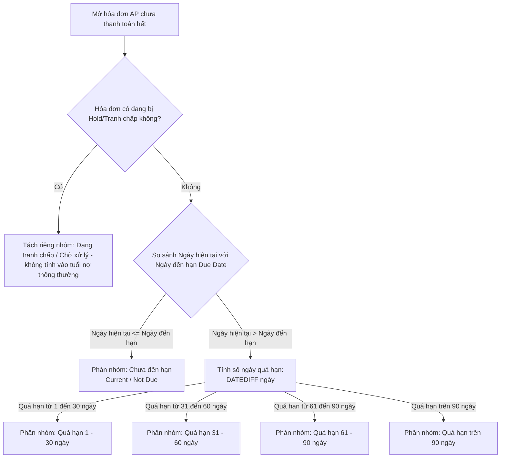

# 5010 Phân tích tuổi nợ phải trả (AP Aging Analysis)

Báo cáo phân tích tuổi nợ phải trả nhà cung cấp (AP Aging Analysis) là công cụ quản trị tài chính thiết yếu để kiểm soát dòng tiền chi ra và lập kế hoạch sử dụng vốn lưu động trong doanh nghiệp. Việc phân loại công nợ chưa thanh toán theo các khoảng thời gian quá hạn khác nhau giúp doanh nghiệp chủ động ưu tiên thanh toán cho các đối tác quan trọng, tối ưu hóa các khoản chiết khấu thanh toán sớm, và tránh rủi ro bị nhà cung cấp ngừng cung ứng vật tư do nợ quá hạn lâu ngày.

---

## 1. Bản chất nghiệp vụ & Cơ chế phân nhóm khoảng tuổi nợ (Aging Buckets)

### Vấn đề cốt lõi:
Một lỗi thiết kế phổ biến của các báo cáo tự xây (In-house) là **tính tuổi nợ dựa trên ngày hóa đơn (Invoice Date)**.
Ví dụ: Nhà cung cấp A áp dụng điều khoản thanh toán ngay (`Immediate`), nhà cung cấp B áp dụng điều khoản thanh toán sau 90 ngày (`Net 90`).
* Nếu hệ thống chỉ tính đơn giản: `Ngày hiện tại - Ngày hóa đơn` để phân nhóm tuổi nợ, thì hóa đơn của cả hai nhà cung cấp có cùng ngày phát hành 30 ngày trước sẽ đều bị xếp vào nhóm "Quá hạn 1 - 30 ngày".
* *Hậu quả:* Báo cáo này sai lệch hoàn toàn thực tế vận hành. Khoản nợ của nhà cung cấp B thực chất vẫn đang trong hạn thanh toán (còn 60 ngày nữa mới đến hạn), trong khi khoản nợ của nhà cung cấp A đã quá hạn thực tế 30 ngày.

### Giải pháp kiến trúc tính tuổi nợ chuẩn xác:
Hệ thống ERP tiêu chuẩn bắt buộc phải tính tuổi nợ dựa trên **Ngày đến hạn thanh toán (Due Date)**. Ngày đến hạn được tự động tính toán dựa trên ngày hóa đơn cộng thêm số ngày được hưởng ưu đãi nợ từ điều khoản thanh toán. Khoảng tuổi nợ (Aging Buckets) được phân chia như sau — lưu ý các mốc 30/60/90 ngày dưới đây chỉ là ví dụ minh họa mặc định, hệ thống nên cho phép cấu hình tùy chỉnh số lượng và độ rộng của từng khoảng theo chính sách tín dụng riêng của doanh nghiệp, không viết cố định trong mã nguồn:



### Tách biệt hóa đơn đang tranh chấp/bị khóa (Disputed & Held Invoices)

Một điểm dễ bị bỏ sót: hóa đơn đang bị khóa thanh toán do sai lệch giá/lượng (System Hold) hoặc đang chờ nhà cung cấp xuất Credit Memo điều chỉnh **không nên bị xếp chung vào nhóm quá hạn thông thường**. Về bản chất, đây là khoản nợ chưa được xác nhận là nợ thật sự (chưa "sạch" để thanh toán), khác hẳn với khoản nợ đã hợp lệ nhưng doanh nghiệp cố tình trì hoãn chi trả. Gộp chung hai loại này khiến báo cáo tuổi nợ đánh giá sai mức độ rủi ro quan hệ nhà cung cấp — một khoản bị Hold do lỗi kỹ thuật đối soát trông giống hệt một khoản nợ xấu do doanh nghiệp thiếu tiền mặt. Cần tách riêng một cột/nhóm "Đang tranh chấp - Disputed" trên báo cáo.

### Quy đổi đa tiền tệ khi tổng hợp tuổi nợ toàn tập đoàn

Tương tự vấn đề đã nêu ở báo cáo phân tích chi tiêu, nếu doanh nghiệp có hóa đơn phải trả bằng nhiều loại tiền tệ khác nhau (USD, EUR, VND), báo cáo tổng hợp tuổi nợ toàn công ty/tập đoàn không được cộng dồn trực tiếp số dư nợ theo nguyên tệ. Hệ thống cần quy đổi số dư còn lại của từng hóa đơn về đồng tiền tệ chức năng tại **tỷ giá của ngày chốt báo cáo (As-of Date)**, không phải tỷ giá tại ngày phát sinh hóa đơn — vì mục đích của báo cáo tuổi nợ là ước tính nghĩa vụ chi tiền thực tế tại thời điểm hiện tại, khác với mục đích hạch toán ban đầu.

---

## 2. Bảng so sánh và Ánh xạ giải pháp giữa các hệ thống

Khi chuyển đổi giữa các hệ thống ERP hoặc tự thiết kế hệ thống (In-house), bạn có thể dễ dàng ánh xạ các tính năng tương đương dựa trên bảng sau:

| Nghiệp vụ thiết kế | Oracle EBS R12.2.10 | Epicor ERP | SAP S/4HANA | Odoo | Hệ thống tự xây (In-house) |
| :--- | :--- | :--- | :--- | :--- | :--- |
| **Báo cáo gốc** | AP Invoice Aging Report / Open Items | AP Aging Report | Accounts Payable Aging (S_ALR_87012085) | Aged Payables Dashboard | Báo cáo Sổ chi tiết công nợ phân tuổi nợ |
| **Căn cứ tính tuổi** | Due Date (dựa trên Payment Schedules) | Due Date (dựa trên APInvHed DueDate) | Net Due Date | Due Date | Trường ngày thanh toán đến hạn tính toán tự động |
| **Khấu trừ khoản treo** | Tự động trừ các khoản Prepayment / Credit Memo đã đối trừ | Khấu trừ số dư hóa đơn điều chỉnh có `DocInvoiceBal < 0` | Khấu trừ Open Credits | Khấu trừ tự động các outstanding debits | Thuật toán Sum trừ đi các khoản báo nợ chưa đối trừ |
| **Tách hóa đơn tranh chấp** | Lọc theo `Hold Status` trên `AP_HOLDS_ALL` | Lọc theo cờ `InvoiceOnHold` | Lọc theo Block Reason (Payment Block) | Lọc theo trạng thái `posted`/`to check` | Cột `Dispute_Status` riêng trên bảng hóa đơn |

---

## 3. Điểm giao thoa & Tham chiếu chéo (Cross-linking) sang các phân hệ khác

* **Danh mục đối tác:** Thông tin nhà cung cấp và điều khoản thanh toán mặc định được tham chiếu từ [2000 Quản lý hồ sơ nhà cung cấp (Supplier Master)]().
* **Chứng từ đầu vào của tuổi nợ:** Dữ liệu hóa đơn gốc phát sinh từ các đơn hàng PO đã hoàn thành đối soát tại bài 7000 Đối soát khớp lệnh 3 chiều và 2 chiều (PO Matching).
* **Tách hóa đơn đang tranh chấp:** Trạng thái khóa/mở khóa hóa đơn nêu ở Mục 1 được đồng bộ trực tiếp từ bài 7010 Xử lý chênh lệch hóa đơn và Mở khóa thanh toán (Invoice Variance & Block/Release).
* **Trừ khoản tạm ứng đang treo:** Số dư nợ thực tế hiển thị trên báo cáo tuổi nợ bắt buộc phải trừ đi các khoản tiền doanh nghiệp đã ứng trước cho nhà cung cấp tại bài [7020 Nghiệp vụ thanh toán tạm ứng và đối trừ hóa đơn nhà cung cấp (Prepayment AP)]() để phản ánh đúng nghĩa vụ nợ ròng cuối cùng.
* **Trừ khoản giấy báo nợ hoàn trả hàng:** Các giấy báo nợ phát sinh từ nghiệp vụ hoàn trả nhà cung cấp cũng cần được khấu trừ tương tự — tham chiếu bài 5020 Xử lý các tình huống giao hàng lỗi, thừa/thiếu số lượng và hoàn trả (Shortage, Over-delivery & Return to Vendor) trong cùng nhóm PO Mua hàng.

---

## 4. Hướng dẫn luồng thiết lập (Setup Flow) chi tiết trên hệ thống

### A. Trên Oracle EBS R12.2.10 (AP Open Items Report)

1. **Thiết lập các khoảng tuổi nợ (Aging Buckets Setup):**
    * *Đường dẫn:* `Payables Super User > Setup > Calendar > Aging Buckets`
    * *Nghiệp vụ:* Khai báo tên bộ khoảng tuổi nợ (ví dụ: `STANDARD_AP_AGING`). Định nghĩa các khoảng thời gian tùy chỉnh theo chính sách công ty (ví dụ: `0 - 30 ngày`, `31 - 60 ngày`, `61 - 90 ngày`, `91+ ngày`).
2. **Vận hành báo cáo tuổi nợ (AP Invoice Aging Report):**
    * *Đường dẫn:* `Payables Super User > Reports > Run`
    * *Nghiệp vụ:* Chọn chạy báo cáo concurrent `Invoice Aging Report`. Khai báo các tham số đầu vào: Chọn Operating Unit (OU), chọn ngày chốt dữ liệu (As of Date), chọn bộ khoảng tuổi nợ vừa tạo ở Bước 1. Hệ thống tự động quét bảng `AP_PAYMENT_SCHEDULES_ALL` để kết xuất báo cáo, đồng thời tự động loại trừ các hóa đơn đang có Hold active (`AP_HOLDS_ALL` với `release_lookup_code IS NULL`) ra khỏi nhóm tuổi nợ thông thường.

### B. Trên Epicor ERP (AP Aging Report)

1. **Thiết lập tham số chạy báo cáo:**
    * *Đường dẫn:* `Financial Management > Accounts Payable > Reports > AP Aging Report`
    * *Nghiệp vụ:* Khai báo ngày chốt công nợ (`Aging Date`). Chọn cách tính tuổi nợ (`Age Invoices By`) là `Due Date` để hệ thống tính toán dựa trên ngày đến hạn của hóa đơn.
2. **Cấu hình khoảng tuổi nợ mặc định:**
    * *Nghiệp vụ:* Tại tab `Options`, nhập các giá trị cho các khoảng tuổi nợ theo chính sách công ty (mặc định gợi ý của Epicor là 30, 60, 90, 120 ngày, có thể chỉnh sửa). Hệ thống sẽ tự động quét qua các hóa đơn AP chưa thanh toán hết (`OpenInvoice = 1`) để phân bổ số dư vào các cột tương ứng, loại trừ các hóa đơn có `InvoiceOnHold = 1`.

---

## 5. Truy vấn SQL đối soát cấu trúc tổ chức (SQL Database Audit Queries)

### A. Cho Oracle EBS R12.2.10

Query dưới đây là **thuật toán xây dựng báo cáo phân tích tuổi nợ phải trả (AP Aging)** tiêu chuẩn. Nó tự động tính toán số dư nợ còn lại của từng đợt thanh toán (`amount_remaining`) và phân bổ động số dư đó vào các cột khoảng tuổi nợ tương ứng dựa trên ngày đến hạn (Due Date) so với ngày hiện tại. Lưu ý: điều kiện lọc hóa đơn chưa thanh toán hết nên đặt tại **cấp độ lịch thanh toán (`apsa.payment_status_flag`)** thay vì cấp độ đầu mục hóa đơn (`aia.payment_status_flag`), vì một hóa đơn có nhiều đợt thanh toán (installment) có thể đã trả xong một số đợt trong khi các đợt khác vẫn còn nợ — cờ trạng thái ở đầu mục hóa đơn không phản ánh đúng chi tiết này:

```sql
SELECT 
    hou.name                      AS operating_unit,
    aps.segment1                  AS vendor_number,
    hp.party_name                 AS vendor_name,
    aia.invoice_num               AS invoice_number,
    aia.invoice_date              AS invoice_date,
    apsa.due_date                 AS due_date,
    aia.invoice_amount            AS total_invoice_amount,
    -- Số dư nợ còn lại thực tế của từng đợt thanh toán (installment) cần phải trả
    apsa.amount_remaining         AS amount_remaining,
    -- Phân nhóm tuổi nợ dựa trên ngày đến hạn thanh toán
    CASE 
        WHEN TRUNC(SYSDATE) <= apsa.due_date THEN apsa.amount_remaining 
        ELSE 0 
    END                           AS current_not_due,
    CASE 
        WHEN TRUNC(SYSDATE) > apsa.due_date AND TRUNC(SYSDATE) - apsa.due_date BETWEEN 1 AND 30 THEN apsa.amount_remaining 
        ELSE 0 
    END                           AS overdue_1_30,
    CASE 
        WHEN TRUNC(SYSDATE) > apsa.due_date AND TRUNC(SYSDATE) - apsa.due_date BETWEEN 31 AND 60 THEN apsa.amount_remaining 
        ELSE 0 
    END                           AS overdue_31_60,
    CASE 
        WHEN TRUNC(SYSDATE) > apsa.due_date AND TRUNC(SYSDATE) - apsa.due_date BETWEEN 61 AND 90 THEN apsa.amount_remaining 
        ELSE 0 
    END                           AS overdue_61_90,
    CASE 
        WHEN TRUNC(SYSDATE) - apsa.due_date > 90 THEN apsa.amount_remaining 
        ELSE 0 
    END                           AS overdue_over_90
FROM 
    ap_invoices_all aia
INNER JOIN 
    ap_payment_schedules_all apsa ON aia.invoice_id = apsa.invoice_id
INNER JOIN 
    ap_suppliers aps ON aia.vendor_id = aps.vendor_id
INNER JOIN 
    hz_parties hp ON aps.party_id = hp.party_id
INNER JOIN 
    hr_operating_units hou ON aia.org_id = hou.organization_id
WHERE 
    apsa.payment_status_flag <> 'Y' -- Chỉ quét các đợt thanh toán (installment) chưa được trả hết, thay vì lọc theo cờ đầu mục hóa đơn
    AND apsa.amount_remaining <> 0
ORDER BY 
    aps.segment1, apsa.due_date;
```

### B. Cho Epicor ERP (Truy vấn cơ sở dữ liệu SQL Server)

Query dưới đây tính toán phân nhóm tuổi nợ của các hóa đơn AP đang mở trong hệ thống Epicor dựa trên thuộc tính ngày đến hạn (`DueDate`):

```sql
SELECT 
    ah.Company,
    v.VendorID                    AS Vendor_Code,
    v.Name                        AS Vendor_Name,
    ah.InvoiceNum                 AS Invoice_Number,
    ah.InvoiceDate                AS Invoice_Date,
    ah.DueDate                    AS Due_Date,
    ah.DocInvoiceBal              AS Invoice_Balance, -- Số dư còn lại chưa thanh toán
    -- Phân bổ động số dư vào các khoảng tuổi nợ
    CASE 
        WHEN GETDATE() <= ah.DueDate THEN ah.DocInvoiceBal 
        ELSE 0 
    END                           AS Current_Not_Due,
    CASE 
        WHEN GETDATE() > ah.DueDate AND DATEDIFF(day, ah.DueDate, GETDATE()) BETWEEN 1 AND 30 THEN ah.DocInvoiceBal 
        ELSE 0 
    END                           AS Overdue_1_30,
    CASE 
        WHEN GETDATE() > ah.DueDate AND DATEDIFF(day, ah.DueDate, GETDATE()) BETWEEN 31 AND 60 THEN ah.DocInvoiceBal 
        ELSE 0 
    END                           AS Overdue_31_60,
    CASE 
        WHEN GETDATE() > ah.DueDate AND DATEDIFF(day, ah.DueDate, GETDATE()) BETWEEN 61 AND 90 THEN ah.DocInvoiceBal 
        ELSE 0 
    END                           AS Overdue_61_90,
    CASE 
        WHEN DATEDIFF(day, ah.DueDate, GETDATE()) > 90 THEN ah.DocInvoiceBal 
        ELSE 0 
    END                           AS Overdue_Over_90
FROM 
    Erp.APInvHed ah
INNER JOIN 
    Erp.Vendor v ON ah.Company = v.Company AND ah.VendorNum = v.VendorNum
WHERE 
    ah.Company = 'YOUR_COMPANY_CODE'
    AND ah.OpenInvoice = 1 -- Chỉ lấy các hóa đơn còn nợ đang mở
    AND ah.DocInvoiceBal <> 0
ORDER BY 
    v.VendorID, ah.DueDate;
```

---

## 6. Giải pháp khắc phục lỗi phổ biến & Cảnh báo cho Hệ thống tự xây (In-house)

Nếu đội ngũ của bạn đang tự phát triển mô-đun Báo cáo công nợ (AP Aging), hãy đặc biệt chú ý các điểm thiết kế sau:

1. **Bẫy băm nhỏ ngày đến hạn đối với hóa đơn thanh toán nhiều kỳ (Installment Invoices):**
    * *Triệu chứng:* Một hóa đơn trị giá 12,000 USD áp dụng điều khoản thanh toán chia làm 3 đợt (4,000 USD trả ngay, 4,000 USD trả sau 30 ngày, 4,000 USD trả sau 60 ngày). Nếu hệ thống tự xây chỉ lưu duy nhất một ngày đến hạn `Due_Date` trên đầu mục hóa đơn, hệ thống sẽ phân bổ sai lệch toàn bộ số tiền 12,000 USD vào cùng một khoảng tuổi nợ.
    * *Giải pháp khắc phục:* Không được tính tuổi nợ trực tiếp từ bảng đầu mục hóa đơn `AP_Invoices`. Hệ thống bắt buộc phải quản lý bảng lịch trình thanh toán chi tiết **`AP_Payment_Schedules` (cho phép một hóa đơn có nhiều dòng đến hạn với các ngày đến hạn khác nhau)**. Truy vấn tính tuổi nợ phải quét qua bảng chi tiết này để phân bổ đúng giá trị của từng đợt thanh toán vào đúng khoảng tuổi nợ thực tế, đồng thời lọc theo cờ trạng thái thanh toán ở chính cấp độ đợt thanh toán này (xem chú thích ở Mục 5).

2. **Lỗi bỏ sót việc khấu trừ các khoản Giấy báo nợ (Credit/Debit Memos) đang treo:**
    * *Triệu chứng:* Doanh nghiệp đang nợ nhà cung cấp 10,000 USD tiền hóa đơn chính thức, nhưng đồng thời có một Giấy báo nợ (Debit Memo) trị giá 2,000 USD do xuất trả hàng lỗi đang treo chưa đối trừ. Nếu báo cáo tuổi nợ của hệ thống tự xây chỉ Sum hóa đơn chính thức mà bỏ qua Debit Memo, báo cáo sẽ hiển thị khống số nợ phải trả lên thành 10,000 USD (thực chất nghĩa vụ nợ ròng chỉ là 8,000 USD).
    * *Giải pháp:* Thuật toán tính tuổi nợ bắt buộc phải quét cả các chứng từ giảm nợ (`Debit Memo` / `Credit Memo` / `Prepayment`) có số dư lớn hơn 0 để tự động khấu trừ ghi giảm vào tổng số nợ quá hạn của nhà cung cấp đó trên báo cáo.

3. **Lỗi không cố định được số liệu lịch sử (Historical Aging Error):**
    * *Triệu chứng:* Ban giám đốc yêu cầu kế toán xuất báo cáo tuổi nợ lùi về thời điểm ngày `31/12` của năm ngoái (As-of Date) để phục vụ kiểm toán. Nếu hệ thống tự xây chỉ tính toán động dựa trên ngày hiện tại (`GETDATE()`), hệ thống sẽ không thể tái hiện được chính xác số dư nợ của từng hóa đơn tại thời điểm lịch sử đó.
    * *Giải pháp:* Thiết kế thuật toán lọc giao dịch theo ngày hạch toán lịch sử. Khi chạy báo cáo lùi ngày, hệ thống bắt buộc phải tính toán số dư còn lại của hóa đơn bằng cách lấy: `Giá trị hóa đơn gốc - Tổng số tiền thực tế đã thanh toán tính đến ngày As-of Date đó`, hoàn toàn bỏ qua các giao dịch chi tiền phát sinh sau ngày As-of Date.

4. **Lỗi gộp chung hóa đơn đang tranh chấp/bị khóa vào nhóm nợ quá hạn thông thường:**
    * *Triệu chứng:* Một hóa đơn đang bị System Hold do sai lệch giá (chưa được xác nhận là nợ hợp lệ) bị báo cáo tuổi nợ xếp chung vào nhóm "Quá hạn trên 90 ngày" giống như các khoản nợ thông thường doanh nghiệp cố tình chưa trả. Điều này khiến Ban giám đốc hiểu sai về sức khỏe quan hệ nhà cung cấp và mức độ rủi ro dòng tiền thực tế.
    * *Giải pháp:* Thiết kế cột/nhóm riêng "Đang tranh chấp - Disputed/On Hold" trên báo cáo, tách biệt hoàn toàn với các khoảng tuổi nợ thông thường, đồng bộ trạng thái Hold từ nghiệp vụ xử lý chênh lệch hóa đơn.

5. **Lỗi cộng dồn trực tiếp số dư nợ đa tiền tệ mà không quy đổi:**
    * *Triệu chứng:* Doanh nghiệp có hóa đơn nợ bằng cả USD và VND. Báo cáo tổng hợp tuổi nợ toàn công ty cộng thẳng các con số này lại với nhau mà không quy đổi cùng một loại tiền tệ, tạo ra tổng số nợ vô nghĩa.
    * *Giải pháp:* Áp dụng nguyên tắc quy đổi tương tự đã trình bày ở báo cáo phân tích chi tiêu — quy đổi số dư nợ còn lại của từng hóa đơn ngoại tệ về đồng tiền tệ chức năng bằng tỷ giá tại ngày chốt báo cáo (As-of Date), trước khi thực hiện tổng hợp theo nhà cung cấp hoặc theo toàn công ty.

<p align="center" style={{color: 'var(--ifm-color-primary)'}}>
  <strong>Chúc các bạn thành công và vui vẻ!</strong>
</p>