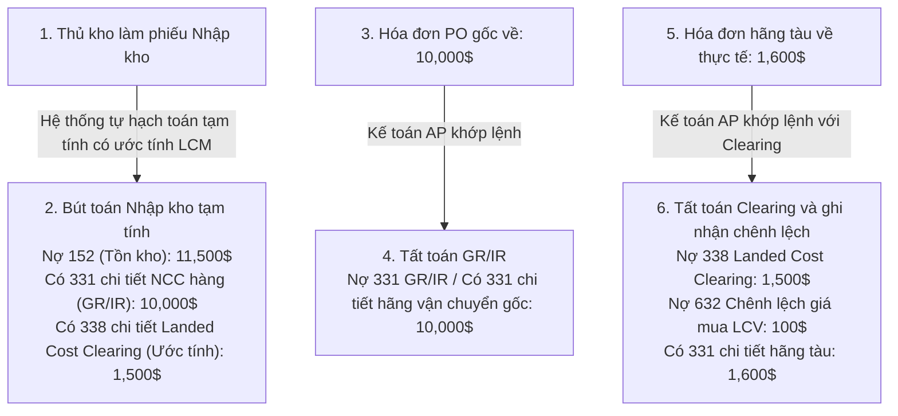
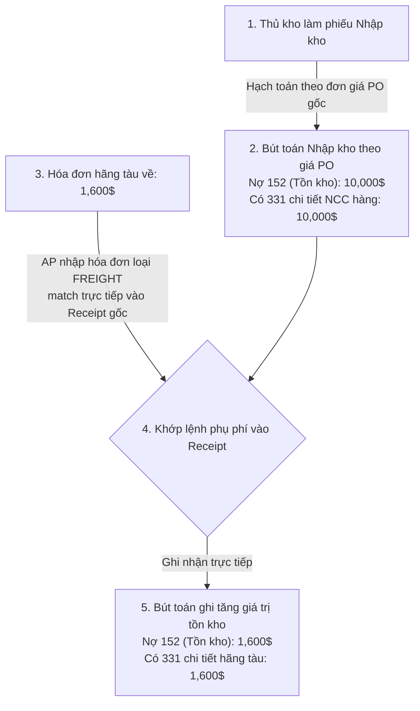

# 5000 Phân bổ chi phí mua hàng Landed Cost

Nghiệp vụ phân bổ chi phí mua hàng trên đường vào giá trị tồn kho (Landed Cost Allocation / Actual Costing) là khâu xử lý tài chính phức tạp thuộc phân hệ Kế toán giá thành (FIN-COST). Phân biệt rõ rệt với khâu khai báo tác nghiệp mua hàng nhập khẩu của chuỗi cung ứng, nghiệp vụ này chịu trách nhiệm thu thập các hóa đơn chi phí dịch vụ phát sinh thực tế (vận chuyển, hải quan, bảo hiểm), thực hiện thuật toán phân bổ giá vốn và kết chuyển phần chênh lệch vào giá trị tồn kho hoặc giá vốn hàng bán trong kỳ.

Một điểm thiết kế quan trọng cần xác định trước khi triển khai: hệ thống có xây dựng **module LCM chuyên biệt** (Landed Cost Management, quản lý ước tính chi phí và bút toán trung gian ngay từ khi nhận hàng) hay không. Không phải mọi hệ thống ERP hoặc hệ thống tự xây đều triển khai module này — rất nhiều doanh nghiệp vừa và nhỏ chọn phương án đơn giản hơn: **match trực tiếp hóa đơn phụ phí (cước vận chuyển, phí hải quan) vào giao dịch Receipt gốc**, không cần bút toán ước tính và tài khoản trung gian riêng. Bài viết này trình bày cả hai kiến trúc để bạn lựa chọn phù hợp với quy mô hệ thống.

---

## 1. Bản chất nghiệp vụ & Hai kiến trúc xử lý Landed Cost

### Vấn đề cốt lõi:
Hóa đơn dịch vụ vận chuyển quốc tế hoặc phí hải quan thường về trễ hơn rất nhiều (từ vài tuần đến một tháng) so với thời điểm nguyên vật liệu thô đã được thủ kho nhập kho vật lý và đưa vào sản xuất.

Nếu hệ thống tự xây (In-house) chỉ thực hiện hạch toán đơn giản:
* Tại thời điểm nhập kho: Ghi nhận giá trị tài sản kho theo đơn giá PO gốc (ví dụ: Nợ 152 / Có 331 là 10,000 USD).
* Tại thời điểm hóa đơn vận chuyển về: Hạch toán thẳng số tiền 1,500 USD này vào tài khoản chi phí quản lý hoặc chi phí bán hàng trong kỳ.
* *Hậu quả:* Doanh nghiệp sẽ đánh giá sai lệch hoàn toàn giá thành sản xuất (Product Costing), bóp méo biên lợi nhuận gộp và vi phạm quy định kiểm toán tài chính vì chi phí mua hàng không được vốn hóa trực tiếp vào nguyên giá tài sản tồn kho đầu vào.

### Kiến trúc A — Có module LCM (ước tính trước, trung gian Clearing)

Với các hệ thống có triển khai LCM chuyên biệt, ERP tạo một bút toán **ước tính chi phí (Estimated Landed Cost)** ngay tại thời điểm nhập kho, thông qua tài khoản trung gian phân bổ, sau đó tất toán và ghi nhận chênh lệch khi hóa đơn thực tế về:



### Kiến trúc B — Không có module LCM (Match phụ phí trực tiếp vào Receipt)

Với các hệ thống không triển khai LCM riêng — như hệ thống đang chạy thực tế của bạn — không có bút toán ước tính hay tài khoản trung gian độc lập. Thay vào đó, hóa đơn phụ phí (cước vận chuyển/hải quan) được khớp lệnh trực tiếp vào giao dịch nhận hàng gốc (`RECEIVE` transaction) thông qua kiểu đối soát **Match to Receipt** với loại dòng `FREIGHT` hoặc `MISCELLANEOUS`, không phải `ITEM`:



Ưu điểm của Kiến trúc B là đơn giản, không cần thiết kế thêm tài khoản trung gian hay chạy tiến trình ước tính/tất toán riêng. Nhược điểm là giá trị tồn kho của lô hàng sẽ **biến động sau khi đã nhập kho** — nếu một phần hàng đã xuất dùng trước khi hóa đơn phụ phí về, hệ thống bắt buộc phải xử lý phần chênh lệch không còn tồn kho để gánh (xem Mục 6, lỗi số 2).

---

## 2. Bảng so sánh và Ánh xạ giải pháp giữa các hệ thống

| Nghiệp vụ thiết kế | Oracle EBS R12.2.10 (có LCM) | Oracle EBS R12.2.10 (không LCM — Match to Receipt) | Epicor ERP | Hệ thống tự xây (In-house) |
| :--- | :--- | :--- | :--- | :--- |
| **Bản chất hạch toán** | LCM Post-Receipt Valuation Adjustment | AP Invoice Match to Receipt, line type `FREIGHT`/`MISCELLANEOUS` | Landed Cost Disbursement Entry | Tùy chọn theo quy mô: chạy tiến trình ước tính/tất toán, hoặc match phụ phí trực tiếp |
| **Xử lý chênh lệch** | CST Purchase Price Variance (PPV/IPV) | Không phát sinh Clearing riêng — giá trị tồn kho được cộng dồn trực tiếp bằng phụ phí thực nhận | PartTran ADJ-PUR Transaction | Hạch toán tự động vào tài khoản chênh lệch giá hoặc cộng dồn trực tiếp vào giá trị kho |
| **Tài khoản trung gian** | Landed Cost Absorption Account (riêng biệt) | Không cần — hạch toán thẳng vào TK Tồn kho và TK công nợ chi tiết theo Vendor | Landed Cost Clearing Account | Có thể có hoặc không tùy kiến trúc lựa chọn |

---

## 3. Điểm giao thoa & Tham chiếu chéo (Cross-linking) sang các phân hệ khác

* **Tham chiếu tờ khai hải quan:** Kế toán giá thành thực hiện phân bổ dựa trên thông tin tờ khai hải quan và điều kiện thương mại quốc tế đã cấu hình tại bài [5030 Thủ tục nhập khẩu, thông quan và điều kiện giao hàng quốc tế (Import Procurement)]().
* **Điều chỉnh giá trị kho:** Sau khi hoàn thành phân bổ thực tế, giá trị tài sản kho được tự động cập nhật và tính lại đơn giá bình quân tại bài [5020 Định giá tồn kho cuối kỳ (Inventory Valuation)]() thuộc phân hệ Tồn kho.
* **Tính toán giá thành sản phẩm:** Đơn giá nguyên vật liệu sau khi đã phân bổ đủ Landed Cost là căn cứ để tính toán chính xác chi phí sản xuất tại phân hệ [Kế toán Giá thành - COST]().

---

## 4. Hướng dẫn luồng thiết lập (Setup Flow) chi tiết trên hệ thống

### A. Trên Oracle EBS R12.2.10 — Có triển khai LCM (Post-Receipt)

1. **Cấu hình Tài khoản trung gian (Landed Cost Absorption Account):**
    * *Đường dẫn:* `Purchasing Super User > Setup > Organizations > Receiving Options`
    * *Nghiệp vụ:* Khai báo tài khoản trung gian hấp thụ chi phí để làm cầu nối hạch toán giữa phân hệ PO và phân hệ AP khi có hóa đơn cước vận chuyển.
2. **Khớp hóa đơn dịch vụ vận chuyển (AP Invoice Match to LCM):**
    * *Đường dẫn:* `Payables Super User > Invoices > Entry > Invoices`
    * *Nghiệp vụ:* Tạo hóa đơn AP cho hãng tàu vận chuyển. Chọn loại đối chiếu là `Match to LCM Shipment` (tham chiếu đến mã lô hàng nhập khẩu LCM đã tạo tại bài viết `5030`).
3. **Chạy chương trình tính toán và cập nhật giá vốn (CST Processor):**
    * *Nghiệp vụ:* Sau khi hóa đơn được duyệt, hệ thống tự động chạy chương trình `Landed Cost Integration` và `Cost Processor` để so khớp giữa chi phí ước tính ban đầu và chi phí thực tế trên hóa đơn, tự động sinh bút toán điều chỉnh giá vốn tài sản tồn kho trong kỳ.

### B. Trên Oracle EBS R12.2.10 — Không triển khai LCM (Match to Receipt trực tiếp)

1. **Nhập hóa đơn phụ phí (AP Invoice Entry):**
    * *Đường dẫn:* `Payables Super User > Invoices > Entry > Invoices`
    * *Nghiệp vụ:* Tạo hóa đơn AP cho hãng vận chuyển/hải quan. Chọn nút `Match`, sau đó chọn `Match to Receipt` thay vì `Match to PO`.
2. **Chỉ định loại dòng phụ phí:**
    * *Nghiệp vụ:* Tại dòng hóa đơn, gán `Line Type = FREIGHT` (cước vận chuyển) hoặc `MISCELLANEOUS` (phí hải quan, bảo hiểm, phụ phí khác), tham chiếu trực tiếp đến `Receipt Number` và dòng nhận hàng cụ thể (`rcv_transaction_id`). Hệ thống tự động cộng dồn phần phụ phí này vào giá trị tồn kho của lô hàng tương ứng khi kế toán chạy tiến trình `Receipt Accounting` / `Cost Processor` định kỳ.
3. **Kiểm soát điều kiện tồn kho còn lại:**
    * *Nghiệp vụ:* Trước khi cho phép match phụ phí, hệ thống nên kiểm tra số lượng On-hand còn lại của lô hàng nhận đó — nếu đã xuất dùng một phần hoặc toàn bộ, phần phụ phí tương ứng với số lượng đã xuất cần được kết chuyển sang giá vốn hàng bán (xem Mục 6).

### C. Trên Epicor ERP (Landed Cost Disbursement Entry)

1. **Nhập hóa đơn chi phí dịch vụ AP (AP Invoice Entry):**
    * *Đường dẫn:* `Financial Management > Accounts Payable > General Operations > AP Invoice Entry`
    * *Nghiệp vụ:* Nhập hóa đơn của nhà cung cấp dịch vụ (ví dụ: hãng tàu). Chọn dòng hóa đơn là `Landed Cost` để chỉ định đây là chi phí phân bổ cho lô hàng nhập khẩu.
2. **Thực hiện phân bổ chi phí thực tế (Landed Cost Disbursement):**
    * *Đường dẫn:* `Material Management > Purchase Management > General Operations > Landed Cost Disbursement Entry`
    * *Nghiệp vụ:* Chọn Container hàng nhập khẩu tương ứng, chọn hóa đơn AP dịch vụ vừa nhập ở bước 1.
    * *Ghi nhận:* Nhấn `Disburse`. Hệ thống sẽ tính toán chênh lệch và tự tạo giao dịch điều chỉnh giá trị nhập kho loại `ADJ-PUR` trong sổ chi tiết tồn kho PartTran.

---

## 5. Truy vấn SQL đối soát cấu trúc tổ chức (SQL Database Audit Queries)

### A. Cho Oracle EBS R12.2.10 — Hệ thống không triển khai LCM (Match to Receipt)

Query dưới đây phù hợp với các hệ thống **không sử dụng module LCM**: tính đơn giá thực tế của từng dòng nhận hàng bằng cách cộng dồn trực tiếp toàn bộ hóa đơn phụ phí (loại `FREIGHT`/`MISCELLANEOUS`) đã được match vào giao dịch Receipt gốc, thay vì dựa vào cặp bảng `inl_ship_headers_all`/`inl_ship_lines_all` của LCM (vốn chỉ tồn tại khi hệ thống có bật module này):

```sql
SELECT 
    hou.name                          AS operating_unit,
    rsh.receipt_num                   AS receipt_number,
    pha.segment1                      AS po_number,
    msib.segment1                     AS item_code,
    rt.quantity                       AS received_qty,
    -- Đơn giá gốc trên đơn mua hàng (Ước tính ban đầu)
    rt.po_unit_price                  AS po_estimated_unit_cost,
    -- Tính đơn giá thực tế = (Tiền hàng PO + Tiền phụ phí AP đã match) / Số lượng nhận
    ( (rt.quantity * rt.po_unit_price) + NVL(ap_costs.total_charge_amount, 0) ) 
        / DECODE(rt.quantity, 0, 1, rt.quantity) AS actual_landed_unit_cost,
    -- Chi phí chênh lệch trên mỗi đơn vị sản phẩm (Variance)
    (NVL(ap_costs.total_charge_amount, 0) / DECODE(rt.quantity, 0, 1, rt.quantity)) AS landed_variance_per_unit
FROM 
    rcv_transactions rt
INNER JOIN 
    rcv_shipment_headers rsh ON rt.shipment_header_id = rsh.shipment_header_id
INNER JOIN 
    rcv_shipment_lines rsl ON rt.shipment_line_id = rsl.shipment_line_id
INNER JOIN 
    po_headers_all pha ON rt.po_header_id = pha.po_header_id
INNER JOIN 
    hr_operating_units hou ON pha.org_id = hou.organization_id
LEFT JOIN 
    mtl_system_items_b msib ON rsl.item_id = msib.inventory_item_id 
                            AND msib.organization_id = rt.organization_id
LEFT JOIN (
    SELECT 
        ail.rcv_transaction_id,
        SUM(ail.amount) AS total_charge_amount
    FROM 
        ap_invoice_lines_all ail
    WHERE 
        ail.line_type_lookup_code IN ('FREIGHT', 'MISCELLANEOUS') 
        AND ail.match_type IN ('ITEM_TO_RECEIPT', 'OTHER_TO_RECEIPT')
    GROUP BY 
        ail.rcv_transaction_id
) ap_costs ON rt.transaction_id = ap_costs.rcv_transaction_id
WHERE 
    rt.transaction_type = 'RECEIVE' 
    AND rt.routing_header_id IS NOT NULL
ORDER BY 
    rsh.receipt_num DESC;
```

> **Lưu ý chọn đúng query theo kiến trúc hệ thống:** Nếu hệ thống của bạn có triển khai module LCM đầy đủ (bảng `inl_ship_headers_all`/`inl_ship_lines_all` tồn tại và có dữ liệu), hãy dùng cách tiếp cận dựa trên các bảng đó để so sánh chi phí ước tính (`est_unit_landed_cost`) với chi phí thực tế. Nếu hệ thống không triển khai LCM — như trường hợp phổ biến ở trên — dùng query dựa trên `rcv_transactions` kết hợp `ap_invoice_lines_all` như trên, vì đây là cách duy nhất phản ánh đúng cách chi phí phụ phí được ghi nhận vào hệ thống.

### B. Cho Epicor ERP (Truy vấn cơ sở dữ liệu SQL Server)

Query dưới đây quét qua sổ chi tiết giao dịch tồn kho `PartTran` trong Epicor để lọc ra các giao dịch điều chỉnh giá trị nhập kho loại `ADJ-PUR` phát sinh từ nghiệp vụ phân bổ chi phí Landed Cost:

```sql
SELECT 
    pt.Company,
    pt.TranNum                    AS Transaction_Num,
    pt.TranDate                   AS Transaction_Date,
    pt.PartNum                    AS Part_Number,
    pt.TranType                   AS Transaction_Type, -- 'ADJ-PUR' đại diện cho giao dịch điều chỉnh giá trị do phân bổ Landed Cost
    pt.PONum                      AS PO_Number,
    pt.PackSlip                   AS Receipt_Packing_Slip,
    pt.TranQty                    AS Adjusted_Qty,
    pt.MtlUnitCost                AS Original_PO_Cost,
    pt.LclMtlUnitCost             AS New_Landed_Material_Cost,
    -- Phần chênh lệch chi phí được điều chỉnh phân bổ cộng dồn trên mỗi đơn vị
    (pt.LclMtlUnitCost - pt.MtlUnitCost) AS Landed_Cost_Adjustment_Per_Unit
FROM 
    Erp.PartTran pt
WHERE 
    pt.Company = 'YOUR_COMPANY_CODE'
    AND pt.TranType = 'ADJ-PUR' -- Chỉ lọc các giao dịch điều chỉnh chi phí mua hàng
ORDER BY 
    pt.TranDate DESC, pt.TranNum DESC;
```

---

## 6. Giải pháp khắc phục lỗi phổ biến & Cảnh báo cho Hệ thống tự xây (In-house)

Nếu đội ngũ của bạn đang tự xây dựng (In-house) mô-đun Giá thành kế toán, hãy đặc biệt chú ý các điểm thiết kế sau để tránh các bẫy lỗi hệ thống nghiêm trọng:

1. **Bẫy lỗi sửa đổi thô bạo giá trị lịch sử nhập kho (Data Corruption Pitfall):**
    * *Triệu chứng:* Khi hóa đơn hãng tàu về phát sinh thêm chi phí 1,500 USD, lập trình viên viết câu lệnh SQL để cập nhật trực tiếp (Update) đơn giá trong bảng lịch sử nhập kho cũ từ 10$ thành 13.5$. Việc này làm sai lệch toàn bộ số liệu báo cáo tài chính đã khóa sổ của các tuần trước và làm vỡ luồng đối chiếu công nợ của kế toán.
    * *Giải pháp khắc phục:* Tuyệt đối không sửa đổi trực tiếp dữ liệu lịch sử. Giá trị chi phí phân bổ Landed Cost phải được ghi nhận dưới dạng một **giao dịch điều chỉnh giá trị độc lập** (ví dụ: giao dịch loại `ADJ-PUR` trong Epicor hoặc bút toán match phụ phí riêng biệt trong Oracle). Giao dịch này ghi nhận ngày hạch toán tại ngày hiện tại (kỳ kế toán hiện tại) và ghi tăng giá trị tài sản kho thông qua tài khoản đối chiếu chênh lệch, giữ nguyên vẹn tính lịch sử của chứng từ gốc.

2. **Lỗi bỏ sót việc phân bổ chi phí đối với hàng đã xuất kho tiêu dùng trước đó:**
    * *Triệu chứng:* Nguyên vật liệu đã được xuất dùng hết ngoài xưởng sản xuất (On-hand = 0). Sau đó hóa đơn chi phí vận chuyển mới về. Nếu hệ thống tự xây cố gắng phân bổ chi phí này vào giá trị tồn kho của mã vật tư đó, hệ thống sẽ bị lỗi do không còn số lượng tồn kho để gánh chi phí, dẫn đến việc hạch toán sai lệch. Đây là rủi ro **đặc biệt cao đối với kiến trúc không LCM (Kiến trúc B)**, vì phụ phí thường về sau một khoảng thời gian dài, đủ để một phần hoặc toàn bộ lô hàng đã được xuất dùng.
    * *Giải pháp:* Thiết kế logic tự động kết chuyển chênh lệch (Variance Forwarding). Trước khi match phụ phí vào Receipt, hệ thống phải kiểm tra số lượng On-hand thực tế còn lại của lô hàng đó. Nếu số lượng còn lại nhỏ hơn số lượng nhận kho ban đầu, phần phụ phí tương ứng với tỷ lệ đã xuất dùng phải được tự động kết chuyển trực tiếp vào Giá vốn hàng bán (TK 632 - COGS Account) thay vì cố cộng dồn toàn bộ vào giá trị tồn kho hiện có.

3. **Lỗi lệch số dư tài khoản trung gian cuối kỳ (chỉ áp dụng với Kiến trúc A - có LCM):**
    * *Triệu chứng:* Tài khoản trung gian Landed Cost Clearing bị treo số dư lớn cuối kỳ do kế toán AP nhập hóa đơn cước vận chuyển thực tế lệch nhiều so với số tiền thủ kho tạm tính ban đầu trên PO mà không có bước hạch toán xử lý chênh lệch.
    * *Giải pháp:* Hệ thống phải tự động tính toán phần chênh lệch giữa hóa đơn thực tế và tạm tính (Landed Cost Variance - LCV). Khoản chênh lệch này phải được hệ thống tự động hạch toán ghi nhận vào tài khoản chênh lệch để triệt tiêu hoàn toàn số dư tài khoản trung gian về không tại thời điểm duyệt hóa đơn. **Lưu ý:** nếu hệ thống chọn Kiến trúc B (không LCM) như trường hợp thực tế đang triển khai, lỗi này không phát sinh vì không có tài khoản trung gian nào cần tất toán — phụ phí được cộng dồn thẳng vào giá trị tồn kho ngay khi match, nên cần tập trung kiểm soát rủi ro ở lỗi số 2 thay vì lỗi này.
    
<p align="center" style={{color: 'var(--ifm-color-primary)'}}>
  <strong>Chúc các bạn thành công và vui vẻ!</strong>
</p>