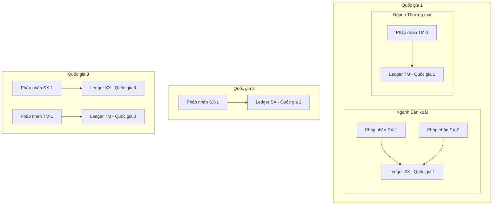
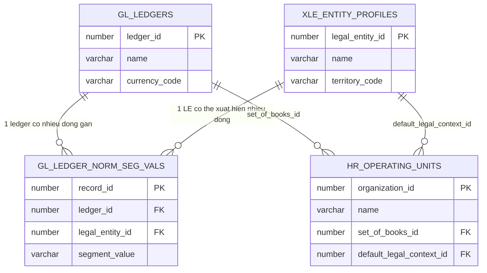

# Chiến lược Kiến trúc Legal Entity & Ledger: Tách riêng hay Gộp chung một Sổ cái?

Đây là quyết định **đầu tiên và quan trọng nhất** khi triển khai phân hệ Sổ cái cho một tập đoàn có nhiều pháp nhân. Điểm dễ hiểu sai nhất khi mới tiếp cận chủ đề này: nhiều người nghĩ đây là **1 câu hỏi duy nhất áp dụng cho cả tập đoàn** ("nên tách hay nên gộp?") — thực tế đây là **1 câu hỏi được hỏi lặp lại ở từng cấp, từng nhóm**, vì tổ chức của một tập đoàn đa quốc gia (thậm chí đa ngành) có nhiều lớp phân cấp hơn người mới triển khai thường hình dung.

Đổi kiến trúc sau khi hệ thống đã có giao dịch thực tế là việc **cực kỳ tốn kém và rủi ro** — đòi hỏi migrate toàn bộ dữ liệu lịch sử. Vì vậy quyết định này nên chốt **trước khi thiết kế Chart of Accounts**.

## 1. Khái niệm chung: mọi ERP đều phải trả lời cùng 1 câu hỏi

Dù tên gọi khác nhau, mọi hệ thống ERP đều buộc người triển khai phải trả lời:

> "Mỗi pháp nhân (công ty con) sẽ có **sổ sách kế toán hoàn toàn riêng biệt**, hay **nhiều pháp nhân dùng chung 1 sổ sách**, phân biệt nhau bằng 1 mã số?"

Bảng đối chiếu thuật ngữ giữa các hệ thống:

| Khái niệm | SAP S/4HANA | Oracle EBS | Epicor | Odoo |
|---|---|---|---|---|
| Đơn vị pháp lý (1 công ty con) | Company Code | Legal Entity (LE) | Company | Company (`res.company`) |
| "Sổ cái" chứa giao dịch | Ledger (ghi vào bảng `ACDOCA`) | Ledger | Book | (không tách riêng khỏi Company — dữ liệu lưu chung 1 database, phân biệt qua field) |
| Mã phân biệt công ty trong 1 sổ chung | Company Code (là 1 field riêng, không phải segment) | Balancing Segment Value | *(không có khái niệm tương đương trực tiếp)* | `company_id` (field riêng trên từng bản ghi, ví dụ trên `account.move`) |

**Điểm khác biệt kiến trúc quan trọng — SAP vốn đã "gộp chung" theo mặc định:** Trong SAP, **Leading Ledger (mặc định là `0L`) được gán cho TẤT CẢ Company Code ngay từ đầu** — nghĩa là nhiều pháp nhân (Company Code) trong SAP **luôn luôn dùng chung 1 Ledger chính**, không cần "quyết định gộp" như Oracle. Tạo thêm Ledger song song (Non-Leading Ledger) trong SAP phục vụ mục đích khác hẳn: **báo cáo song song theo nhiều chuẩn mực kế toán** (VD: 1 ledger theo Local GAAP, 1 ledger theo IFRS) — không phải để tách/gộp pháp nhân.

Ở Odoo, "công ty" là 1 field độc lập (`company_id`) gắn trên hầu hết các bảng giao dịch — tách bạch dữ liệu ở tầng field, tương tự nguyên lý Company Code của SAP, nhưng đơn giản hơn vì Odoo không có khái niệm "Ledger" tách biệt khỏi Company.

Riêng **Oracle EBS** có kiến trúc đặc thù nhất: công ty được nhúng **là 1 phần của chuỗi tài khoản (Accounting Flexfield)** qua Balancing Segment — đây là lý do Oracle vừa linh hoạt hơn (chủ động chọn gộp hay tách) vừa tiềm ẩn rủi ro cao hơn khi gộp (nhầm mã công ty khi hạch toán, vì nó chỉ là 1 đoạn trong dãy số tài khoản chứ không phải 1 field tách biệt như Company Code/`company_id`).

## 2. Mô hình phân cấp — chìa khóa để không nhầm lẫn

3 cấp cơ bản:

1. **Tập đoàn (Group)** — cấp cao nhất, chỉ tồn tại trên báo cáo hợp nhất, không phải nơi phát sinh giao dịch.
2. **Quốc gia (Country)** — mỗi quốc gia gần như chắc chắn khác nhau về Currency, Calendar, luật/chuẩn mực kế toán.
3. **Pháp nhân (Legal Entity)** — mỗi pháp nhân tương đương với **1 công ty** cụ thể có tư cách pháp lý riêng — nơi giao dịch thực sự phát sinh.

**Nguyên tắc cốt lõi:**

> Giữa các **Quốc gia** với nhau: câu trả lời **LUÔN LUÔN là "tách riêng"**. Câu hỏi "tách hay gộp" **chỉ có ý nghĩa cân nhắc ở cấp Pháp nhân — giữa các công ty nằm TRONG CÙNG 1 quốc gia**.

## 3. Điều kiện để gộp chung nhiều Pháp nhân vào 1 Ledger

| Tiêu chí | Vì sao cần |
|---|---|
| Cùng Currency | Ledger chỉ có 1 đồng tiền chức năng (functional currency) duy nhất |
| Cùng Calendar | Đóng/mở kỳ kế toán phải đồng thời cho mọi pháp nhân chung Ledger |
| Cùng cấu trúc Chart of Accounts | Balancing Segment và các segment khác phải dùng chung 1 bộ khung |
| **Cùng ngành nghề kinh doanh** | Các ngành khác nhau thường cần cấu trúc theo dõi chi phí, tài khoản tự nhiên, và mô hình báo cáo quản trị khác nhau — dù cùng quốc gia, cùng luật kế toán |

**Cách hiện thực hóa tiêu chí "cùng ngành" rất đơn giản:** không cần khai báo hay đánh dấu "ngành" ở đâu trong hệ thống cả. Nếu 1 quốc gia có nhiều ngành, chỉ cần **tạo nhiều Ledger cho quốc gia đó — mỗi Ledger đại diện cho 1 nhóm ngành**, rồi gán đúng các Pháp nhân cùng ngành vào chung 1 Ledger. Ranh giới ngành thể hiện hoàn toàn qua **pháp nhân nào được add vào Ledger nào**, không phải qua 1 cột dữ liệu đánh dấu ngành.

## 4. Công thức chung: cần bao nhiêu Ledger?

Với 1 nhóm gồm **N pháp nhân** đã thỏa cả 4 điều kiện ở Mục 3:

| Lựa chọn | Số Ledger cần thiết | Cách phân biệt dữ liệu giữa các pháp nhân |
|---|---|---|
| **A — Tách riêng** | **N Ledger** (1 Ledger / 1 pháp nhân) | Mỗi Ledger độc lập hoàn toàn |
| **B — Gộp chung** | **1 Ledger** | N Balancing Segment Value khác nhau trong cùng 1 Ledger |

Nếu tập đoàn có nhiều nhóm đồng nhất khác nhau (nhiều quốc gia, nhiều ngành trong 1 quốc gia), tổng số Ledger = tổng của từng nhóm cộng lại — mỗi nhóm chọn A hoặc B độc lập với nhau.

## 5. Ví dụ minh họa đầy đủ (số liệu hoàn toàn hư cấu)

Giả sử **Tập đoàn X** hoạt động 2 ngành — **Sản xuất (SX)** và **Thương mại (TM)** — có mặt tại 3 quốc gia (Quốc gia 1, 2, 3), với số pháp nhân như sau:

- Quốc gia 1: 2 pháp nhân ngành SX + 1 pháp nhân ngành TM
- Quốc gia 2: 1 pháp nhân ngành SX
- Quốc gia 3: 1 pháp nhân ngành SX + 1 pháp nhân ngành TM

Tổng cộng: **6 pháp nhân**. Áp dụng nguyên tắc: giữa 3 quốc gia luôn tách riêng; trong từng quốc gia, chỉ gộp các pháp nhân **cùng ngành**. Kết quả:



| Nhóm đồng nhất | Số pháp nhân | Lựa chọn | Số Ledger |
|---|---|---|---|
| Quốc gia 1 - Ngành SX | 2 | B (gộp) | 1 |
| Quốc gia 1 - Ngành TM | 1 | (chỉ có 1, không cần chọn) | 1 |
| Quốc gia 2 - Ngành SX | 1 | (chỉ có 1) | 1 |
| Quốc gia 3 - Ngành SX | 1 | (chỉ có 1) | 1 |
| Quốc gia 3 - Ngành TM | 1 | (chỉ có 1) | 1 |
| **Tổng** | **6 pháp nhân** | | **5 Ledger** |

Nếu không cân nhắc gộp gì cả (Lựa chọn A cho toàn bộ): 6 pháp nhân = 6 Ledger. Nhờ gộp 2 pháp nhân cùng ngành SX ở Quốc gia 1, giảm còn **5 Ledger**.

### Áp dụng cụ thể trong Oracle EBS

Đội triển khai sẽ tạo đúng **5 Ledger** như bảng trên. Riêng Ledger "SX - Quốc gia 1" sẽ thực hiện thao tác **Add Legal Entity 2 lần** (Pháp nhân SX-1 và SX-2), mỗi lần gán 1 Balancing Segment Value khác nhau — đúng cơ chế đã trình bày ở Mục 7 bên dưới. 4 Ledger còn lại mỗi cái chỉ Add đúng 1 Legal Entity.

### Áp dụng cụ thể trong Epicor

Vì Epicor **không có cơ chế tương đương Lựa chọn B**, đội triển khai bắt buộc phải tạo đúng **6 Company** (bằng đúng số pháp nhân, không giảm được xuống 5 như Oracle) — kể cả 2 pháp nhân SX ở Quốc gia 1 cùng ngành, cùng quốc gia, muốn xem báo cáo gộp vẫn phải qua **Consolidated Company** ở tầng báo cáo, không thể gộp ngay ở tầng giao dịch như Oracle.

Đây chính là điểm khác biệt kiến trúc lớn nhất giữa 2 hệ thống khi tổ chức đa pháp nhân: **Oracle giảm được số sổ cần quản lý nhờ Balancing Segment, Epicor thì không.**

---

## 6. Cách kiểm soát rủi ro khi chọn Lựa chọn B

1. **Validation Rule ở tầng dữ liệu** — chặn tổ hợp mã pháp nhân + tài khoản/bộ phận không hợp lý (Oracle: *Cross-Validation Rules*; SAP: *Validation/Substitution*).
2. **Phân quyền theo vai trò riêng từng pháp nhân** — user chỉ thấy và chọn được mã pháp nhân mình phụ trách. Đây là cách hiệu quả nhất vì loại bỏ rủi ro "chọn nhầm" ngay từ khi còn chưa có lựa chọn sai để chọn.
3. **Giá trị mặc định theo vai trò đăng nhập** — hệ thống tự điền sẵn mã pháp nhân theo user đang đăng nhập.

---

## 7. Chi tiết kỹ thuật trong Oracle EBS

### Cấu trúc bảng

| Bảng | Vai trò |
|---|---|
| `gl_ledgers` | Lưu thông tin bản thân Ledger (sổ cái) |
| `xle_entity_profiles` | Lưu thông tin bản thân Legal Entity (pháp nhân), có cột `territory_code` xác định thuộc quốc gia nào |
| `gl_ledger_norm_seg_vals` | Bảng **trung gian** — mỗi dòng là 1 cặp gán ghép Ledger + Legal Entity + Balancing Segment Value |
| `hr_operating_units` | Operating Unit — đơn vị vận hành nghiệp vụ (AP/AR/PO), gắn cố định 1 Ledger + 1 Legal Entity mặc định |



### Kiểm tra hiện trạng theo Quốc gia

```sql
SELECT le.territory_code                    AS quoc_gia,
       gbsv.ledger_id,
       COUNT(DISTINCT gbsv.segment_value)    AS so_phap_nhan_trong_ledger
FROM   gl_ledger_norm_seg_vals gbsv
JOIN   xle_entity_profiles le ON le.legal_entity_id = gbsv.legal_entity_id
GROUP  BY le.territory_code, gbsv.ledger_id
ORDER  BY quoc_gia, gbsv.ledger_id;
```

### Operating Unit (`organization_id`) là lớp tách dữ liệu ĐỘC LẬP với quyết định A/B ở Ledger

Đây là điểm rất quan trọng, dễ nhầm lẫn: dù bạn chọn Lựa chọn A hay B ở tầng Ledger, **Operating Unit của từng pháp nhân vẫn tách riêng như nhau** — không hề bị ảnh hưởng bởi quyết định gộp/tách Ledger.

Lý do: Ledger + Balancing Segment là cơ chế phân biệt dữ liệu ở **tầng GL (sổ cái/báo cáo tài chính)**. Operating Unit (qua cột `ORG_ID` trên các bảng giao dịch như `AP_INVOICES_ALL`, `RA_CUSTOMER_TRX_ALL`...) là cơ chế phân biệt dữ liệu ở **tầng vận hành hàng ngày (AP/AR/PO)** — 2 tầng này **độc lập nhau**:

- Chọn Lựa chọn B (2 pháp nhân dùng chung 1 Ledger) → 2 pháp nhân đó **vẫn có 2 Operating Unit riêng biệt** (mỗi OU trỏ `default_legal_context_id` về đúng pháp nhân của mình) → hóa đơn AP/AR của pháp nhân này vẫn tách bạch hoàn toàn khỏi pháp nhân kia qua `ORG_ID`, không hề bị "gộp" theo Ledger.
- Nói cách khác: **gộp Ledger không làm mất khả năng tách dữ liệu giao dịch hàng ngày** — cái gộp lại chỉ là số lượng "cuốn sổ cái" cần quản lý ở tầng kế toán tổng hợp, còn tầng nghiệp vụ (nhập liệu hóa đơn, đơn hàng...) vẫn tách theo OU như cũ.

## 8. Chi tiết kỹ thuật trong Epicor

### Company — mức phân tách cao nhất, mặc định đã là "Lựa chọn A"

Trong Epicor, **Company** là ranh giới phân tách dữ liệu ở mức cao nhất — gần tương đương việc Oracle tách hẳn 1 Ledger riêng cho mỗi pháp nhân.

### Company đảm nhiệm CẢ 2 vai trò cùng lúc — khác với Oracle tách riêng 2 lớp

Đây là hệ quả trực tiếp của việc Epicor không có khái niệm Ledger tách biệt khỏi Company: field **Company** trong Epicor đóng vai trò **VỪA LÀ Ledger (tầng kế toán) VỪA LÀ Operating Unit (tầng vận hành)** cùng lúc — không tách thành 2 lớp độc lập như Oracle. Đây là lý do Epicor không thể "gộp Ledger nhưng vẫn tách OU" như Oracle làm được ở Mục 7 — với Epicor, gộp hay tách luôn đồng thời ảnh hưởng cả 2 tầng cùng lúc vì chỉ có 1 field duy nhất đảm nhiệm.

### Multiple Books — trục khác, không phải cơ chế gộp nhiều pháp nhân

Tính năng **Multiple Books** của Epicor cho phép **1 Company duy nhất** ghi nhận đồng thời vào nhiều "cuốn sổ" song song (Corporate Book / Statutory Book) — gần giống Non-Leading Ledger của SAP, dùng cho báo cáo song song theo chuẩn mực khác nhau, **không phải** cơ chế để nhiều pháp nhân dùng chung 1 sổ.

*(Phần Epicor trình bày theo kiến trúc tổng quát phổ biến của các phiên bản Kinetic/E10 — nên đối chiếu lại với tài liệu chính thức của đúng phiên bản đang triển khai.)*

## 9. Checklist quyết định trước khi bắt đầu setup

- [ ] Vẽ sơ đồ phân cấp thực tế của tập đoàn: Group → từng Quốc gia → từng Ngành (nếu đa ngành) → từng Pháp nhân.
- [ ] Xác nhận: giữa các Quốc gia luôn là Lựa chọn A.
- [ ] Với mỗi nhóm pháp nhân cùng quốc gia: kiểm tra thêm tiêu chí **cùng ngành nghề kinh doanh** trước khi xét gộp.
- [ ] Chỉ những pháp nhân thỏa **cả 4 điều kiện** (Currency, Calendar, CoA, Ngành) mới đưa vào diện cân nhắc Lựa chọn B.
- [ ] Dùng công thức ở Mục 4 để ước tính nhanh số Ledger cần thiết cho từng nhóm.
- [ ] Nếu chọn Lựa chọn B cho nhóm nào → thiết kế song song Cross-Validation Rule + phân quyền Responsibility/Role riêng theo từng pháp nhân, đồng thời xác nhận mỗi pháp nhân vẫn có Operating Unit riêng để không mất khả năng tách dữ liệu vận hành hàng ngày.
- [ ] Xác nhận với đội kế toán/kiểm toán của từng ngành/quốc gia về nhu cầu báo cáo hợp nhất.
<div align="center" style={{color: 'var(--ifm-color-primary)'}}>
  <strong>Chúc các bạn thành công và vui vẻ!</strong>
</div>
