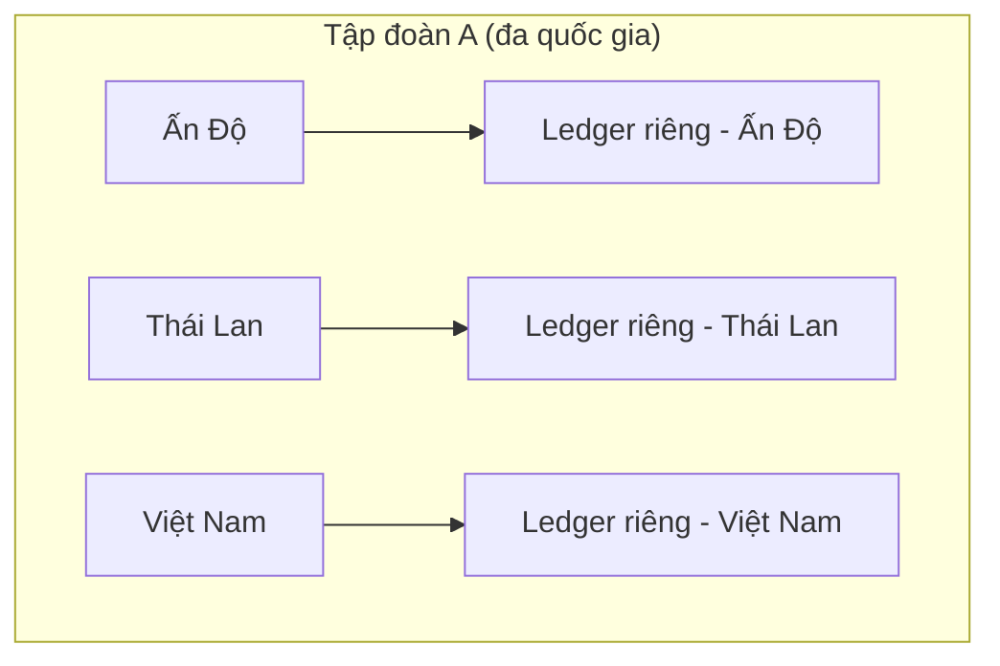
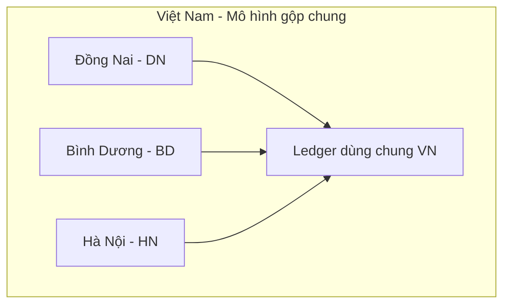
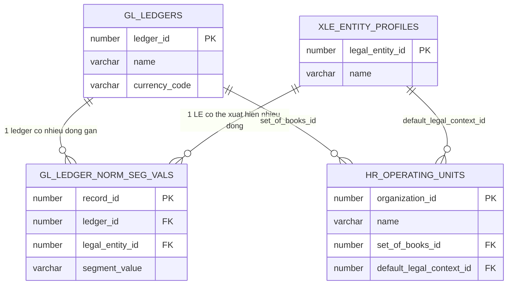

# Chiến lược Kiến trúc Legal Entity & Ledger: Tách riêng hay Gộp chung một Sổ cái?

Đây là quyết định **đầu tiên và quan trọng nhất** khi triển khai phân hệ Sổ cái cho một tập đoàn có nhiều pháp nhân (nhiều công ty con, nhiều chi nhánh có tư cách pháp lý riêng). Quyết định này phải chốt **trước khi thiết kế Chart of Accounts**, vì cấu trúc tài khoản và cách phân biệt dữ liệu giữa các công ty phụ thuộc hoàn toàn vào lựa chọn kiến trúc ở bước này.

Đổi kiến trúc sau khi hệ thống đã có giao dịch thực tế là việc **cực kỳ tốn kém và rủi ro** — đòi hỏi migrate toàn bộ dữ liệu lịch sử, gần như không có đường lùi dễ dàng. Vì vậy bài viết này nên được đọc và quyết định **trước** khi bắt đầu bất kỳ bước setup COA nào.

## 1. Khái niệm chung: mọi ERP đều phải trả lời cùng 1 câu hỏi

Dù tên gọi khác nhau, mọi hệ thống ERP đều buộc người triển khai phải trả lời:

> "Mỗi pháp nhân (công ty con) sẽ có **sổ sách kế toán hoàn toàn riêng biệt**, hay **nhiều pháp nhân dùng chung 1 sổ sách**, phân biệt nhau bằng 1 mã số?"

Bảng đối chiếu thuật ngữ giữa các hệ thống:

| Khái niệm | SAP S/4HANA | Oracle EBS | Epicor | Odoo | Dynamics 365 F&O | NetSuite |
|---|---|---|---|---|---|---|
| Đơn vị pháp lý (1 công ty con) | Company Code | Legal Entity (LE) | Company | Company (res.company) | Legal Entity | Subsidiary |
| "Sổ cái" chứa giao dịch | Ledger (trong ACDOCA) | Ledger | Book | (không tách riêng — 1 DB record) | Ledger | (OneWorld — chung 1 hệ thống) |
| Mã phân biệt công ty trong 1 sổ chung | Company Code (là 1 field riêng, không phải segment) | Balancing Segment Value | *(không có khái niệm tương đương trực tiếp)* | company_id (cột riêng) | Legal Entity (field riêng, không phải dimension) | Subsidiary (field riêng) |

**Điểm khác biệt quan trọng cần lưu ý ngay từ đầu:** Ở phần lớn các hệ thống (SAP, D365, Odoo, NetSuite), "công ty" là **1 cột/field độc lập** gắn trên mọi bảng giao dịch — tách bạch dữ liệu gần như tuyệt đối. Riêng **Oracle EBS** có kiến trúc đặc thù: công ty được nhúng **là 1 phần của chuỗi tài khoản (Accounting Flexfield)** thông qua Balancing Segment — đây là lý do Oracle vừa linh hoạt hơn (có thể gộp nhiều công ty vào 1 sổ mà vẫn tách được số liệu) vừa tiềm ẩn rủi ro cao hơn (nhầm mã công ty khi hạch toán, vì nó chỉ là 1 đoạn trong dãy số tài khoản chứ không phải 1 field tách biệt rõ ràng).

## 2. Hai mô hình kiến trúc

### Mô hình A — Tách riêng (1 Pháp nhân = 1 Sổ cái độc lập)

Mỗi công ty con có sổ sách hoàn toàn riêng biệt, độc lập từ gốc.



**Ưu điểm:**
- An toàn tuyệt đối — không thể lẫn dữ liệu giữa 2 công ty dù có sai sót ở khâu nào (vì bản thân 2 sổ đã tách biệt hoàn toàn, không chỉ tách ở 1 trường dữ liệu).
- Mỗi công ty được tự do chọn Currency, Kỳ kế toán (Calendar), thậm chí phương pháp hạch toán khác nhau — phù hợp khi các công ty ở **nhiều quốc gia khác nhau**.
- Không cần thiết kế Cross-Validation Rule phức tạp để chặn hạch toán nhầm.

**Nhược điểm:**
- Số lượng sổ sách cần quản lý tăng theo số công ty.
- Muốn xem báo cáo hợp nhất toàn tập đoàn phải làm **Consolidation** (quy trình riêng, thường tốn công sức hơn).

**Phù hợp khi:** các công ty con khác nhau về quốc gia, tiền tệ, luật kế toán, kỳ tài chính — điển hình là tập đoàn đa quốc gia.

### Mô hình B — Gộp chung (Nhiều Pháp nhân dùng chung 1 Sổ cái)

Nhiều công ty cùng chia sẻ 1 sổ sách, phân biệt nhau qua 1 mã định danh (Company Code / Balancing Segment / Subsidiary...).



**Điều kiện bắt buộc để áp dụng:** tất cả các công ty phải đồng nhất về:
- Đồng tiền hạch toán (Currency)
- Lịch kỳ kế toán (Calendar) — đóng/mở kỳ cùng lúc
- Cấu trúc Chart of Accounts
- Luật/chuẩn mực kế toán áp dụng (cùng 1 nước hoặc cùng 1 vùng pháp lý tương đồng)

**Ưu điểm:**
- Ít sổ sách cần quản lý hơn.
- Báo cáo theo từng công ty **và** báo cáo hợp nhất đều dễ lấy ngay trong cùng 1 hệ thống — chỉ cần lọc/bỏ lọc theo mã công ty.

**Nhược điểm:**
- Rủi ro **hạch toán nhầm mã công ty** — về mặt kỹ thuật giao dịch vẫn hợp lệ (vì mã công ty khác chỉ là 1 giá trị hợp lệ khác trong hệ thống), hệ thống không tự báo lỗi nếu không có cơ chế kiểm soát bổ sung.
- Đòi hỏi thiết kế thêm lớp kiểm soát: **Cross-Validation Rule** (chặn tổ hợp mã công ty + tài khoản/bộ phận không hợp lý) và **phân quyền theo Responsibility/Role riêng cho từng công ty** (để danh sách chọn mã công ty chỉ hiện đúng công ty user đó thuộc về, giảm khả năng chọn nhầm ngay từ gốc).

**Phù hợp khi:** các công ty con cùng 1 quốc gia, cùng hệ thống pháp luật kế toán, chỉ khác nhau ở tư cách pháp nhân (ví dụ nhiều chi nhánh/công ty con nội địa trong cùng 1 tập đoàn).

### Bảng so sánh nhanh

| Tiêu chí | Mô hình A: Tách riêng | Mô hình B: Gộp chung |
|---|---|---|
| Độ an toàn chống nhầm lẫn | Rất cao (tách từ gốc) | Trung bình — phụ thuộc cấu hình kiểm soát |
| Số lượng sổ cần quản lý | Nhiều | Ít |
| Báo cáo hợp nhất tập đoàn | Cần quy trình Consolidation riêng | Dễ hơn — lọc/bỏ lọc trong cùng hệ thống |
| Yêu cầu đồng nhất Currency/Calendar/CoA | Không bắt buộc | Bắt buộc |
| Phù hợp | Đa quốc gia, luật kế toán khác nhau | Cùng quốc gia, cùng luật kế toán |

## 3. Cách kiểm soát rủi ro khi chọn Mô hình B

Nếu quyết định gộp chung, 3 lớp kiểm soát nên có (tên gọi cụ thể khác nhau tuỳ hệ thống, nhưng nguyên lý chung):

1. **Validation Rule ở tầng dữ liệu** — chặn không cho tạo/hạch toán vào tổ hợp mã công ty + tài khoản/bộ phận không hợp lý (Oracle gọi là *Cross-Validation Rules*, SAP có *Validation/Substitution*, D365 có *Account structure rules*).
2. **Phân quyền theo vai trò/trách nhiệm riêng từng công ty** — user chỉ thấy và chọn được mã công ty mình phụ trách trong danh sách sổ, không thấy công ty khác. Đây là cách hiệu quả nhất vì loại bỏ rủi ro "chọn nhầm" ngay từ khi còn chưa có lựa chọn sai để chọn.
3. **Giá trị mặc định theo vai trò đăng nhập** — hệ thống tự điền sẵn mã công ty theo user đang đăng nhập, giảm thao tác nhập tay thủ công (nguồn gốc phổ biến nhất của lỗi gõ nhầm).

---

## 4. Ví dụ minh họa trong Oracle EBS

Oracle EBS thể hiện rõ nhất cả 2 mô hình vì kiến trúc Accounting Flexfield của nó hỗ trợ đồng thời cả hai.

### Cấu trúc bảng

| Bảng | Vai trò |
|---|---|
| `gl_ledgers` | Lưu thông tin bản thân Ledger (sổ cái) |
| `xle_entity_profiles` | Lưu thông tin bản thân Legal Entity (pháp nhân) — độc lập, không biết gì về Ledger |
| `gl_ledger_norm_seg_vals` | Bảng **trung gian** — mỗi dòng là 1 cặp gán ghép Ledger + Legal Entity + Balancing Segment Value |
| `hr_operating_units` | Operating Unit — đơn vị vận hành nghiệp vụ (AP/AR/PO), gắn cố định 1 Ledger + 1 Legal Entity mặc định |



### Cách nhận biết 1 hệ thống Oracle đang chạy mô hình nào

```sql
SELECT ledger_id, segment_value, COUNT(*)
FROM   gl_ledger_norm_seg_vals
GROUP  BY ledger_id, segment_value
ORDER  BY ledger_id;
```

- Mỗi `ledger_id` chỉ có đúng **1** `segment_value` → đang chạy **Mô hình A** (tách riêng).
- Một `ledger_id` có **nhiều** `segment_value` khác nhau → đang chạy **Mô hình B** (gộp chung).

### Ví dụ thực tế (số liệu minh họa)

Giả sử Tập đoàn A đa quốc gia có chi nhánh ở Ấn Độ, Thái Lan, Việt Nam — và riêng ở Việt Nam có 3 công ty con (Đồng Nai - mã DN, Bình Dương - mã BD, Hà Nội - mã HN) cùng dùng 1 Chart of Accounts:

- Giữa các quốc gia khác nhau (Ấn Độ/Thái Lan/Việt Nam) → bắt buộc **Mô hình A**, vì khác Currency, khác Calendar, khác luật kế toán.
- Giữa 3 công ty VN (DN/BD/HN) → **đủ điều kiện** cân nhắc **Mô hình B**, vì cùng Currency, cùng Calendar, cùng CoA — chỉ khác Balancing Segment (DN/BD/HN). Khi đó, tài khoản của từng công ty vẫn tách biệt hoàn toàn về mặt code combination (ví dụ tài khoản Retained Earnings sẽ là `DN.000000.111111` khác `BD.000000.111111` khác `HN.000000.111111`), chỉ là 3 công ty giờ chia sẻ chung 1 Ledger, 1 Calendar, 1 Currency.
- Cơ chế kiểm soát tương ứng: **Cross-Validation Rules** (chặn tổ hợp Company + Account không hợp lệ) + tách **Responsibility/Data Access Set riêng theo từng công ty** (user ở Đồng Nai không thấy Bình Dương/Hà Nội trong danh sách chọn) — đây là lựa chọn an toàn hơn so với dùng chung 1 Responsibility rồi phân quyền theo Security Profile ở tầng user, vì loại bỏ rủi ro chọn nhầm ngay từ gốc thay vì chặn sau khi đã chọn.

## 5. Ví dụ minh họa trong Epicor

Epicor có triết lý kiến trúc khác biệt đáng chú ý so với Oracle, cần phân biệt rõ 2 khái niệm dễ nhầm lẫn:

### Company — mức phân tách cao nhất, mặc định đã là "Mô hình A"

Trong Epicor, **Company** là ranh giới phân tách dữ liệu ở mức cao nhất — gần tương đương việc Oracle tách hẳn 1 Ledger riêng cho mỗi pháp nhân. Mỗi Company trong Epicor có Chart of Accounts, Calendar, Currency riêng, và về bản chất **thiết kế mặc định của Epicor đã nghiêng về Mô hình A** — không có khái niệm tương đương trực tiếp với "Balancing Segment chia sẻ chung 1 sổ" như Oracle.

Nói cách khác: Epicor **không khuyến khích/không có cơ chế native** để "gộp nhiều pháp nhân vào 1 Company chung, phân biệt bằng 1 segment" theo đúng kiểu Oracle Mô hình B.

### Multiple Books (Corporate Book vs Statutory Book) — đây là 1 trục khác, không phải mô hình gộp nhiều pháp nhân

Đây là điểm dễ nhầm nhất: tính năng **Multiple Books** của Epicor giải quyết một bài toán **khác hẳn** — cho phép **1 Company duy nhất** ghi nhận giao dịch đồng thời vào nhiều "cuốn sổ" song song (ví dụ: Corporate Book theo chuẩn tập đoàn mẹ, Statutory Book theo luật thuế địa phương) — tương tự khái niệm *Parallel Ledger* của SAP hoặc *Reporting Currency* của Oracle, **không phải** cơ chế để nhiều công ty con dùng chung 1 sổ.

### Khi cần báo cáo hợp nhất nhiều Company trong Epicor

Vì Epicor không có cơ chế gộp kiểu Oracle, muốn hợp nhất báo cáo nhiều Company thường dùng tính năng **Consolidated Company** — về bản chất là 1 Company "ảo" dùng để tổng hợp/kéo số liệu từ các Company thành viên phục vụ mục đích báo cáo, chứ không phải nơi phát sinh giao dịch trực tiếp hàng ngày như Ledger gộp chung của Oracle.

> **Kết luận đối chiếu:** Nếu bạn quen thuộc Epicor rồi chuyển sang làm Oracle, cần lưu ý Oracle cho phép "gộp nhiều pháp nhân vào 1 sổ" — một khái niệm không có cơ chế tương đương trực tiếp trong kiến trúc Company của Epicor. Ngược lại, nếu quen Oracle rồi qua Epicor, "Company" trong Epicor gần với "1 Ledger đã gán đúng 1 Legal Entity" của Oracle hơn là gần với khái niệm "Legal Entity" đơn thuần.

*(Lưu ý: phần Epicor trình bày theo kiến trúc tổng quát phổ biến của các phiên bản Kinetic/E10 — các chi tiết cụ thể về tên gọi tính năng nên đối chiếu lại với tài liệu chính thức của đúng phiên bản Epicor đang triển khai, vì Epicor cũng có thay đổi cấu trúc qua từng version.)*

## 6. Checklist quyết định trước khi bắt đầu setup

- [ ] Liệt kê toàn bộ pháp nhân sẽ đưa vào hệ thống, nhóm theo quốc gia/Currency/Calendar/luật kế toán.
- [ ] Với mỗi nhóm đồng nhất (cùng Currency/Calendar/CoA) → cân nhắc Mô hình B nếu muốn giảm số sổ cần quản lý.
- [ ] Với nhóm khác biệt (khác quốc gia/luật) → bắt buộc Mô hình A.
- [ ] Nếu chọn Mô hình B cho bất kỳ nhóm nào → thiết kế song song Cross-Validation Rule + phân quyền Responsibility/Role riêng theo từng công ty trước khi đưa vào Production.
- [ ] Xác nhận với đội kế toán/kiểm toán về nhu cầu báo cáo hợp nhất — quyết định này ảnh hưởng trực tiếp đến việc chọn Consolidation thủ công (Mô hình A) hay tận dụng lọc theo mã công ty ngay trong hệ thống (Mô hình B).
<div align="center" style={{color: 'var(--ifm-color-primary)'}}>
  <strong>Chúc các bạn thành công và vui vẻ!</strong>
</div>
