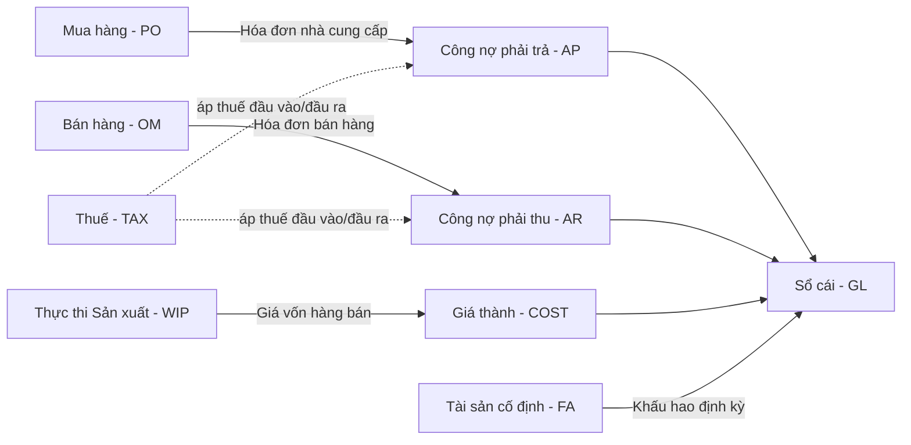

import DocCardList from '@theme/DocCardList';

# Tài chính kế toán (FIN)

Tài chính kế toán (Finance & Accounting - FIN) là phân hệ tổng hợp và "chốt sổ" dữ liệu từ tất cả các phân hệ khác. Công nợ phải trả (AP) nhận dữ liệu từ Mua hàng (PO), Công nợ phải thu (AR) nhận dữ liệu từ Bán hàng (OM), Giá thành (COST) nhận dữ liệu từ Thực thi Sản xuất (WIP) — tất cả cuối cùng đều hạch toán tập trung về Sổ cái (GL). Tài sản cố định (FA) và Thuế (TAX) là hai phân hệ vận hành song song, cắt ngang qua các luồng trên.

## Tương quan phân hệ con với các ERP phổ biến

| Phân hệ con trong tài liệu | SAP | Oracle EBS | Epicor |
|---|---|---|---|
| **Công nợ** *(AP/AR)* | FI-AP / FI-AR (Accounts Payable / Receivable) | Payables (AP), Receivables (AR) | Accounts Payable, Accounts Receivable |
| **Giá thành** *(COST)* | CO-PC (Product Costing) | Cost Management (CST) | Costing (Job Costing, Average/Standard Cost) |
| **Sổ cái** *(GL)* | FI-GL (General Ledger) | General Ledger (GL) | General Ledger |
| **Tài sản cố định** *(FA)* | FI-AA (Asset Accounting) | Fixed Assets (FA) | Fixed Assets |
| **Thuế** *(TAX)* | FI Tax Procedure (Condition-based Tax) | E-Business Tax (EBTax) | Tax Connect (tích hợp Avalara) |

## Sơ đồ luồng nghiệp vụ

## Danh mục tài liệu

<DocCardList />
## Vì sao Kế toán luôn là điểm hẹn cuối cùng của mọi luồng dữ liệu ERP?

Hãy hình dung một ERP vận hành ở mọi phân hệ: mua hàng xử lý nhanh, tồn kho cập nhật chính xác theo thời gian thực, sản xuất bám sát tiến độ. Nhưng đến cuối kỳ, Kế toán không đối chiếu được giá trị tồn kho với Sổ cái, hoặc tài sản đã đưa vào sử dụng nhưng khấu hao không tự động chạy. Lúc đó, mọi nỗ lực đầu tư ở các phân hệ vận hành khó mang lại giá trị trọn vẹn.

Đích đến cuối cùng của bất kỳ luồng dữ liệu nào trong ERP cũng là báo cáo tài chính. Mua hàng, bán hàng, kho, sản xuất, tài sản — dù vận hành độc lập ở tầng nghiệp vụ, tất cả đều là "nguồn cấp dữ liệu" cho Kế toán. Nếu điểm hẹn cuối cùng này bị lệch, thì phần vận hành phía trước, dù trơn tru đến đâu, cũng khó tạo ra giá trị tài chính đáng tin cậy cho doanh nghiệp.

Để dữ liệu từ hàng chục nghiệp vụ khác nhau luôn "gặp đúng chỗ" tại Kế toán, cần phân loại dữ liệu theo đúng bản chất kế toán *ngay từ khi phát sinh*, chứ không đợi đến lúc đóng sổ mới xử lý. Dưới đây là 6 nhóm nghiệp vụ nền tảng cần được phân định rõ vai trò giữa bên vận hành (nhập dữ liệu nguồn) và bên kế toán (kiểm soát và đối chiếu):

| Nhóm nghiệp vụ | Bản chất | Bộ phận vận hành (Nguồn dữ liệu) | Bộ phận Kế toán (Kiểm soát & Đối chiếu) |
|---|---|---|---|
| **Mua hàng & Phải trả** | Ghi nhận công nợ và thanh toán cho nhà cung cấp | Mua hàng, Nhận hàng (Kho) | Kế toán Phải trả (AP) |
| **Bán hàng & Phải thu** | Ghi nhận doanh thu và thu tiền từ khách hàng | Bán hàng (OM), Giao hàng (Kho) | Kế toán Phải thu (AR) |
| **Kho & Giá thành sản xuất** | Theo dõi giá trị hàng tồn kho và chi phí cấu thành giá vốn | Thủ kho, Quản đốc sản xuất | Kế toán Kho & Giá thành (COST) |
| **Tài sản cố định** | Ghi nhận, khấu hao, thanh lý tài sản dài hạn | Bộ phận sử dụng tài sản (Hành chính, IT, Xưởng...) | Kế toán Tài sản (FA) |
| **Xây dựng cơ bản dở dang (CIP)** | Tích lũy chi phí dự án/lắp đặt trước khi trở thành tài sản chính thức | Ban Quản lý dự án, Kỹ thuật | Kế toán Dự án / Kế toán tổng hợp |
| **Sổ cái tổng hợp & điều chỉnh** | Bút toán điều chỉnh, trích trước, đảo, phân loại lại không gắn với chứng từ gốc | *(Không có)* | Kế toán tổng hợp (GL) |

### "Hố sâu" đối chiếu lớn nhất: Cơ chế GR/IR (Accrued Liabilities)
Trong doanh nghiệp sản xuất, khoảng trễ thời gian giữa lúc nhận hàng và lúc nhận hóa đơn là nơi rất dễ phát sinh sai lệch số liệu:
* **Thực tế vận hành:** Hàng về kho (Goods Receipt - GR) thường đi trước, hóa đơn tài chính (Invoice Receipt - IR) về sau (có khi trễ từ vài ngày đến vài tuần). Nếu hệ thống đợi hóa đơn về mới hạch toán, giá trị tồn kho trên sổ sách sẽ bị sai lệch so với thực tế ở kho.
* **Giải pháp trong ERP:** Các hệ thống ERP lớn sử dụng tài khoản trung gian tạm tính (thường gọi là **GR/IR** trong SAP, hoặc **Accrued Receipts** trong Oracle):
    * **Khi nhập kho (chưa hóa đơn):** Nợ Kho / Có GR/IR (Ghi nhận ngay giá trị tồn kho và khoản nợ tạm tính).
    * **Khi nhận hóa đơn:** Nợ GR/IR / Có Phải trả nhà cung cấp (AP) (Tất toán khoản tạm tính, ghi nhận công nợ chính thức).

Phần lớn trường hợp lệch sổ giữa Kho và Kế toán cuối tháng xuất phát từ việc không đối chiếu được số dư của tài khoản trung gian này.

### Chốt chặn kiểm soát tại nguồn: Khớp lệnh 3 bên (3-Way Match)
Để đảm bảo tính chính xác của dữ liệu công nợ ngay tại thời điểm phát sinh, ERP áp dụng cơ chế kiểm soát tự động **3-Way Match** trước khi ghi nhận hóa đơn phải trả:
1. **Đơn mua hàng (PO):** Đảm bảo đúng đơn giá và điều khoản đã thỏa thuận.
2. **Phiếu nhập kho (GR):** Đảm bảo đúng số lượng thực tế đã nhận tại kho.
3. **Hóa đơn (Invoice):** Đảm bảo số tiền nhà cung cấp yêu cầu khớp với thực tế.

Nếu phát hiện sai lệch vượt quá dung sai cấu hình, hệ thống sẽ tự động chặn (hold) hóa đơn để kiểm tra, ngăn ngừa việc hạch toán sai lệch dòng tiền lên Sổ cái.

## Nếu bản chất giống nhau, vì sao mỗi ERP lại chia khác nhau?

Đây là điểm thú vị: nếu các nhóm trên là bản chất chung, thì lẽ ra mọi ERP phải tổ chức dữ liệu giống hệt nhau — nhưng thực tế thì không. SAP, Epicor, Odoo và Oracle EBS đều tiếp cận theo cách riêng, phản ánh đúng phân khúc khách hàng và triết lý kiến trúc mà mỗi hãng theo đuổi. Điều không đổi chỉ là đích đến — dữ liệu, dù được gọi tên khác nhau, vẫn luôn quy được về đúng các nhóm bản chất ở trên.

**SAP** không dùng khái niệm "category" mà quản lý trực tiếp qua **Document Type**, gắn liền với từng phân hệ gốc: FI-AP, FI-AR, MM/PP, FI-AA. Nhờ tích hợp chặt giữa module vận hành và FI, phần lớn bút toán từ mua hàng, bán hàng, xuất nhập kho được sinh ra gần như ngay khi chứng từ gốc được xác nhận — không cần một bước "đẩy dữ liệu" tách biệt như nhiều hệ thống khác. Ngoại lệ nằm ở các nghiệp vụ mang tính chu kỳ, như phân bổ chi phí (CO) hay chạy khấu hao (AFAB), vẫn xử lý theo batch định kỳ chứ không tức thời.

**Epicor** có tư duy kiểm soát khá gần với Oracle EBS — dùng **Transaction Type** để phân loại giao dịch — nhưng chọn cách gộp mạnh tay hơn, chỉ còn 4 nhóm lớn: AR, AP, Inventory (gộp cả MTL lẫn WIP), và Asset Management (gộp cả Tài sản cố định lẫn CIP). Việc dịch giao dịch vận hành thành bút toán GL được giao cho một **Posting Engine**, chạy theo bộ quy tắc định khoản thiết lập sẵn — xét về vai trò, nó tương đương lớp Subledger Accounting của Oracle EBS, chỉ khác ở mức độ chia nhỏ.

**Odoo** đi theo hướng ngược lại: tối giản tối đa, chỉ giữ 5 loại **Journal** — Customer Invoices, Vendor Bills, Bank, Cash, và Miscellaneous. Phần lớn nghiệp vụ Kho, Tài sản và Điều chỉnh, kể cả bút toán khấu hao, mặc định dồn chung vào journal loại **Miscellaneous**. Đây là đánh đổi hợp lý cho doanh nghiệp nhỏ cần triển khai nhanh, nhưng cũng đồng nghĩa: muốn đối chiếu sâu như mô hình EBS, doanh nghiệp phải tự tách thêm journal riêng cho từng nhóm — Odoo không làm sẵn việc này.

**Oracle EBS** chọn hướng chi tiết nhất trong 4 hệ thống, với 28 `je_category`, vận hành qua **Subledger Accounting (SLA)** — cho phép cấu hình rule định khoản linh hoạt theo từng loại giao dịch trước khi đẩy về GL.

Nhìn xuyên suốt 4 cách tiếp cận, có thể thấy một quy luật: **mức độ chia nhỏ tỷ lệ thuận với mức độ phức tạp cần đối chiếu, chứ không tỷ lệ với "chuẩn mực".** Epicor dừng ở 4 nhóm vì đã đủ cho doanh nghiệp sản xuất vừa; Odoo chỉ cần 5 journal vì phục vụ nhóm khách hàng ưu tiên sự đơn giản; còn EBS đi đến 28 category vì phục vụ các tập đoàn cần audit trail chi tiết đến từng loại giao dịch.

## Bài học rút ra khi thiết kế một ERP

Không phải cứ tổ chức dữ liệu chi tiết như EBS mới là đúng — mức độ chia nhỏ nên xuất phát từ nhu cầu đối chiếu thực tế của doanh nghiệp, không phải từ việc sao chép một hệ thống khác. Nhưng dù chọn chia thành nhiều hay ít nhóm, nên xuất phát từ các nhóm bản chất kế toán nêu trên ngay từ bước thiết kế, thay vì đi theo mặc định tối giản của phần mềm rồi mới nhận ra cần tách lại.

Cái giá của việc tách lại về sau thường không nhỏ: khi doanh nghiệp lớn lên và cần đối chiếu chi tiết hơn, việc phân loại lại toàn bộ dữ liệu lịch sử đã dồn chung vào một journal (như tình huống thường gặp ở Odoo) tốn kém hơn nhiều so với việc thiết kế đúng cấu trúc ngay từ đầu.

### Ví dụ áp dụng: 28 je_category trong Oracle EBS

| Nhóm nghiệp vụ | je_category |
|---|---|
| Mua hàng & Phải trả | Purchase Invoices, Receiving, Payments |
| Bán hàng & Phải thu | Sales Invoices, Receipts, Trade Receipts, Misc Receipts, Credit Memos, Credit Memo Applications |
| Kho & Giá thành sản xuất | Inventory, MTL, WIP, Labor Cost |
| Tài sản cố định | Addition, Depreciation, Retirement, Adjustment, Transfer |
| Xây dựng cơ bản dở dang (CIP) | CIP Addition, CIP Adjustment, CIP Reclassification, CIP Transfer, CIP Retirement |
| Sổ cái tổng hợp & điều chỉnh | Accrual, Reverse, Reclass, Cross Currency, Budget |

Lưu ý: **CIP** tách riêng để tiện theo dõi tiến độ dự án, nhưng bản chất kế toán vẫn thuộc Tài sản cố định — khi dự án hoàn thành, giá trị CIP kết chuyển thành tài sản chính thức (Addition). **Thuế (TAX)** không xuất hiện như một je_category riêng, vì thường hạch toán lồng trong Purchase Invoices và Sales Invoices, không tách thành nhật ký độc lập trên GL.

  <strong>Chúc các bạn thành công và vui vẻ!</strong>

