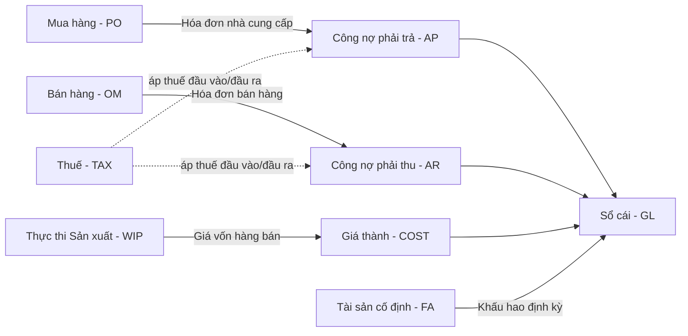

import DocCardList from '@theme/DocCardList';

# Tài chính kế toán (FIN)

Tài chính kế toán (Finance & Accounting - FIN) là phân hệ tổng hợp và "chốt sổ" dữ liệu từ tất cả các phân hệ khác. Công nợ phải trả (AP) nhận dữ liệu từ Mua hàng (PO), Công nợ phải thu (AR) nhận dữ liệu từ Bán hàng (OM), Giá thành (COST) nhận dữ liệu từ Thực thi Sản xuất (WIP) — tất cả cuối cùng đều hạch toán tập trung về Sổ cái (GL). Tài sản cố định (FA) và Thuế (TAX) là hai phân hệ vận hành song song, cắt ngang qua các luồng trên.

## Tương quan phân hệ con với các ERP phổ biến

| Phân hệ con trong tài liệu | SAP | Oracle EBS | Epicor |
|---|---|---|---|
| **Công nợ** *(AP/AR)* | FI-AP / FI-AR (Accounts Payable / Receivable) | Payables (AP), Receivables (AR) | Accounts Payable, Accounts Receivable |
| **Giá thành** *(COST)* | CO-PC (Product Costing) | Cost Management (CST) | Costing (Job Costing, Average/Standard Cost) |
| **Sổ cái** *(GL)* | FI-GL (General Ledger) | General Ledger (GL) | General Ledger |
| **Tài sản cố định** *(FA)* | FI-AA (Asset Accounting) | Fixed Assets (FA) | Fixed Assets |
| **Thuế** *(TAX)* | FI Tax Procedure (Condition-based Tax) | E-Business Tax (EBTax) | Tax Connect (tích hợp Avalara) |

## Sơ đồ luồng nghiệp vụ

## Danh mục tài liệu

<DocCardList />

  <strong>Chúc các bạn thành công và vui vẻ!</strong>

