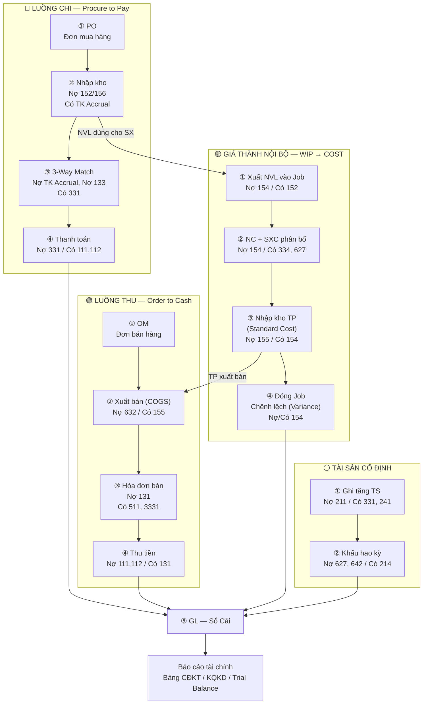
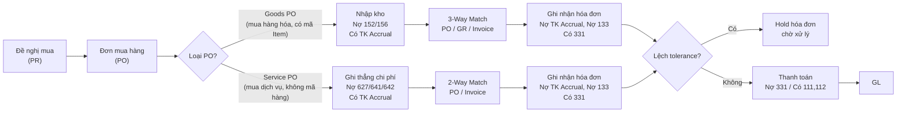
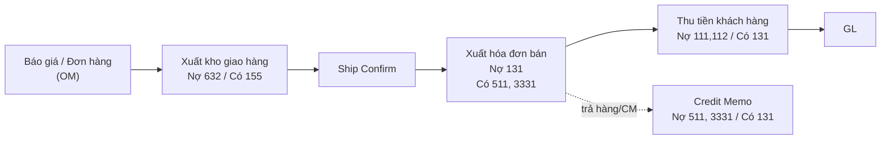
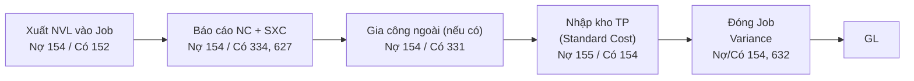

import DocCardList from '@theme/DocCardList';

# Tài chính kế toán (FIN)

Tài chính kế toán (Finance & Accounting - FIN) là phân hệ tổng hợp và "chốt sổ" dữ liệu từ tất cả các phân hệ khác. Công nợ phải trả (AP) nhận dữ liệu từ Mua hàng (PO), Công nợ phải thu (AR) nhận dữ liệu từ Bán hàng (OM), Giá thành (COST) nhận dữ liệu từ Thực thi Sản xuất (WIP) — tất cả cuối cùng đều hạch toán tập trung về Sổ cái (GL). Tài sản cố định (FA) và Thuế (TAX) là hai phân hệ vận hành song song, cắt ngang qua các luồng trên.

## Tương quan phân hệ con với các ERP phổ biến

| Phân hệ con trong tài liệu | SAP | Oracle EBS | Epicor |
|---|---|---|---|
| **Công nợ** *(AP/AR)* | FI-AP / FI-AR (Accounts Payable / Receivable) | Payables (AP), Receivables (AR) | Accounts Payable, Accounts Receivable |
| **Giá thành** *(COST)* | CO-PC (Product Costing) | Cost Management (CST) | Costing (Job Costing, Average/Standard Cost) |
| **Sổ cái** *(GL)* | FI-GL (General Ledger) | General Ledger (GL) | General Ledger |
| **Tài sản cố định** *(FA)* | FI-AA (Asset Accounting) | Fixed Assets (FA) | Fixed Assets |
| **Thuế** *(TAX)* | FI Tax Procedure (Condition-based Tax) | E-Business Tax (EBTax) | Tax Connect (tích hợp Avalara) |

## Sơ đồ luồng dữ liệu ERP

### Tổng quan

Sơ đồ trên cho thấy toàn cảnh: hai luồng **Chi** và **Thu** không tách rời nhau mà được nối qua **Giá thành nội bộ (WIP → COST)** — nguyên vật liệu mua về (luồng Chi) chảy vào sản xuất, thành phẩm sản xuất ra chảy sang bán hàng (luồng Thu). Tài sản cố định vận hành song song, cùng đổ về GL. Chi tiết từng luồng được trình bày riêng bên dưới.

### Luồng Chi tiết (Procure to Pay)

Luồng Chi được tách thành 2 nhánh ngay từ bước phân loại PO, vì bản chất kế toán của hàng hóa và dịch vụ khác nhau:

- **Goods PO** (NVL, hàng hóa, CCDC có mã Item): đi qua nhập kho, giá trị được vốn hóa vào 152/156 trước, đối chiếu qua **3-Way Match** (PO/GR/Invoice) để đảm bảo khớp cả số lượng lẫn đơn giá trước khi ghi nhận công nợ.
- **Service PO** (dịch vụ, chi phí không có hàng vật lý): không qua kho, ghi thẳng vào chi phí (627/641/642) ngay khi ghi nhận hóa đơn, chỉ cần **2-Way Match** (PO/Invoice) vì không có bước xác nhận nhận hàng tại kho.

Cả 2 nhánh đều đi qua **tài khoản trung gian (Accrual)**: khoản nợ tạm tính được ghi nhận ngay tại thời điểm phát sinh nghiệp vụ (nhập kho hoặc ghi chi phí), tách biệt với thời điểm hóa đơn tài chính thực sự về — tránh sai lệch giá trị tồn kho/chi phí khi hóa đơn về trễ. Khi hóa đơn khớp đủ điều kiện (không vượt tolerance), khoản Accrual được tất toán và chuyển thành công nợ chính thức trên 331, chờ thanh toán.

### Luồng Thu chi tiết (Order to Cash)

Luồng Thu tách bạch hai bút toán quan trọng xảy ra gần như đồng thời khi giao hàng: ghi nhận **giá vốn hàng bán (632)** ngay khi xuất kho, và ghi nhận **doanh thu (511)** khi xuất hóa đơn — hai sự kiện này thường không trùng thời điểm với dòng tiền thực thu, nên vẫn cần theo dõi qua 131 cho đến khi khách hàng thanh toán.

### Luồng Giá thành chi tiết (WIP → COST)

Luồng Cost là nơi tích lũy chi phí (NVL, nhân công, SXC, gia công ngoài) vào tài khoản **154 (WIP)** trong suốt vòng đời của Job. Khi hoàn thành, thành phẩm nhập kho theo **giá thành tiêu chuẩn (Standard Cost)**; phần chênh lệch giữa chi phí thực tế phát sinh và giá tiêu chuẩn chỉ được xử lý khi **đóng Job (Variance)** — đây là bước dễ gây lệch sổ nhất nếu không đối chiếu định kỳ giữa Kho và Kế toán giá thành.

## Danh mục tài liệu

<DocCardList />

  <strong>Chúc các bạn thành công và vui vẻ!</strong>

