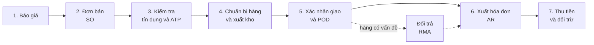

# Tổng quan Bán hàng (Order-to-Cash)

Bán hàng không kết thúc ở lúc ký đơn. Nó kết thúc khi tiền về tài khoản — và trên đường đi có bốn bộ phận khác nhau cùng tham gia: người bán, người kho, người xuất hóa đơn, người thu tiền. Đơn hàng hứa giao thứ kho không có, hóa đơn xuất trước khi hàng đi, tiền thu về nhưng không khớp hóa đơn — đều là những lỗi xảy ra ở **ranh giới giữa các bộ phận**, không phải trong từng bộ phận.

Bài này mô tả toàn cảnh quy trình và ranh giới trách nhiệm. Chi tiết từng bước ở các bài riêng trong cùng khối.

## Quy trình gồm bảy bước

Điểm mấu chốt: **bước 3 là chốt chặn kép** — kiểm tra cả *khách có đủ khả năng trả tiền* (tín dụng) lẫn *mình có đủ hàng để giao* (ATP). Bỏ qua một trong hai thì hoặc mất tiền, hoặc mất uy tín.

## Ba nhóm tài liệu

### 🟢 I. Dữ liệu gốc & Thiết lập nền tảng (Master Data & Setup)

*Mục đích: Xác lập bán cho ai, giá nào, chiết khấu và chính sách — trước khi phát sinh đơn bán.*

- **[1000 Danh mục & chính sách bán](./1000-danh-muc-va-chinh-sach-ban.md)** — Bảng giá, chiết khấu, hạn mức tín dụng, điều kiện giao hàng.

### 🟡 II. Vận hành Order-to-Cash (Operations)

*Mục đích: Luồng chạy thật từ lúc nhận đơn đến lúc thu tiền và xử lý đổi trả.*

- **[2000 Tiếp nhận đơn & ATP](./2000-tiep-nhan-don-va-atp.md)** — Khách có đủ hạn mức? Mình có đủ hàng để hứa giao?
- **[2010 Giao hàng & xuất kho](./2010-giao-hang-va-xuat-kho.md)** — Lấy hàng nào, đóng gói và giao ra sao.
- **[2020 RMA & đổi trả](./2020-rma-va-doi-tra.md)** — Nhận lại hàng và trả tiền khách thế nào.
- **[2030 Mô hình bán đặc thù](./2030-mo-hinh-ban-dac-thu.md)** — Giao thẳng, bán kèm dịch vụ, bán ký gửi, bán dự án.

### 🔴 III. Kiểm soát & Báo cáo (Control & Reporting)

*Mục đích: Đo lường doanh thu, lợi nhuận gộp, tỷ lệ đổi trả và học từ các sai sót thực tế.*

- **[3000 Báo cáo bán hàng](./3000-bao-cao-ban-hang.md)** — Doanh thu theo khách/nhóm hàng/kênh, đơn treo, tỷ lệ giao đúng hạn.
- **[9000 Bẫy thực chiến bán hàng](./9000-bay-ban-hang.md)** — Những lỗi khiến bán hàng thất thu mà sổ sách vẫn cân.

## Ranh giới trách nhiệm

| Việc | Bán hàng quyết định | Kho quyết định | Kế toán quyết định |
|---|---|---|---|
| Bán cho ai, giá bao nhiêu | ✅ | — | — |
| Có đủ hàng để hứa giao | Đọc ATP để trả lời khách | ✅ tính ATP và giữ hàng | — |
| Có xuất hàng được không | Yêu cầu xuất | ✅ kiểm tra và ghi giao dịch | Chặn xuất nếu khách quá hạn nợ |
| Hóa đơn ghi bao nhiêu | Cung cấp điều kiện giá | Cung cấp số lượng thực giao | ✅ xuất và ghi sổ |
| Được bán chịu hay không | ✅ xin duyệt vượt hạn mức | — | ✅ sở hữu hạn mức tín dụng |
| Thu tiền và xóa nợ | Hỗ trợ đối chiếu | — | ✅ |

Nguyên tắc cốt lõi: **người bán không được tự tăng hạn mức tín dụng, người kho không được tự đổi giá, người thu tiền không được tự hủy hóa đơn.**

## Bán hàng liên quan gì tới các phần khác

- **Kho** giữ hàng, trừ tồn và ghi giao dịch xuất: [Giữ hàng, phân bổ & ATP](../1-kho/2010-giu-hang-phan-bo-va-atp.md), [Giao dịch nhập, xuất & chuyển](../1-kho/2000-giao-dich-nhap-xuat-chuyen.md)
- **Công nợ** nhận hóa đơn đã xuất và thực hiện thu tiền: [AR - Nguyên lý & tài khoản](../5-ke-toan/cong-no/2000-ar-nguyen-ly-va-tai-khoan.md)
- **Kế toán chung** nhận bút toán doanh thu và giá vốn: [Hạch toán & tài khoản trung gian](../5-ke-toan/ke-toan-tong-hop/1000-hach-toan-va-tai-khoan-trung-gian.md)
- **Sản xuất** cung cấp thành phẩm cho kho trước khi bán: [Lệnh sản xuất & WIP](../3-san-xuat/2000-lenh-san-xuat-va-wip.md)

## Bắt đầu đọc từ đâu

Nếu triển khai từ đầu, đọc theo thứ tự 1000 → 9000. Nếu đang xử lý sự cố, đi thẳng tới bài tương ứng:

- Hứa giao hàng nhưng kho không có → [Tiếp nhận đơn & ATP](./2000-tiep-nhan-don-va-atp.md)
- Khách quá hạn nợ vẫn đặt được đơn → [Danh mục & chính sách bán](./1000-danh-muc-va-chinh-sach-ban.md)
- Giá bán sai, chiết khấu cộng dồn → [Danh mục & chính sách bán](./1000-danh-muc-va-chinh-sach-ban.md)
- Hàng không qua kho, giao thẳng từ nhà cung cấp → [Mô hình bán đặc thù](./2030-mo-hinh-ban-dac-thu.md)
- Khách trả hàng nhưng công nợ không giảm → [RMA & đổi trả](./2020-rma-va-doi-tra.md)

  <strong>Chúc các bạn thành công và vui vẻ!</strong>

