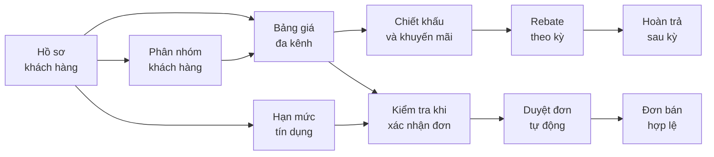

# Danh mục & chính sách bán

Ba quyết định phải có trước khi bán được món hàng đầu tiên: **bán cho ai với hạn mức bao nhiêu**, **bán với giá nào**, và **giảm giá tối đa đến đâu**. Cả ba đều là dữ liệu nền — sai ở đây thì mọi đơn hàng phía sau đều sai, và sửa lại rất tốn kém vì không thể hồi tố các đơn đã xuất.

## Nguyên lý (áp dụng mọi ERP)

1. **Khách hàng là một pháp nhân, không phải một cái tên.** Một khách gắn với mã số thuế, địa chỉ xuất hóa đơn, địa chỉ giao hàng, điều khoản thanh toán. Tạo trùng hai mã cho cùng một khách dẫn tới hạn mức bị chia đôi, công nợ không thấy hết.
2. **Hạn mức tín dụng là rào chắn, không phải lời khuyên.** Nếu hệ thống chỉ cảnh báo mà vẫn cho bán, nhân viên bán hàng luôn chọn bán — vì doanh số của họ tính theo đơn đã ký, không theo tiền đã thu.
3. **Phơi nhiễm tín dụng phải tính cả đơn chưa giao.** Hạn mức không chỉ so với dư nợ hiện tại, mà với *dư nợ + đơn đã xác nhận chưa giao + đơn đang chờ duyệt*. Chỉ so dư nợ thì khách có thể đặt thêm bao nhiêu cũng lọt.
4. **Giá phải có nguồn và có thứ tự ưu tiên rõ ràng.** Bảng giá riêng khách → bảng giá nhóm khách → bảng giá chung. Nếu không có thứ tự, nhân viên tự chọn bảng giá có lợi cho mình.
5. **Chiết khấu phải có quy tắc kết hợp, không được cộng dồn tùy ý.** Chiết khấu nhóm khách 5% cộng chiết khấu số lượng 10% không có nghĩa là 15% — nếu cộng gộp, biên lợi nhuận có thể xuống dưới giá vốn.
6. **Khuyến mãi và rebate là hai thứ khác nhau.** Khuyến mãi giảm giá *tại thời điểm bán* (tác động ngay vào doanh thu đơn). Rebate là khoản hoàn trả *sau kỳ* dựa trên tổng mua (tác động chi phí sau). Gộp chung hai loại làm báo cáo lãi lỗ sai kỳ.

## 1. Luồng vận hành



## 2. Ai làm gì ở module nào

| Việc | Bán hàng (OM) | Kế toán | Ban điều hành | Kho |
|---|---|---|---|---|
| Tạo và cập nhật hồ sơ khách hàng | ✅ đề xuất | ✅ duyệt MST, điều khoản thanh toán | — | — |
| Phân nhóm khách hàng và kênh bán | ✅ sở hữu | — | ✅ duyệt phân khúc | — |
| Cấp và thay đổi hạn mức tín dụng | ✅ đề xuất | ✅ sở hữu, dựa trên lịch sử thanh toán | ✅ duyệt hạn mức lớn | — |
| Khóa đơn khi quá hạn nợ | ✅ thực thi trong đơn | ✅ sở hữu quy tắc | — | Chặn xuất hàng |
| Khai bảng giá và chiết khấu | ✅ sở hữu | Kiểm tra có dưới giá vốn không | ✅ duyệt chính sách giá | — |
| Chương trình khuyến mãi | ✅ sở hữu | Theo dõi tác động doanh thu | ✅ duyệt ngân sách khuyến mãi | ✅ đủ hàng cho khuyến mãi |
| Chính sách rebate | ✅ đề xuất | ✅ hạch toán trích lập và hoàn trả | ✅ duyệt | — |
| Luồng duyệt đơn tự động | ✅ cấu hình | Duyệt theo hạn mức chiết khấu | ✅ duyệt ngoại lệ | — |

**Ranh giới cốt lõi:** người **bán** không được **cấp hạn mức tín dụng** cho khách của mình; người **bán** không được **duyệt chiết khấu** vượt mức đã thỏa thuận.

## 3. Hạch toán

Dữ liệu nền bán hàng không sinh bút toán, nhưng quyết định số tiền trên bút toán doanh thu:

- **Hạn mức tín dụng** quyết định doanh thu có được ghi nhận hay bị treo chờ duyệt.
- **Bảng giá và chiết khấu** quyết định số tiền doanh thu — chiết khấu thương mại là giảm trừ doanh thu, không phải chi phí.
- **Khuyến mãi tại thời điểm bán** (giảm giá, quà tặng) cũng là giảm trừ doanh thu hoặc chi phí bán hàng tùy bản chất.
- **Rebate theo kỳ** là khoản trích lập trong kỳ và hoàn trả khi đạt ngưỡng — phải tính trước vào chi phí bán hàng, không đợi tới khi trả.

Bản đồ tài khoản ở [Hạch toán & tài khoản trung gian](../5-ke-toan/ke-toan-tong-hop/1000-hach-toan-va-tai-khoan-trung-gian.md); doanh thu và thuế ở [AR - Nguyên lý & tài khoản](../5-ke-toan/cong-no/2000-ar-nguyen-ly-va-tai-khoan.md).

## 4. Điểm chạm & rủi ro

- **Dùng hạn mức khi xác nhận đơn**: [Tiếp nhận đơn & ATP](./2000-tiep-nhan-don-va-atp.md)
- **Dùng bảng giá khi lập đơn**: [Tiếp nhận đơn & ATP](./2000-tiep-nhan-don-va-atp.md)
- **Chặn xuất hàng khi khách quá hạn nợ**: [Giao hàng & xuất kho](./2010-giao-hang-va-xuat-kho.md)
- **Hạn mức và dư nợ thực tế**: [AR - Xuất hóa đơn & hạn mức tín dụng](../5-ke-toan/cong-no/2010-ar-xuat-hoa-don-va-han-muc-tin-dung.md)
- **Chống trùng khách hàng**: [Kiểm soát nội bộ & phân tách nhiệm vụ](../0-nen-tang/2010-kiem-soat-noi-bo-va-phan-tach-nhiem-vu.md)

**Rủi ro chính:**

- **Trùng mã khách hàng** — hạn mức bị chia đôi, không thấy được tổng dư nợ thật.
- **Hạn mức chỉ so dư nợ** — khách đặt thêm không giới hạn vì đơn chưa giao chưa tính.
- **Chọn sai bảng giá** — bán giá sỉ cho khách lẻ hoặc ngược lại.
- **Cộng dồn chiết khấu** — biên lợi nhuận xuống dưới giá vốn mà không ai kiểm.
- **Nhân viên tự duyệt chiết khấu** — chính sách giá mất hiệu lực.
- **Rebate hạch toán khi trả thay vì trích lập** — lãi kỳ trước cao giả, kỳ trả thấp giả.

## 5. Triển khai tham chiếu ERP

### A. Ánh xạ khái niệm

| Khái niệm | Oracle EBS R12 | Epicor ERP | SAP S/4HANA | Odoo |
|---|---|---|---|---|
| Hồ sơ khách hàng | TCA: `HZ_PARTIES` + `HZ_CUST_ACCOUNTS` + site | `Erp.Customer` | Business Partner + Customer role | `res.partner` |
| Hạn mức tín dụng | `HZ_CUSTOMER_PROFILES` | `Erp.Customer` (Credit fields) | `UKMB_BPAR` (Credit Data) | `res.partner.credit_limit` |
| Quy tắc kiểm tra tín dụng | `OE_CREDIT_CHECK_RULES` | `Erp.Company` (Grace Period) | `T024B` (Credit Groups) | Rules / workflows |
| Khóa đơn tín dụng | `OE_ORDER_HOLDS_ALL` | `Erp.OrderHed.CreditHold` | `VBAK.CMGST` | Trạng thái trên `sale.order` |
| Bảng giá | `QP_LIST_HEADERS` / `QP_LIST_LINES` | `Erp.PriceLst` / `PriceLstParts` | `KONH` / `KONP` | `product.pricelist` / `.item` |
| Giá bậc thang theo số lượng | Attribute của `QP_LIST_LINES` | `Erp.PriceLstPartsBreak` | `KONM` (Quantity Scales) | `product.pricelist.item` |
| Chiết khấu / khuyến mãi | `QP_MODIFIERS_PUB` | `Erp.Discount` | Access Sequence `A000`–`A999` | `coupon.program` |
| Rebate theo kỳ | Rebate Agreement (`QP`) | `Rebate` module | Settlement Management (Rebate) | Cần tùy biến |

### B. Hệ thống tự xây — thiết kế tối thiểu

```sql
CREATE TABLE Customer (
    Customer_ID      VARCHAR(50) PRIMARY KEY,
    Tax_Code         VARCHAR(30) NOT NULL UNIQUE,   -- chống trùng khách
    Legal_Name       NVARCHAR(200) NOT NULL,
    Customer_Group   VARCHAR(20) NOT NULL,
    Payment_Terms    VARCHAR(20) NOT NULL,
    Credit_Limit     DECIMAL(18,2) NOT NULL DEFAULT 0,
    Credit_Blocked   BIT NOT NULL DEFAULT 0,
    Status           VARCHAR(20) NOT NULL DEFAULT 'ACTIVE'
);

CREATE TABLE Price_List_Line (
    Price_List_ID    VARCHAR(20) NOT NULL,
    Item_ID          VARCHAR(50) NOT NULL,
    Min_Qty          DECIMAL(18,4) NOT NULL DEFAULT 1,
    Unit_Price       DECIMAL(18,4) NOT NULL,
    Currency         VARCHAR(3)  NOT NULL,
    Valid_From       DATE NOT NULL,
    Valid_To         DATE NOT NULL,
    PRIMARY KEY (Price_List_ID, Item_ID, Min_Qty, Valid_From)
);

CREATE TABLE Discount_Rule (
    Rule_ID          INT IDENTITY PRIMARY KEY,
    Rule_Type        VARCHAR(20) NOT NULL,   -- CUSTOMER_GROUP | QUANTITY | PROMO
    Customer_Group   VARCHAR(20) NULL,
    Min_Qty          DECIMAL(18,4) NULL,
    Discount_Pct     DECIMAL(6,2) NULL,
    Stackable        BIT NOT NULL DEFAULT 0, -- 1 = được cộng dồn
    Priority         INT NOT NULL DEFAULT 5
);
```

Bốn ràng buộc bắt buộc:

1. **`Tax_Code` UNIQUE** — chặn trùng khách ngay ở tầng dữ liệu.
2. **Phơi nhiễm tín dụng** phải tính `Dư nợ + Đơn đã xác nhận chưa giao + Đơn chờ duyệt`, không chỉ dư nợ.
3. **`Stackable = 0` là mặc định** — chỉ những quy tắc được phép kết hợp mới bật cờ này, và phải có trần chiết khấu tổng.
4. **Bảng giá phải bắt buộc có `Valid_From`/`Valid_To`** — tránh giá hết hiệu lực vẫn áp dụng.

### C. Truy vấn kiểm soát

**Khách hàng trùng mã số thuế:**

```sql
SELECT Tax_Code, COUNT(*) AS So_Ma, STRING_AGG(Customer_ID, ', ') AS Cac_Ma
FROM Customer
WHERE Status = 'ACTIVE'
GROUP BY Tax_Code
HAVING COUNT(*) > 1;
```

**Phơi nhiễm tín dụng vượt hạn mức — khách vẫn đặt đơn mới:**

```sql
SELECT c.Customer_ID, c.Legal_Name, c.Credit_Limit,
       ISNULL(ar.Open_Balance, 0)         AS Du_No,
       ISNULL(so.Order_Not_Shipped, 0)    AS Don_Chua_Giao,
       ISNULL(ar.Open_Balance, 0) + ISNULL(so.Order_Not_Shipped, 0) AS Exposure,
       ISNULL(ar.Open_Balance, 0) + ISNULL(so.Order_Not_Shipped, 0) - c.Credit_Limit AS Over_By
FROM Customer c
LEFT JOIN (SELECT Customer_ID, SUM(Open_Amount) AS Open_Balance
           FROM AR_Invoice WHERE Status = 'OPEN' GROUP BY Customer_ID) ar
       ON ar.Customer_ID = c.Customer_ID
LEFT JOIN (SELECT Customer_ID, SUM(Amount_Not_Shipped) AS Order_Not_Shipped
           FROM Sales_Order WHERE Status IN ('CONFIRMED', 'PARTIAL') GROUP BY Customer_ID) so
       ON so.Customer_ID = c.Customer_ID
WHERE ISNULL(ar.Open_Balance, 0) + ISNULL(so.Order_Not_Shipped, 0) > c.Credit_Limit
ORDER BY Over_By DESC;
```

**Đơn bán có tổng chiết khấu vượt ngưỡng cho phép — nguy cơ bán dưới giá vốn:**

```sql
SELECT so.Order_No, so.Customer_ID,
       SUM(sl.Line_Amount)      AS Doanh_Thu_Sau_CK,
       SUM(sl.List_Amount)      AS Gia_Niem_Yet,
       (1 - SUM(sl.Line_Amount) / NULLIF(SUM(sl.List_Amount), 0)) * 100 AS Discount_Pct
FROM Sales_Order so
JOIN Sales_Order_Line sl ON sl.Order_ID = so.Order_ID
WHERE so.Order_Date >= DATEADD(MONTH, -3, GETDATE())
GROUP BY so.Order_No, so.Customer_ID
HAVING (1 - SUM(sl.Line_Amount) / NULLIF(SUM(sl.List_Amount), 0)) * 100 > 30
ORDER BY Discount_Pct DESC;
```

**Bảng giá đã hết hiệu lực nhưng vẫn được dùng trên đơn mới:**

```sql
SELECT so.Order_No, so.Order_Date, pl.Price_List_ID, pl.Valid_To
FROM Sales_Order so
JOIN Sales_Order_Line sl  ON sl.Order_ID = so.Order_ID
JOIN Price_List_Line pl   ON pl.Price_List_ID = sl.Price_List_ID
                         AND pl.Item_ID = sl.Item_ID
WHERE so.Order_Date > pl.Valid_To;
```

**Epicor — khách hàng đang bị khóa tín dụng nhưng có đơn mở:**

```sql
SELECT oh.OrderNum, oh.CustNum, c.Name, oh.OrderDate, oh.CreditHold
FROM Erp.OrderHed oh
JOIN Erp.Customer c ON c.Company = oh.Company AND c.CustNum = oh.CustNum
WHERE oh.Company = 'YOUR_COMPANY_CODE'
  AND oh.OpenOrder = 1
  AND c.CreditHold = 1
ORDER BY oh.OrderDate;
```

## 6. Bẫy thực chiến & Checklist

| # | Bẫy | Triệu chứng | Cách phòng tránh |
|---|---|---|---|
| 1 | Trùng mã khách hàng | Hạn mức chia đôi, không thấy tổng dư nợ thật | `Tax_Code` UNIQUE + tìm trước khi tạo |
| 2 | Hạn mức chỉ so dư nợ | Khách đặt thêm vô hạn vì đơn chưa giao chưa tính | Exposure = dư nợ + đơn chưa giao + đơn chờ duyệt |
| 3 | Hạn mức chỉ cảnh báo, không chặn | Nhân viên bán luôn chọn bán, nợ xấu tăng | Chặn ở tầng hệ thống, muốn vượt phải duyệt |
| 4 | Chọn sai bảng giá | Bán giá sỉ cho khách lẻ, hoặc ngược lại | Thứ tự ưu tiên cố định: khách → nhóm → chung |
| 5 | Cộng dồn chiết khấu tùy ý | 5% + 10% thành 15%, biên lợi nhuận âm | `Stackable = 0` mặc định + trần chiết khấu tổng |
| 6 | Không kiểm chiết khấu so với giá vốn | Bán dưới giá thành mà không ai biết | Báo cáo đơn có chiết khấu > 30% |
| 7 | Bảng giá hết hạn vẫn áp dụng | Bán theo giá 6 tháng trước, lỗ thầm | `Valid_From`/`Valid_To` bắt buộc, chặn áp ngoài khoảng |
| 8 | Gộp khuyến mãi và rebate | Lãi kỳ trước cao giả, kỳ trả thấp giả | Khuyến mãi giảm doanh thu tại chỗ; rebate trích lập chi phí |
| 9 | Không trích lập rebate trong kỳ | Đạt ngưỡng cuối năm mới biết, lãi năm bị đảo | Trích lập theo tỷ lệ doanh số, tất toán cuối kỳ |
| 10 | Nhân viên bán tự duyệt chiết khấu | Chính sách giá chỉ còn trên giấy | SoD: người bán ≠ người duyệt chiết khấu vượt mức |

**Checklist trước go-live:**

- [ ] `Tax_Code` UNIQUE trên khách hàng (đã test tạo trùng bị chặn).
- [ ] Công thức phơi nhiễm tín dụng gồm dư nợ + đơn chưa giao + đơn chờ duyệt (đã đối chiếu tay).
- [ ] Khóa đơn là chặn thật ở tầng hệ thống, không chỉ cảnh báo.
- [ ] Thứ tự ưu tiên bảng giá đã cố định: khách → nhóm → chung.
- [ ] Chiết khấu mặc định không cộng dồn; có trần chiết khấu tổng.
- [ ] Có báo cáo đơn vượt ngưỡng chiết khấu.
- [ ] Bảng giá bắt buộc có ngày hiệu lực, chặn áp dụng ngoài khoảng (đã test).
- [ ] Tách rõ khuyến mãi (giảm doanh thu) và rebate (trích lập chi phí).
- [ ] Rebate có trích lập định kỳ, không đợi tới khi trả.
- [ ] SoD: bán hàng / cấp hạn mức / duyệt chiết khấu là các vai trò tách biệt.

## Xem thêm

- [Tổng quan Bán hàng](./0000-tong-quan-o2c.md)
- [Tiếp nhận đơn & ATP](./2000-tiep-nhan-don-va-atp.md)
- [Giao hàng & xuất kho](./2010-giao-hang-va-xuat-kho.md)
- [AR - Xuất hóa đơn & hạn mức tín dụng](../5-ke-toan/cong-no/2010-ar-xuat-hoa-don-va-han-muc-tin-dung.md)
- [Kiểm soát nội bộ & phân tách nhiệm vụ](../0-nen-tang/2010-kiem-soat-noi-bo-va-phan-tach-nhiem-vu.md)

<div align="center" style={{color: 'var(--ifm-color-primary)'}}>
  <strong>Chúc các bạn thành công và vui vẻ!</strong>
</div>
