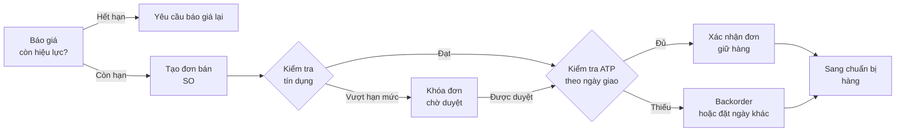

# Tiếp nhận đơn & ATP

Đơn bán hàng là **cam kết hai chiều**: khách cam kết mua, doanh nghiệp cam kết giao. Hầu hết tranh chấp bán hàng bắt nguồn từ bước này — hoặc hứa giao hàng không có, hoặc hứa giá không có phép, hoặc nhận đơn của khách không đủ khả năng thanh toán.

Bài này nói về ba chốt chặn khi xác nhận đơn: **giá**, **tín dụng**, và **khả năng cung ứng (ATP)**.

## Nguyên lý (áp dụng mọi ERP)

1. **Báo giá là văn bản có hạn, không phải bảng giá tham khảo.** Giá chào gắn với thời điểm và điều kiện thị trường. Dùng báo giá hết hạn để tạo đơn là tự nguyện bán lỗ.
2. **Chuyển báo giá sang đơn phải mang theo dữ liệu, không gõ lại.** Nhập lại bằng tay dẫn tới lệch giá, lệch số lượng, lệch điều khoản — và không dòng nào có dấu vết đối chiếu.
3. **ATP trả lời "giao được khi nào", không phải "có bao nhiêu".** Công thức phải tính tồn khả dụng **+ hàng đang về (PO)** **+ hàng đang sản xuất** **− đơn đã cam kết**, theo trục thời gian. Chỉ nhìn tồn hiện tại thì hoặc từ chối đơn đáp ứng được, hoặc hứa ngày giao không thực hiện được.
4. **Đơn đã cam kết phải trừ khỏi ATP ngay khi xác nhận.** Nếu chờ đến lúc xuất kho mới trừ, hai nhân viên bán sẽ cùng bán một lượng hàng cho hai khách khác nhau.
5. **Đơn chưa xác nhận cũng phải chiếm chỗ trong hạn mức tín dụng.** Khách đặt 10 đơn nháp chưa duyệt vẫn không được coi là sạch nợ.
6. **Backorder là trạng thái hợp lệ, không phải lỗi.** Khách đặt trước khi hết hàng là chuyện bình thường — nhưng phải hiển thị rõ ngày dự kiến và không được coi là đã có hàng.

## 1. Luồng vận hành



Bốn điểm chốt: **báo giá còn hạn**, **tín dụng đạt**, **ATP đạt theo ngày khách cần**, và **giữ hàng ngay khi xác nhận**. Bỏ bước cuối, hai đơn có thể bán cùng một lượng hàng.

## 2. Ai làm gì ở module nào

| Bước | Bán hàng (OM) | Kho | Kế toán | Sản xuất | Mua hàng |
|---|---|---|---|---|---|
| Tạo và gửi báo giá | ✅ sở hữu | — | — | Cung cấp lead time nếu là hàng sản xuất | — |
| Kiểm tra hiệu lực báo giá | ✅ tự động | — | — | — | — |
| Chuyển báo giá sang đơn | ✅ sở hữu | — | — | — | — |
| Kiểm tra tín dụng | Đọc kết quả, xin duyệt vượt | — | ✅ sở hữu hạn mức và quy tắc | — | — |
| Kiểm tra ATP | ✅ gọi động cơ ATP | ✅ cung cấp tồn khả dụng và giữ hàng | — | Cung cấp ngày hoàn thành dự kiến | Cung cấp ngày giao của PO |
| Giữ hàng khi xác nhận | ✅ yêu cầu | ✅ thực thi giữ hàng | — | Giữ nguyên liệu nếu là lệnh SX liên kết | — |
| Xử lý backorder | ✅ thông báo khách | Đọc hàng sắp về | — | Ưu tiên lệnh SX cho đơn trễ | Ưu tiên PO cho đơn trễ |
| Duyệt đơn ngoại lệ | ✅ trình duyệt | — | ✅ duyệt vượt tín dụng | — | — |

## 3. Hạch toán

Đơn bán **chưa sinh bút toán doanh thu** — doanh thu ghi khi xuất hóa đơn, giá vốn ghi khi xuất kho. Nhưng đơn đã xác nhận có hai hệ quả tài chính gián tiếp:

- **Chiếm hạn mức tín dụng của khách** — ảnh hưởng đến khả năng nhận đơn tiếp theo.
- **Cam kết chi phí sản xuất/mua hàng** nếu là đơn sản xuất theo đơn hoặc đơn mua liên kết — xem [Mô hình bán đặc thù](./2030-mo-hinh-ban-dac-thu.md).

Bản đồ tài khoản doanh thu, thuế và giá vốn ở [AR - Nguyên lý & tài khoản](../5-ke-toan/cong-no/2000-ar-nguyen-ly-va-tai-khoan.md) và [Hạch toán & tài khoản trung gian](../5-ke-toan/ke-toan-tong-hop/1000-hach-toan-va-tai-khoan-trung-gian.md).

## 4. Điểm chạm & rủi ro

- **Hạn mức và khóa đơn**: [Danh mục & chính sách bán](./1000-danh-muc-va-chinh-sach-ban.md)
- **Cơ chế tính ATP và giữ hàng** (bài gốc): [Giữ hàng, phân bổ & ATP](../1-kho/2010-giu-hang-phan-bo-va-atp.md)
- **Xuất kho theo đơn**: [Giao hàng & xuất kho](./2010-giao-hang-va-xuat-kho.md)
- **Ngày hoàn thành lệnh sản xuất**: [Lệnh sản xuất & WIP](../3-san-xuat/2000-lenh-san-xuat-va-wip.md)
- **Ngày giao của đơn mua**: [Đơn mua hàng](../2-mua-hang/2000-don-mua-hang.md)

**Rủi ro chính:**

- **Báo giá hết hạn vẫn tạo được đơn** — bán theo giá cũ, lỗ thầm.
- **Gõ lại đơn từ báo giá bằng tay** — sai giá, sai số lượng, không đối chiếu được.
- **ATP chỉ nhìn tồn hiện tại** — từ chối đơn lẽ ra đáp ứng được, hoặc hứa ngày giao không thực hiện được.
- **Không giữ hàng khi xác nhận** — hai đơn cùng bán một lượng hàng, một khách bị bỏ rơi.
- **Không tính đơn chưa giao vào tín dụng** — khách đặt vượt hạn mức.
- **Backorder giấu khách** — khách chờ vô vọng, mất uy tín khi phát hiện.

## 5. Triển khai tham chiếu ERP

### A. Ánh xạ khái niệm

| Khái niệm | Oracle EBS R12 | Epicor ERP | SAP S/4HANA | Odoo |
|---|---|---|---|---|
| Báo giá | `OE_ORDER_HEADERS_ALL` (phase `NEGOTIATE`) | `Erp.QuoteHed` / `QuoteDtl` | `VBAK` với `VBTYP = 'B'` | `sale.order` state `draft`/`sent` |
| Đơn bán | `OE_ORDER_HEADERS_ALL` (phase `FULFILL`) | `Erp.OrderHed` / `OrderDtl` | `VBAK` với `VBTYP = 'C'` | `sale.order` state `sale` |
| Liên kết báo giá → đơn | `QUOTE_NUMBER` trên header | `OrderDtl.QuoteNum`, `QuoteLine` | `VBFA` (document flow) | `sale.order` tự tham chiếu |
| Cờ bật ATP | `MTL_SYSTEM_ITEMS_B.atp_flag` | `Erp.Part.CheckATP` | `MARC.MTVFP` (check group) | Route / product type |
| Quy tắc ATP | `MSC_ATP_RULES` / GOP | `PartClass` / Scheduling Rules | `T399D` (MRP Controller) | Lead times & lead days |
| Nhu cầu đã cam kết | `MTL_DEMAND` / `OE_ORDER_LINES_ALL` | `PartWhse.DemandQty` | `VBBE` (individual requirements) | `stock.move` chờ |
| Ngày giao cam kết | `SCHEDULE_SHIP_DATE` | `OrderRel.NeedByDate` | `VBEP.EDATU` | `sale_order_line.commitment_date` |

### B. Hệ thống tự xây — thiết kế tối thiểu

```sql
CREATE TABLE Sales_Order (
    Order_ID         BIGINT IDENTITY PRIMARY KEY,
    Order_No         VARCHAR(30) NOT NULL UNIQUE,
    Quote_No         VARCHAR(30) NULL,
    Customer_ID      VARCHAR(50) NOT NULL,
    Order_Date       DATE NOT NULL,
    Request_Date     DATE NOT NULL,
    Status           VARCHAR(20) NOT NULL,
    -- DRAFT | ON_HOLD_CREDIT | CONFIRMED | PARTIAL | SHIPPED | CLOSED | CANCELLED
    Credit_Exposure  DECIMAL(18,2) NULL,
    Hold_Reason      VARCHAR(50) NULL
);

CREATE TABLE Sales_Order_Line (
    Order_ID         BIGINT NOT NULL,
    Line_No          INT NOT NULL,
    Item_ID          VARCHAR(50) NOT NULL,
    Qty_Ordered      DECIMAL(18,4) NOT NULL,
    Qty_Allocated    DECIMAL(18,4) NOT NULL DEFAULT 0,
    Qty_Shipped      DECIMAL(18,4) NOT NULL DEFAULT 0,
    Unit_Price       DECIMAL(18,4) NOT NULL,
    Request_Date     DATE NOT NULL,
    Price_List_ID    VARCHAR(20) NOT NULL,
    PRIMARY KEY (Order_ID, Line_No)
);

CREATE TABLE Quote (
    Quote_No         VARCHAR(30) PRIMARY KEY,
    Customer_ID      VARCHAR(50) NOT NULL,
    Valid_Until      DATE NOT NULL,        -- bắt buộc
    Status           VARCHAR(20) NOT NULL  -- DRAFT | SENT | ACCEPTED | EXPIRED | LOST
);
```

Bốn ràng buộc bắt buộc:

1. **`Quote.Valid_Until` bắt buộc** và chặn tạo đơn từ quote đã hết hạn, trừ khi có duyệt ngoại lệ.
2. **Đơn tạo từ quote phải copy dữ liệu** (giá, số lượng, điều khoản) bằng tham chiếu, không nhập tay.
3. **Đếm `Qty_Allocated` và `Qty_Shipped` trên dòng đơn**, và ATP phải trừ `Qty_Ordered − Qty_Shipped` của mọi đơn `CONFIRMED`.
4. **Kiểm tra tín dụng tính cả đơn `DRAFT` và `ON_HOLD_CREDIT`** — không chỉ đơn đã xác nhận.

### C. Truy vấn kiểm soát

**Đơn tạo từ báo giá đã hết hạn:**

```sql
SELECT so.Order_No, so.Order_Date, q.Quote_No, q.Valid_Until
FROM Sales_Order so
JOIN Quote q ON q.Quote_No = so.Quote_No
WHERE so.Order_Date > q.Valid_Until
  AND so.Status <> 'CANCELLED';
```

**Bán vượt ATP — tổng cam kết lớn hơn tồn khả dụng khi không có hàng về:**

```sql
SELECT sl.Item_ID, sl.Request_Date,
       SUM(sl.Qty_Ordered - sl.Qty_Shipped) AS Qty_Committed,
       ISNULL(oh.Qty_Available, 0)          AS Qty_Available
FROM Sales_Order_Line sl
JOIN Sales_Order so ON so.Order_ID = sl.Order_ID
LEFT JOIN (
    SELECT Item_ID, SUM(Qty) AS Qty_Available
    FROM Inventory_Transaction t
    JOIN Inv_Location l ON l.Location_ID = t.To_Location_ID AND l.Location_Type = 'PHYSICAL'
    WHERE t.Is_Logical = 0
    GROUP BY Item_ID
) oh ON oh.Item_ID = sl.Item_ID
WHERE so.Status = 'CONFIRMED'
GROUP BY sl.Item_ID, sl.Request_Date, oh.Qty_Available
HAVING SUM(sl.Qty_Ordered - sl.Qty_Shipped) > ISNULL(MAX(oh.Qty_Available), 0)
   AND NOT EXISTS (
       SELECT 1 FROM Supply_Forecast f
       WHERE f.Item_ID = sl.Item_ID AND f.Expected_Date <= sl.Request_Date);
```

**Đơn confirm nhưng không giữ hàng — rủi ro bán trùng:**

```sql
SELECT so.Order_No, sl.Line_No, sl.Item_ID, sl.Qty_Ordered, sl.Qty_Allocated
FROM Sales_Order so
JOIN Sales_Order_Line sl ON sl.Order_ID = so.Order_ID
WHERE so.Status IN ('CONFIRMED', 'PARTIAL')
  AND sl.Qty_Allocated = 0;
```

**Đơn bị khóa tín dụng quá lâu — cơ hội bán đang mất:**

```sql
SELECT Order_No, Customer_ID, Order_Date, Credit_Exposure, Hold_Reason,
       DATEDIFF(DAY, Order_Date, GETDATE()) AS Days_Held
FROM Sales_Order
WHERE Status = 'ON_HOLD_CREDIT'
  AND DATEDIFF(DAY, Order_Date, GETDATE()) > 3
ORDER BY Days_Held DESC;
```

**Epicor — đơn đã xác nhận nhưng chưa cấp phát, trễ ngày yêu cầu:**

```sql
SELECT oh.OrderNum, c.Name, od.PartNum, od.OrderQty,
       od.RequestDate, DATEDIFF(DAY, od.RequestDate, GETDATE()) AS Days_Late
FROM Erp.OrderHed oh
JOIN Erp.OrderDtl od ON od.Company = oh.Company AND od.OrderNum = oh.OrderNum
JOIN Erp.Customer c  ON c.Company = oh.Company AND c.CustNum = oh.CustNum
WHERE oh.Company = 'YOUR_COMPANY_CODE'
  AND oh.OpenOrder = 1
  AND oh.CreditHold = 0
  AND od.RequestDate < GETDATE()
  AND NOT EXISTS (
      SELECT 1 FROM Erp.PartDtl pd
      WHERE pd.Company = od.Company AND pd.OrderNum = od.OrderNum
        AND pd.OrderLine = od.OrderLine AND pd.AllocatedQty > 0)
ORDER BY Days_Late DESC;
```

## 6. Bẫy thực chiến & Checklist

| # | Bẫy | Triệu chứng | Cách phòng tránh |
|---|---|---|---|
| 1 | Báo giá hết hạn vẫn tạo đơn | Bán theo giá 6 tháng trước, lỗ thầm | `Valid_Until` bắt buộc, chặn tạo đơn ngoài hạn |
| 2 | Gõ lại đơn từ báo giá | Sai giá, sai lượng, không đối chiếu được với báo giá | Copy dữ liệu bằng tham chiếu `Quote_No` |
| 3 | ATP chỉ nhìn tồn hiện tại | Từ chối đơn đáp ứng được, hoặc hứa ngày giao không thực hiện | ATP theo trục thời gian: tồn + về + SX − cam kết |
| 4 | Không giữ hàng khi xác nhận | Hai đơn bán cùng một lượng hàng | Giữ hàng ngay trong transaction xác nhận đơn |
| 5 | Không khóa dòng khi kiểm ATP | Hai đơn cùng lúc thấy "đủ hàng", cùng xác nhận | Khóa dòng tồn trong transaction kiểm tra và giữ |
| 6 | Tín dụng chỉ tính dư nợ | Khách đặt vượt hạn mức bằng nhiều đơn chưa giao | Exposure = dư nợ + chưa giao + đơn chờ duyệt |
| 7 | Backorder không thông báo khách | Khách chờ vô vọng, phát hiện muộn thì mất uy tín | Đơn trễ tự động hiển thị ngày dự kiến |
| 8 | Đồng bộ đơn đa kênh không chống trùng | Cùng một đơn từ sàn về hai lần, xuất hàng hai lần | Khóa unique theo `(kênh, mã đơn ngoài)` |
| 9 | Đơn nháp chiếm hàng vĩnh viễn | Kho bị giữ cho đơn không bao giờ xác nhận | Hết hạn giữ hàng cho đơn nháp |
| 10 | Đổi ngày giao sau khi giữ hàng, không kiểm lại ATP | Hàng đã giữ cho ngày cũ, khách cần ngày mới không có | Đổi ngày giao phải chạy lại ATP |

**Checklist trước go-live:**

- [ ] `Quote.Valid_Until` bắt buộc; đã test chặn tạo đơn từ quote hết hạn.
- [ ] Đơn từ báo giá copy dữ liệu bằng tham chiếu (đối chiếu 10 đơn mẫu).
- [ ] ATP tính cả hàng đang về và đang sản xuất (đã đối chiếu với kế hoạch thật).
- [ ] Giữ hàng nằm trong cùng transaction với xác nhận đơn (đã test hai đơn song song).
- [ ] Tín dụng tính cả đơn nháp và đơn chờ duyệt.
- [ ] Backorder hiển thị ngày dự kiến cho khách.
- [ ] Đồng bộ đa kênh có khóa chống trùng theo mã đơn ngoài (đã test gửi lặp).
- [ ] Đơn nháp có hạn giữ hàng, tự giải phóng khi hết hạn.
- [ ] Đổi ngày giao chạy lại ATP (đã test).
- [ ] Có báo cáo đơn khóa tín dụng quá 3 ngày.

## Xem thêm

- [Tổng quan Bán hàng](./0000-tong-quan-o2c.md)
- [Danh mục & chính sách bán](./1000-danh-muc-va-chinh-sach-ban.md)
- [Giao hàng & xuất kho](./2010-giao-hang-va-xuat-kho.md)
- [Giữ hàng, phân bổ & ATP](../1-kho/2010-giu-hang-phan-bo-va-atp.md)
- [Lệnh sản xuất & WIP](../3-san-xuat/2000-lenh-san-xuat-va-wip.md)

<div align="center" style={{color: 'var(--ifm-color-primary)'}}>
  <strong>Chúc các bạn thành công và vui vẻ!</strong>
</div>
