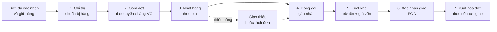

# Giao hàng & xuất kho

Đây là **điểm chuyển giao quan trọng nhất trong toàn bộ chuỗi bán hàng**: hàng rời kho của doanh nghiệp, quyền sở hữu có thể chuyển sang khách, và từ đây hệ thống mới được phép ghi giá vốn. Mọi sai lệch ở bước này dẫn tới hai lỗi nghiêm trọng: **ghi doanh thu non** (hàng chưa tới khách đã ghi) hoặc **bán hàng không có thật** (ghi giá vốn mà hàng vẫn còn trong kho).

## Nguyên lý (áp dụng mọi ERP)

1. **Nhặt hàng, xuất kho và giao hàng là ba sự kiện khác nhau.** Nhặt hàng là thao tác của thủ kho trong kho; xuất kho là **giao dịch trừ tồn**; giao hàng là hàng tới tay khách. Gộp ba việc vào một nút bấm khiến không ai biết hàng đang ở đâu.
2. **Xuất kho và chuyển quyền sở hữu có thể không cùng lúc.** Điều kiện giao hàng quyết định thời điểm chuyển rủi ro và lợi ích. Ghi doanh thu theo ngày xuất kho khi Incoterms là DDP/DAP là **ghi doanh thu non** — hàng còn trên xe, chưa phải của khách.
3. **Gom đợt (wave) là tối ưu đường đi, không phải tối ưu cho đẹp.** Nhặt hàng đơn lẻ khiến thủ kho đi hết chiều dài kho nhiều lần cho cùng một mã hàng. Gom đợt theo tuyến đường và theo nhà vận chuyển giảm thời gian soạn hàng đáng kể.
4. **Số lượng giao thực tế là con số duy nhất dùng để xuất hóa đơn.** Không phải số lượng đặt, không phải số lượng nhặt — là số lượng khách ký nhận. Lệch ở đây là nguồn gốc của mọi tranh chấp công nợ.
5. **POD là bằng chứng, không phải thủ tục.** Không có POD thì khi khách phủ nhận đã nhận hàng, doanh nghiệp không có căn cứ đòi nợ.
6. **Xuất kho phải đồng thời trừ tồn và ghi giá vốn.** Nếu trừ tồn mà không ghi giá vốn, hàng tồn sổ sách giảm nhưng chi phí không tăng — lợi nhuận bị thổi phồng.

## 1. Luồng vận hành



**Đọc sơ đồ:** mũi tên nét đứt là nhánh thực tế luôn xảy ra — nhặt hàng thiếu so với đơn. Xử lý đúng nhánh này (giao thiếu, tách đơn, hoặc backorder phần còn lại) quan trọng hơn luồng lý tưởng.

## 2. Ai làm gì ở module nào

| Bước | Bán hàng (OM) | Kho | Kế toán | Vận chuyển / 3PL |
|---|---|---|---|---|
| Chỉ thị chuẩn bị hàng | ✅ phát hành | ✅ nhận chỉ thị | — | — |
| Gom đợt nhặt hàng | Đề xuất theo hạn giao | ✅ sở hữu | — | — |
| Nhặt hàng và đóng gói | Đọc tiến độ | ✅ thực hiện | — | — |
| Chọn đơn vị vận chuyển | ✅ theo hợp đồng khách | Cung cấp khối lượng, kích thước | — | ✅ xác nhận lịch lấy hàng |
| Xuất kho (trừ tồn) | Xác nhận giao | ✅ ghi giao dịch | Nhận bút toán giá vốn | — |
| POD | ✅ sở hữu nghiệp vụ | Ghi nhận kết quả giao | — | ✅ cung cấp bằng chứng giao |
| Xuất hóa đơn | Cung cấp điều kiện giá | Cung cấp số lượng thực giao | ✅ xuất và ghi sổ | — |
| Xử lý giao thiếu | ✅ thông báo khách, tách đơn | Ghi số thực xuất | Xuất hóa đơn theo số thực | Báo cáo thiếu |

## 3. Hạch toán

Bước xuất kho sinh **hai bút toán cùng lúc**: giảm tài sản tồn kho và ghi giá vốn hàng bán. Bản đồ tài khoản ở [Hạch toán & tài khoản trung gian](../5-ke-toan/ke-toan-tong-hop/1000-hach-toan-va-tai-khoan-trung-gian.md), phần định giá ở [Giá vốn & định giá tồn kho](../5-ke-toan/ke-toan-tong-hop/1010-gia-von-va-dinh-gia-ton-kho.md).

Ba điểm phải chốt với kế toán trước khi go-live:

1. **Thời điểm ghi doanh thu** — theo ngày xuất kho hay theo ngày POD, tùy điều kiện giao hàng. Phải là **một quy tắc cấu hình được**, không hard-code.
2. **Xuất kho luôn kèm giá vốn** — không có giao dịch xuất nào được phép ghi thiếu giá trị.
3. **Hàng đang đi đường** — nếu điều kiện giao hàng chuyển quyền sở hữu tại kho người mua, hàng xuất kho phải vào tài khoản hàng đi đường, không trừ thẳng tồn kho thành chi phí.

## 4. Điểm chạm & rủi ro

- **Đơn và giữ hàng trước khi giao**: [Tiếp nhận đơn & ATP](./2000-tiep-nhan-don-va-atp.md)
- **Cơ chế ghi giao dịch xuất kho** (bài gốc): [Giao dịch nhập, xuất & chuyển](../1-kho/2000-giao-dich-nhap-xuat-chuyen.md)
- **Cấu trúc bin và vị trí nhặt hàng**: [Cấu trúc kho & vị trí](../1-kho/1000-cau-truc-kho-va-vi-tri.md)
- **Xuất hóa đơn theo số thực giao**: [AR - Xuất hóa đơn & hạn mức tín dụng](../5-ke-toan/cong-no/2010-ar-xuat-hoa-don-va-han-muc-tin-dung.md)
- **Khách trả hàng sau khi giao**: [RMA & đổi trả](./2020-rma-va-doi-tra.md)

**Rủi ro chính:**

- **Ghi doanh thu ngay khi xuất kho với DDP/DAP** — doanh thu non, phải đảo khi hàng hỏng trên đường.
- **Xuất hóa đơn theo số lượng đặt** — khách từ chối thanh toán toàn bộ vì lệch.
- **POD không có bằng chứng** — không đòi được nợ khi khách phủ nhận.
- **Xuất kho không ghi giá vốn** — lợi nhuận thổi phồng, tồn kho sổ sách hết mà chi phí không tăng.
- **Nhặt hàng đơn lẻ** — năng suất thấp, thủ kho kiệt sức, trễ giờ giao.
- **Giao thiếu không tách đơn** — đơn treo vĩnh viễn, không đóng được.

## 5. Triển khai tham chiếu ERP

### A. Ánh xạ khái niệm

| Khái niệm | Oracle EBS R12 | Epicor ERP | SAP S/4HANA | Odoo |
|---|---|---|---|---|
| Đợt gom đơn (wave) | `WSH_PICKING_BATCHES` | Allocation Template | `/SCWM/WAVE` (chỉ trong EWM) | `stock.picking.batch` |
| Chỉ thị soạn hàng | `WSH_DELIVERY_DETAILS` (`RELEASED_STATUS = 'S'`) | `Erp.MtlQueue` | `LIPS` (Delivery Item) | `stock.move.line` |
| Phiếu giao hàng | `WSH_NEW_DELIVERIES` | `Erp.ShipHead` / `ShipDtl` | `LIKP` (Delivery Header) | `stock.picking` |
| Xác nhận xuất kho | `WSH_NEW_DELIVERIES.STATUS_CODE = 'CO'` | `ShipHead.ShipStatus = 'SHIPPED'` | Post Goods Issue (PGI) | `stock.picking` state `done` |
| POD | Mở rộng `POD_STATUS`, `POD_DATE` | `ShipHead.ReadyToInvoice = 1` | `LIKP.PDSTK` | Chữ ký / attachment trên picking |
| Giao dịch trừ tồn | `MTL_MATERIAL_TRANSACTIONS` (Sales Order issue) | `Erp.PartTran` loại `STK-CUS` | `MSEG` (movement `601`) | `stock.move` + `stock.valuation.layer` |

**Lưu ý SAP:** khái niệm wave chỉ có native trong EWM. Nếu doanh nghiệp dùng LE-WM hoặc luồng Delivery/Picking đơn giản, việc gom đợt thường xử lý qua danh sách Outbound Delivery lọc theo route/shipping point — không có bảng wave riêng.

### B. Hệ thống tự xây — thiết kế tối thiểu

```sql
CREATE TABLE Shipment (
    Shipment_ID      BIGINT IDENTITY PRIMARY KEY,
    Shipment_No      VARCHAR(30) NOT NULL UNIQUE,
    Order_ID         BIGINT NOT NULL,
    Ship_Date        DATE NULL,
    Carrier_ID       VARCHAR(30) NULL,
    Tracking_No      VARCHAR(50) NULL,
    POD_Received     BIT NOT NULL DEFAULT 0,
    POD_Date         DATE NULL,
    Status           VARCHAR(20) NOT NULL
    -- PLANNED | PICKED | SHIPPED | DELIVERED | FAILED
);

CREATE TABLE Shipment_Line (
    Shipment_ID      BIGINT NOT NULL,
    Line_No          INT NOT NULL,
    Order_Line_No    INT NOT NULL,
    Item_ID          VARCHAR(50) NOT NULL,
    Qty_Planned      DECIMAL(18,4) NOT NULL,
    Qty_Picked       DECIMAL(18,4) NOT NULL DEFAULT 0,
    Qty_Shipped      DECIMAL(18,4) NOT NULL DEFAULT 0,
    Qty_POD          DECIMAL(18,4) NULL,       -- số khách ký nhận
    Incoterm         VARCHAR(10) NOT NULL,     -- điều kiện giao hàng của lô này
    Transfer_Ownership_At VARCHAR(20) NOT NULL -- SHIP | POD | DESTINATION
);
```

Bốn ràng buộc bắt buộc:

1. **`Qty_Shipped` có thể nhỏ hơn `Qty_Planned`** (giao thiếu là hợp lệ) nhưng **không được lớn hơn**.
2. **`Qty_POD` là con số dùng để xuất hóa đơn**, không dùng `Qty_Planned`.
3. **`Transfer_Ownership_At` quyết định ngày ghi doanh thu**, không phải ngày tạo shipment.
4. **Không chuyển sang `SHIPPED` nếu chưa có giao dịch trừ tồn** — shipment và giao dịch kho phải đồng bộ trong một transaction.

### C. Truy vấn kiểm soát

**Phiếu giao đã xuất kho nhưng không có POD quá 14 ngày:**

```sql
SELECT sh.Shipment_No, so.Order_No, sh.Customer_ID, sh.Ship_Date,
       DATEDIFF(DAY, sh.Ship_Date, GETDATE()) AS Days_No_POD
FROM Shipment sh
JOIN Sales_Order so ON so.Order_ID = sh.Order_ID
WHERE sh.Status = 'SHIPPED'
  AND sh.POD_Received = 0
  AND DATEDIFF(DAY, sh.Ship_Date, GETDATE()) > 14
ORDER BY Days_No_POD DESC;
```

**Lệch số lượng giữa phiếu giao và hóa đơn — nguồn gốc tranh chấp công nợ:**

```sql
SELECT sh.Shipment_No, sl.Item_ID,
       sl.Qty_Shipped, sl.Qty_POD,
       ISNULL(inv.Qty_Invoiced, 0) AS Qty_Invoiced
FROM Shipment_Line sl
JOIN Shipment sh ON sh.Shipment_ID = sl.Shipment_ID
LEFT JOIN (
    SELECT Shipment_ID, Line_No, SUM(Qty) AS Qty_Invoiced
    FROM AR_Invoice_Line GROUP BY Shipment_ID, Line_No
) inv ON inv.Shipment_ID = sl.Shipment_ID AND inv.Line_No = sl.Line_No
WHERE sh.Status IN ('SHIPPED', 'DELIVERED')
  AND ISNULL(sl.Qty_POD, sl.Qty_Shipped) <> ISNULL(inv.Qty_Invoiced, 0);
```

**Xuất kho nhưng chưa ghi giá vốn (giao dịch thiếu giá trị):**

```sql
SELECT t.Trx_ID, t.Item_ID, t.Qty_Base, t.Unit_Cost, t.Source_Doc_No
FROM Inventory_Transaction t
WHERE t.Trx_Type = 'ISSUE'
  AND t.Trx_Source = 'SO'
  AND (t.Unit_Cost IS NULL OR t.Unit_Cost = 0)
ORDER BY t.Trx_ID DESC;
```

**Hóa đơn xuất trước ngày giao hàng (ghi doanh thu non):**

```sql
SELECT i.Invoice_No, i.Invoice_Date, sh.Shipment_No, sh.Ship_Date, sh.Incoterm
FROM AR_Invoice i
JOIN Shipment sh ON sh.Shipment_ID = i.Shipment_ID
WHERE sh.Incoterm IN ('DDP', 'DAP', 'DDU')
  AND i.Invoice_Date < sh.Ship_Date;
```

**Epicor — phiếu giao đã xuất nhưng chưa sẵn sàng xuất hóa đơn:**

```sql
SELECT sh.PackNum, sh.OrderNum, sh.ShipDate, sh.ReadyToInvoice,
       DATEDIFF(DAY, sh.ShipDate, GETDATE()) AS Days_Waiting
FROM Erp.ShipHead sh
WHERE sh.Company = 'YOUR_COMPANY_CODE'
  AND sh.ShipStatus = 'SHIPPED'
  AND sh.ReadyToInvoice = 0
  AND DATEDIFF(DAY, sh.ShipDate, GETDATE()) > 7
ORDER BY Days_Waiting DESC;
```

## 6. Bẫy thực chiến & Checklist

| # | Bẫy | Triệu chứng | Cách phòng tránh |
|---|---|---|---|
| 1 | Gộp nhặt – xuất – giao vào một nút | Không biết hàng đang ở đâu: đã nhặt, đã trừ tồn, hay đã tới khách | Tách 3 trạng thái, mỗi bước có người chịu trách nhiệm |
| 2 | Ghi doanh thu theo ngày xuất với DDP/DAP | Hàng hỏng trên đường phải đảo doanh thu, phức tạp | `Transfer_Ownership_At` theo Incoterms, cấu hình được |
| 3 | Xuất hóa đơn theo số lượng đặt | Khách từ chối thanh toán toàn bộ vì lệch số thực nhận | Hóa đơn luôn dựa trên `Qty_POD` |
| 4 | Không có POD | Khách phủ nhận đã nhận hàng, không có căn cứ đòi nợ | Bắt buộc POD trước khi ghi doanh thu (với điều kiện giao tới đích) |
| 5 | Xuất kho không ghi giá vốn | Lợi nhuận thổi phồng, tồn kho hết mà chi phí không tăng | Chặn giao dịch xuất thiếu `Unit_Cost` |
| 6 | Nhặt hàng đơn lẻ | Năng suất thấp, trễ giờ giao, chi phí nhân công cao | Gom đợt theo tuyến đường và theo hãng vận chuyển |
| 7 | Giao thiếu không tách đơn | Đơn treo vĩnh viễn, không bao giờ đóng được | Tự động tách: phần đã giao xuất hóa đơn, phần còn lại thành backorder |
| 8 | Không chặn xuất hàng khi khách quá hạn nợ | Khách đang nợ xấu vẫn nhận thêm hàng | Chặn xuất theo trạng thái tín dụng, cho phép duyệt ngoại lệ |
| 9 | Chọn nhầm hãng vận chuyển | Chi phí cao hơn hợp đồng, giao sai cam kết với khách | Đơn vị vận chuyển mặc định theo hợp đồng khách, không để trống |
| 10 | Xuất kho trước khi hàng thực sự rời kho | Hàng còn trên kệ nhưng sổ báo đã xuất | Chỉ ghi xuất khi có xác nhận bốc hàng thực tế |

**Checklist trước go-live:**

- [ ] Ba trạng thái nhặt / xuất / giao tách biệt và có người chịu trách nhiệm.
- [ ] `Transfer_Ownership_At` cấu hình được theo Incoterms (đã test DDP).
- [ ] Hóa đơn dựa trên số POD, không dựa số đặt (đã test giao thiếu).
- [ ] POD bắt buộc với điều kiện giao tới đích.
- [ ] Chặn giao dịch xuất thiếu giá trị (đã test).
- [ ] Gom đợt theo tuyến và theo hãng vận chuyển.
- [ ] Giao thiếu tự tách phần còn lại thành backorder (đã test).
- [ ] Chặn xuất hàng khi khách quá hạn nợ, có luồng duyệt ngoại lệ.
- [ ] Đơn vị vận chuyển mặc định lấy từ hợp đồng khách.
- [ ] Có báo cáo shipment chưa có POD quá 14 ngày.

## Xem thêm

- [Tổng quan Bán hàng](./0000-tong-quan-o2c.md)
- [Tiếp nhận đơn & ATP](./2000-tiep-nhan-don-va-atp.md)
- [RMA & đổi trả](./2020-rma-va-doi-tra.md)
- [Giao dịch nhập, xuất & chuyển](../1-kho/2000-giao-dich-nhap-xuat-chuyen.md)
- [AR - Xuất hóa đơn & hạn mức tín dụng](../5-ke-toan/cong-no/2010-ar-xuat-hoa-don-va-han-muc-tin-dung.md)

<div align="center" style={{color: 'var(--ifm-color-primary)'}}>
  <strong>Chúc các bạn thành công và vui vẻ!</strong>
</div>
