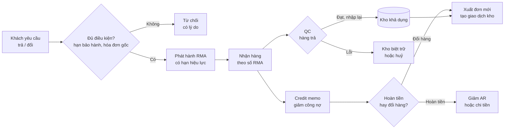

# RMA & đổi trả

Khách trả hàng là nghiệp vụ bình thường, nhưng nó là **cửa sau của dòng tiền**: nếu để mở, doanh nghiệp vừa mất hàng vừa mất tiền, và trong nhiều trường hợp không có căn cứ để từ chối. Ba câu hỏi phải trả lời được trước khi nhận lại hàng: **khách có được phép trả không**, **hàng trả về có thật không**, và **giảm trừ công nợ bao nhiêu**.

## Nguyên lý (áp dụng mọi ERP)

1. **Không có RMA thì không nhận hàng trả.** Hàng về kho mà không tham chiếu được RMA là hàng trả khống, hàng cũ đổi mới, hoặc hàng không phải do doanh nghiệp bán. Thủ kho không có cách nào phân biệt nếu không có chứng từ.
2. **RMA phải có hạn hiệu lực.** Số RMA không hết hạn sẽ tồn đọng vĩnh viễn ở trạng thái "chờ nhận hàng", làm sai lệch mọi báo cáo dự kiến tồn kho trả về.
3. **Giá trị hoàn phải lấy từ hóa đơn gốc, không lấy cảm tính.** Nhân viên bán dễ tự thỏa thuận mức hoàn cao hơn giá khách đã mua, đặc biệt khi không tham chiếu hóa đơn gốc.
4. **Nhận hàng trả và giảm trừ công nợ là hai sự kiện khác nhau.** Hàng có thể về trước, credit memo phát hành sau, hoặc ngược lại. Gộp hai việc làm không đối chiếu được phần nào đã hoàn.
5. **Hàng trả về không tự động bán được.** Cần kiểm tra chất lượng rồi mới quyết định: nhập lại kho bán, vào kho hàng lỗi, hay hủy. Nhập thẳng vào tồn khả dụng là giao hàng lỗi cho khách tiếp theo.
6. **Đổi hàng khác hoàn tiền.** Đổi hàng là giao dịch xuất mới và nhập trả — không phải chỉ giảm công nợ. Nếu hệ thống chỉ ghi credit memo, doanh thu thay đổi nhưng hàng ra không được ghi nhận.

## 1. Luồng vận hành



Hai điểm quan trọng: **QC nằm giữa** nhận hàng và nhập kho khả dụng — không nhập thẳng; và **credit memo tách khỏi nhận hàng** — mỗi cái có chứng từ riêng.

## 2. Ai làm gì ở module nào

| Bước | Bán hàng (OM) | Kho | Kế toán | Chất lượng (QC) |
|---|---|---|---|---|
| Tiếp nhận yêu cầu và kiểm điều kiện | ✅ sở hữu | — | Cung cấp lịch sử thanh toán | — |
| Phát hành RMA và hạn hiệu lực | ✅ sở hữu | Nhận thông báo để chuẩn bị nhận | — | — |
| Nhận hàng trả theo RMA | Đọc trạng thái | ✅ ghi nhận thực nhận | — | — |
| Kiểm tra chất lượng hàng trả | — | Đưa vào khu chờ kiểm | — | ✅ quyết định đạt/lỗi |
| Quyết định nhập lại hay hủy | Đề xuất theo chính sách đổi trả | ✅ thực hiện và ghi giao dịch | Nhận chi phí hủy | ✅ kết luận |
| Phát hành credit memo | ✅ yêu cầu, giới hạn trong giá trị hóa đơn gốc | — | ✅ duyệt và ghi sổ | — |
| Hoàn tiền | — | — | ✅ thực hiện | — |
| Đơn đổi hàng | ✅ tạo đơn mới, giá 0 hoặc bù tiền | ✅ xuất hàng theo đơn mới | Ghi giá vốn | — |
| Đóng RMA | ✅ quyết định | Xác nhận số đã nhận | Xác nhận đã hoàn | — |

**Ranh giới cốt lõi:** người **bán** không tự duyệt credit memo; người **nhận hàng trả** không tự quyết định nhập vào tồn khả dụng.

## 3. Hạch toán

Nhận hàng trả về sinh bút toán **đảo chiều** so với lúc bán: tăng lại tài sản tồn kho và giảm giá vốn. Credit memo giảm doanh thu và thuế đầu ra, đồng thời giảm công nợ phải thu.

Toàn bộ bút toán được định nghĩa tại [Hạch toán & tài khoản trung gian](../5-ke-toan/ke-toan-tong-hop/1000-hach-toan-va-tai-khoan-trung-gian.md), phần công nợ ở [AR - Nguyên lý & tài khoản](../5-ke-toan/cong-no/2000-ar-nguyen-ly-va-tai-khoan.md).

Bốn điểm cần nhớ khi triển khai:

1. **Giá trị hoàn không được vượt giá trị đã bán** trên hóa đơn gốc — chặn ở tầng hệ thống, không chỉ kiểm tra thủ công.
2. **Hàng trả nhập lại kho kế thừa giá gốc của lô đã xuất**, không lấy giá mua hiện tại — nếu không, giá vốn bị điều chỉnh vô lý.
3. **Hàng lỗi hủy ghi chi phí hàng hủy**, không giảm giá trị tồn kho như hàng bán được.
4. **Đổi hàng phải có cả hai bút toán**: nhập lại hàng cũ và xuất hàng mới. Chỉ credit memo là thiếu.

## 4. Điểm chạm & rủi ro

- **Giao dịch kho nhập hàng trả về**: [Giao dịch nhập, xuất & chuyển](../1-kho/2000-giao-dich-nhap-xuat-chuyen.md)
- **Cấu trúc kho biệt trữ và khu chờ kiểm**: [Cấu trúc kho & vị trí](../1-kho/1000-cau-truc-kho-va-vi-tri.md)
- **Credit memo và giảm trừ công nợ**: [AR - Nguyên lý & tài khoản](../5-ke-toan/cong-no/2000-ar-nguyen-ly-va-tai-khoan.md)
- **Hóa đơn gốc làm căn cứ hoàn tiền**: [Giao hàng & xuất kho](./2010-giao-hang-va-xuat-kho.md)
- **Đơn đổi hàng**: [Tiếp nhận đơn & ATP](./2000-tiep-nhan-don-va-atp.md)

**Rủi ro chính:**

- **Nhận hàng không có RMA** — hàng trả khống, hàng cũ đổi mới, không có căn cứ từ chối.
- **RMA không có hạn** — chứng từ treo vĩnh viễn, báo cáo dự kiến tồn sai.
- **Hoàn tiền vượt giá bán gốc** — nhân viên tự thỏa thuận mức hoàn cao hơn.
- **Nhập thẳng hàng trả vào tồn khả dụng** — giao hàng lỗi cho khách tiếp theo.
- **Đổi hàng chỉ ghi credit memo** — doanh thu giảm nhưng hàng không được ghi nhận xuất/nhập.
- **Không đóng RMA** — đơn trả hàng mở mãi, không đối chiếu được.

## 5. Triển khai tham chiếu ERP

### A. Ánh xạ khái niệm

| Khái niệm | SAP S/4HANA | Oracle EBS R12 | Epicor ERP | Odoo |
|---|---|---|---|---|
| Đầu phiếu RMA | `VBAK` với order type `RE` (Returns) | `OE_ORDER_HEADERS_ALL` (`ORDER_CATEGORY_CODE = 'RETURN'`) | `Erp.RMAHead` | `sale.order` (custom module RMA) |
| Dòng RMA | `VBAP` | `OE_ORDER_LINES_ALL` (`LINE_CATEGORY_CODE = 'RETURN'`) | `Erp.RMADtl` | `sale_order_line` |
| Trạng thái RMA | `VBUK.GBSTK` | `OE_ORDER_HEADERS_ALL.FLOW_STATUS_CODE` | `Erp.RMAHead.RMAStatus` | `sale.order.state` |
| Nhận hàng RMA | Goods Receipt movement `651` | `RCV_TRANSACTIONS` (RMA Receipt) | `Erp.RMARct` | `stock.picking` (Return, `done`) |
| Credit memo | Credit Memo Request (`VF01` type `G2`) | `AR_INVOICES_ALL` (`INVOICE_TYPE = 'CREDIT'`) | `Erp.APInvHed` / AR Credit | `account.move` type `out_refund` |
| Đơn đổi hàng | Returns order + subsequent delivery | Return Order với line mới | `RMAHead` liên kết `OrderHed` | `sale.order` mới |

### B. Hệ thống tự xây — thiết kế tối thiểu

```sql
CREATE TABLE RMA_Header (
    RMA_ID           BIGINT IDENTITY PRIMARY KEY,
    RMA_No           VARCHAR(30) NOT NULL UNIQUE,
    Customer_ID      VARCHAR(50) NOT NULL,
    Original_Order   VARCHAR(30) NULL,
    Original_Invoice VARCHAR(30) NULL,
    Reason_Code      VARCHAR(20) NOT NULL,
    Valid_Until      DATE NOT NULL,        -- bắt buộc
    Status           VARCHAR(20) NOT NULL,
    -- DRAFT | APPROVED | PARTIAL_RECEIVED | RECEIVED | CLOSED | REJECTED | EXPIRED
    Resolution       VARCHAR(20) NOT NULL  -- REFUND | EXCHANGE | REPAIR | SCRAP
);

CREATE TABLE RMA_Line (
    RMA_ID           BIGINT NOT NULL,
    Line_No          INT NOT NULL,
    Item_ID          VARCHAR(50) NOT NULL,
    Qty_Authorized   DECIMAL(18,4) NOT NULL,
    Qty_Received     DECIMAL(18,4) NOT NULL DEFAULT 0,
    Qty_Accepted     DECIMAL(18,4) NOT NULL DEFAULT 0,
    Qty_Rejected     DECIMAL(18,4) NOT NULL DEFAULT 0,
    Unit_Price_Orig  DECIMAL(18,4) NOT NULL,   -- lấy từ hóa đơn gốc
    PRIMARY KEY (RMA_ID, Line_No)
);

CREATE TABLE Credit_Memo (
    CM_ID            BIGINT IDENTITY PRIMARY KEY,
    CM_No            VARCHAR(30) NOT NULL UNIQUE,
    RMA_ID           BIGINT NOT NULL,
    Original_Invoice VARCHAR(30) NOT NULL,
    Amount           DECIMAL(18,2) NOT NULL,
    Tax_Amount       DECIMAL(18,2) NOT NULL,
    Status           VARCHAR(20) NOT NULL,  -- DRAFT | APPROVED | POSTED | CANCELLED
    Approved_By      VARCHAR(50) NULL,
    Posted_At        DATETIME NULL
);
```

Bốn ràng buộc bắt buộc:

1. **`Valid_Until` bắt buộc** và job hằng đêm chuyển RMA quá hạn sang `EXPIRED`.
2. **`Qty_Received` không được vượt `Qty_Authorized`** — chặn ở tầng dịch vụ khi nhận hàng.
3. **`Credit_Memo.Amount ≤ giá trị đã bán trên hóa đơn gốc`** cho dòng tương ứng — kiểm tra trong transaction khi duyệt.
4. **Không chuyển `Qty_Received` sang `Qty_Accepted` nếu chưa có kết quả QC** — hàng trả chưa xác nhận chất lượng không được nhập kho khả dụng.

### C. Truy vấn kiểm soát

**RMA quá hạn hiệu lực nhưng chưa nhận hàng — làm sai báo cáo dự kiến tồn:**

```sql
SELECT RMA_No, Customer_ID, Valid_Until,
       DATEDIFF(DAY, Valid_Until, GETDATE()) AS Days_Overdue
FROM RMA_Header
WHERE Status IN ('APPROVED', 'PARTIAL_RECEIVED')
  AND Valid_Until < GETDATE()
ORDER BY Days_Overdue DESC;
```

**Nhận hàng trả vượt số đã cho phép:**

```sql
SELECT r.RMA_No, l.Line_No, l.Item_ID,
       l.Qty_Authorized, l.Qty_Received,
       l.Qty_Received - l.Qty_Authorized AS Over_Received
FROM RMA_Line l
JOIN RMA_Header r ON r.RMA_ID = l.RMA_ID
WHERE l.Qty_Received > l.Qty_Authorized;
```

**Credit memo vượt giá trị hóa đơn gốc:**

```sql
SELECT c.CM_No, c.RMA_ID, c.Original_Invoice,
       c.Amount AS CM_Amount, i.Line_Amount AS Invoice_Amount
FROM Credit_Memo c
JOIN AR_Invoice_Line i ON i.Invoice_No = c.Original_Invoice
WHERE c.Amount > i.Line_Amount;
```

**Hàng trả nhập vào kho khả dụng khi chưa có kết quả QC:**

```sql
SELECT t.Trx_ID, t.Item_ID, t.To_Location_ID, t.Qty_Base, d.RMA_No
FROM Inventory_Transaction t
JOIN Inv_Location l ON l.Location_ID = t.To_Location_ID
LEFT JOIN RMA_Receive_Detail d ON d.Trx_ID = t.Trx_ID
WHERE t.Trx_Source = 'RMA'
  AND l.Is_Available = 1
  AND d.Qc_Result IS NULL;
```

**Epicor — phiếu RMA đã duyệt nhưng chưa nhận hàng quá 60 ngày:**

```sql
SELECT rh.RMANum, rh.CustNum, rh.RMADate, rh.RMAStatus,
       DATEDIFF(DAY, rh.RMADate, GETDATE()) AS Days_Open
FROM Erp.RMAHead rh
WHERE rh.Company = 'YOUR_COMPANY_CODE'
  AND rh.RMAStatus = 'A'          -- Approved
  AND DATEDIFF(DAY, rh.RMADate, GETDATE()) > 60
ORDER BY Days_Open DESC;
```

## 6. Bẫy thực chiến & Checklist

| # | Bẫy | Triệu chứng | Cách phòng tránh |
|---|---|---|---|
| 1 | Nhận hàng trả không cần RMA | Thủ kho nhận hàng không phải doanh nghiệp bán, chi phí hủy tăng | Chặn nhận hàng nếu không tham chiếu RMA hợp lệ |
| 2 | RMA không có hạn hiệu lực | Chứng từ treo vĩnh viễn, báo cáo dự kiến tồn sai | `Valid_Until` bắt buộc + job chuyển `EXPIRED` |
| 3 | Hoàn tiền vượt giá bán gốc | Nhân viên tự thỏa thuận mức hoàn cao hơn | Kiểm tra `Amount ≤ giá trị hóa đơn gốc` |
| 4 | Nhập thẳng hàng trả vào tồn khả dụng | Giao hàng lỗi cho khách tiếp theo | Bắt buộc qua QC trước khi nhập kho khả dụng |
| 5 | Đổi hàng chỉ ghi credit memo | Doanh thu giảm nhưng không ghi xuất/nhập kho | Đổi hàng phải có đơn mới + cả hai giao dịch kho |
| 6 | Không có đơn gốc để tham chiếu | Không biết trả hàng nào, giá bao nhiêu | RMA bắt buộc gắn `Original_Order`/`Original_Invoice` |
| 7 | Hàng trả nhập lại theo giá mua hiện tại | Giá vốn bị điều chỉnh vô lý | Kế thừa giá gốc của lô đã xuất |
| 8 | RMA không đóng sau khi hoàn tất | Đơn mở mãi, không đối chiếu được | Quy tắc đóng: nhận đủ + đã phát hành credit memo |
| 9 | Không tách hàng đạt và hàng lỗi | Báo cáo tồn kho gộp cả hàng lỗi | Bin biệt trữ riêng, `Is_Available = 0` |
| 10 | Nhân viên bán tự duyệt credit memo | Hoàn tiền khống, thất thoát dòng tiền | SoD: người bán ≠ người duyệt credit memo |

**Checklist trước go-live:**

- [ ] Chặn nhận hàng trả không có RMA (đã test).
- [ ] `Valid_Until` bắt buộc, job chuyển `EXPIRED` chạy hằng đêm.
- [ ] Chặn `Qty_Received > Qty_Authorized` (đã test).
- [ ] Chặn credit memo vượt giá trị hóa đơn gốc (đã test).
- [ ] Hàng trả phải qua QC trước khi vào kho khả dụng.
- [ ] Hàng trả nhập lại theo giá gốc của lô đã xuất.
- [ ] Đổi hàng tạo đơn mới + ghi đủ hai giao dịch kho.
- [ ] RMA bắt buộc tham chiếu đơn/hóa đơn gốc.
- [ ] Có quy tắc tự đóng RMA khi đã nhận đủ và đã phát hành credit memo.
- [ ] SoD: bán hàng / nhận hàng trả / duyệt credit memo là các vai trò tách biệt.

## Xem thêm

- [Tổng quan Bán hàng](./0000-tong-quan-o2c.md)
- [Giao hàng & xuất kho](./2010-giao-hang-va-xuat-kho.md)
- [Mô hình bán đặc thù](./2030-mo-hinh-ban-dac-thu.md)
- [AR - Nguyên lý & tài khoản](../5-ke-toan/cong-no/2000-ar-nguyen-ly-va-tai-khoan.md)
- [Giao dịch nhập, xuất & chuyển](../1-kho/2000-giao-dich-nhap-xuat-chuyen.md)

<div align="center" style={{color: 'var(--ifm-color-primary)'}}>
  <strong>Chúc các bạn thành công và vui vẻ!</strong>
</div>
