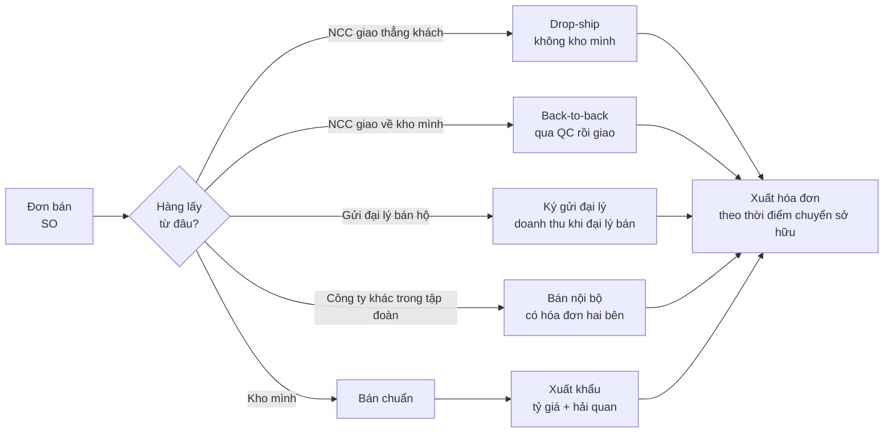

# Mô hình bán đặc thù

Năm mô hình dưới đây đều là "bán hàng" nhưng **không mô hình nào chạy đúng nếu dùng chung quy trình bán chuẩn**. Mỗi mô hình thất bại theo một cách riêng: ghi doanh thu trước khi được phép, tạo tồn kho ảo, hoặc hàng đi mà không ai biết đã đi.

## Nguyên lý (áp dụng mọi ERP)

1. **Doanh thu ghi khi chuyển quyền sở hữu, không khi xuất kho.** Đây là ranh giới quan trọng nhất của cả bài. Drop-ship chuyển quyền khi khách nhận từ nhà cung cấp; ký gửi chuyển quyền khi đại lý bán ra, không phải khi giao cho đại lý.
2. **Hàng ký gửi vẫn là tài sản của doanh nghiệp.** Nó nằm ngoài kho mình, nhưng vẫn thuộc mình. Bán khống nó cho khách khác là bán tài sản đã nằm ở nơi khác.
3. **Drop-ship không có giao dịch kho thật, nhưng phải có dòng chứng từ.** Không ghi nhận nhập rồi xuất vật lý, nhưng vẫn cần liên kết PO–SO để khớp công nợ hai đầu.
4. **Back-to-back là mô hình có kho, drop-ship là mô hình không có kho.** Back-to-back hàng vẫn về kho, qua QC, đóng gói lại rồi mới giao. Điểm khác biệt là **giữ chỗ cứng 1:1** giữa nguồn cung và đơn bán.
5. **Xuất khẩu thêm ba biến số:** tỷ giá, điều kiện giao hàng quốc tế (Incoterms quyết định thời điểm ghi doanh thu), và thủ tục hải quan.
6. **Bán nội bộ giữa pháp nhân là bán thật, không phải chuyển kho.** Phải có hóa đơn, có doanh thu và giá vốn ở cả hai bên, và phải loại trừ khi hợp nhất báo cáo tập đoàn.

## 1. Luồng vận hành



## 2. Ai làm gì ở module nào

| Mô hình | Bán hàng (OM) | Kho | Mua hàng (PO) | Kế toán | Điểm khác biệt then chốt |
|---|---|---|---|---|---|
| **Drop-ship** | Tạo SO và yêu cầu PO ship-to khách | Ghi giao dịch ảo, không đụng tồn | ✅ PO giao thẳng khách | AP và AR đồng thời, khớp hai đầu | Không có hàng thật trong kho |
| **Back-to-back** | Tạo SO và yêu cầu nguồn cung | Nhận vào kho, QC, đóng gói, xuất | ✅ PO gắn 1:1 với SO | Doanh thu khi xuất kho | Giữ chỗ cứng, không vào bể tồn chung |
| **Ký gửi đại lý** | Tạo giao hàng ký gửi, đối soát tiêu dùng | Theo dõi tồn ký gửi tách khỏi tồn bán được | — | Doanh thu khi đại lý báo bán | Hàng đi mà chưa ghi doanh thu |
| **Xuất khẩu** | Xác định Incoterms, chứng từ xuất khẩu | Xuất kho theo ngày giao | — | Tỷ giá, thuế xuất khẩu, hoàn thuế | Thời điểm doanh thu theo Incoterms |
| **Bán nội bộ** | SO giữa hai pháp nhân | Ghi xuất ở bên bán, nhập ở bên mua | PO ở bên mua | Doanh thu + giá vốn cả hai bên | Phải loại trừ khi hợp nhất |

## 3. Hạch toán

Bài này **không định nghĩa lại tài khoản** — bản đồ duy nhất ở [Hạch toán & tài khoản trung gian](../5-ke-toan/ke-toan-tong-hop/1000-hach-toan-va-tai-khoan-trung-gian.md). Mỗi mô hình có một nguyên tắc riêng:

| Mô hình | Nguyên tắc bắt buộc |
|---|---|
| Drop-ship | Doanh thu ghi khi **khách nhận hàng từ NCC**. Công nợ AP và AR phát sinh đồng thời; chỉ trả NCC sau khi đã xác nhận khách nhận. |
| Back-to-back | Hàng về kho phải **giữ chỗ cho đúng SO** — không vào bể tồn khả dụng dùng chung. Doanh thu khi xuất kho giao khách. |
| Ký gửi đại lý | Doanh thu ghi khi **đại lý báo bán ra**, không khi giao cho đại lý. Hàng ký gửi vẫn là tài sản của doanh nghiệp. |
| Xuất khẩu | Doanh thu theo **Incoterms** (FOB: khi lên tàu; DDP: khi tới đích). Chênh lệch tỷ giá ghi lãi/lỗ tỷ giá, không gộp vào doanh thu. |
| Bán nội bộ | **Cả hai bên đều ghi nghiệp vụ bán/mua.** Chuyển kho vượt pháp nhân không phải chuyển kho. |

## 4. Điểm chạm & rủi ro

- **Cơ chế sinh giao dịch kho và giao dịch ảo**: [Giao dịch nhập, xuất & chuyển](../1-kho/2000-giao-dich-nhap-xuat-chuyen.md)
- **Tồn kho theo chủ sở hữu (ký gửi)**: [Cấu trúc kho & vị trí](../1-kho/1000-cau-truc-kho-va-vi-tri.md)
- **Liên kết PO cho drop-ship và back-to-back**: [Mô hình mua đặc thù](../2-mua-hang/2030-mo-hinh-mua-dac-thu.md)
- **Công nợ hai đầu drop-ship**: [AR - Nguyên lý & tài khoản](../5-ke-toan/cong-no/2000-ar-nguyen-ly-va-tai-khoan.md)
- **Tỷ giá và chênh lệch tỷ giá**: [Đối trừ công nợ, netting & đa tiền tệ](../5-ke-toan/cong-no/3000-cong-no-doi-tru-netting-va-tien-te.md)
- **Loại trừ giao dịch nội bộ khi hợp nhất**: [Sổ cái & báo cáo tài chính](../5-ke-toan/ke-toan-tong-hop/2000-so-cai-va-bao-cao-tai-chinh.md)

**Rủi ro chính:**

- **Drop-ship ghi nhận nhập xuất thật** — tồn kho ảo trong báo cáo.
- **Drop-ship trả NCC trước khi khách nhận** — mất tiền nếu khách hủy.
- **Back-to-back không giữ chỗ** — sales khác lấy mất hàng của khách đã đặt.
- **Hủy SO không hủy PO/lệnh SX liên kết** — tồn kho chết không ai dùng.
- **Ký gửi tính vào tồn bán được** — bán khống hàng đã nằm ở đại lý.
- **Ký gửi không theo dõi tuổi hàng** — hàng tồn đọng hết hạn tại đại lý.
- **Xuất khẩu ghi doanh thu theo ngày xuất kho** — với DDP là ghi doanh thu non.
- **Bán nội bộ chỉ ghi một bên** — sổ tập đoàn lệch, loại trừ không khớp.

## 5. Triển khai tham chiếu ERP

### A. Ánh xạ khái niệm

| Mô hình | Oracle EBS R12 | Epicor ERP | SAP S/4HANA | Odoo |
|---|---|---|---|---|
| Drop-ship | `OE_ORDER_LINES_ALL.SOURCE_TYPE_CODE = 'EXTERNAL'` + `OE_DROP_SHIP_SOURCES` | `OrderRel.DropShip = 1` | Item Category `TAS` (từ `BANS`) | Route `Dropship` |
| Back-to-back | `SOURCE_TYPE_CODE = 'INTERNAL'` + `MTL_RESERVATIONS` | `OrderRel.BuyToOrder` / `MakeToOrder` | Item Category `TAB` hoặc Special Stock `E` | Route `MTO + Buy` / `MTO + Manufacture` |
| Ký gửi – giao cho đại lý | Transaction Type Fill-up | Warehouse gán `CustNum` | Order type `KB` | `stock.picking` tới vị trí ký gửi |
| Ký gửi – xuất hóa đơn tiêu dùng | Transaction Type Issue | `OrderHed` xuất từ kho ký gửi | Order type `KE` | `sale.order` từ kho ký gửi |
| Ký gửi – thu hồi | Transaction Type Pickup | Transfer Order về kho tổng | Order type `KA` | `stock.picking` ngược |
| Tồn kho ký gửi | Subinventory Consignment | `PartBin` tại kho ký gửi | `MSKU` (special stock customer) | `stock.quant.owner_id` |
| Xuất khẩu | Import/Export PO với Incoterms | `ShipVia` + `Incoterms` | Incoterms + Foreign Trade | Incoterms trên `sale.order` |
| Bán nội bộ | Intercompany AR/AP (`MOAC`) | Intercompany Order + Company | Intercompany (`STO`/PO + IV) | `inter-company` rules |

### B. Hệ thống tự xây — điểm dữ liệu bắt buộc

```sql
-- Bổ sung vào bảng Sales_Order đã có
ALTER TABLE Sales_Order ADD
    Sales_Model          VARCHAR(20) NOT NULL DEFAULT 'STANDARD',
    -- STANDARD | DROPSHIP | BACK_TO_BACK | CONSIGNMENT | EXPORT | INTERCOMPANY
    Supply_Source_Doc    VARCHAR(50) NULL,     -- PO / WO liên kết 1:1
    Counterparty_Company VARCHAR(20) NULL,     -- dùng cho INTERCOMPANY
    Transfer_Ownership_At VARCHAR(20) NOT NULL DEFAULT 'SHIP',
    -- SHIP | POD | CONSIGNMENT_CONSUMPTION | INCOTERM
    Incoterm             VARCHAR(10) NULL;

CREATE TABLE Consignment_Stock (
    Customer_ID      VARCHAR(50) NOT NULL,
    Item_ID          VARCHAR(50) NOT NULL,
    Lot_Serial       VARCHAR(50) NULL,
    Qty_On_Hand      DECIMAL(18,4) NOT NULL,
    Qty_Invoiced     DECIMAL(18,4) NOT NULL DEFAULT 0,
    First_Ship_Date  DATE NOT NULL,            -- theo dõi tuổi hàng ký gửi
    PRIMARY KEY (Customer_ID, Item_ID, ISNULL(Lot_Serial, ''))
);
```

Bốn ràng buộc bắt buộc:

1. **`DROPSHIP` phải đánh cờ `Is_Logical = 1`** trên mọi giao dịch kho liên quan.
2. **`BACK_TO_BACK` bắt buộc có `Supply_Source_Doc`** và hàng nhận về phải giữ chỗ cho đúng SO, không vào bể tồn khả dụng.
3. **`CONSIGNMENT` ghi tồn vào `Consignment_Stock`, không vào tồn khả dụng**, và chỉ ghi doanh thu khi có dòng tiêu dùng.
4. **`INTERCOMPANY` bắt buộc `Counterparty_Company`** và phải sinh chứng từ ở cả hai phía.

### C. Truy vấn kiểm soát

**Back-to-back đã mua nhưng chưa có nguồn cung liên kết — hàng dễ bị sales khác lấy:**

```sql
SELECT so.Order_No, sl.Item_ID, sl.Qty_Ordered
FROM Sales_Order so
JOIN Sales_Order_Line sl ON sl.Order_ID = so.Order_ID
WHERE so.Sales_Model = 'BACK_TO_BACK'
  AND so.Status IN ('CONFIRMED', 'PARTIAL')
  AND (so.Supply_Source_Doc IS NULL OR so.Supply_Source_Doc = '');
```

**SO đã hủy nhưng PO/lệnh SX liên kết vẫn còn mở — tồn kho chết đang hình thành:**

```sql
SELECT so.Order_No, so.Supply_Source_Doc, po.Status AS PO_Status
FROM Sales_Order so
JOIN Purchase_Order po ON po.PO_No = so.Supply_Source_Doc
WHERE so.Status = 'CANCELLED'
  AND po.Status NOT IN ('CLOSED', 'CANCELLED');
```

**Hàng ký gửi tồn tại đại lý quá lâu chưa bán ra:**

```sql
SELECT Customer_ID, Item_ID, Qty_On_Hand, First_Ship_Date,
       DATEDIFF(DAY, First_Ship_Date, GETDATE()) AS Days_At_Agent
FROM Consignment_Stock
WHERE Qty_On_Hand > 0
  AND DATEDIFF(DAY, First_Ship_Date, GETDATE()) > 90
ORDER BY Days_At_Agent DESC;
```

**Drop-ship trả nhà cung cấp trước khi khách xác nhận nhận hàng:**

```sql
SELECT so.Order_No, so.Supply_Source_Doc AS PO_No, ap.Payment_Date, so.POD_Date
FROM Sales_Order so
JOIN AP_Payment ap ON ap.PO_No = so.Supply_Source_Doc
WHERE so.Sales_Model = 'DROPSHIP'
  AND (so.POD_Date IS NULL OR ap.Payment_Date < so.POD_Date);
```

**Epicor — đơn ký gửi đã giao cho đại lý nhưng chưa báo cáo tiêu dùng quá 30 ngày:**

```sql
SELECT oh.OrderNum, oh.CustNum, od.PartNum, od.OrderQty, od.ShipDate
FROM Erp.OrderHed oh
JOIN Erp.OrderDtl od ON od.Company = oh.Company AND od.OrderNum = oh.OrderNum
WHERE oh.Company = 'YOUR_COMPANY_CODE'
  AND oh.OrderType = 'CONSIGNMENT_FILL'
  AND od.ShipDate IS NOT NULL
  AND DATEDIFF(DAY, od.ShipDate, GETDATE()) > 30
ORDER BY od.ShipDate;
```

## 6. Bẫy thực chiến & Checklist

| # | Bẫy | Triệu chứng | Cách phòng tránh |
|---|---|---|---|
| 1 | Drop-ship ghi nhập xuất kho thật | Báo cáo tồn kho ảo, MRP tính sai nhu cầu | Cờ `Is_Logical`, loại khỏi On-hand |
| 2 | Drop-ship trả NCC trước khi khách nhận | Khách hủy đơn sau khi đã trả tiền NCC | Chỉ giải phóng AP khi có xác nhận khách nhận |
| 3 | Back-to-back không giữ chỗ | Hàng về kho bị sales khác lấy, khách đã đặt trễ hẹn | Giữ chỗ cứng 1:1, không vào bể tồn khả dụng |
| 4 | Hủy SO không hủy PO/lệnh SX | Hàng vẫn về kho, tồn kho chết không ai dùng | Cascade hủy hoặc tạo cảnh báo bắt buộc xử lý |
| 5 | Ký gửi tính vào tồn bán được | Bán khống hàng đã nằm ở đại lý | Tồn ký gửi tách riêng, không tính ATP |
| 6 | Ký gửi ghi doanh thu khi giao cho đại lý | Doanh thu non, thuế xuất sớm, khách chưa bán được | Doanh thu chỉ khi đại lý báo cáo tiêu dùng |
| 7 | Ký gửi không theo dõi tuổi hàng | Hàng nằm ở đại lý cả năm, hết hạn mới phát hiện | `First_Ship_Date` + báo cáo tuổi hàng ký gửi |
| 8 | Báo cáo tiêu dùng của đại lý không đối chiếu | Lệch tồn kho thực tế tại đại lý so với ERP | Đối soát định kỳ, kiểm kê tại đại lý |
| 9 | Xuất khẩu ghi doanh thu theo ngày xuất kho | Với DDP là ghi doanh thu non | `Transfer_Ownership_At` theo Incoterms |
| 10 | Xuất khẩu gộp chênh lệch tỷ giá vào doanh thu | Doanh thu sai, sai bản chất chi phí | Ghi vào lãi/lỗ tỷ giá |
| 11 | Bán nội bộ chỉ ghi ở bên bán | Sổ tập đoàn lệch, loại trừ công nợ nội bộ không khớp | Sinh chứng từ hai phía, có `Intercompany_Link` |
| 12 | Bán nội bộ không có hóa đơn | Không có căn cứ thuế và hạch toán doanh thu | Bắt buộc hóa đơn giữa hai pháp nhân |

**Checklist trước go-live:**

- [ ] `Sales_Model` có giá trị cho 100% đơn bán, không mặc định STANDARD cho tất cả.
- [ ] Drop-ship: cờ logical bật, đã test On-hand không bị ảnh hưởng.
- [ ] Drop-ship: AP chỉ giải phóng sau khi có POD.
- [ ] Back-to-back: đã test hàng nhận về giữ chỗ đúng SO (sales khác không lấy được).
- [ ] Hủy SO: đã test cảnh báo hoặc cascade sang PO/lệnh SX.
- [ ] Ký gửi: tồn ký gửi tách khỏi ATP, đã test không bán khống được.
- [ ] Ký gửi: doanh thu chỉ ghi khi có báo cáo tiêu dùng (đã test).
- [ ] Ký gửi: có báo cáo tuổi hàng tại đại lý.
- [ ] Xuất khẩu: `Transfer_Ownership_At` theo Incoterms, đã test FOB và DDP.
- [ ] Xuất khẩu: chênh lệch tỷ giá ghi tách khỏi doanh thu.
- [ ] Bán nội bộ: đã test sinh chứng từ hai phía và khớp công nợ nội bộ.

## Xem thêm

- [Tổng quan Bán hàng](./0000-tong-quan-o2c.md)
- [Giao hàng & xuất kho](./2010-giao-hang-va-xuat-kho.md)
- [Mô hình mua đặc thù](../2-mua-hang/2030-mo-hinh-mua-dac-thu.md)
- [Giao dịch nhập, xuất & chuyển](../1-kho/2000-giao-dich-nhap-xuat-chuyen.md)
- [Đối trừ công nợ, netting & đa tiền tệ](../5-ke-toan/cong-no/3000-cong-no-doi-tru-netting-va-tien-te.md)

<div align="center" style={{color: 'var(--ifm-color-primary)'}}>
  <strong>Chúc các bạn thành công và vui vẻ!</strong>
</div>
