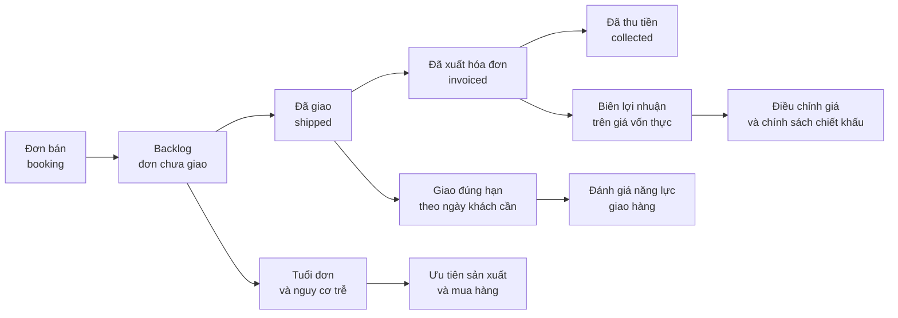

# 3000 Báo cáo bán hàng

Dữ liệu bán hàng bị đọc sai nhiều nhất là **doanh thu**. Doanh thu trên đơn đã ký chưa phải doanh thu; doanh thu đã xuất hóa đơn nhưng chưa thu tiền cũng chưa phải tiền. Bài này nói về các báo cáo trả lời được câu hỏi thật: **đơn có giao được không, giao có đúng hạn không, và có lãi không**.

## 0. Nguyên lý (áp dụng mọi ERP)

1. **Ba con số doanh thu phải tách rời.** Doanh thu đặt hàng (booking) — doanh thu đã giao (shipped) — doanh thu đã ghi sổ (invoiced). Gộp ba con số thành một là nguồn gốc của mọi tranh cãi giữa sales, kho và kế toán.
2. **Backlog là chỉ số quan trọng nhất của bán hàng.** Tổng giá trị đơn đã cam kết nhưng chưa giao. Backlog tăng nhanh hơn doanh thu nghĩa là năng lực giao hàng không theo kịp bán, và tới một lúc sẽ đổ vỡ.
3. **Tỷ lệ hoàn thành đơn phải đo ở cấp dòng, không ở cấp đơn.** Một đơn 10 dòng giao được 9 dòng vẫn tính là "giao một phần" — nếu báo cáo chỉ đếm đơn thì mất thông tin.
4. **Biên lợi nhuận phải tính trên giá vốn thực, không trên giá vốn định mức.** Nếu dùng giá chuẩn, mọi đơn đều có lãi trên giấy cho tới kỳ quyết toán chênh lệch giá thành.
5. **Đúng hạn đo trên ngày khách yêu cầu, không trên ngày hệ thống đề xuất.** Sales sẽ đổi ngày yêu cầu nếu báo cáo dùng ngày hệ thống.
6. **Mỗi chỉ số phải gắn với người chịu trách nhiệm.** Báo cáo không gắn trách nhiệm là báo cáo để đọc cho vui.

## 1. Luồng vận hành



## 2. Ai làm gì ở module nào

| Chỉ số | Bán hàng (OM) | Kho | Kế toán | Sản xuất | Ban điều hành |
|---|---|---|---|---|---|
| Booking và backlog | ✅ sở hữu | — | — | Đọc để lập kế hoạch SX | Xem để quyết định năng lực |
| Tỷ lệ hoàn thành đơn | ✅ lập báo cáo | ✅ cung cấp số thực giao | — | Cung cấp ngày hoàn thành | — |
| Giao đúng hạn theo ngày khách cần | ✅ sở hữu | ✅ cung cấp ngày giao thực | — | Chịu trách nhiệm phần SX trễ | Xem định kỳ |
| Doanh thu đã xuất hóa đơn | Đọc | — | ✅ sở hữu | — | ✅ đối chiếu kế hoạch |
| Biên lợi nhuận theo đơn | ✅ lập | — | ✅ cung cấp giá vốn thực | Cung cấp chi phí SX | ✅ quyết định giá |
| Tuổi backlog và nguy cơ trễ | ✅ sở hữu | — | — | ✅ nhận ưu tiên | — |
| Phân tích đa kênh | ✅ sở hữu | — | Đối chiếu doanh thu từng kênh | — | ✅ quyết định kênh đầu tư |

## 3. Hạch toán

Báo cáo bán hàng không sinh bút toán, nhưng **phải khớp với sổ cái** ở con số doanh thu đã xuất hóa đơn. Nếu báo cáo bán hàng dựa trên giá đơn còn sổ cái dựa trên hóa đơn, hai con số sẽ lệch và báo cáo mất uy tín.

Nguyên tắc: **doanh thu trên báo cáo bán hàng = doanh thu trên sổ cái của kỳ tương ứng**. Chênh lệch chỉ được phép do thời điểm (hóa đơn chưa ghi sổ), không được do định nghĩa khác nhau. Bản đồ tài khoản ở [AR - Nguyên lý & tài khoản](../5-ke-toan/cong-no/2000-ar-nguyen-ly-va-tai-khoan.md); giá vốn ở [Giá vốn & định giá tồn kho](../5-ke-toan/ke-toan-tong-hop/1010-gia-von-va-dinh-gia-ton-kho.md).

## 4. Điểm chạm & rủi ro

- **Nguồn dữ liệu đơn và ngày yêu cầu**: [Tiếp nhận đơn & ATP](./2000-tiep-nhan-don-va-atp.md)
- **Nguồn dữ liệu giao thực tế**: [Giao hàng & xuất kho](./2010-giao-hang-va-xuat-kho.md)
- **Doanh thu đã ghi sổ**: [AR - Xuất hóa đơn & hạn mức tín dụng](../5-ke-toan/cong-no/2010-ar-xuat-hoa-don-va-han-muc-tin-dung.md)
- **Giá vốn thực để tính biên lợi nhuận**: [Giá vốn & định giá tồn kho](../5-ke-toan/ke-toan-tong-hop/1010-gia-von-va-dinh-gia-ton-kho.md)
- **Ngày hoàn thành sản xuất ảnh hưởng OTD**: [Lệnh sản xuất & WIP](../3-san-xuat/2000-lenh-san-xuat-va-wip.md)

**Rủi ro chính:**

- **Gộp ba con số doanh thu** — sales báo doanh thu khác kế toán, không ai tin báo cáo.
- **Đo OTD trên ngày hệ thống** — điểm cao giả vì ngày yêu cầu bị đẩy lùi.
- **Đếm tỷ lệ hoàn thành theo đơn** — mất thông tin giao một phần.
- **Dùng giá vốn định mức** — mọi đơn đều "có lãi" cho tới khi quyết toán giá thành.
- **Backlog không đo tuổi** — đơn chờ 6 tháng vẫn nằm chung với đơn chờ 2 ngày.
- **Báo cáo không khớp sổ cái** — nhóm tự quay lại Excel.

## 5. Triển khai tham chiếu ERP

### A. Nguồn dữ liệu

| Chỉ số | Oracle EBS R12 | Epicor ERP | SAP S/4HANA | Odoo |
|---|---|---|---|---|
| Booking | `OE_ORDER_LINES_ALL` (confirmed) | `Erp.OrderDtl` | `VBAP` | `sale.order.line` |
| Backlog | `OE_ORDER_LINES_ALL` − shipped | `OrderDtl` − `ShipDtl` | `VBAP` − `LIPS` | `sale.order.line.qty_to_invoice` |
| Shipped | `WSH_NEW_DELIVERIES` / `MTL_MATERIAL_TRANSACTIONS` | `Erp.ShipDtl` | `LIPS` + `MSEG` | `stock.move` done |
| Invoiced | `RA_CUSTOMER_TRX_ALL` | `Erp.InvcHead` | `VBRK` / `VBRP` | `account.move` (`out_invoice`) |
| Ngày yêu cầu | `OE_ORDER_LINES_ALL.SCHEDULE_SHIP_DATE` | `OrderRel.NeedByDate` | `VBEP.EDATU` | `sale.order.line.commitment_date` |
| Giá vốn thực | `MTL_TRANSACTION_ACCOUNTS` | `Erp.PartTran.MtlUnitCost` | `MSEG` + `ACDOCA` | `stock.valuation.layer` |

### B. Công thức các chỉ số

$$\text{Fill Rate} = \frac{\text{Số dòng đã giao đủ}}{\text{Tổng số dòng đã cam kết}} \times 100$$

Đếm ở **cấp dòng**, không cấp đơn.

$$\text{OTD} = \frac{\text{Số dòng giao} \le \text{Ngày khách yêu cầu}}{\text{Tổng số dòng đã giao}} \times 100$$

So với `NeedByDate`, không so với ngày hệ thống đề xuất.

$$\text{Biên lợi nhuận gộp} = \frac{\text{Doanh thu thuần} - \text{Giá vốn thực}}{\text{Doanh thu thuần}} \times 100$$

`Doanh thu thuần` = doanh thu sau chiết khấu và giảm giá, **chưa gồm thuế**.

### C. Truy vấn kiểm soát

**Backlog theo tuổi — đơn chờ lâu nhất:**

```sql
SELECT so.Order_No, so.Customer_ID, sl.Item_ID,
       sl.Qty_Ordered - sl.Qty_Shipped AS Qty_Open,
       sl.Request_Date,
       DATEDIFF(DAY, sl.Request_Date, GETDATE()) AS Days_Overdue
FROM Sales_Order so
JOIN Sales_Order_Line sl ON sl.Order_ID = so.Order_ID
WHERE so.Status IN ('CONFIRMED', 'PARTIAL')
  AND sl.Qty_Ordered > sl.Qty_Shipped
ORDER BY Days_Overdue DESC;
```

**Tỷ lệ hoàn thành đơn ở cấp dòng:**

```sql
SELECT CAST(SUM(CASE WHEN sl.Qty_Shipped >= sl.Qty_Ordered THEN 1 ELSE 0 END) AS DECIMAL) * 100
       / COUNT(*) AS Fill_Rate_Pct,
       COUNT(*) AS Total_Lines
FROM Sales_Order so
JOIN Sales_Order_Line sl ON sl.Order_ID = so.Order_ID
WHERE so.Order_Date BETWEEN @FromDate AND @ToDate
  AND so.Status <> 'CANCELLED';
```

**OTD theo ngày khách yêu cầu:**

```sql
SELECT sh.Customer_ID,
       COUNT(*) AS Lines_Shipped,
       SUM(CASE WHEN sh.Ship_Date <= sl.Request_Date THEN 1 ELSE 0 END) AS Lines_On_Time,
       CAST(SUM(CASE WHEN sh.Ship_Date <= sl.Request_Date THEN 1 ELSE 0 END) AS DECIMAL) * 100
       / COUNT(*) AS OTD_Pct
FROM Shipment_Line shl
JOIN Shipment sh ON sh.Shipment_ID = shl.Shipment_ID
JOIN Sales_Order_Line sl ON sl.Order_ID = sh.Order_ID AND sl.Line_No = shl.Order_Line_No
WHERE sh.Ship_Date >= DATEADD(MONTH, -3, GETDATE())
GROUP BY sh.Customer_ID
ORDER BY OTD_Pct;
```

**Doanh thu đã xuất hóa đơn so với doanh thu ghi sổ — phát hiện lệch định nghĩa:**

```sql
SELECT i.Period_ID,
       SUM(i.Total_Net) AS Doanh_Thu_Hoa_Don,
       (SELECT SUM(g.Amount) FROM GL_Journal g
        WHERE g.Period_ID = i.Period_ID AND g.Account_Type = 'REVENUE') AS Doanh_Thu_So_Cai
FROM AR_Invoice i
WHERE i.Period_ID >= '2025-01'
GROUP BY i.Period_ID;
```

**Epicor — đơn quá hạn chưa cấp phát, xếp theo giá trị:**

```sql
SELECT oh.OrderNum, c.Name, od.PartNum, od.OrderQty, od.RequestDate,
       (od.OrderQty * od.DocUnitPrice) AS Line_Value,
       DATEDIFF(DAY, od.RequestDate, GETDATE()) AS Days_Late
FROM Erp.OrderHed oh
JOIN Erp.OrderDtl od ON od.Company = oh.Company AND od.OrderNum = oh.OrderNum
JOIN Erp.Customer c  ON c.Company = oh.Company AND c.CustNum = oh.CustNum
WHERE oh.Company = 'YOUR_COMPANY_CODE'
  AND oh.OpenOrder = 1
  AND od.RequestDate < GETDATE()
  AND NOT EXISTS (
      SELECT 1 FROM Erp.PartDtl pd
      WHERE pd.Company = od.Company AND pd.OrderNum = od.OrderNum
        AND pd.OrderLine = od.OrderLine AND pd.AllocatedQty > 0)
ORDER BY Line_Value DESC;
```

## 6. Bẫy thực chiến & Checklist

| # | Bẫy | Triệu chứng | Cách phòng tránh |
|---|---|---|---|
| 1 | Gộp booking, shipped, invoiced thành một con số | Sales báo một số, kế toán báo số khác, họp không đi tới đâu | Ba con số riêng, ghi rõ định nghĩa trên từng báo cáo |
| 2 | OTD đo trên ngày hệ thống | Điểm cao giả vì ngày yêu cầu bị đẩy lùi | Đo trên `Request_Date` / `NeedByDate` |
| 3 | Fill rate đếm theo đơn | Đơn 10 dòng giao 9 dòng được tính là hoàn thành | Đếm ở cấp dòng |
| 4 | Dùng giá vốn định mức cho biên lợi nhuận | Mọi đơn "có lãi" tới khi quyết toán giá thành | Dùng giá vốn thực (`MtlUnitCost` / `stock.valuation.layer`) |
| 5 | Backlog không đo tuổi | Đơn chờ 6 tháng lẫn với đơn chờ 2 ngày | Báo cáo backlog theo dải tuổi |
| 6 | Báo cáo không khớp sổ cái | Nhóm quay lại Excel để đối chiếu tay | Đối chiếu định kỳ, dùng cùng định nghĩa doanh thu |
| 7 | Không tách kênh bán | Không biết kênh nào thực sự có lãi | Phân tích theo kênh, tách doanh thu và chi phí bán hàng theo kênh |
| 8 | Tính biên lợi nhuận gộp chưa trừ chiết khấu | Biên cao giả, quyết định giá sai | Doanh thu thuần sau chiết khấu và giảm giá |
| 9 | Không gắn chỉ số với người chịu trách nhiệm | Báo cáo đẹp nhưng không ai hành động | Mỗi chỉ số gắn owner và ngưỡng hành động |

**Checklist trước go-live:**

- [ ] Ba khái niệm booking / shipped / invoiced được định nghĩa rõ và tách riêng trong báo cáo.
- [ ] OTD tính trên ngày khách yêu cầu (đã đối chiếu tay 1 tháng).
- [ ] Fill rate đếm theo dòng, không theo đơn.
- [ ] Biên lợi nhuận dùng giá vốn thực.
- [ ] Backlog có dải tuổi.
- [ ] Đã đối chiếu doanh thu báo cáo với sổ cái, sai lệch chỉ do thời điểm.
- [ ] Phân tích được doanh thu và biên lợi nhuận theo kênh.
- [ ] Doanh thu thuần đã trừ chiết khấu và giảm giá.
- [ ] Mỗi chỉ số có owner và ngưỡng hành động cụ thể.

## Xem thêm

- [Tổng quan Bán hàng](./0000-tong-quan-o2c.md)
- [Tiếp nhận đơn & ATP](./2000-tiep-nhan-don-va-atp.md)
- [Giao hàng & xuất kho](./2010-giao-hang-va-xuat-kho.md)
- [AR - Xuất hóa đơn & hạn mức tín dụng](../5-ke-toan/cong-no/2010-ar-xuat-hoa-don-va-han-muc-tin-dung.md)
- [Giá vốn & định giá tồn kho](../5-ke-toan/ke-toan-tong-hop/1010-gia-von-va-dinh-gia-ton-kho.md)

<div align="center" style={{color: 'var(--ifm-color-primary)'}}>
  <strong>Chúc các bạn thành công và vui vẻ!</strong>
</div>
