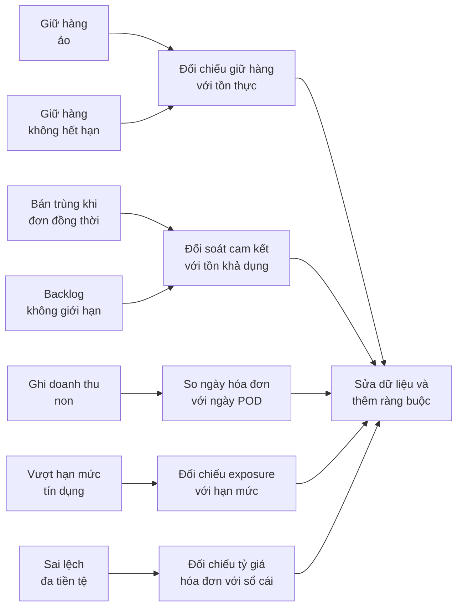

# 9000 Bẫy thực chiến bán hàng

Các lỗi trong bài này có chung một đặc điểm: **hệ thống không báo lỗi khi chúng xảy ra**. Đơn vẫn được tạo, hàng vẫn được ghi xuất, báo cáo vẫn ra số. Chỉ khi đối chiếu kho, đối chiếu công nợ hoặc khách khiếu nại mới phát hiện — và lúc đó đã tích lũy nhiều kỳ.

## 0. Nguyên lý (áp dụng mọi ERP)

1. **Bán hàng là bài toán đồng thời, không phải số học.** Hai người bấm xác nhận cùng một giây trên cùng một SKU còn 1 cái — hệ thống phải chặn một người. Kiểm tra rồi mới ghi mà không khóa dòng thì cả hai đều qua.
2. **Ba gốc lỗi bao trùm gần hết:** giữ hàng không được giải phóng, kiểm tra không khóa dữ liệu, và định nghĩa doanh thu không thống nhất giữa các bộ phận.
3. **Giờ cao điểm phơi bày mọi lỗi đồng thời.** Hệ thống chạy tốt với 10 đơn/ngày có thể sụp với 1.000 đơn/giờ, và lỗi chỉ xuất hiện đúng lúc đó.
4. **Mỗi bẫy phải có truy vấn phát hiện.** Mô tả lỗi mà không có cách tìm ra nó trong dữ liệu thật thì không dùng được.

## 1. Luồng vận hành



## 2. Ai làm gì ở module nào

| Bẫy | Bán hàng (OM) | Kho | Kế toán | Người phát hiện sớm nhất |
|---|---|---|---|---|
| Giữ hàng ảo | Chủ trì rà soát | ✅ phát hiện khi chuẩn bị hàng | — | Kho |
| Giữ hàng không hết hạn | Chủ trì giải phóng | Báo tồn khả dụng thấp bất thường | — | Kho và bán hàng |
| Bán trùng | ✅ sở hữu cơ chế khóa | Xác nhận không đủ hàng | — | Kho khi nhặt hàng |
| Backlog không giới hạn | ✅ sở hữu | Báo không đủ năng lực giao | — | Kho |
| Ghi doanh thu non | Đọc số liệu | Cung cấp ngày POD | ✅ sở hữu định nghĩa doanh thu | Kế toán |
| Vượt hạn mức tín dụng | Thực thi trong đơn | — | ✅ sở hữu hạn mức | Kế toán |
| Sai lệch đa tiền tệ | — | — | ✅ sở hữu tỷ giá | Kế toán |

## 3. Hạch toán

Các bẫy này đều gây **hệ quả kế toán**, dù không phải lỗi kế toán:

- Giữ hàng ảo → không ảnh hưởng sổ cái, nhưng làm mua hàng sai và đứt vật tư.
- Bán trùng → phải hủy đơn, nếu đã xuất hóa đơn thì phải đảo.
- Ghi doanh thu non → doanh thu kỳ này cao, kỳ sau đảo, lãi lỗ đảo chiều.
- Vượt hạn mức → nợ xấu, phải trích lập dự phòng.
- Đa tiền tệ → doanh thu và chênh lệch tỷ giá gộp nhau, báo cáo sai bản chất.

Bản đồ tài khoản ở [Hạch toán & tài khoản trung gian](../5-ke-toan/ke-toan-tong-hop/1000-hach-toan-va-tai-khoan-trung-gian.md).

## 4. Điểm chạm & rủi ro

- **Cơ chế giữ hàng và ATP** (bài gốc): [Giữ hàng, phân bổ & ATP](../1-kho/2010-giu-hang-phan-bo-va-atp.md)
- **Hạn mức tín dụng và khóa đơn**: [Danh mục & chính sách bán](./1000-danh-muc-va-chinh-sach-ban.md)
- **Kiểm tra tín dụng và ATP khi nhận đơn**: [Tiếp nhận đơn & ATP](./2000-tiep-nhan-don-va-atp.md)
- **Thời điểm ghi doanh thu theo điều kiện giao**: [Giao hàng & xuất kho](./2010-giao-hang-va-xuat-kho.md)
- **Đa tiền tệ và chênh lệch tỷ giá**: [Đối trừ công nợ, netting & đa tiền tệ](../5-ke-toan/cong-no/3000-cong-no-doi-tru-netting-va-tien-te.md)

## 5. Triển khai tham chiếu ERP

### A. Năm bẫy lớn và cách phát hiện

**Bẫy 1 — Giữ hàng ảo (ghost reservation)**

Đơn hủy nhưng giữ hàng còn treo, hàng có trong kho nhưng báo cáo khả dụng luôn về 0.

```sql
-- Giữ hàng còn treo cho đơn đã hủy hoặc đã đóng
SELECT r.Order_No, r.Item_ID, r.Qty_Reserved, so.Status
FROM Inventory_Reservation r
JOIN Sales_Order so ON so.Order_No = r.Demand_Doc_No
WHERE r.Status = 'HELD'
  AND so.Status IN ('CANCELLED', 'CLOSED', 'SHIPPED');
```

```sql
-- Giữ hàng quá hạn nhưng chưa giải phóng
SELECT Demand_Doc_No, Item_ID, Qty_Reserved, Hold_Until,
       DATEDIFF(DAY, Hold_Until, GETDATE()) AS Days_Overdue
FROM Inventory_Reservation
WHERE Status = 'HELD' AND Hold_Until < GETDATE()
ORDER BY Days_Overdue DESC;
```

**Bẫy 2 — Bán trùng khi hai đơn xác nhận đồng thời**

Tổng cam kết lớn hơn tồn khả dụng thực tế.

```sql
SELECT sl.Item_ID,
       SUM(sl.Qty_Ordered - sl.Qty_Shipped) AS Qty_Committed,
       ISNULL(t.Qty_Onhand, 0)              AS Qty_Onhand,
       SUM(sl.Qty_Ordered - sl.Qty_Shipped) - ISNULL(t.Qty_Onhand, 0) AS Over_Committed
FROM Sales_Order_Line sl
JOIN Sales_Order so ON so.Order_ID = sl.Order_ID
LEFT JOIN (
    SELECT Item_ID, SUM(Qty) AS Qty_Onhand
    FROM Inventory_Transaction
    WHERE Is_Logical = 0
    GROUP BY Item_ID
) t ON t.Item_ID = sl.Item_ID
WHERE so.Status = 'CONFIRMED'
GROUP BY sl.Item_ID, t.Qty_Onhand
HAVING SUM(sl.Qty_Ordered - sl.Qty_Shipped) > ISNULL(t.Qty_Onhand, 0);
```

**Bẫy 3 — Ghi doanh thu non**

Hóa đơn xuất trước khi khách ký nhận, với điều kiện giao tới đích.

```sql
SELECT i.Invoice_No, i.Invoice_Date, sh.Shipment_No, sh.Ship_Date, sh.Incoterm
FROM AR_Invoice i
JOIN Shipment sh ON sh.Shipment_ID = i.Shipment_ID
WHERE sh.Incoterm IN ('DDP', 'DAP', 'DDU')
  AND (sh.POD_Date IS NULL OR i.Invoice_Date < sh.POD_Date);
```

**Bẫy 4 — Vượt hạn mức tín dụng**

```sql
SELECT c.Customer_ID, c.Legal_Name, c.Credit_Limit,
       ISNULL(a.Open_Balance, 0) + ISNULL(s.Order_Open, 0) AS Exposure,
       ISNULL(a.Open_Balance, 0) + ISNULL(s.Order_Open, 0) - c.Credit_Limit AS Over_By
FROM Customer c
LEFT JOIN (SELECT Customer_ID, SUM(Open_Amount) AS Open_Balance
           FROM AR_Invoice WHERE Status = 'OPEN' GROUP BY Customer_ID) a
       ON a.Customer_ID = c.Customer_ID
LEFT JOIN (SELECT Customer_ID, SUM(Qty_Ordered - Qty_Shipped) * 1.0 AS Order_Open
           FROM Sales_Order_Line l JOIN Sales_Order o ON o.Order_ID = l.Order_ID
           WHERE o.Status IN ('CONFIRMED','PARTIAL') GROUP BY Customer_ID) s
       ON s.Customer_ID = c.Customer_ID
WHERE ISNULL(a.Open_Balance, 0) + ISNULL(s.Order_Open, 0) > c.Credit_Limit
ORDER BY Over_By DESC;
```

**Bẫy 5 — Sai lệch đa tiền tệ**

Đơn ngoại tệ nhưng tổng tiền VND không khớp tỷ giá tại ngày hóa đơn.

```sql
SELECT i.Invoice_No, i.Currency, i.Amount_Foreign, i.Exchange_Rate,
       i.Amount_Local,
       ROUND(i.Amount_Foreign * i.Exchange_Rate, 2) AS Amount_Expected,
       i.Amount_Local - ROUND(i.Amount_Foreign * i.Exchange_Rate, 2) AS Diff
FROM AR_Invoice i
WHERE i.Currency <> 'VND'
  AND ABS(i.Amount_Local - ROUND(i.Amount_Foreign * i.Exchange_Rate, 2)) > 0.01;
```

**Epicor — đơn bị giữ tín dụng quá lâu làm mất cơ hội bán:**

```sql
SELECT oh.OrderNum, oh.CustNum, c.Name, oh.OrderDate,
       DATEDIFF(DAY, oh.OrderDate, GETDATE()) AS Days_Held
FROM Erp.OrderHed oh
JOIN Erp.Customer c ON c.Company = oh.Company AND c.CustNum = oh.CustNum
WHERE oh.Company = 'YOUR_COMPANY_CODE'
  AND oh.OpenOrder = 1
  AND oh.CreditHold = 1
  AND DATEDIFF(DAY, oh.OrderDate, GETDATE()) > 3
ORDER BY Days_Held DESC;
```

### B. Nhịp chạy kiểm soát

| Truy vấn | Tần suất | Người chịu trách nhiệm |
|---|---|---|
| Giữ hàng treo cho đơn đã đóng/hủy | Hằng ngày | Bán hàng + Kho |
| Giữ hàng quá hạn | Hằng ngày | Bán hàng |
| Cam kết vượt tồn khả dụng | Hằng ngày | Bán hàng |
| Hóa đơn trước POD | Hằng tuần | Kế toán |
| Vượt hạn mức tín dụng | Hằng ngày | Kế toán |
| Sai lệch tỷ giá | Trước mỗi kỳ khóa sổ | Kế toán |

## 6. Bẫy thực chiến & Checklist

| # | Bẫy | Triệu chứng | Cách phòng tránh |
|---|---|---|---|
| 1 | Giữ hàng không giải phóng khi hủy đơn | Tồn thực còn nhưng báo khả dụng luôn 0, mua thêm vô ích | Cascade giải phóng giữ hàng khi đơn hủy/đóng |
| 2 | Giữ hàng không có hạn | Rác tích lũy vĩnh viễn, không ai dọn | `Hold_Until` bắt buộc + job hằng đêm |
| 3 | Kiểm tra rồi ghi, không khóa | Hai đơn cùng bán 1 cái, một khách mất hàng | Khóa dòng trong transaction xác nhận |
| 4 | Backlog không giới hạn | Hứa giao hàng tháng sau, khách hủy hết | Ngưỡng backlog theo SKU, cảnh báo khi vượt |
| 5 | Ghi doanh thu theo ngày xuất với DDP | Doanh thu non, phải đảo khi hàng hỏng trên đường | Ghi theo POD khi điều kiện giao tới đích |
| 6 | Không chặn xuất hàng khi quá hạn nợ | Khách nợ xấu vẫn nhận thêm hàng | Chặn ở tầng hệ thống, cho duyệt ngoại lệ |
| 7 | Tín dụng chỉ tính dư nợ | Khách đặt vượt hạn mức qua nhiều đơn | Exposure = dư nợ + đơn chưa giao + đơn chờ |
| 8 | Gộp chênh lệch tỷ giá vào doanh thu | Doanh thu sai, sai bản chất chi phí | Ghi riêng vào lãi/lỗ tỷ giá |
| 9 | Đồng bộ đơn đa kênh không có khóa chống trùng | Cùng đơn về hai lần, xuất hàng hai lần | Unique `(kênh, mã đơn ngoài)` |
| 10 | Báo cáo chỉ tin số hệ thống | Lỗi tồn tại nhiều tháng | Truy vấn kiểm soát định kỳ theo lịch ở §5.B |

**Checklist trước go-live:**

- [ ] Hủy/đóng đơn tự giải phóng giữ hàng (đã test).
- [ ] `Hold_Until` bắt buộc + job giải phóng hằng đêm.
- [ ] Khóa dòng khi kiểm tra và giữ hàng (đã test hai đơn song song).
- [ ] Có ngưỡng backlog tối đa theo SKU.
- [ ] Điều kiện giao tới đích ghi doanh thu theo POD (đã test).
- [ ] Chặn xuất hàng khi khách quá hạn nợ, có luồng duyệt.
- [ ] Exposure tính đủ dư nợ + đơn chưa giao + đơn chờ duyệt.
- [ ] Chênh lệch tỷ giá ghi tách khỏi doanh thu (đã test ngoại tệ).
- [ ] Đồng bộ đa kênh có khóa chống trùng (đã test gửi lặp).
- [ ] 6 truy vấn ở §5.A có lịch chạy và người chịu trách nhiệm.

## Xem thêm

- [Tổng quan Bán hàng](./0000-tong-quan-o2c.md)
- [Danh mục & chính sách bán](./1000-danh-muc-va-chinh-sach-ban.md)
- [Tiếp nhận đơn & ATP](./2000-tiep-nhan-don-va-atp.md)
- [Giao hàng & xuất kho](./2010-giao-hang-va-xuat-kho.md)
- [Giữ hàng, phân bổ & ATP](../1-kho/2010-giu-hang-phan-bo-va-atp.md)

<div align="center" style={{color: 'var(--ifm-color-primary)'}}>
  <strong>Chúc các bạn thành công và vui vẻ!</strong>
</div>
