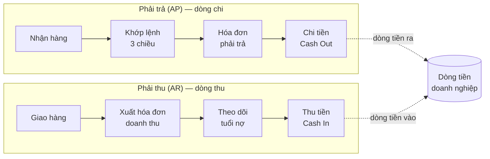

# Tổng quan Công nợ (AP / AR)

Công nợ là **bộ phận giữ dòng tiền**: một bên lo trả tiền đúng hạn và đúng người, một bên lo thu tiền đúng hạn và đủ số. Hai bên đối xứng về cơ chế nhưng khác nhau hoàn toàn về rủi ro — nên tài liệu này tách riêng, không gộp.

## Hai dòng đối xứng

**Điểm đối xứng:** AP bắt đầu từ *hàng về* rồi mới tới *hóa đơn*; AR bắt đầu từ *hàng đi* rồi mới tới *hóa đơn*. Cùng một sự kiện vật chất, nhưng chiều và rủi ro ngược nhau.

## Vì sao không gộp AP và AR

| Khía cạnh | AP | AR |
|---|---|---|
| Gắn với quy trình | Mua hàng: PO → nhận → khớp 3 chiều | Bán hàng: SO → giao → xuất hóa đơn |
| Rủi ro chính | Trả khống, trùng hóa đơn, GR/IR treo | Nợ khó đòi, vượt hạn mức tín dụng |
| Chứng từ điều chỉnh | Debit memo (mình tự lập) | Credit memo (mình phát hành) |
| Dòng tiền | Chi ra | Thu vào |
| Người đối chiếu | Nhà cung cấp | Khách hàng |

Gộp hai bên thành một bài sẽ buộc phải viết mọi nội dung hai lần với hai bộ rủi ro khác nhau — và người đọc không biết phần nào áp dụng cho mình.

## Ba câu hỏi mọi hệ công nợ phải trả lời

| Câu hỏi | AP | AR |
|---|---|---|
| Ghi nhận nợ khi nào và vào tài khoản nào? | [AP - Nguyên lý & tài khoản](./ap/1000-ap-nguyen-ly-va-tai-khoan.md) | [AR - Nguyên lý & tài khoản](./ar/5000-ar-nguyen-ly-va-tai-khoan.md) |
| Chứng từ nào được phép ghi nợ? | [AP - Nhận hóa đơn & đối tất tạm ứng](./ap/2000-ap-nhan-hoa-don-va-doi-tat-tam-ung.md) | [AR - Xuất hóa đơn & hạn mức tín dụng](./ar/6000-ar-xuat-hoa-don-va-han-muc-tin-dung.md) |
| Tiền đi/về đối trừ vào đâu? | [AP - Thanh toán & Cash Out](./ap/3000-ap-thanh-toan-va-cash-out.md) | [AR - Thu tiền & nhắc nợ](./ar/7000-ar-thu-tien-va-dunning.md) |

## Hai việc dùng chung cho cả AP và AR

- **Đối trừ công nợ, netting và đa tiền tệ** — khi một đối tượng vừa mua vừa bán, khi công nợ bằng ngoại tệ: [Đối trừ công nợ, netting & đa tiền tệ](./8000-cong-no-doi-tru-netting-va-tien-te.md)
- **Báo cáo tuổi nợ và dự báo dòng tiền** — câu hỏi quản trị quan trọng nhất của cả hai bên: [Báo cáo công nợ (Aging & Cashflow)](./9000-bao-cao-cong-no-aging-cashflow.md)

## Ranh giới trách nhiệm

| Việc | Mua / Bán hàng | Kế toán công nợ | Kho | Ban điều hành |
|---|---|---|---|---|
| Ghi nhận nợ | Cung cấp chứng từ gốc | ✅ sở hữu | Cung cấp số lượng thực nhận/giao | — |
| Duyệt chi / duyệt hạn mức | Đề xuất | ✅ sở hữu | — | ✅ duyệt vượt hạn mức |
| Đối trừ tiền với hóa đơn | Hỗ trợ tra cứu | ✅ sở hữu | — | — |
| Xử lý tranh chấp | ✅ chủ trì với đối tác | Phối hợp | Xác nhận số liệu | — |
| Khóa sổ công nợ cuối kỳ | — | ✅ sở hữu | — | — |

Nguyên tắc: **người tạo chứng từ gốc không được tự ghi nợ; người ghi nợ không được tự duyệt chi.**

## Bắt đầu đọc từ đâu

Nếu làm **phải trả**, đọc theo thứ tự `ap/1000 → ap/4000` rồi sang `8000`, `9000`.
Nếu làm **phải thu**, đọc theo thứ tự `ar/5000 → ar/7000` rồi sang `8000`, `9000`.

Nếu đang xử lý sự cố:

- Số dư công nợ lệch giữa sổ chi tiết và sổ cái → [AP: Bẫy & kiểm soát](./ap/4000-ap-bay-va-kiem-soat.md)
- Khách nợ quá hạn vẫn đặt được đơn → [AR: Xuất hóa đơn & hạn mức tín dụng](./ar/6000-ar-xuat-hoa-don-va-han-muc-tin-dung.md)
- Thu tiền rồi nhưng công nợ không giảm → [AR: Thu tiền & nhắc nợ](./ar/7000-ar-thu-tien-va-dunning.md)
- Chênh lệch tỷ giá trên công nợ ngoại tệ → [Đối trừ công nợ, netting & đa tiền tệ](./8000-cong-no-doi-tru-netting-va-tien-te.md)

  <strong>Chúc các bạn thành công và vui vẻ!</strong>

