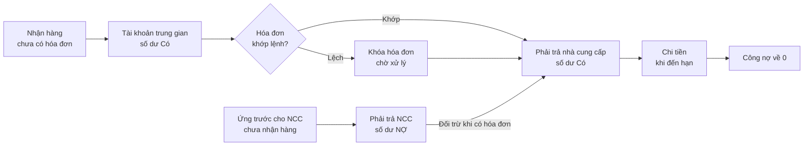

# 1000 AP: Nguyên lý & tài khoản

Phải trả trả lời một câu duy nhất: **doanh nghiệp đang nợ ai, bao nhiêu, đến hạn khi nào**. Nhưng để trả lời đúng, hệ thống phải tách được ba trạng thái rất khác nhau của cùng một khoản nợ: *đã nhận hàng chưa có hóa đơn*, *đã có hóa đơn chưa đến hạn*, và *đã ứng trước chưa nhận hàng*.

Bài này định nghĩa cơ chế ghi nhận và tài khoản. Các bước nghiệp vụ chi tiết ở [Nhận hóa đơn & đối tất tạm ứng](./2000-ap-nhan-hoa-don-va-doi-tat-tam-ung.md) và [Thanh toán & Cash Out](./3000-ap-thanh-toan-va-cash-out.md).

## 0. Nguyên lý (áp dụng mọi ERP)

1. **Nợ phát sinh khi nhận hàng, không phải khi nhận hóa đơn.** Hàng đã về kho là doanh nghiệp đã có nghĩa vụ trả tiền, dù hóa đơn chưa tới. Ghi nợ muộn hơn thời điểm nhận hàng là làm sai kỳ kế toán.
2. **Nhưng chưa đủ căn cứ để ghi nợ chính thức.** Giá và số lượng trên hóa đơn có thể khác PO và phiếu nhận. Vì vậy khoản nợ tạm thời nằm ở **tài khoản trung gian** cho tới khi khớp lệnh.
3. **Tài khoản phải trả nhà cung cấp là tài khoản lưỡng tính.** Theo chế độ kế toán Việt Nam, khoản ứng trước cho nhà cung cấp vẫn nằm trên cùng tài khoản phải trả, nhưng ở **số dư bên Nợ**. Vì vậy không mở một tài khoản tổng hợp riêng cho tạm ứng — hãy theo dõi chi tiết theo từng nhà cung cấp.
4. **Sổ chi tiết theo nhà cung cấp là bắt buộc, không phải tùy chọn.** Không có nó, không biết nợ ai bao nhiêu, không đối chiếu được với xác nhận công nợ của nhà cung cấp.
5. **Điều khoản thanh toán quyết định ngày đến hạn, không quyết định ngày ghi nợ.** Ghi nợ theo ngày nhận hàng/hóa đơn; điều khoản chỉ dời hạn trả.
6. **Tài khoản trung gian phải tự triệt tiêu về 0.** Số dư khác 0 kéo dài nghĩa là có giao dịch chưa hoàn tất, không phải sai số bình thường.

## 1. Luồng vận hành



**Đọc sơ đồ:** tài khoản phải trả nhà cung cấp nhận dòng vào từ **ba nguồn** — khớp hóa đơn, ứng trước (ghi Nợ), và đối trừ giữa hai dòng đó. Đây là lý do nó là tài khoản lưỡng tính.

## 2. Ai làm gì ở module nào

| Bước | Mua hàng | Kho | Kế toán AP | Ban điều hành |
|---|---|---|---|---|
| Ghi nhận khoản trung gian khi nhận hàng | Duyệt PO | ✅ ghi giao dịch kho | Nhận bút toán tự động | — |
| Nhận hóa đơn và khớp lệnh | ✅ làm việc với NCC khi lệch | Cung cấp số lượng thực nhận | ✅ sở hữu | — |
| Ghi nợ chính thức vào phải trả | — | — | ✅ sở hữu | — |
| Ứng trước cho nhà cung cấp | ✅ đề xuất theo hợp đồng | — | ✅ ghi nhận và đối tất | ✅ duyệt ứng trước lớn |
| Cấu hình điều khoản thanh toán | Thỏa thuận với NCC | — | ✅ sở hữu | ✅ duyệt chính sách |
| Đối chiếu số dư với nhà cung cấp | Hỗ trợ tra cứu | — | ✅ chủ trì | — |
| Duyệt chi tiền | Trình duyệt | — | ✅ thực hiện | ✅ duyệt theo hạn mức |

**Ranh giới cốt lõi:** mua hàng **thỏa thuận** điều khoản, kế toán **ghi nhận và thực thi**. Người đàm phán điều khoản không được là người duyệt chi theo điều khoản đó.

## 3. Hạch toán

### A. Ba trạng thái của cùng một khoản nợ

| Trạng thái | Thời điểm | Tài khoản | Ý nghĩa |
|---|---|---|---|
| Hàng đã về, chưa có hóa đơn | Khi nhập kho | **Tài khoản trung gian** (số dư Có) | Nghĩa vụ có thật, chưa đủ căn cứ ghi nợ chính thức |
| Có hóa đơn, chưa trả | Khi khớp lệnh | **Phải trả nhà cung cấp** (số dư Có) | Nợ chính thức, đã có hạn trả |
| Đã ứng trước, chưa nhận hàng | Khi chi tạm ứng | **Phải trả nhà cung cấp** (số dư Nợ) | Quyền đòi hàng/hoàn tiền, bản chất là tài sản |

Bản đồ tài khoản trung gian, nguyên tắc tất toán và cách xử lý chênh lệch giá nằm duy nhất tại [Hạch toán & tài khoản trung gian](../../6-ke-toan-chung/1000-hach-toan-va-tai-khoan-trung-gian.md).

### B. Vì sao tạm ứng không mở tài khoản riêng

Khi ứng trước tiền cho nhà cung cấp, doanh nghiệp chưa nhận hàng — về bản chất đây là **quyền đòi hàng hoặc đòi lại tiền**, tức một khoản tài sản. Nhưng chế độ kế toán hiện hành vẫn theo dõi nó trên cùng tài khoản phải trả, ở chi tiết từng nhà cung cấp, với số dư bên Nợ.

Hệ quả khi trình bày báo cáo: khoản ứng trước được đưa vào phần **Tài sản**, lấy từ **số dư Nợ chi tiết** của tài khoản phải trả — không phải từ một tài khoản độc lập.

Nếu tự mở một tài khoản tổng hợp riêng cho tạm ứng, hệ thống sẽ lệch với cách trình bày chuẩn của báo cáo tài chính và làm phức tạp việc đối chiếu với nhà cung cấp.

### C. Điều khoản thanh toán

Điều khoản chỉ **dời ngày trả**, không đổi ngày ghi nợ. Ba dạng phổ biến:

- **Trả ngay / trả trước**: hạn = ngày hóa đơn, hoặc trả trước khi nhận hàng.
- **Net N**: hạn = ngày hóa đơn + N ngày.
- **Chiết khấu thanh toán sớm** (ví dụ 2/10 net 30): trả trong 10 ngày được giảm 2%, quá hạn thì trả đủ trong 30 ngày.

Chiết khấu thanh toán sớm được hưởng là **thu nhập tài chính**, không phải giảm giá mua — hạch toán sai chỗ này làm sai cả giá vốn lẫn doanh thu tài chính.

## 4. Điểm chạm & rủi ro

- **Nghiệp vụ nhận hóa đơn và tạm ứng**: [Nhận hóa đơn & đối tất tạm ứng](./2000-ap-nhan-hoa-don-va-doi-tat-tam-ung.md)
- **Trả tiền thực tế**: [Thanh toán & Cash Out](./3000-ap-thanh-toan-va-cash-out.md)
- **Khớp lệnh trước khi ghi nợ**: [Đối soát hóa đơn & 3-Way Match](../../2-mua-hang/5000-doi-soat-hoa-don-va-3-way-match.md)
- **Tài khoản trung gian**: [Hạch toán & tài khoản trung gian](../../6-ke-toan-chung/1000-hach-toan-va-tai-khoan-trung-gian.md)
- **Hồ sơ nhà cung cấp và điều khoản**: [Danh mục & hợp đồng mua](../../2-mua-hang/2000-danh-muc-va-hop-dong-mua.md)
- **Chênh lệch tỷ giá**: [Đối trừ công nợ, netting & đa tiền tệ](../8000-cong-no-doi-tru-netting-va-tien-te.md)

**Rủi ro chính:**

- **Ghi nợ tại thời điểm nhận hóa đơn thay vì nhận hàng** — kỳ kế toán sai khi hóa đơn về trễ.
- **Mở tài khoản riêng cho tạm ứng** — lệch cách trình bày báo cáo tài chính chuẩn.
- **Không theo dõi số dư chi tiết theo nhà cung cấp** — không biết nợ ai bao nhiêu, không đối chiếu được.
- **Không đối tất tạm ứng khi có hóa đơn** — trả hai lần cho cùng một khoản.
- **Hạch toán chiết khấu thanh toán sớm như giảm giá mua** — sai giá vốn và thu nhập tài chính.

## 5. Triển khai tham chiếu ERP

### A. Ánh xạ khái niệm

| Khái niệm | Oracle EBS R12 | Epicor ERP | SAP S/4HANA | Odoo |
|---|---|---|---|---|
| Hồ sơ nhà cung cấp | TCA: `HZ_PARTIES` + `AP_SUPPLIERS` + site | `Erp.Vendor` | BP + Supplier role (`LFA1`) | `res.partner` |
| Số dư phải trả theo NCC | `AP_SUPPLIER_SITES_ALL` + `AP_INVOICES_ALL` | `Erp.Vendor` + `APInvHed` | `LFB1` (Company Code Data) + `BSID` | `account.move.line` |
| Tài khoản trung gian | AP Accrual (SLA) | GL Control Account theo Product Group | GR/IR Clearing (`WRX`) | Stock Interim |
| Tạm ứng (prepayment) | Prepayment Invoice, đối tất bằng Apply | `AP Invoice` type Prepayment + `Prepayment` apply | Down Payment Request (`F-47`) → `F-48` | Không có native, dùng `account.partial.reconcile` |
| Điều khoản thanh toán | `AP_TERMS` | `Payment Terms` trên Vendor | `ZTERM` (`T052`) | `account.payment.term` |
| Chiết khấu thanh toán sớm | `AP_INVOICE_PAYMENTS` (discount taken) | `Terms` + `EarlyPayDiscount` | Cash discount (`ZTERM` discount %) | `account.payment.term` discount |

### B. Hệ thống tự xây — thiết kế tối thiểu

```sql
CREATE TABLE AP_Open_Item (
    AP_Item_ID        BIGINT IDENTITY PRIMARY KEY,
    Vendor_ID         VARCHAR(50) NOT NULL,
    Doc_Type          VARCHAR(20) NOT NULL,  -- INVOICE | PREPAYMENT | CREDIT_MEMO | DEBIT_MEMO
    Doc_No            VARCHAR(30) NOT NULL,
    Doc_Date          DATE NOT NULL,
    Due_Date          DATE NOT NULL,
    Currency          VARCHAR(3) NOT NULL,
    Amount_Foreign    DECIMAL(18,2) NOT NULL,
    Amount_Base       DECIMAL(18,2) NOT NULL,
    Amount_Open       DECIMAL(18,2) NOT NULL,  -- số còn lại chưa tất toán
    GL_Account        VARCHAR(20) NOT NULL,    -- 331 chi tiết
    Status            VARCHAR(20) NOT NULL,    -- OPEN | PARTIAL | CLEARED
    Source_Doc        VARCHAR(50) NULL          -- PO / GRN liên quan
);
```

Bốn ràng buộc bắt buộc:

1. **`Vendor_ID` NOT NULL** trên mọi dòng — không có nợ "chung chung".
2. **`Amount_Open` giảm dần khi thanh toán hoặc đối trừ**; `Status` chuyển `CLEARED` khi về 0.
3. **Cùng một tài khoản phải giữ được cả số dư Nợ (tạm ứng) và Có (phải trả)** — không tách tài khoản.
4. **Chặn đối trừ nếu tổng đối trừ vượt `Amount_Open`** của chứng từ nguồn.

### C. Truy vấn kiểm soát

**Số dư chi tiết theo nhà cung cấp — phải khớp tổng sổ cái:**

```sql
SELECT Vendor_ID,
       SUM(CASE WHEN Doc_Type = 'PREPAYMENT' THEN Amount_Open ELSE 0 END) AS Prepaid_Debit,
       SUM(CASE WHEN Doc_Type IN ('INVOICE','DEBIT_MEMO') THEN Amount_Open
                WHEN Doc_Type = 'CREDIT_MEMO' THEN -Amount_Open ELSE 0 END) AS Payable_Credit,
       SUM(CASE WHEN Doc_Type = 'PREPAYMENT' THEN Amount_Open ELSE 0 END)
     - SUM(CASE WHEN Doc_Type IN ('INVOICE','DEBIT_MEMO') THEN Amount_Open
                WHEN Doc_Type = 'CREDIT_MEMO' THEN -Amount_Open ELSE 0 END) AS Net_Balance
FROM AP_Open_Item
WHERE Status <> 'CLEARED'
GROUP BY Vendor_ID
ORDER BY Net_Balance;
```

**Tài khoản trung gian còn số dư — có giao dịch chưa hoàn tất:**

```sql
SELECT Period_ID, SUM(Debit) - SUM(Credit) AS Balance
FROM GL_Journal
WHERE Account_ID = 'GR_IR_CLEARING'
GROUP BY Period_ID
HAVING ABS(SUM(Debit) - SUM(Credit)) > 0.01
ORDER BY Period_ID DESC;
```

**Nhà cung cấp có khoản tạm ứng chưa đối tất quá hạn:**

```sql
SELECT Vendor_ID, Doc_No, Doc_Date, Amount_Open,
       DATEDIFF(DAY, Doc_Date, GETDATE()) AS Days_Outstanding
FROM AP_Open_Item
WHERE Doc_Type = 'PREPAYMENT'
  AND Status <> 'CLEARED'
  AND DATEDIFF(DAY, Doc_Date, GETDATE()) > 180
ORDER BY Days_Outstanding DESC;
```

**Hóa đơn có tạm ứng chưa đối tất khi ghi nợ — nguy cơ trả hai lần:**

```sql
SELECT i.Vendor_ID, i.Doc_No AS Invoice_No, i.Amount_Open,
       p.Doc_No AS Prepayment_No, p.Amount_Open AS Prepaid_Open
FROM AP_Open_Item i
JOIN AP_Open_Item p ON p.Vendor_ID = i.Vendor_ID AND p.Doc_Type = 'PREPAYMENT'
WHERE i.Doc_Type = 'INVOICE'
  AND i.Status = 'OPEN'
  AND p.Status = 'OPEN'
  AND (i.Source_Doc = p.Source_Doc OR p.Source_Doc IS NULL);
```

**Epicor — số dư phải trả theo nhà cung cấp và tuổi nợ:**

```sql
SELECT v.VendorID, v.Name,
       SUM(ah.DocInvoiceAmt - ISNULL(ah.DocAmountPaid, 0)) AS Open_Balance,
       MIN(ah.DueDate) AS Oldest_Due,
       DATEDIFF(DAY, MIN(ah.DueDate), GETDATE()) AS Max_Days_Overdue
FROM Erp.APInvHed ah
JOIN Erp.Vendor v ON v.Company = ah.Company AND v.VendorNum = ah.VendorNum
WHERE ah.Company = 'YOUR_COMPANY_CODE'
  AND ah.Posted = 1
  AND ah.DocInvoiceAmt > ISNULL(ah.DocAmountPaid, 0)
GROUP BY v.VendorID, v.Name
ORDER BY Max_Days_Overdue DESC;
```

## 6. Bẫy thực chiến & Checklist

| # | Bẫy | Triệu chứng | Cách phòng tránh |
|---|---|---|---|
| 1 | Ghi nợ khi nhận hóa đơn thay vì nhận hàng | Kỳ kế toán sai khi hóa đơn về trễ | Ghi qua tài khoản trung gian tại thời điểm nhận |
| 2 | Mở tài khoản riêng cho tạm ứng | Báo cáo tài chính lệch cách trình bày chuẩn | Giữ trên cùng tài khoản phải trả, số dư Nợ |
| 3 | Không theo dõi chi tiết theo nhà cung cấp | Không biết nợ ai, không đối chiếu được | Bảng `AP_Open_Item` theo `Vendor_ID` |
| 4 | Không đối tất tạm ứng khi có hóa đơn | Trả hai lần cho cùng một khoản | Quét tạm ứng treo trước khi giải phóng thanh toán |
| 5 | Điều khoản thanh toán không có ngày hiệu lực | Đổi điều khoản làm hạn trả của hóa đơn cũ thay đổi | Hạn trả chốt tại ngày hóa đơn |
| 6 | Chiết khấu sớm ghi vào giảm giá mua | Sai giá vốn và thu nhập tài chính | Ghi vào thu nhập tài chính |
| 7 | Không phân biệt nợ ngoại tệ | Số dư VND sai khi tỷ giá đổi | Lưu cả `Amount_Foreign` và `Amount_Base` |
| 8 | Không đối chiếu số dư với NCC | Tranh chấp khi xác nhận công nợ | Quy trình gửi sao kê và xác nhận định kỳ |
| 9 | Tài khoản trung gian treo qua nhiều kỳ | Khoản nợ không ai xử lý | Báo cáo số dư trung gian, xử lý trước khóa sổ |
| 10 | Sửa số dư nợ trực tiếp | Mất dấu vết kiểm toán | Chỉ ghi chứng từ mới hoặc đối trừ, không sửa số dư |

**Checklist trước go-live:**

- [ ] Có bảng số dư chi tiết theo nhà cung cấp (đã đối chiếu với sổ cái).
- [ ] Tài khoản phải trả giữ được cả số dư Nợ và Có (đã test tạm ứng).
- [ ] Hóa đơn có tạm ứng treo bị chặn khi chưa đối tất (đã test).
- [ ] Điều khoản thanh toán chốt hạn trả tại ngày hóa đơn (đã test đổi điều khoản sau đó).
- [ ] Chiết khấu thanh toán sớm ghi vào thu nhập tài chính.
- [ ] Công nợ ngoại tệ lưu cả nguyên tệ và VND.
- [ ] Có báo cáo số dư tài khoản trung gian, xử lý trước khóa sổ.
- [ ] Có báo cáo tạm ứng treo quá 180 ngày.
- [ ] Đã test vòng đời: ứng 30% → nhận hóa đơn 100% → đối tất → trả 70%.

## Xem thêm

- [Tổng quan Công nợ](../0000-tong-quan-cong-no.md)
- [AP: Nhận hóa đơn & đối tất tạm ứng](./2000-ap-nhan-hoa-don-va-doi-tat-tam-ung.md)
- [AP: Thanh toán & Cash Out](./3000-ap-thanh-toan-va-cash-out.md)
- [AP: Bẫy & kiểm soát](./4000-ap-bay-va-kiem-soat.md)
- [Hạch toán & tài khoản trung gian](../../6-ke-toan-chung/1000-hach-toan-va-tai-khoan-trung-gian.md)

<div align="center" style={{color: 'var(--ifm-color-primary)'}}>
  <strong>Chúc các bạn thành công và vui vẻ!</strong>
</div>
