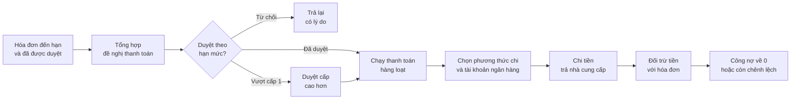

# 3000 AP: Thanh toán & Cash Out

Đây là bước **duy nhất trong chuỗi mua hàng mà tiền thực sự rời doanh nghiệp**. Mọi kiểm soát phía trước — yêu cầu, đơn mua, nhận hàng, khớp lệnh — đều chỉ có giá trị nếu bước này chỉ trả đúng số tiền cho đúng người vào đúng lúc.

## 0. Nguyên lý (áp dụng mọi ERP)

1. **Thanh toán là chứng từ riêng, không phải thao tác trên hóa đơn.** Một lần chi có thể trả nhiều hóa đơn; một hóa đơn có thể được trả nhiều lần. Gộp hai chiều này vào một bản ghi làm mất khả năng đối chiếu.
2. **Duyệt chi phải tách khỏi người lập đề nghị.** Người muốn trả tiền không được là người duyệt trả tiền. Đây là nguyên tắc phân tách nhiệm vụ cốt lõi của AP.
3. **Chạy thanh toán hàng loạt phải có "kỳ chạy" đóng băng.** Khi chạy, hệ thống chọn các hóa đơn đến hạn tại một thời điểm; hóa đơn được thêm vào sau không tự động chen vào lô đã chạy.
4. **Phương thức chi quyết định chứng từ và chi phí.** Chuyển khoản nội địa, chuyển khoản quốc tế, séc, tiền mặt — mỗi loại có chứng từ riêng và phí riêng.
5. **Chênh lệch nhỏ không được để âm thầm treo.** Làm tròn vài trăm đồng, phí chuyển khoản, chiết khấu nhỏ — phải có tài khoản và ngưỡng dung sai, không để số dư lẻ tồn vĩnh viễn.
6. **Sau khi chi, số dư công nợ phải về 0 và đối chiếu được với nhà cung cấp.** Nếu không, tranh chấp sẽ phát sinh ở lần mua sau.

## 1. Luồng vận hành



## 2. Ai làm gì ở module nào

| Bước | Kế toán AP | Kế toán trưởng / CFO | Thủ quỹ / Ngân hàng | Mua hàng | Ban điều hành |
|---|---|---|---|---|---|
| Xác định hóa đơn đến hạn | ✅ sở hữu | — | — | — | — |
| Lập đề nghị thanh toán | ✅ sở hữu | — | — | Đề xuất khi cần gấp | — |
| Duyệt chi cấp 1 | Trình duyệt | ✅ duyệt theo hạn mức | — |
| Duyệt chi vượt hạn mức | — | Trình duyệt | — | ✅ duyệt |
| Chạy thanh toán hàng loạt | ✅ thực hiện | ✅ kiểm tra lô | — | — | — |
| Thực hiện chuyển tiền | — | ✅ thực hiện | — | — |
| Đối trừ tiền với hóa đơn | ✅ sở hữu | — | — |
| Xử lý chênh lệch thanh toán | ✅ đề xuất | ✅ duyệt | — | — | — |

**Ranh giới cốt lõi:** người **lập đề nghị** ≠ người **duyệt chi** ≠ người **thực hiện chuyển tiền** ≠ người **đối trừ**. Bốn vai trò, không ai giữ từ hai vai trò trở lên trên cùng một chứng từ.

## 3. Hạch toán

Bản đồ tài khoản và nguyên tắc tất toán ở [Hạch toán & tài khoản trung gian](../../6-ke-toan-chung/1000-hach-toan-va-tai-khoan-trung-gian.md); phần phải trả ở [AP: Nguyên lý & tài khoản](./1000-ap-nguyen-ly-va-tai-khoan.md).

Bốn điểm cần nhớ:

1. **Chi tiền là Nợ tài khoản phải trả nhà cung cấp, Có tài khoản tiền.** Không ghi vào chi phí — chi phí đã ghi khi nhận hàng/hóa đơn.
2. **Chiết khấu thanh toán sớm được hưởng là thu nhập tài chính**, không phải giảm giá mua. Hạch toán vào tài khoản doanh thu tài chính.
3. **Phí chuyển khoản ngân hàng là chi phí tài chính**, tách khỏi số tiền trả nhà cung cấp.
4. **Chênh lệch làm tròn và chênh lệch nhỏ** phải vào một tài khoản chênh lệch có ngưỡng dung sai — không để dư nợ lẻ tồn tại.

## 4. Điểm chạm & rủi ro

- **Hóa đơn được trả**: [Nhận hóa đơn & đối tất tạm ứng](./2000-ap-nhan-hoa-don-va-doi-tat-tam-ung.md)
- **Khóa hóa đơn trước khi chi**: [Đối soát hóa đơn & 3-Way Match](../../2-mua-hang/5000-doi-soat-hoa-don-va-3-way-match.md)
- **Thuế khấu trừ tại nguồn khi chi trả**: [Thuế & tài sản cố định](../../6-ke-toan-chung/3000-thue-va-tai-san-co-dinh.md)
- **Chênh lệch tỷ giá khi thanh toán ngoại tệ**: [Đối trừ công nợ, netting & đa tiền tệ](../8000-cong-no-doi-tru-netting-va-tien-te.md)
- **Đối chiếu số dư sau chi**: [Báo cáo công nợ (Aging & Cashflow)](../9000-bao-cao-cong-no-aging-cashflow.md)
- **Phân tách nhiệm vụ**: [Kiểm soát nội bộ & phân tách nhiệm vụ](../../0-nen-tang/4000-kiem-soat-noi-bo-va-phan-tach-nhiem-vu.md)

**Rủi ro chính:**

- **Trả trùng hóa đơn** — chi hai lần cho cùng một khoản nợ.
- **Cùng người lập đề nghị và duyệt chi** — khe hở gian lận lớn nhất.
- **Chạy thanh toán không đóng băng kỳ** — hóa đơn chen vào lô đã chạy, chi ngoài kế hoạch.
- **Chọn nhầm tài khoản ngân hàng** — chi từ tài khoản không đúng, sai đối chiếu ngân hàng.
- **Chênh lệch nhỏ để treo** — công nợ không bao giờ về 0.
- **Không đối trừ sau chi** — hóa đơn vẫn mở dù tiền đã ra.

## 5. Triển khai tham chiếu ERP

### A. Ánh xạ khái niệm

| Khái niệm | Oracle EBS R12 | Epicor ERP | SAP S/4HANA | Odoo |
|---|---|---|---|---|
| Đề nghị thanh toán | `AP_INVOICE_PAYMENTS` (draft) | `Payment Entry` | Payment Proposal (`F110`) | `account.payment` draft |
| Duyệt chi nhiều cấp | AME (Approval Management Engine) | Payment Approval | Release Strategy / Workflow | Không native, dùng `approval` |
| Chạy thanh toán hàng loạt | Payment Process Request | `Payment File Generation` | Automatic Payment Program (`F110`) | Batch payment |
| Phương thức chi | `AP_PAYMENT_METHODS` | `PayMethod` | Payment Method (`T042Z`) | `account.payment.method` |
| Chiết khấu sớm | Discount trong `AP_TERMS` | `EarlyPayDiscount` | Cash discount (`ZTERM`) | Payment term discount |
| Chênh lệch nhỏ | Payment Tolerance | `Payment Tolerance` | Tolerance (`T043`) | Không native |
| Đối trừ tiền với hóa đơn | Invoice Payment + Apply | `Payment Apply` | Clearing (`F-53` / automatic) | `account.partial.reconcile` |
| Ngoại tệ | Exchange rate tại ngày chi | `ExchangeRate` trên Payment | Payment date rate | `amount_currency` |

### B. Hệ thống tự xây — thiết kế tối thiểu

```sql
CREATE TABLE AP_Payment_Run (
    Run_ID           BIGINT IDENTITY PRIMARY KEY,
    Run_No           VARCHAR(30) NOT NULL UNIQUE,
    Run_Date         DATE NOT NULL,
    Cutoff_Date      DATE NOT NULL,        -- hóa đơn đến hạn <= ngày này
    Status           VARCHAR(20) NOT NULL, -- DRAFT | APPROVED | EXECUTED | CANCELLED
    Approved_By      VARCHAR(50) NULL,
    Approved_At      DATETIME NULL
);

CREATE TABLE AP_Payment (
    Payment_ID       BIGINT IDENTITY PRIMARY KEY,
    Run_ID           BIGINT NULL,
    Vendor_ID        VARCHAR(50) NOT NULL,
    Payment_Date     DATE NOT NULL,
    Method           VARCHAR(20) NOT NULL, -- BANK_TRANSFER | CHEQUE | CASH | INTL_TRANSFER
    Bank_Account     VARCHAR(30) NOT NULL,
    Currency         VARCHAR(3) NOT NULL,
    Amount_Foreign   DECIMAL(18,2) NOT NULL,
    Amount_Base      DECIMAL(18,2) NOT NULL,
    Exchange_Rate    DECIMAL(18,6) NOT NULL,
    Discount_Taken   DECIMAL(18,2) NOT NULL DEFAULT 0,
    Variance_Amount  DECIMAL(18,2) NOT NULL DEFAULT 0,
    Status           VARCHAR(20) NOT NULL  -- DRAFT | APPROVED | PAID | CANCELLED
);

CREATE TABLE AP_Payment_Apply (
    Payment_ID       BIGINT NOT NULL,
    Invoice_ID       BIGINT NOT NULL,
    Amount_Applied   DECIMAL(18,2) NOT NULL,
    Discount_Applied DECIMAL(18,2) NOT NULL DEFAULT 0,
    PRIMARY KEY (Payment_ID, Invoice_ID)
);
```

Sáu ràng buộc bắt buộc:

1. **`Approved_By` NOT NULL trước khi chuyển `APPROVED`**, và phải khác người tạo.
2. **Chỉ chọn hóa đơn có `Due_Date <= Cutoff_Date`** khi chạy thanh toán.
3. **Tổng `Amount_Applied` của một payment không vượt `Amount_Net` của payment**.
4. **Tổng đã trả cho một hóa đơn không vượt `Amount_Open`** của hóa đơn.
5. **`Variance_Amount` chỉ được ghi khi ≤ ngưỡng dung sai đã cấu hình**, nếu vượt phải trình duyệt.
6. **`Exchange_Rate` chốt tại `Payment_Date`**, không dùng tỷ giá ngày hóa đơn.

### C. Truy vấn kiểm soát

**Hóa đơn đã thanh toán đủ nhưng vẫn còn số dư mở:**

```sql
SELECT i.Invoice_ID, i.Vendor_ID, i.Invoice_No,
       i.Amount_Net,
       ISNULL(SUM(a.Amount_Applied), 0) AS Paid,
       i.Amount_Net - ISNULL(SUM(a.Amount_Applied), 0) AS Still_Open
FROM AP_Invoice i
LEFT JOIN AP_Payment_Apply a ON a.Invoice_ID = i.Invoice_ID
WHERE i.Status IN ('APPROVED','POSTED')
GROUP BY i.Invoice_ID, i.Vendor_ID, i.Invoice_No, i.Amount_Net
HAVING i.Amount_Net - ISNULL(SUM(a.Amount_Applied), 0) <> 0;
```

**Thanh toán vượt số dư hóa đơn — trả thừa:**

```sql
SELECT a.Payment_ID, a.Invoice_ID, a.Amount_Applied, i.Amount_Net
FROM AP_Payment_Apply a
JOIN AP_Invoice i ON i.Invoice_ID = a.Invoice_ID
WHERE a.Amount_Applied > i.Amount_Net;
```

**Cùng người lập và duyệt — vi phạm phân tách nhiệm vụ:**

```sql
SELECT r.Run_No, r.Approved_By, COUNT(p.Payment_ID) AS So_Payment
FROM AP_Payment_Run r
JOIN AP_Payment p ON p.Run_ID = r.Run_ID
WHERE r.Approved_By = p.Created_By
GROUP BY r.Run_No, r.Approved_By;
```

**Chênh lệch thanh toán vượt ngưỡng dung sai:**

```sql
SELECT Payment_ID, Vendor_ID, Amount_Base, Variance_Amount,
       Variance_Amount * 100 / NULLIF(Amount_Base, 0) AS Variance_Pct
FROM AP_Payment
WHERE Variance_Amount > 0
ORDER BY Variance_Amount DESC;
```

**Hóa đơn quá hạn mà chưa được đưa vào lô thanh toán nào:**

```sql
SELECT i.Invoice_ID, i.Vendor_ID, i.Invoice_No, i.Due_Date,
       DATEDIFF(DAY, i.Due_Date, GETDATE()) AS Days_Overdue, i.Amount_Net
FROM AP_Invoice i
WHERE i.Status = 'POSTED'
  AND i.Due_Date < GETDATE()
  AND NOT EXISTS (SELECT 1 FROM AP_Payment_Apply a WHERE a.Invoice_ID = i.Invoice_ID)
ORDER BY Days_Overdue DESC;
```

**Oracle EBS — hóa đơn đến hạn chưa được chi trả:**

```sql
SELECT hou.name AS operating_unit, aia.invoice_num, aia.invoice_date,
       aps.vendor_name, aia.invoice_amount, ail.due_date,
       ROUND(SYSDATE - ail.due_date) AS days_overdue
FROM ap_invoices_all aia
JOIN ap_invoice_lines_all ail ON aia.invoice_id = ail.invoice_id
JOIN ap_suppliers aps          ON aia.vendor_id = aps.vendor_id
JOIN hr_operating_units hou    ON aia.org_id = hou.organization_id
WHERE aia.payment_status_flag = 'N'
  AND ail.due_date < SYSDATE
ORDER BY days_overdue DESC;
```

## 6. Bẫy thực chiến & Checklist

| # | Bẫy | Triệu chứng | Cách phòng tránh |
|---|---|---|---|
| 1 | Trả hai lần cho cùng hóa đơn | Công nợ âm, đòi lại tiền rất khó | Chặn `Amount_Applied` vượt số dư hóa đơn |
| 2 | Cùng người lập và duyệt chi | Gian lận không ai phát hiện | SoD: bốn vai trò tách biệt |
| 3 | Chạy thanh toán không đóng băng cutoff | Hóa đơn chen vào lô đã chạy | `Cutoff_Date` cố định khi chạy |
| 4 | Ghi chi tiền vào tài khoản chi phí | Chi phí bị tính hai lần | Chỉ Nợ phải trả, Có tiền |
| 5 | Chiết khấu sớm ghi giảm giá mua | Sai giá vốn, sai thu nhập tài chính | Ghi vào thu nhập tài chính |
| 6 | Phí ngân hàng gộp vào số trả NCC | Đối chiếu sao kê không khớp | Tách phí vào chi phí tài chính |
| 7 | Chênh lệch nhỏ để treo | Công nợ không bao giờ về 0 | Dung sai chênh lệch có tài khoản riêng |
| 8 | Dùng tỷ giá ngày hóa đơn khi chi ngoại tệ | Chênh lệch tỷ giá không được ghi nhận | Chốt tỷ giá tại ngày chi |
| 9 | Trả tiền cho hóa đơn đang bị khóa | Trả trước khi sai lệch được xử lý | Chỉ chi hóa đơn đã `APPROVED` |
| 10 | Không đối trừ sau khi chi | Hóa đơn vẫn mở dù tiền đã ra | Bắt buộc `AP_Payment_Apply` khi chi |

**Checklist trước go-live:**

- [ ] `Approved_By` bắt buộc và khác người tạo (đã test).
- [ ] SoD: lập đề nghị / duyệt / chuyển tiền / đối trừ là bốn vai trò khác nhau.
- [ ] Chạy thanh toán lọc theo `Cutoff_Date` (đã test hóa đơn đến hạn sau cutoff).
- [ ] Chặn trả vượt số dư hóa đơn (đã test).
- [ ] Dung sai chênh lệch có tài khoản riêng (đã test làm tròn).
- [ ] Chiết khấu sớm vào thu nhập tài chính.
- [ ] Phí ngân hàng tách khỏi số trả nhà cung cấp.
- [ ] Ngoại tệ chốt tỷ giá tại ngày chi (đã test chênh lệch).
- [ ] Chỉ chi hóa đơn đã `APPROVED`, không chi hóa đơn đang khóa.
- [ ] Sau chi, công nợ về 0 hoặc chênh lệch có lý do (đã test toàn vòng).

## Xem thêm

- [Tổng quan Công nợ](../0000-tong-quan-cong-no.md)
- [AP: Nguyên lý & tài khoản](./1000-ap-nguyen-ly-va-tai-khoan.md)
- [AP: Nhận hóa đơn & đối tất tạm ứng](./2000-ap-nhan-hoa-don-va-doi-tat-tam-ung.md)
- [AP: Bẫy & kiểm soát](./4000-ap-bay-va-kiem-soat.md)
- [Báo cáo công nợ (Aging & Cashflow)](../9000-bao-cao-cong-no-aging-cashflow.md)

<div align="center" style={{color: 'var(--ifm-color-primary)'}}>
  <strong>Chúc các bạn thành công và vui vẻ!</strong>
</div>
