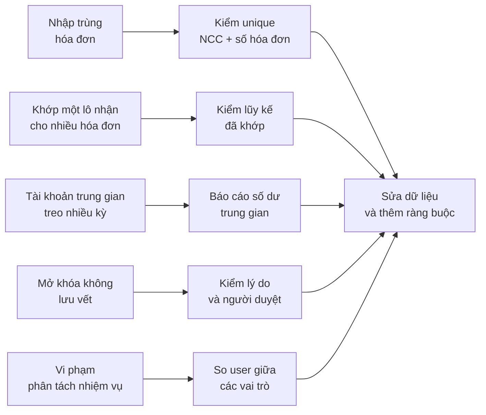

---
id: ap-bay-va-kiem-soat
title: "4000 AP: Bẫy & kiểm soát"
slug: /erp-nghiep-vu/cong-no/ap/bay-va-kiem-soat
sidebar_position: 4000
description: "Các bẫy phổ biến trong công nợ phải trả: nhập trùng hóa đơn, khớp một lô nhận cho nhiều hóa đơn, tài khoản trung gian treo, mở khóa không lưu vết và vi phạm phân tách nhiệm vụ."
tags: [erp, finance, ap, sod, kiem-soat]
---

# 4000 AP: Bẫy & kiểm soát

Bài này gom các lỗi lặp lại ở nhiều doanh nghiệp và nhiều hệ thống khác nhau. Điểm chung: **hệ thống không báo lỗi khi chúng xảy ra** — chỉ phát hiện khi đối chiếu công nợ hoặc kiểm toán.

## 0. Nguyên lý (áp dụng mọi ERP)

1. **Bốn khe hở lớn nhất của AP:** nhập trùng hóa đơn, khớp một lô nhận cho nhiều hóa đơn, tài khoản trung gian treo, và cùng một người làm nhiều vai trò.
2. **Mỗi khe hở cần một ràng buộc ở tầng dữ liệu, không phải quy trình nhắc nhở.** Nhắc người dùng "nhớ kiểm tra trùng" là vô hiệu khi có một hóa đơn thứ hai đúng thật.
3. **Sổ chi tiết phải luôn khớp sổ cái.** Lệch giữa hai sổ là dấu hiệu có giao dịch ghi thiếu hoặc ghi sai bên.
4. **Mở khóa hóa đơn là hành động có rủi ro cao nhất trong AP** — nó bỏ qua mọi kiểm tra tự động. Phải có người, lý do và dấu vết.

## 1. Luồng vận hành



## 2. Ai làm gì ở module nào

| Bẫy | Kế toán AP | Mua hàng | Kho | Kiểm soát nội bộ | Người phát hiện sớm nhất |
|---|---|---|---|---|---|
| Trùng hóa đơn | ✅ sở hữu kiểm soát | Hỗ trợ xác nhận với NCC | — | Rà soát định kỳ | Kế toán AP |
| Khớp một lô nhiều hóa đơn | ✅ sở hữu cột lũy kế | Đọc sai lệch | Cung cấp số nhận | — | Kế toán AP |
| Trung gian treo | ✅ chủ trì xử lý | Phối hợp | Xác nhận đã nhận | ✅ theo dõi | Kế toán cuối kỳ |
| Mở khóa không lưu vết | ✅ thực thi | — | — | ✅ kiểm tra log | Kiểm toán |
| Vi phạm SoD | — | — | — | ✅ sở hữu ma trận | Kiểm toán |

## 3. Hạch toán

Các bẫy trong bài gây **hệ quả tài chính trực tiếp**: trả thừa tiền, công nợ ảo, chi phí sai kỳ.

- **Trùng hóa đơn** → chi hai lần, phải đòi lại nhà cung cấp.
- **Khớp một lô nhiều lần** → cùng một lượng hàng thành nhiều khoản nợ.
- **Trung gian treo** → tài sản và nợ phải trả cùng bị đánh giá sai.
- **Mở khóa bừa** → chênh lệch được duyệt mà không ai phân tích nguyên nhân.

Bản đồ tài khoản ở [Hạch toán & tài khoản trung gian](../../6-ke-toan-chung/1000-hach-toan-va-tai-khoan-trung-gian.md).

## 4. Điểm chạm & rủi ro

- **Nguyên lý tài khoản phải trả**: [AP: Nguyên lý & tài khoản](./1000-ap-nguyen-ly-va-tai-khoan.md)
- **Nhập hóa đơn và đối tất tạm ứng**: [Nhận hóa đơn & đối tất tạm ứng](./2000-ap-nhan-hoa-don-va-doi-tat-tam-ung.md)
- **Chi tiền và đối trừ**: [Thanh toán & Cash Out](./3000-ap-thanh-toan-va-cash-out.md)
- **Khớp lệnh và dung sai**: [Đối soát hóa đơn & 3-Way Match](../../2-mua-hang/5000-doi-soat-hoa-don-va-3-way-match.md)
- **Phân tách nhiệm vụ**: [Kiểm soát nội bộ & phân tách nhiệm vụ](../../0-nen-tang/5000-kiem-soat-noi-bo-va-phan-tach-nhiem-vu.md)

## 5. Triển khai tham chiếu ERP

### A. Năm bẫy lớn và cách phát hiện

**Bẫy 1 — Nhập trùng hóa đơn**

```sql
SELECT Vendor_ID, Invoice_No, COUNT(*) AS So_Lan, SUM(Amount_Total) AS Tong_Tien
FROM AP_Invoice
WHERE Status <> 'CANCELLED'
GROUP BY Vendor_ID, Invoice_No
HAVING COUNT(*) > 1
ORDER BY Tong_Tien DESC;
```

Ràng buộc chặn: `UNIQUE (Vendor_ID, Invoice_No)` ở tầng dữ liệu.

**Bẫy 2 — Khớp một lô nhận cho nhiều hóa đơn**

```sql
SELECT r.Receipt_Line_ID, COUNT(DISTINCT m.Invoice_ID) AS So_Hoa_Don,
       SUM(m.Qty_Invoiced) AS Tong_Qty_Xuat_Hoa_Don, rc.Qty_Received
FROM Invoice_Match_Result m
JOIN Receipt_Line rc ON rc.Receipt_Line_ID = m.Receipt_Line_ID
JOIN Invoice_Match_Result r ON r.Receipt_Line_ID = m.Receipt_Line_ID
GROUP BY r.Receipt_Line_ID, rc.Qty_Received
HAVING SUM(m.Qty_Invoiced) > rc.Qty_Received;
```

Ràng buộc chặn: cột `Qty_Matched_Used` lũy kế + kiểm tra trong transaction có khóa dòng.

**Bẫy 3 — Tài khoản trung gian treo nhiều kỳ**

```sql
SELECT Period_ID, SUM(Debit) - SUM(Credit) AS Balance
FROM GL_Journal
WHERE Account_ID = 'GR_IR_CLEARING'
GROUP BY Period_ID
HAVING ABS(SUM(Debit) - SUM(Credit)) > 0.01
ORDER BY Period_ID DESC;
```

**Bẫy 4 — Mở khóa hóa đơn không lưu vết**

```sql
SELECT Invoice_ID, Released_By, Released_At, Release_Code, Release_Reason
FROM Invoice_Hold
WHERE Released_At IS NOT NULL
  AND (Release_Reason IS NULL OR LTRIM(RTRIM(Release_Reason)) = '');
```

**Bẫy 5 — Vi phạm phân tách nhiệm vụ**

```sql
-- Cùng người vừa nhập hóa đơn vừa duyệt chi
SELECT p.Payment_ID, p.Vendor_ID, p.Created_By, r.Approved_By
FROM AP_Payment p
JOIN AP_Payment_Run r ON r.Run_ID = p.Run_ID
WHERE p.Created_By = r.Approved_By;
```

```sql
-- Cùng người tạo PO và duyệt hóa đơn của chính PO đó
SELECT i.Invoice_No, i.Vendor_ID, i.Approved_By, po.Created_By
FROM AP_Invoice i
JOIN PO_Header po ON po.PO_No = i.PO_No
WHERE i.Approved_By = po.Created_By;
```

### B. Nhịp chạy kiểm soát

| Truy vấn | Tần suất | Người chịu trách nhiệm |
|---|---|---|
| Trùng hóa đơn | Hằng ngày | Kế toán AP |
| Khớp một lô nhiều hóa đơn | Hằng tuần | Kế toán AP |
| Trung gian treo | Trước mỗi kỳ khóa sổ | Kế toán AP |
| Mở khóa không lý do | Hằng tháng | Kiểm soát nội bộ |
| Vi phạm SoD | Hằng tháng | Kiểm soát nội bộ |

## 6. Bẫy thực chiến & Checklist

| # | Bẫy | Triệu chứng | Cách phòng tránh |
|---|---|---|---|
| 1 | Không có unique số hóa đơn | Trả hai lần cho cùng một lô | `UNIQUE (Vendor_ID, Invoice_No)` |
| 2 | Không lưu lũy kế đã khớp | Một lô nhận bị hóa đơn nhiều lần | `Qty_Matched_Used` + khóa dòng |
| 3 | Trung gian treo không ai xử lý | Tài sản và nợ cùng sai | Báo cáo số dư trung gian, xử lý trước khóa sổ |
| 4 | Mở khóa không nhập lý do | Chênh lệch được duyệt không ai phân tích | Bắt buộc mã lý do và ghi chú |
| 5 | Không lưu người mở khóa | Không truy được trách nhiệm | Ghi User + Timestamp |
| 6 | Cùng người tạo PO và nhập hóa đơn | Gian lận tự tạo chứng từ | SoD: ba vai trò tách biệt |
| 7 | Cùng người nhập hóa đơn và mở khóa | Tự duyệt sai lệch của mình | SoD: người nhập ≠ người mở khóa |
| 8 | Không đối chiếu sổ chi tiết với sổ cái | Lệch số dư nhiều kỳ | Đối chiếu định kỳ trước khóa sổ |
| 9 | Dung sai quá rộng | Chênh lệch 5% tự động qua | Dung sai theo nhóm hàng, rà soát định kỳ |
| 10 | Không có báo cáo hóa đơn khóa lâu | AP tắc nghẽn, nhà cung cấp ngừng giao | Báo cáo hóa đơn bị khóa quá 30 ngày |

**Checklist trước go-live:**

- [ ] `UNIQUE (Vendor_ID, Invoice_No)` (đã test).
- [ ] Cột lũy kế đã khớp có kiểm tra trong transaction (đã test hai hóa đơn song song).
- [ ] Có báo cáo số dư tài khoản trung gian.
- [ ] Mở khóa bắt buộc lý do + lưu User/Timestamp (đã test không lưu được khi trống).
- [ ] Ma trận SoD đã kiểm tra ba vai trò: tạo PO / nhập hóa đơn / duyệt chi.
- [ ] Có báo cáo vi phạm SoD chạy hằng tháng.
- [ ] Đối chiếu sổ chi tiết với sổ cái trước mỗi kỳ khóa sổ.
- [ ] Dung sai cấu hình được, có phân biệt dương/âm.
- [ ] Có báo cáo hóa đơn bị khóa quá 30 ngày.

<div align="center" style={{color: 'var(--ifm-color-primary)'}}>
  <strong>Chúc các bạn thành công và vui vẻ!</strong>
</div>
