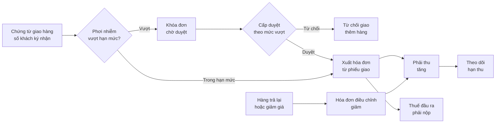

# 6000 AR: Xuất hóa đơn & hạn mức tín dụng

Hai việc tưởng như khác nhau nhưng cùng bảo vệ một thứ — dòng tiền thu về. **Hóa đơn** biến hàng đã giao thành khoản phải thu có căn cứ. **Hạn mức tín dụng** chặn việc giao thêm hàng cho khách không có khả năng trả.

## 0. Nguyên lý (áp dụng mọi ERP)

1. **Hóa đơn sinh từ chứng từ giao hàng, không từ đơn đặt hàng.** Số lượng trên hóa đơn là số khách đã ký nhận, không phải số đã đặt.
2. **Phơi nhiễm tín dụng = dư nợ + đơn đã xác nhận chưa giao + đơn chờ duyệt.** Chỉ so dư nợ thì khách có thể đặt bao nhiêu cũng lọt.
3. **Chặn ở tầng hệ thống, không cảnh báo.** Hạn mức chỉ cảnh báo thì nhân viên bán luôn chọn bán — doanh số của họ tính theo đơn đã ký, không theo tiền đã thu.
4. **Phân cấp duyệt theo mức vượt, không theo tổng đơn.** Vượt 5% thì trưởng phòng tín dụng duyệt; vượt 50% thì lên CFO.
5. **Hóa đơn điều chỉnh giảm phải tham chiếu hóa đơn gốc và không vượt giá trị gốc.** Nếu không, có thể giảm trừ nhiều hơn đã bán.
6. **Xuất hóa đơn muộn là mất tiền thật.** Thuế phải nộp theo kỳ phát sinh, khách được kéo dài thời gian trả, và dòng tiền đvn về chậm.

## 1. Luồng vận hành



## 2. Ai làm gì ở module nào

| Bước | Kinh doanh | Kế toán AR | Trưởng tín dụng | CFO | Kho |
|---|---|---|---|---|---|
| Giao hàng và lấy chứng từ nhận | ✅ thực hiện | — | — | — | ✅ xuất kho |
| Xuất hóa đơn từ chứng từ giao | Cung cấp điều kiện giá | ✅ sở hữu | — | — | — |
| Tính phơi nhiễm tín dụng | Đọc để trả lời khách | ✅ sở hữu công thức | ✅ kiểm tra | — | — |
| Chặn giao hàng khi vượt hạn mức | Nhận thông báo | ✅ thực thi | — | Chặn xuất kho |
| Duyệt vượt hạn mức nhỏ | Đề xuất | — | ✅ duyệt | — | — |
| Duyệt vượt hạn mức lớn | Đề xuất | — | Trình duyệt | ✅ duyệt | — |
| Phát hành hóa đơn điều chỉnh | Đề xuất | ✅ phát hành | — | ✅ duyệt nếu lớn | ✅ nhận hàng trả |

**Ranh giới cốt lõi:** người **bán** không được **cấp hạn mức** cho khách của mình; người **xuất hóa đơn** không được là người **duyệt giảm trừ**.

## 3. Hạch toán

Bản đồ tài khoản ở [Hạch toán & tài khoản trung gian](../../6-ke-toan-chung/1000-hach-toan-va-tai-khoan-trung-gian.md); phần phải thu ở [AR: Nguyên lý & tài khoản](./5000-ar-nguyen-ly-va-tai-khoan.md).

Bốn điểm cần nhớ:

1. **Hóa đơn bán:** Nợ phải thu khách hàng, Có doanh thu (giá trị chưa thuế), Có thuế GTGT đầu ra.
2. **Hóa đơn điều chỉnh giảm:** đảo chiều bút toán gốc — giảm phải thu, giảm doanh thu, giảm thuế đầu ra.
3. **Hàng trả lại:** phát sinh cả bút toán nhập kho và đảo giá vốn, không chỉ hóa đơn điều chỉnh.
4. **Chiết khấu thương mại trên hóa đơn** giảm trừ doanh thu, không phải chi phí.

## 4. Điểm chạm & rủi ro

- **Chứng từ giao hàng làm căn cứ xuất hóa đơn**: [Giao hàng & xuất kho](../../4-ban-hang/3000-giao-hang-va-xuat-kho.md)
- **Hạn mức và chính sách bán**: [Danh mục & chính sách bán](../../4-ban-hang/1000-danh-muc-va-chinh-sach-ban.md)
- **Tính ATP và giữ hàng**: [Tiếp nhận đơn & ATP](../../4-ban-hang/2000-tiep-nhan-don-va-atp.md)
- **Thu tiền sau khi xuất hóa đơn**: [Thu tiền & nhắc nợ](./7000-ar-thu-tien-va-dunning.md)
- **Hàng trả lại và đổi trả**: [RMA & đổi trả](../../4-ban-hang/4000-rma-va-doi-tra.md)
- **Thuế GTGT đầu ra**: [Thuế & tài sản cố định](../../6-ke-toan-chung/3000-thue-va-tai-san-co-dinh.md)

**Rủi ro chính:**

- **Xuất hóa đơn theo số lượng đặt** — khách từ chối thanh toán toàn bộ vì lệch số thực nhận.
- **Hạn mức chỉ so dư nợ** — khách đặt vượt hạn mức qua nhiều đơn chưa giao.
- **Hạn mức chỉ cảnh báo** — nhân viên bán luôn chọn bán, nợ xấu tăng.
- **Điều chỉnh giảm vượt số gốc** — doanh thu và thuế bị giảm sai.
- **Xuất hóa đơn muộn** — thuế nộp trễ, dòng tiền về chậm, khách kéo dài hạn trả.
- **Hàng trả lại chỉ ghi hóa đơn điều chỉnh** — kho không nhận lại hàng, giá vốn không đảo.

## 5. Triển khai tham chiếu ERP

### A. Ánh xạ khái niệm

| Khái niệm | Oracle EBS R12 | Epicor ERP | SAP S/4HANA | Odoo |
|---|---|---|---|---|
| Xuất hóa đơn từ giao hàng | Autoinvoice (`RAXTRX`) | `AR Invoice Entry` từ `ShipHead` | VF01 từ `LIKP` | `account.move` từ `stock.picking` |
| Hạn mức tín dụng | `HZ_CUSTOMER_PROFILES` | `Erp.Customer.CreditLimit` | `UKMB_BPAR` | `res.partner.credit_limit` |
| Quy tắc kiểm tra | `OE_CREDIT_CHECK_RULES` | `Company` Grace Period | `T024B` Credit Groups | Rules / workflows |
| Khóa đơn tín dụng | `OE_ORDER_HOLDS_ALL` | `OrderHed.CreditHold` | `VBAK.CMGST` | Trạng thái trên `sale.order` |
| Chặn giao hàng | Delivery Block | `OrderHed.CreditHold` chặn Ship | Delivery Block (`LIKP.LIFSK`) | Chặn `stock.picking` |
| Hóa đơn điều chỉnh | Credit Memo (`RA_CUSTOMER_TRX_ALL`) | `InvcHead` type `CM` | Credit Memo (`VF11`) | `account.move` (`out_refund`) |

### B. Hệ thống tự xây — thiết kế tối thiểu

```sql
CREATE TABLE Customer_Credit (
    Customer_ID        VARCHAR(50) PRIMARY KEY,
    Credit_Limit       DECIMAL(18,2) NOT NULL,
    Credit_Blocked     BIT NOT NULL DEFAULT 0,
    Review_Date        DATE NULL,
    Notes              NVARCHAR(500) NULL
);

CREATE TABLE AR_Invoice (
    Invoice_ID         BIGINT IDENTITY PRIMARY KEY,
    Customer_ID        VARCHAR(50) NOT NULL,
    Invoice_No         VARCHAR(30) NOT NULL UNIQUE,
    Invoice_Date       DATE NOT NULL,
    Delivery_No        VARCHAR(30) NULL,   -- căn cứ xuất hóa đơn
    Amount_Net         DECIMAL(18,2) NOT NULL,
    Tax_Amount         DECIMAL(18,2) NOT NULL,
    Amount_Total       DECIMAL(18,2) NOT NULL,
    Parent_Invoice     VARCHAR(30) NULL,   -- bắt buộc với credit memo
    Doc_Type           VARCHAR(20) NOT NULL, -- INVOICE | CREDIT_MEMO
    Status             VARCHAR(20) NOT NULL,
    Approved_By        VARCHAR(50) NULL
);
```

Bốn ràng buộc bắt buộc:

1. **Hóa đơn `INVOICE` bắt buộc `Delivery_No`** — không xuất hóa đơn không có căn cứ giao hàng.
2. **`CREDIT_MEMO` bắt buộc `Parent_Invoice`**, và `Amount_Total ≤ Amount_Total` của hóa đơn gốc.
3. **`Invoice_No` UNIQUE** ở tầng dữ liệu.
4. **Phơi nhiễm > `Credit_Limit` thì chặn cứng** ở dịch vụ xác nhận đơn, không chỉ hiển thị cảnh báo.

### C. Truy vấn kiểm soát

**Phơi nhiễm tín dụng vượt hạn mức — khách vẫn nhận thêm hàng:**

```sql
SELECT c.Customer_ID, c.Credit_Limit,
       ISNULL(a.Du_No, 0) + ISNULL(s.Don_Chua_Giao, 0) AS Exposure,
       ISNULL(a.Du_No, 0) + ISNULL(s.Don_Chua_Giao, 0) - c.Credit_Limit AS Over_By
FROM Customer_Credit c
LEFT JOIN (SELECT Customer_ID, SUM(Amount_Total - Amount_Paid) AS Du_No
           FROM AR_Invoice WHERE Status = 'OPEN' GROUP BY Customer_ID) a
       ON a.Customer_ID = c.Customer_ID
LEFT JOIN (SELECT Customer_ID, SUM(Amount_Remaining) AS Don_Chua_Giao
           FROM Sales_Order WHERE Status IN ('CONFIRMED','PARTIAL') GROUP BY Customer_ID) s
       ON s.Customer_ID = c.Customer_ID
WHERE ISNULL(a.Du_No, 0) + ISNULL(s.Don_Chua_Giao, 0) > c.Credit_Limit
ORDER BY Over_By DESC;
```

**Hóa đơn xuất theo số lượng đặt thay vì số thực giao:**

```sql
SELECT i.Invoice_No, i.Delivery_No, il.Item_ID,
       il.Qty_Invoiced, dl.Qty_Delivered
FROM AR_Invoice i
JOIN AR_Invoice_Line il ON il.Invoice_ID = i.Invoice_ID
JOIN Delivery_Line dl   ON dl.Delivery_No = i.Delivery_No AND dl.Line_No = il.Delivery_Line_No
WHERE il.Qty_Invoiced > dl.Qty_Delivered;
```

**Hóa đơn điều chỉnh giảm vượt giá trị hóa đơn gốc:**

```sql
SELECT c.Invoice_No AS Credit_No, c.Parent_Invoice,
       c.Amount_Total AS Credit_Amount, o.Amount_Total AS Original_Amount
FROM AR_Invoice c
JOIN AR_Invoice o ON o.Customer_ID = c.Customer_ID AND o.Invoice_No = c.Parent_Invoice
WHERE c.Doc_Type = 'CREDIT_MEMO'
  AND c.Amount_Total > o.Amount_Total;
```

**Chứng từ giao hàng đã quá 7 ngày nhưng chưa xuất hóa đơn:**

```sql
SELECT d.Delivery_No, d.Customer_ID, d.Delivery_Date,
       DATEDIFF(DAY, d.Delivery_Date, GETDATE()) AS Days_Not_Invoiced
FROM Delivery d
WHERE d.Status = 'DELIVERED'
  AND NOT EXISTS (SELECT 1 FROM AR_Invoice i WHERE i.Delivery_No = d.Delivery_No)
  AND DATEDIFF(DAY, d.Delivery_Date, GETDATE()) > 7
ORDER BY Days_Not_Invoiced DESC;
```

**Epicor — khách đang bị khóa tín dụng nhưng vẫn có đơn mở:**

```sql
SELECT oh.OrderNum, oh.CustNum, c.Name, oh.OrderDate, c.CreditHold
FROM Erp.OrderHed oh
JOIN Erp.Customer c ON c.Company = oh.Company AND c.CustNum = oh.CustNum
WHERE oh.Company = 'YOUR_COMPANY_CODE'
  AND oh.OpenOrder = 1
  AND c.CreditHold = 1
ORDER BY oh.OrderDate;
```

## 6. Bẫy thực chiến & Checklist

| # | Bẫy | Triệu chứng | Cách phòng tránh |
|---|---|---|---|
| 1 | Xuất hóa đơn theo số đặt | Khách từ chối thanh toán toàn bộ vì lệch | Hóa đơn chỉ từ chứng từ giao hàng + số ký nhận |
| 2 | Hạn mức chỉ tính dư nợ | Khách đặt vượt hạn mức qua nhiều đơn | Exposure = dư nợ + chưa giao + chờ duyệt |
| 3 | Hạn mức chỉ cảnh báo | Nợ xấu tăng, không ai chặn | Chặn cứng, duyệt mới vượt được |
| 4 | Không có cấp duyệt theo mức vượt | Mọi ngoại lệ đều lên CFO, tắc nghẽn | Phân cấp theo % vượt |
| 5 | Điều chỉnh giảm vượt số gốc | Doanh thu và thuế giảm sai | Kiểm tra `≤` giá trị hóa đơn gốc |
| 6 | Hàng trả lại chỉ ghi hóa đơn điều chỉnh | Kho không nhận lại hàng, giá vốn không đảo | Đổi trả phải có cả giao dịch kho |
| 7 | Xuất hóa đơn muộn | Thuế trễ, dòng tiền chậm | Báo cáo phiếu giao chưa xuất hóa đơn |
| 8 | Không rà soát hạn mức định kỳ | Hạn mức khai từ năm trước, không còn phù hợp | Rà soát theo `Review_Date` |
| 9 | Cùng người bán và duyệt giảm trừ | Gian lận chiết khấu | SoD: bán ≠ duyệt giảm trừ |
| 10 | Không chặn xuất kho khi quá hạn nợ | Khách nợ xấu vẫn nhận thêm hàng | Chặn ở tầng xuất kho, có luồng duyệt ngoại lệ |

**Checklist trước go-live:**

- [ ] Hóa đơn bắt buộc gắn chứng từ giao hàng (đã test chặn hóa đơn không nguồn).
- [ ] Phơi nhiễm tính đủ ba thành phần (đã đối chiếu tay).
- [ ] Chặn cứng khi vượt hạn mức (đã test, không chỉ cảnh báo).
- [ ] Phân cấp duyệt theo mức vượt, không theo tổng đơn.
- [ ] `Invoice_No` UNIQUE (đã test).
- [ ] Credit memo không vượt hóa đơn gốc (đã test).
- [ ] Hàng trả lại có cả giao dịch kho + hóa đơn điều chỉnh.
- [ ] Có báo cáo phiếu giao chưa xuất hóa đơn quá 7 ngày.
- [ ] Hạn mức có ngày rà soát, không khai một lần rồi quên.
- [ ] Chặn xuất kho khi khách quá hạn nợ (đã test).

## Xem thêm

- [Tổng quan Công nợ](../0000-tong-quan-cong-no.md)
- [AR: Nguyên lý & tài khoản](./5000-ar-nguyen-ly-va-tai-khoan.md)
- [AR: Thu tiền & nhắc nợ](./7000-ar-thu-tien-va-dunning.md)
- [Giao hàng & xuất kho](../../4-ban-hang/3000-giao-hang-va-xuat-kho.md)
- [RMA & đổi trả](../../4-ban-hang/4000-rma-va-doi-tra.md)

<div align="center" style={{color: 'var(--ifm-color-primary)'}}>
  <strong>Chúc các bạn thành công và vui vẻ!</strong>
</div>
