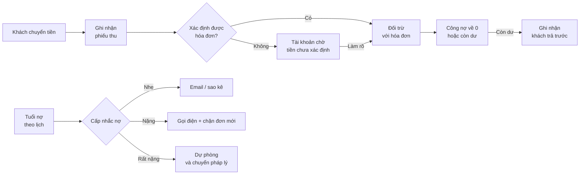

# 7000 AR: Thu tiền & nhắc nợ

Thu tiền là bước duy nhất trong chuỗi bán hàng mà tiền thực sự vào doanh nghiệp. Nhưng nhận được tiền chưa đủ — phải biết **tiền đó trả cho hóa đơn nào**, nếu không công nợ vẫn mở và khách vẫn bị coi là nợ dù đã trả.

## 0. Nguyên lý (áp dụng mọi ERP)

1. **Nhận tiền là chứng từ riêng, đối trừ là hành động riêng.** Một lần khách chuyển tiền có thể trả nhiều hóa đơn; một hóa đơn có thể được trả nhiều lần. Tách hai việc để còn đối chiếu được.
2. **Tiền thu chưa xác định đối tượng không được bỏ mặc.** Khách chuyển khoản không ghi nội dung, hoặc trả thừa — khoản đó phải vào một tài khoản chờ, có người theo dõi, không treo vô hạn.
3. **Đối trừ phải theo quy tắc ưu tiên rõ ràng.** Khách trả một cục cho nhiều hóa đơn: trả hóa đơn cũ trước hay chia đều? Quy tắc cấu hình được và áp dụng nhất quán.
4. **Nhắc nợ theo cấp độ, dựa trên tuổi nợ.** Nhắc từ ngày đầu thì mất khách; nhắc khi đã quá 180 ngày thì quá muộn.
5. **Dự phòng nợ khó đòi là chi phí của kỳ phát sinh, không phải kỳ xóa nợ.** Trích lập dần theo tuổi nợ, không đợi không đòi được mới ghi một cục.
6. **Mọi đối trừ phải lưu vết.** Biết ai đối trừ, khi nào, vì sao — nếu không, không giải trình được khi khách khiếu nại.

## 1. Luồng vận hành



## 2. Ai làm gì ở module nào

| Bước | Kế toán AR | Kinh doanh | Thủ quỹ / Ngân hàng | Trưởng tín dụng | Ban điều hành |
|---|---|---|---|---|---|
| Ghi nhận phiếu thu | ✅ sở hữu | — | ✅ xác nhận tiền về | — | — |
| Đối trừ với hóa đơn | ✅ sở hữu | Hỗ trợ tra cứu | — | — | — |
| Xử lý tiền chưa xác định | ✅ chủ trì | ✅ liên hệ khách | — | — | — |
| Gửi sao kê định kỳ | ✅ sở hữu | Hỗ trợ | — | — | — |
| Nhắc nợ cấp 1 (nhẹ) | ✅ tự động | Nhận thông báo | — | — | — |
| Nhắc nợ cấp 2 (gọi điện) | Chuyển sang | ✅ thực hiện | — | Giám sát | — |
| Chặn đơn mới | — | Nhận thông báo | — | ✅ quyết định | — |
| Trích lập dự phòng | ✅ sở hữu | — | — | Đề xuất | ✅ duyệt |
| Xóa nợ | ✅ lập hồ sơ | Cung cấp chứng từ | — | — | ✅ duyệt |

**Ranh giới cốt lõi:** người **thu tiền** không được là người **xóa nợ**; người **bán** không được tự đối trừ tiền cho khách của mình.

## 3. Hạch toán

Bản đồ tài khoản ở [Hạch toán & tài khoản trung gian](../../6-ke-toan-chung/1000-hach-toan-va-tai-khoan-trung-gian.md); phần phải thu ở [AR: Nguyên lý & tài khoản](./5000-ar-nguyen-ly-va-tai-khoan.md).

Bốn điểm cần nhớ:

1. **Thu tiền:** Nợ tài khoản tiền, Có tài khoản phải thu khách hàng. Không ghi vào doanh thu — doanh thu đã ghi khi xuất hóa đơn.
2. **Tiền chưa xác định đối tượng:** vẫn Có tài khoản phải thu, nhưng Nợ tài khoản trung gian chờ xử lý — phải làm rõ trong kỳ.
3. **Chiết khấu thanh toán cho khách** (trả sớm được giảm): chi phí tài chính, không phải giảm doanh thu.
4. **Dự phòng nợ khó đòi:** chi phí trong kỳ trích lập; xóa nợ chỉ giảm khoản dự phòng đã lập và giảm phải thu.

## 4. Điểm chạm & rủi ro

- **Hóa đơn được thu tiền**: [Xuất hóa đơn & hạn mức tín dụng](./6000-ar-xuat-hoa-don-va-han-muc-tin-dung.md)
- **Tuổi nợ và báo cáo dòng tiền**: [Báo cáo công nợ (Aging & Cashflow)](../9000-bao-cao-cong-no-aging-cashflow.md)
- **Hàng trả lại giảm trừ công nợ**: [RMA & đổi trả](../../4-ban-hang/4000-rma-va-doi-tra.md)
- **Chênh lệch tỷ giá khi thu ngoại tệ**: [Đối trừ công nợ, netting & đa tiền tệ](../8000-cong-no-doi-tru-netting-va-tien-te.md)
- **Phân tách nhiệm vụ**: [Kiểm soát nội bộ & phân tách nhiệm vụ](../../0-nen-tang/4000-kiem-soat-noi-bo-va-phan-tach-nhiem-vu.md)

**Rủi ro chính:**

- **Nhận tiền nhưng không đối trừ** — công nợ vẫn mở, khách bị coi là nợ dù đã trả.
- **Đối trừ sai hóa đơn** — hóa đơn cũ vẫn treo, hóa đơn mới bị đóng nhầm.
- **Tiền chưa xác định treo vô hạn** — sổ sách có khoản không ai giải trình.
- **Nhắc nợ không phân cấp** — mất khách tốt hoặc để nợ quá lâu.
- **Không trích lập dự phòng** — lãi kỳ này cao giả, kỳ sau phải ghi một cục.
- **Xóa nợ không có hồ sơ** — cơ quan thuế không chấp nhận.

## 5. Triển khai tham chiếu ERP

### A. Ánh xạ khái niệm

| Khái niệm | Oracle EBS R12 | Epicor ERP | SAP S/4HANA | Odoo |
|---|---|---|---|---|
| Phiếu thu | `AR_CASH_RECEIPTS_ALL` | `Erp.CashHed` / `CashDtl` | `F-28` (Incoming Payment) | `account.payment` |
| Đối trừ với hóa đơn | `AR_RECEIVABLE_APPLICATIONS_ALL` | `CashDtl` apply | `F-28` clear / `F-32` | `account.partial.reconcile` |
| Tiền chưa xác định | Unapplied Receipt | `CashDtl` không apply | "On account" | `account.payment` chưa reconcile |
| Nhắc nợ | Dunning Letters | `Dunning` | Dunning (`F150`) | Automation rules |
| Dự phòng nợ khó đòi | Provision theo tuổi nợ | `Bad Debt Provision` | FI-AR allowance | `account.move` tùy biến |
| Xóa nợ | Adjustment / Write-off | `Write-off` | `F-32` write-off | `account.move` + write-off |
| Ngoại tệ | Tỷ giá tại ngày thu | `ExchangeRate` trên CashDtl | Receipt date rate | `amount_currency` |

### B. Hệ thống tự xây — thiết kế tối thiểu

```sql
CREATE TABLE AR_Receipt (
    Receipt_ID       BIGINT IDENTITY PRIMARY KEY,
    Receipt_No       VARCHAR(30) NOT NULL UNIQUE,
    Customer_ID      VARCHAR(50) NULL,      -- NULL khi chưa xác định
    Receipt_Date     DATE NOT NULL,
    Method           VARCHAR(20) NOT NULL,  -- BANK_TRANSFER | CASH | CHEQUE
    Bank_Account     VARCHAR(30) NOT NULL,
    Currency         VARCHAR(3) NOT NULL,
    Amount_Foreign   DECIMAL(18,2) NOT NULL,
    Amount_Base      DECIMAL(18,2) NOT NULL,
    Exchange_Rate    DECIMAL(18,6) NOT NULL,
    Unapplied_Amount DECIMAL(18,2) NOT NULL DEFAULT 0,
    Status           VARCHAR(20) NOT NULL   -- DRAFT | POSTED | SUSPENSE | CLOSED
);

CREATE TABLE AR_Receipt_Apply (
    Receipt_ID       BIGINT NOT NULL,
    Invoice_ID       BIGINT NOT NULL,
    Amount_Applied   DECIMAL(18,2) NOT NULL,
    Discount_Applied DECIMAL(18,2) NOT NULL DEFAULT 0,
    PRIMARY KEY (Receipt_ID, Invoice_ID)
);

CREATE TABLE AR_Dunning_Level (
    Level_ID          INT PRIMARY KEY,
    Days_Overdue_From INT NOT NULL,
    Days_Overdue_To   INT NULL,
    Action            VARCHAR(20) NOT NULL,  -- EMAIL | CALL | BLOCK_ORDERS | LEGAL
    Template_ID       VARCHAR(20) NULL
);
```

Bốn ràng buộc bắt buộc:

1. **`Unapplied_Amount` giảm dần khi đối trừ**, về 0 thì `Status = CLOSED`.
2. **Tổng `Amount_Applied` không vượt `Amount_Base`** của phiếu thu.
3. **Tổng đã thu một hóa đơn không vượt `Amount_Total`** của hóa đơn.
4. **`Customer_ID` NULL chỉ được phép ở `Status = SUSPENSE`**, phải làm rõ trong kỳ.

### C. Truy vấn kiểm soát

**Tiền thu chưa xác định đối tượng quá 30 ngày:**

```sql
SELECT Receipt_No, Receipt_Date, Amount_Base,
       DATEDIFF(DAY, Receipt_Date, GETDATE()) AS Days_In_Suspense
FROM AR_Receipt
WHERE Status = 'SUSPENSE'
  AND DATEDIFF(DAY, Receipt_Date, GETDATE()) > 30
ORDER BY Days_In_Suspense DESC;
```

**Hóa đơn đã thu đủ nhưng vẫn mở:**

```sql
SELECT i.Invoice_No, i.Amount_Total,
       ISNULL(SUM(a.Amount_Applied), 0) AS Da_Thu,
       i.Amount_Total - ISNULL(SUM(a.Amount_Applied), 0) AS Con_No
FROM AR_Invoice i
LEFT JOIN AR_Receipt_Apply a ON a.Invoice_ID = i.Invoice_ID
WHERE i.Status = 'OPEN'
GROUP BY i.Invoice_No, i.Amount_Total
HAVING i.Amount_Total - ISNULL(SUM(a.Amount_Applied), 0) = 0;
```

**Thu vượt số tiền hóa đơn:**

```sql
SELECT a.Receipt_ID, i.Invoice_No, i.Amount_Total, SUM(a.Amount_Applied) AS Tong_Thu
FROM AR_Receipt_Apply a
JOIN AR_Invoice i ON i.Invoice_ID = a.Invoice_ID
GROUP BY a.Receipt_ID, i.Invoice_No, i.Amount_Total
HAVING SUM(a.Amount_Applied) > i.Amount_Total;
```

**Khách quá hạn nợ nhưng chưa được nhắc lần nào:**

```sql
SELECT i.Customer_ID, i.Invoice_No, i.Due_Date,
       DATEDIFF(DAY, i.Due_Date, GETDATE()) AS Days_Overdue, i.Amount_Total
FROM AR_Invoice i
WHERE i.Status = 'OPEN'
  AND DATEDIFF(DAY, i.Due_Date, GETDATE()) > 30
  AND NOT EXISTS (SELECT 1 FROM AR_Dunning_Log d WHERE d.Invoice_ID = i.Invoice_ID)
ORDER BY Days_Overdue DESC;
```

**Phân bố tuổi nợ theo khách — cơ sở trích lập dự phòng:**

```sql
SELECT Customer_ID,
       SUM(CASE WHEN DATEDIFF(DAY, Due_Date, GETDATE()) <= 0 THEN Amount_Open ELSE 0 END) AS Chua_Den_Han,
       SUM(CASE WHEN DATEDIFF(DAY, Due_Date, GETDATE()) BETWEEN 1 AND 30 THEN Amount_Open ELSE 0 END) AS Qua_1_30,
       SUM(CASE WHEN DATEDIFF(DAY, Due_Date, GETDATE()) BETWEEN 31 AND 90 THEN Amount_Open ELSE 0 END) AS Qua_31_90,
       SUM(CASE WHEN DATEDIFF(DAY, Due_Date, GETDATE()) > 90 THEN Amount_Open ELSE 0 END) AS Qua_90
FROM AR_Open_Item
WHERE Doc_Type = 'INVOICE' AND Status <> 'CLEARED'
GROUP BY Customer_ID
ORDER BY Qua_90 DESC;
```

**Epicor — hóa đơn quá hạn chưa thu:**

```sql
SELECT ih.InvoiceNum, ih.InvoiceDate, c.CustID, c.Name,
       ih.DocInvoiceAmt, ih.DueDate,
       DATEDIFF(DAY, ih.DueDate, GETDATE()) AS Days_Overdue
FROM Erp.InvcHead ih
JOIN Erp.Customer c ON c.Company = ih.Company AND c.CustNum = ih.CustNum
WHERE ih.Company = 'YOUR_COMPANY_CODE'
  AND ih.Posted = 1
  AND ih.DocInvoiceAmt > ISNULL(ih.DocAmountPaid, 0)
  AND ih.DueDate < GETDATE()
ORDER BY Days_Overdue DESC;
```

## 6. Bẫy thực chiến & Checklist

| # | Bẫy | Triệu chứng | Cách phòng tránh |
|---|---|---|---|
| 1 | Nhận tiền không đối trừ | Khách đã trả mà vẫn bị coi là nợ | Phiếu thu và đối trừ là hai bước, đối trừ ngay khi xác định được |
| 2 | Đối trừ sai hóa đơn | Hóa đơn cũ treo, hóa đơn mới đóng nhầm | Quy tắc ưu tiên rõ, có màn hình xác nhận |
| 3 | Tiền chưa xác định treo vô hạn | Khoản treo không ai giải trình | Tài khoản chờ + báo cáo quá 30 ngày |
| 4 | Thu vượt hóa đơn không xử lý | Công nợ âm, phải hoàn lại tiền | Chặn vượt, phần dư ghi nhận trả trước |
| 5 | Nhắc nợ không phân cấp | Mất khách tốt hoặc để nợ quá lâu | `AR_Dunning_Level` theo tuổi nợ |
| 6 | Không trích lập dự phòng | Lãi kỳ này cao giả | Trích lập theo tuổi nợ, định kỳ |
| 7 | Xóa nợ không có hồ sơ | Thuế không chấp nhận | Hồ sơ đầy đủ + duyệt cấp cao |
| 8 | Cùng người thu tiền và xóa nợ | Gian lận không ai phát hiện | SoD: thu ≠ xóa nợ |
| 9 | Ngoại tệ dùng sai tỷ giá | Chênh lệch tỷ giá không ghi nhận | Chốt tỷ giá tại ngày thu |
| 10 | Chiết khấu thanh toán ghi giảm doanh thu | Sai bản chất chi phí | Ghi vào chi phí tài chính |

**Checklist trước go-live:**

- [ ] Phiếu thu và đối trừ là hai bước tách biệt (đã test).
- [ ] Có tài khoản chờ cho tiền chưa xác định + báo cáo quá 30 ngày.
- [ ] Chặn thu vượt số tiền hóa đơn (đã test).
- [ ] Có bảng cấp độ nhắc nợ theo tuổi nợ.
- [ ] Có báo cáo phân bố tuổi nợ dùng làm cơ sở dự phòng.
- [ ] Dự phòng được trích lập định kỳ, không đợi khi xóa nợ.
- [ ] Xóa nợ có hồ sơ và duyệt cấp cao.
- [ ] SoD: thu tiền ≠ xóa nợ.
- [ ] Ngoại tệ chốt tỷ giá tại ngày thu (đã test chênh lệch).
- [ ] Đã test vòng đời: hóa đơn 100 → thu 40 → thu 60 → công nợ về 0.

## Xem thêm

- [Tổng quan Công nợ](../0000-tong-quan-cong-no.md)
- [AR: Nguyên lý & tài khoản](./5000-ar-nguyen-ly-va-tai-khoan.md)
- [AR: Xuất hóa đơn & hạn mức tín dụng](./6000-ar-xuat-hoa-don-va-han-muc-tin-dung.md)
- [Báo cáo công nợ (Aging & Cashflow)](../9000-bao-cao-cong-no-aging-cashflow.md)
- [Đối trừ công nợ, netting & đa tiền tệ](../8000-cong-no-doi-tru-netting-va-tien-te.md)

<div align="center" style={{color: 'var(--ifm-color-primary)'}}>
  <strong>Chúc các bạn thành công và vui vẻ!</strong>
</div>
