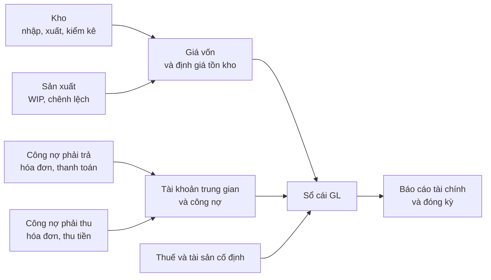

# Tổng quan Kế toán (FIN)

Kế toán là **nơi mọi phân hệ khác đổ về**. Kho ghi số lượng, sản xuất ghi chi phí, mua và bán ghi công nợ — nhưng chỉ ở đây người ta mới biết doanh nghiệp lãi hay lỗ, và tài sản đáng giá bao nhiêu.

Bài này mô tả vị trí của khối kế toán trong toàn bộ hệ thống, cách chia ba nhóm tài liệu bên trong, và ranh giới với các khối khác.

## Ba nhóm tài liệu trong khối kế toán

Kế toán là **một khối duy nhất**, bên trong chia ba nhóm theo việc kế toán thực sự làm:

| Nhóm | Trả lời câu hỏi |
|---|---|
| **[Kế toán công nợ (AP / AR)](./cong-no/0000-tong-quan-cong-no.md)** | Ghi nợ khi nào, chứng từ nào được ghi nợ, tiền đi/về đối trừ vào đâu |
| **[Kế toán tổng hợp (GL)](./ke-toan-tong-hop/1000-hach-toan-va-tai-khoan-trung-gian.md)** | Khoản trung gian, giá vốn, sổ cái, đóng kỳ, bẫy sổ sách |
| **[Thuế & tài sản cố định](./thue-va-tai-san/1000-thue-va-tai-san-co-dinh.md)** | Thuế GTGT, thuế nhà thầu, vòng đời tài sản cố định |

## Bốn luồng chảy vào kế toán

**Đọc sơ đồ:** kế toán không tạo ra giao dịch gốc — nó **nhận** rồi hạch toán. Vì vậy mọi sai sót ở phân hệ trước đều thành sai số ở đây, và không thể sửa bằng bút toán mà không che mất nguyên nhân.

## Ba nhóm tài liệu (mỗi nhóm một dải số riêng)

### 🟢 Nhóm 1: Kế toán công nợ (AP / AR)

*Mục đích: Ghi nhận và tất toán công nợ với nhà cung cấp và khách hàng.*

- **[Tổng quan Kế toán công nợ](./cong-no/0000-tong-quan-cong-no.md)**
- **[1000 AP: Nguyên lý & tài khoản](./cong-no/1000-ap-nguyen-ly-va-tai-khoan.md)**
- **[1010 AP: Nhận hóa đơn & đối tất tạm ứng](./cong-no/1010-ap-nhan-hoa-don-va-doi-tat-tam-ung.md)**
- **[1020 AP: Thanh toán & Cash Out](./cong-no/1020-ap-thanh-toan-va-cash-out.md)**
- **[2000 AR: Nguyên lý & tài khoản](./cong-no/2000-ar-nguyen-ly-va-tai-khoan.md)**
- **[2010 AR: Xuất hóa đơn & hạn mức tín dụng](./cong-no/2010-ar-xuat-hoa-don-va-han-muc-tin-dung.md)**
- **[2020 AR: Thu tiền & nhắc nợ](./cong-no/2020-ar-thu-tien-va-dunning.md)**
- **[3000 Đối trừ công nợ, netting & đa tiền tệ](./cong-no/3000-cong-no-doi-tru-netting-va-tien-te.md)**
- **[3010 Báo cáo công nợ (Aging & Cashflow)](./cong-no/3010-bao-cao-cong-no-aging-cashflow.md)**
- **[9000 AP: Bẫy & kiểm soát](./cong-no/9000-ap-bay-va-kiem-soat.md)**

### 🟡 Nhóm 2: Kế toán tổng hợp (GL)

*Mục đích: Nhận dữ liệu từ mọi phân hệ, tính giá vốn, ghi sổ cái và khóa sổ.*

- **[1000 Hạch toán & tài khoản trung gian](./ke-toan-tong-hop/1000-hach-toan-va-tai-khoan-trung-gian.md)** — Khoản nợ tạm thời nằm ở tài khoản nào, tất toán khi nào.
- **[1010 Giá vốn & định giá tồn kho](./ke-toan-tong-hop/1010-gia-von-va-dinh-gia-ton-kho.md)** — Giá trị hàng tồn và giá vốn tính theo phương pháp nào.
- **[2000 Sổ cái & báo cáo tài chính](./ke-toan-tong-hop/2000-so-cai-va-bao-cao-tai-chinh.md)** — Hệ thống tài khoản, kỳ kế toán và báo cáo tài chính.
- **[2010 Đóng kỳ & đối soát sổ phụ](./ke-toan-tong-hop/2010-dong-ky-va-doi-soat-so-phu.md)** — Làm sao để sổ phụ và sổ cái khớp trước khi khóa sổ.
- **[9000 Bẫy kế toán](./ke-toan-tong-hop/9000-bay-ke-toan.md)** — Những lỗi khiến sổ sách sai mà không ai phát hiện.

### 🔴 Nhóm 3: Thuế & tài sản cố định

*Mục đích: Các khoản thuế và vòng đời tài sản cố định — phần tách riêng vì nghiệp vụ và chứng từ khác hẳn.*

- **[1000 Thuế & tài sản cố định](./thue-va-tai-san/1000-thue-va-tai-san-co-dinh.md)** — Thuế GTGT, thuế nhà thầu và hạch toán tài sản.

## Ranh giới trách nhiệm

| Việc | Kho | Mua / Bán hàng | Công nợ | Kế toán tổng hợp |
|---|---|---|---|---|
| Ghi giao dịch gốc | ✅ | ✅ chứng từ | ✅ hóa đơn | — |
| Chọn tài khoản hạch toán | Cung cấp nhóm hàng | — | Cung cấp đối tác | ✅ sở hữu |
| Chốt phương pháp tính giá | — | — | — | ✅ sở hữu |
| Hạch toán thuế | — | — | Cung cấp hóa đơn | ✅ sở hữu |
| Khóa sổ và lập báo cáo | — | — | — | ✅ sở hữu |

Nguyên tắc: **kế toán tổng hợp không sửa số liệu phân hệ khác** — nó yêu cầu phân hệ nguồn sửa, hoặc hạch toán điều chỉnh có giải trình.

## Kế toán liên quan gì tới các phần khác

- **Kho** cung cấp giá trị nhập xuất và số liệu kiểm kê: [Giao dịch nhập, xuất & chuyển](../1-kho/2000-giao-dich-nhap-xuat-chuyen.md)
- **Sản xuất** cung cấp chi phí WIP và chênh lệch giá thành: [Giá thành sản xuất](../3-san-xuat/2020-gia-thanh-san-xuat.md)
- **Mua hàng** cung cấp hóa đơn đầu vào: [Đối soát hóa đơn & 3-Way Match](../2-mua-hang/2020-doi-soat-hoa-don-va-3-way-match.md)
- **Bán hàng** cung cấp hóa đơn đầu ra và giá vốn: [Giao hàng & xuất kho](../4-ban-hang/2010-giao-hang-va-xuat-kho.md)
- **Công nợ** cung cấp số dư AP/AR: [Tổng quan Công nợ](./cong-no/0000-tong-quan-cong-no.md)

## Bắt đầu đọc từ đâu

Nếu triển khai từ đầu: đọc nhóm 1 (công nợ) → nhóm 2 (tổng hợp) → nhóm 3 (thuế & tài sản cố định). Nếu đang xử lý sự cố:

- Số dư tài khoản trung gian không về 0 → [Hạch toán & tài khoản trung gian](./ke-toan-tong-hop/1000-hach-toan-va-tai-khoan-trung-gian.md)
- Giá vốn lệch so với sổ kho → [Giá vốn & định giá tồn kho](./ke-toan-tong-hop/1010-gia-von-va-dinh-gia-ton-kho.md)
- Thuế đầu vào bị bác khấu trừ → [Thuế & tài sản cố định](./thue-va-tai-san/1000-thue-va-tai-san-co-dinh.md)
- Sổ phụ và sổ cái lệch nhau → [Đóng kỳ & đối soát sổ phụ](./ke-toan-tong-hop/2010-dong-ky-va-doi-soat-so-phu.md)
- Lãi lỗ báo cáo không khớp thực tế → [Bẫy kế toán](./ke-toan-tong-hop/9000-bay-ke-toan.md)

  <strong>Chúc các bạn thành công và vui vẻ!</strong>

