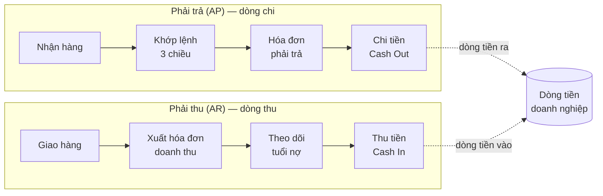

# Tổng quan Kế toán công nợ (AP / AR)

Công nợ là **bộ phận giữ dòng tiền**: một bên lo trả tiền đúng hạn và đúng người, một bên lo thu tiền đúng hạn và đủ số. Hai bên đối xứng về cơ chế nhưng khác nhau hoàn toàn về rủi ro — nên tài liệu này tách riêng, không gộp.

## Hai dòng đối xứng

**Điểm đối xứng:** AP bắt đầu từ *hàng về* rồi mới tới *hóa đơn*; AR bắt đầu từ *hàng đi* rồi mới tới *hóa đơn*. Cùng một sự kiện vật chất, nhưng chiều và rủi ro ngược nhau.

## Vì sao không gộp AP và AR

| Khía cạnh | AP | AR |
|---|---|---|
| Gắn với quy trình | Mua hàng: PO → nhận → khớp 3 chiều | Bán hàng: SO → giao → xuất hóa đơn |
| Rủi ro chính | Trả khống, trùng hóa đơn, GR/IR treo | Nợ khó đòi, vượt hạn mức tín dụng |
| Chứng từ điều chỉnh | Debit memo (mình tự lập) | Credit memo (mình phát hành) |
| Dòng tiền | Chi ra | Thu vào |
| Người đối chiếu | Nhà cung cấp | Khách hàng |

Gộp hai bên thành một bài sẽ buộc phải viết mọi nội dung hai lần với hai bộ rủi ro khác nhau — và người đọc không biết phần nào áp dụng cho mình.

## Ba nhóm tài liệu

### 🟢 Nhóm 1: Kế toán phải trả — AP (Accounts Payable)

*Mục đích: Ghi nhận và tất toán mọi khoản nợ với nhà cung cấp — dòng tiền chi ra.*

- **[1000 AP: Nguyên lý & tài khoản](./1000-ap-nguyen-ly-va-tai-khoan.md)** — Ghi nhận nợ khi nào và vào tài khoản nào.
- **[1010 AP: Nhận hóa đơn & đối tất tạm ứng](./1010-ap-nhan-hoa-don-va-doi-tat-tam-ung.md)** — Chứng từ nào được phép ghi nợ.
- **[1020 AP: Thanh toán & Cash Out](./1020-ap-thanh-toan-va-cash-out.md)** — Tiền chi ra đối trừ vào hóa đơn nào.

### 🟡 Nhóm 2: Kế toán phải thu — AR (Accounts Receivable)

*Mục đích: Ghi nhận và thu hồi mọi khoản khách nợ — dòng tiền thu vào.*

- **[2000 AR: Nguyên lý & tài khoản](./2000-ar-nguyen-ly-va-tai-khoan.md)** — Ghi nhận doanh thu và nợ phải thu khi nào.
- **[2010 AR: Xuất hóa đơn & hạn mức tín dụng](./2010-ar-xuat-hoa-don-va-han-muc-tin-dung.md)** — Kiểm soát hạn mức trước khi bán chịu.
- **[2020 AR: Thu tiền & nhắc nợ](./2020-ar-thu-tien-va-dunning.md)** — Tiền về đối trừ hóa đơn nào, nhắc nợ theo tuổi nợ.

### 🔴 Nhóm 3: Đối soát, báo cáo & kiểm soát (Reconciliation & Control)

*Mục đích: Hai bên dùng chung — đối trừ, báo cáo tuổi nợ, dòng tiền và các bẫy gây lệch sổ.*

- **[3000 Đối trừ công nợ, netting & đa tiền tệ](./3000-cong-no-doi-tru-netting-va-tien-te.md)** — Khi một đối tượng vừa mua vừa bán, khi công nợ bằng ngoại tệ.
- **[3010 Báo cáo công nợ (Aging & Cashflow)](./3010-bao-cao-cong-no-aging-cashflow.md)** — Câu hỏi quản trị quan trọng nhất của cả hai bên.
- **[9000 AP: Bẫy & kiểm soát](./9000-ap-bay-va-kiem-soat.md)** — Những lỗi khiến số dư công nợ lệch giữa sổ chi tiết và sổ cái.

## Ranh giới trách nhiệm

| Việc | Mua / Bán hàng | Kế toán công nợ | Kho | Ban điều hành |
|---|---|---|---|---|
| Ghi nhận nợ | Cung cấp chứng từ gốc | ✅ sở hữu | Cung cấp số lượng thực nhận/giao | — |
| Duyệt chi / duyệt hạn mức | Đề xuất | ✅ sở hữu | — | ✅ duyệt vượt hạn mức |
| Đối trừ tiền với hóa đơn | Hỗ trợ tra cứu | ✅ sở hữu | — | — |
| Xử lý tranh chấp | ✅ chủ trì với đối tác | Phối hợp | Xác nhận số liệu | — |
| Khóa sổ công nợ cuối kỳ | — | ✅ sở hữu | — | — |

Nguyên tắc: **người tạo chứng từ gốc không được tự ghi nợ; người ghi nợ không được tự duyệt chi.**

## Bắt đầu đọc từ đâu

Nếu làm **phải trả**, đọc nhóm 1 (`1000 → 1020`).
Nếu làm **phải thu**, đọc nhóm 2 (`2000 → 2020`).
Cả hai nhóm đọc tiếp nhóm 3 (đối trừ, báo cáo tuổi nợ, bẫy).

Nếu đang xử lý sự cố:

- Số dư công nợ lệch giữa sổ chi tiết và sổ cái → [AP: Bẫy & kiểm soát](./9000-ap-bay-va-kiem-soat.md)
- Khách nợ quá hạn vẫn đặt được đơn → [AR: Xuất hóa đơn & hạn mức tín dụng](./2010-ar-xuat-hoa-don-va-han-muc-tin-dung.md)
- Thu tiền rồi nhưng công nợ không giảm → [AR: Thu tiền & nhắc nợ](./2020-ar-thu-tien-va-dunning.md)
- Chênh lệch tỷ giá trên công nợ ngoại tệ → [Đối trừ công nợ, netting & đa tiền tệ](./3000-cong-no-doi-tru-netting-va-tien-te.md)

  <strong>Chúc các bạn thành công và vui vẻ!</strong>

