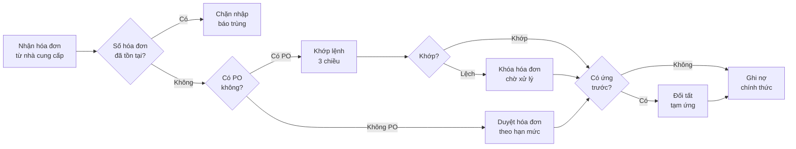

# 1010 AP: Nhận hóa đơn & đối tất tạm ứng

Hóa đơn là chứng từ **duy nhất** biến khoản nợ tiềm tàng thành nợ chính thức có hạn trả. Nhưng nó cũng là cửa ngõ của hai rủi ro lớn nhất trong toàn bộ chuỗi chi tiền: **nhập trùng** và **ghi nợ cho thứ chưa từng nhận**.

Bài này nói về cách kiểm soát hai rủi ro đó, cùng cách đối tất khoản ứng trước.

## 0. Nguyên lý (áp dụng mọi ERP)

1. **Có hai loại hóa đơn, và chúng cần hai mức kiểm soát khác nhau.** Hóa đơn có PO phải khớp lệnh; hóa đơn không PO (điện, nước, thuê văn phòng, dịch vụ phát sinh) không có gì để khớp, nên phải kiểm soát bằng **người duyệt và hạn mức**, không bằng đối chiếu chứng từ.
2. **Trùng số hóa đơn là rủi ro số một.** Cùng một nhà cung cấp, cùng một số hóa đơn, nhập hai lần → trả tiền hai lần. Hệ thống phải chặn ở tầng dữ liệu, không dựa vào trí nhớ người nhập.
3. **Hóa đơn dịch vụ không có phiếu nhận — nhưng vẫn cần bằng chứng.** Hợp đồng, biên bản nghiệm thu, hoặc xác nhận của người yêu cầu là thứ thay thế phiếu nhận.
4. **Ứng trước phải được đối tất, không để treo.** Khoản ứng 30% rồi không đối tất khi hóa đơn 100% về là trả 130%.
5. **Hóa đơn điều chỉnh phải tham chiếu hóa đơn gốc.** Không có tham chiếu, không biết nó điều chỉnh cái gì và không chặn được việc điều chỉnh vượt số gốc.
6. **Hóa đơn về trước hàng là bình thường — nhưng phải ở trạng thái chờ.** Từ chối hẳn thì dồn việc cuối kỳ; chấp nhận luôn thì ghi nợ cho hàng chưa có.

## 1. Luồng vận hành



## 2. Ai làm gì ở module nào

| Bước | Nhà cung cấp | Mua hàng | Kho | Kế toán AP | Người duyệt |
|---|---|---|---|---|---|
| Gửi hóa đơn | ✅ phát hành và gửi | Nhận và chuyển AP | — | Nhận | — |
| Kiểm tra trùng lặp | — | — | ✅ chặn tự động | — |
| Khớp lệnh 3 chiều (có PO) | — | ✅ xử lý sai lệch | Cung cấp số thực nhận | ✅ thực hiện khớp | — |
| Duyệt hóa đơn không PO | — | Xác nhận dịch vụ đã nhận | — | Trình duyệt | ✅ duyệt theo hạn mức |
| Đối tất tạm ứng | — | Xác nhận hợp đồng | — | ✅ sở hữu | — |
| Ghi nợ chính thức | — | — | — | ✅ sở hữu | — |
| Xử lý hóa đơn điều chỉnh | ✅ phát hành credit/debit memo | Xác nhận lý do | — | ✅ đối trừ | ✅ duyệt nếu giá trị lớn |

**Ranh giới cốt lõi:** người **nhận hóa đơn** không được là người **duyệt** hóa đơn không PO. Với hóa đơn không PO, đây là chốt chặn duy nhất.

## 3. Hạch toán

Toàn bộ bút toán và tài khoản được định nghĩa tại [Hạch toán & tài khoản trung gian](../../5-ke-toan/ke-toan-tong-hop/1000-hach-toan-va-tai-khoan-trung-gian.md); phần tài khoản phải trả và tạm ứng ở [AP: Nguyên lý & tài khoản](./1000-ap-nguyen-ly-va-tai-khoan.md).

Ba điểm nghiệp vụ cần nhớ:

1. **Hóa đơn có PO:** ghi Nợ tài khoản trung gian (đã tích lũy từ khi nhận hàng), Nợ thuế GTGT đầu vào, Có tài khoản phải trả nhà cung cấp.
2. **Hóa đơn không PO:** ghi thẳng vào tài khoản chi phí hoặc tài sản theo bản chất, không qua tài khoản trung gian nhận hàng.
3. **Đối tất tạm ứng:** giảm số dư Nợ của tài khoản phải trả (khoản ứng) đồng thời giảm số dư Có (khoản nợ mới) — kết quả là chỉ còn lại phần chênh lệch cần trả.

## 4. Điểm chạm & rủi ro

- **Khớp lệnh chi tiết**: [Đối soát hóa đơn & 3-Way Match](../../2-mua-hang/2020-doi-soat-hoa-don-va-3-way-match.md)
- **Tài khoản trung gian và chênh lệch giá**: [Hạch toán & tài khoản trung gian](../../5-ke-toan/ke-toan-tong-hop/1000-hach-toan-va-tai-khoan-trung-gian.md)
- **Duyệt và chi tiền**: [Thanh toán & Cash Out](./1020-ap-thanh-toan-va-cash-out.md)
- **Thuế GTGT đầu vào**: [Thuế & tài sản cố định](../tai-san-co-dinh/1000-tai-san-co-dinh-va-khau-hao.md)
- **Hồ sơ nhà cung cấp**: [Danh mục & hợp đồng mua](../../2-mua-hang/1010-danh-muc-va-hop-dong-mua.md)

**Rủi ro chính:**

- **Nhập trùng hóa đơn** — trả tiền hai lần cho cùng một lô hàng.
- **Hóa đơn không PO không ai duyệt** — chi tiêu không kiểm soát.
- **Ứng trước không đối tất** — trả 130% cho một hóa đơn 100%.
- **Hóa đơn điều chỉnh vượt số gốc** — giảm trừ nhiều hơn thực tế.
- **Hóa đơn về trước hàng bị ghi nợ ngay** — công nợ khống trước khi hàng tồn tại.
- **Không kiểm thuế trên hóa đơn** — khấu trừ bị bác, mất tiền thuế.

## 5. Triển khai tham chiếu ERP

### A. Ánh xạ khái niệm

| Khái niệm | Oracle EBS R12 | Epicor ERP | SAP S/4HANA | Odoo |
|---|---|---|---|---|
| Hóa đơn có PO | Standard Invoice + `Match` | `AP Invoice Entry` dòng `PO Lines` / `Receipt Lines` | MIRO (PO-based) | `account.move` từ PO |
| Hóa đơn không PO | Standard Invoice không tham chiếu PO | Dòng `Miscellaneous` | FB60 (FI invoice) | `account.move` tay |
| Chặn trùng số hóa đơn | `AP_INVOICES_ALL` unique check | `APInvHed.InvoiceNum` + `VendorNum` unique | `RBKP` check số + NCC | `account.move` unique ref |
| Tạm ứng | Prepayment Invoice + Apply | `AP Invoice` type `Prepayment` | Down Payment Request (`F-47`) → `F-48` | Partial reconcile |
| Hóa đơn điều chỉnh | Credit Memo / Debit Memo | `APInvHed` với `InvoiceType = CR` / `DR` | Credit Memo (FB75) / Debit Memo | `account.move` `in_refund` |
| Trạng thái chờ khớp | Invoice Hold `NO RECEIPT` | `InvoiceOnHold` | Parked Invoice | `account.move` `draft` |

### B. Hệ thống tự xây — thiết kế tối thiểu

```sql
CREATE TABLE AP_Invoice (
    Invoice_ID       BIGINT IDENTITY PRIMARY KEY,
    Vendor_ID        VARCHAR(50) NOT NULL,
    Invoice_No       VARCHAR(30) NOT NULL,
    Invoice_Date     DATE NOT NULL,
    Invoice_Type     VARCHAR(20) NOT NULL,  -- STANDARD | SERVICE | CREDIT_MEMO | DEBIT_MEMO
    PO_No            VARCHAR(30) NULL,      -- NULL với hóa đơn không PO
    Amount_Net       DECIMAL(18,2) NOT NULL,
    Tax_Amount       DECIMAL(18,2) NOT NULL,
    Amount_Total     DECIMAL(18,2) NOT NULL,
    Parent_Invoice   VARCHAR(30) NULL,      -- bắt buộc với CREDIT/DEBIT_MEMO
    Status           VARCHAR(20) NOT NULL,
    -- DRAFT | PENDING_MATCH | HELD | APPROVED | POSTED | CANCELLED
    Approved_By      VARCHAR(50) NULL,
    UNIQUE (Vendor_ID, Invoice_No)          -- chặn trùng ở tầng dữ liệu
);

CREATE TABLE AP_Invoice_Apply (
    Apply_ID         BIGINT IDENTITY PRIMARY KEY,
    Invoice_ID       BIGINT NOT NULL,
    Prepayment_ID    BIGINT NOT NULL,
    Amount_Applied   DECIMAL(18,2) NOT NULL
);
```

Bốn ràng buộc bắt buộc:

1. **`UNIQUE (Vendor_ID, Invoice_No)`** — chặn trùng ở tầng dữ liệu, không chỉ cảnh báo.
2. **`Invoice_Type IN ('CREDIT_MEMO','DEBIT_MEMO')` bắt buộc có `Parent_Invoice`.**
3. **`Amount_Applied` không được vượt số dư còn lại** của cả hóa đơn và khoản ứng trước.
4. **`SERVICE` bắt buộc có `Approved_By`** trước khi chuyển `APPROVED`.

### C. Truy vấn kiểm soát

**Hóa đơn trùng số — rủi ro trả tiền hai lần:**

```sql
SELECT Vendor_ID, Invoice_No, COUNT(*) AS So_Lan,
       SUM(Amount_Total) AS Tong_Tien
FROM AP_Invoice
WHERE Status NOT IN ('CANCELLED')
GROUP BY Vendor_ID, Invoice_No
HAVING COUNT(*) > 1
ORDER BY Tong_Tien DESC;
```

**Hóa đơn không PO chưa có người duyệt mà vẫn ở trạng thái chờ ghi nợ:**

```sql
SELECT Invoice_ID, Vendor_ID, Invoice_No, Invoice_Date, Amount_Total
FROM AP_Invoice
WHERE Invoice_Type = 'SERVICE'
  AND PO_No IS NULL
  AND Status IN ('DRAFT', 'PENDING_MATCH')
  AND Approved_By IS NULL
ORDER BY Amount_Total DESC;
```

**Hóa đơn điều chỉnh vượt giá trị hóa đơn gốc:**

```sql
SELECT c.Invoice_No AS Credit_No, c.Parent_Invoice,
       c.Amount_Total AS Credit_Amount,
       o.Amount_Total AS Original_Amount
FROM AP_Invoice c
JOIN AP_Invoice o ON o.Vendor_ID = c.Vendor_ID AND o.Invoice_No = c.Parent_Invoice
WHERE c.Invoice_Type = 'CREDIT_MEMO'
  AND c.Amount_Total > o.Amount_Total;
```

**Khoản ứng trước chưa đối tất dù đã có hóa đơn cùng PO:**

```sql
SELECT p.Invoice_No AS Prepayment_No, p.Vendor_ID,
       p.Amount_Total - ISNULL(SUM(a.Amount_Applied), 0) AS Prepaid_Open,
       i.Invoice_No AS Invoice_No
FROM AP_Invoice p
JOIN AP_Invoice i ON i.Vendor_ID = p.Vendor_ID AND i.Invoice_Type = 'STANDARD'
LEFT JOIN AP_Invoice_Apply a ON a.Prepayment_ID = p.Invoice_ID
WHERE p.Invoice_Type = 'SERVICE'
  AND p.Invoice_No LIKE 'PRE%'          -- hoặc dùng cột phân loại riêng
  AND i.Status = 'POSTED'
GROUP BY p.Invoice_No, p.Vendor_ID, p.Amount_Total, i.Invoice_No
HAVING p.Amount_Total - ISNULL(SUM(a.Amount_Applied), 0) > 0;
```

**Epicor — hóa đơn đang bị giữ do chưa nhận hàng:**

```sql
SELECT ah.InvoiceNum, ah.InvoiceDate, v.VendorID, v.Name,
       ah.DocInvoiceAmt, ah.HoldReasonCode
FROM Erp.APInvHed ah
JOIN Erp.Vendor v ON v.Company = ah.Company AND v.VendorNum = ah.VendorNum
WHERE ah.Company = 'YOUR_COMPANY_CODE'
  AND ah.InvoiceOnHold = 1
  AND ah.Posted = 0
ORDER BY ah.InvoiceDate DESC;
```

## 6. Bẫy thực chiến & Checklist

| # | Bẫy | Triệu chứng | Cách phòng tránh |
|---|---|---|---|
| 1 | Không chặn trùng số hóa đơn | Trả hai lần cho cùng một lô | `UNIQUE (Vendor_ID, Invoice_No)` |
| 2 | Hóa đơn không PO không ai duyệt | Chi tiêu ngoài kiểm soát | Bắt buộc `Approved_By` với loại `SERVICE` |
| 3 | Ứng trước không đối tất | Trả 130% cho hóa đơn 100% | Bảng `AP_Invoice_Apply`, kiểm tra trước khi ghi nợ |
| 4 | Điều chỉnh không tham chiếu hóa đơn gốc | Không biết điều chỉnh cái gì | `Parent_Invoice` bắt buộc |
| 5 | Điều chỉnh vượt số gốc | Giảm trừ nhiều hơn thực tế | Kiểm tra `Credit_Amount ≤ Original_Amount` |
| 6 | Từ chối hẳn hóa đơn về trước hàng | Dồn việc cuối kỳ, AP tắc nghẽn | Trạng thái `PENDING_MATCH`, tự ghép khi hàng về |
| 7 | Không kiểm thuế trên hóa đơn | Khấu trừ bị bác, mất tiền thuế | Đối chiếu thuế suất với hợp đồng và quy định |
| 8 | Hóa đơn dịch vụ không có bằng chứng | Không chứng minh được dịch vụ đã nhận | Bắt buộc biên bản nghiệm thu hoặc xác nhận người yêu cầu |
| 9 | Nhập hóa đơn ngoại tệ bằng VND | Số dư công nợ sai, chênh lệch tỷ giá không tách được | Lưu nguyên tệ và tỷ giá tại ngày hóa đơn |
| 10 | Sửa hóa đơn đã POSTED | Mất dấu vết kiểm toán | Hủy bằng chứng từ điều chỉnh, không sửa gốc |

**Checklist trước go-live:**

- [ ] `UNIQUE (Vendor_ID, Invoice_No)` đã bật (đã test nhập trùng bị chặn).
- [ ] Hóa đơn `SERVICE` bắt buộc người duyệt (đã test không duyệt được qua bước ghi nợ).
- [ ] Đối tất tạm ứng chặn vượt số dư (đã test).
- [ ] `Parent_Invoice` bắt buộc với hóa đơn điều chỉnh (đã test).
- [ ] Chặn credit memo vượt giá trị hóa đơn gốc (đã test).
- [ ] Có trạng thái `PENDING_MATCH` cho hóa đơn về trước hàng.
- [ ] Có kiểm tra thuế suất khi nhập hóa đơn.
- [ ] Hóa đơn ngoại tệ lưu nguyên tệ + tỷ giá.
- [ ] Đã test vòng đời: ứng 30% → hóa đơn 100% → đối tất → còn nợ 70%.

## Xem thêm

- [Tổng quan Công nợ](./0000-tong-quan-cong-no.md)
- [AP: Nguyên lý & tài khoản](./1000-ap-nguyen-ly-va-tai-khoan.md)
- [AP: Thanh toán & Cash Out](./1020-ap-thanh-toan-va-cash-out.md)
- [Đối soát hóa đơn & 3-Way Match](../../2-mua-hang/2020-doi-soat-hoa-don-va-3-way-match.md)
- [Hạch toán & tài khoản trung gian](../../5-ke-toan/ke-toan-tong-hop/1000-hach-toan-va-tai-khoan-trung-gian.md)

<div align="center" style={{color: 'var(--ifm-color-primary)'}}>
  <strong>Chúc các bạn thành công và vui vẻ!</strong>
</div>
