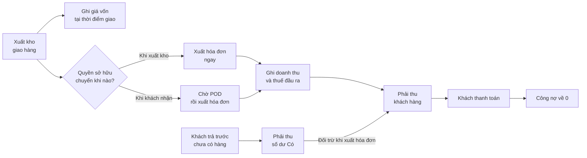

# 2000 AR: Nguyên lý & tài khoản

Phải thu trả lời câu hỏi **ai đang nợ mình, bao nhiêu, quá hạn bao lâu**. Nhưng để trả lời đúng, hệ thống phải tách được hai sự kiện thường xảy ra gần nhau nhưng không cùng lúc: **hàng đã đi** và **doanh thu đã ghi**.

Bài này định nghĩa cơ chế ghi nhận và tài khoản. Các bước nghiệp vụ ở [Xuất hóa đơn & hạn mức tín dụng](./2010-ar-xuat-hoa-don-va-han-muc-tin-dung.md) và [Thu tiền & nhắc nợ](./2020-ar-thu-tien-va-dunning.md).

## 0. Nguyên lý (áp dụng mọi ERP)

1. **Doanh thu ghi khi chuyển giao quyền sở hữu, không khi xuất kho.** Điều kiện giao hàng quyết định thời điểm này. Xuất kho rồi ghi doanh thu ngay với điều kiện giao tới đích là **ghi doanh thu non**.
2. **Giá vốn và doanh thu là hai bút toán độc lập.** Xuất kho sinh giá vốn; xuất hóa đơn sinh doanh thu. Khoảng thời gian giữa hai việc chính là phần hàng đã giao nhưng chưa xuất hóa đơn — phải được theo dõi, không được để mất.
3. **Tài khoản phải thu khách hàng là tài khoản lưỡng tính.** Khách trả trước vẫn nằm trên cùng tài khoản phải thu, nhưng ở **số dư bên Có**. Không mở tài khoản tổng hợp riêng cho tiền khách trả trước.
4. **Thuế GTGT đầu ra tách khỏi doanh thu.** Doanh thu ghi trên giá trị chưa thuế; thuế ghi riêng vào tài khoản thuế phải nộp.
5. **Sổ chi tiết theo khách hàng là bắt buộc.** Không có nó, không biết ai nợ bao nhiêu, không gửi được sao kê, không thu được nợ.
6. **Doanh thu đã ghi không được sửa, chỉ được điều chỉnh.** Sai sót xử lý bằng hóa đơn điều chỉnh giảm hoặc bút toán đảo — không sửa số trên hóa đơn gốc.

## 1. Luồng vận hành



## 2. Ai làm gì ở module nào

| Bước | Bán hàng | Kho | Kế toán AR | Ban điều hành |
|---|---|---|---|---|
| Xác định thời điểm ghi doanh thu | ✅ theo điều kiện giao hàng | Cung cấp ngày giao thực | ✅ sở hữu quy tắc | — |
| Xuất hóa đơn | Cung cấp điều kiện giá | Cung cấp số lượng thực giao | ✅ phát hành và ghi sổ | — |
| Ghi giá vốn | — | ✅ ghi giao dịch xuất | Nhận bút toán | — |
| Theo dõi công nợ theo khách | Đọc để nhắc khách | — | ✅ sở hữu | — |
| Nhận tiền khách trả trước | ✅ thỏa thuận | — | ✅ ghi nhận và theo dõi | — |
| Đối tất trả trước với hóa đơn | Xác nhận đơn | — | ✅ sở hữu | — |
| Duyệt hạn mức tín dụng | Đề xuất | — | ✅ sở hữu | ✅ duyệt hạn mức lớn |

## 3. Hạch toán

### A. Ba trạng thái của cùng một khoản phải thu

| Trạng thái | Thời điểm | Tài khoản | Ý nghĩa |
|---|---|---|---|
| Hàng đã giao, chưa xuất hóa đơn | Sau xuất kho | (chưa ghi phải thu) | Đã có giá vốn, chưa có doanh thu — cần theo dõi riêng |
| Có hóa đơn, chưa thu tiền | Khi xuất hóa đơn | **Phải thu khách hàng** (số dư Nợ) | Nợ chính thức, đã có hạn thu |
| Khách trả trước | Khi nhận tiền trước | **Phải thu khách hàng** (số dư Có) | Nghĩa vụ giao hàng, bản chất là nợ phải trả |

Bản đồ tài khoản ở [Hạch toán & tài khoản trung gian](../../5-ke-toan/ke-toan-tong-hop/1000-hach-toan-va-tai-khoan-trung-gian.md).

### B. Vì sao tiền khách trả trước không mở tài khoản riêng

Giống trường hợp tạm ứng nhà cung cấp ở AP: khoản khách trả trước về bản chất là **nghĩa vụ phải giao hàng**, tức một khoản nợ phải trả. Nhưng chế độ kế toán hiện hành vẫn theo dõi trên cùng tài khoản phải thu, chi tiết từng khách, với số dư bên Có.

Khi trình bày báo cáo, khoản này được đưa vào phần **Nợ phải trả**, lấy từ số dư Có chi tiết của tài khoản phải thu.

### C. Quan hệ với giá vốn

Hai bút toán xảy ra ở hai thời điểm khác nhau:

- **Khi xuất kho:** ghi giá vốn hàng bán, giảm tồn kho.
- **Khi xuất hóa đơn:** ghi doanh thu và thuế đầu ra, tăng phải thu.

Nếu doanh nghiệp ghi doanh thu muộn hơn giá vốn (chờ POD), sẽ có giai đoạn hàng đã ra khỏi kho nhưng chưa có doanh thu. Giai đoạn này phải được **theo dõi thành chỉ tiêu riêng** — nếu không, báo cáo lãi lỗ bị lệch giữa hai kỳ.

### D. Chiết khấu

Ba loại chiết khấu cần phân biệt vì hạch toán khác nhau:

- **Chiết khấu thương mại** (giảm giá ngay trên hóa đơn): giảm trừ doanh thu.
- **Chiết khấu thanh toán** (khách trả sớm được giảm): chi phí tài chính.
- **Chiết khấu hồi tố / rebate** (hoàn trả sau kỳ theo doanh số): trích lập chi phí trong kỳ, tất toán cuối kỳ.

## 4. Điểm chạm & rủi ro

- **Xuất hóa đơn và hạn mức**: [Xuất hóa đơn & hạn mức tín dụng](./2010-ar-xuat-hoa-don-va-han-muc-tin-dung.md)
- **Thu tiền và đối trừ**: [Thu tiền & nhắc nợ](./2020-ar-thu-tien-va-dunning.md)
- **Thời điểm ghi doanh thu theo điều kiện giao**: [Giao hàng & xuất kho](../../4-ban-hang/2010-giao-hang-va-xuat-kho.md)
- **Giá vốn và định giá tồn kho**: [Giá vốn & định giá tồn kho](../ke-toan-tong-hop/1010-gia-von-va-dinh-gia-ton-kho.md)
- **Thuế GTGT đầu ra**: [Thuế & tài sản cố định](../tai-san-co-dinh/1000-tai-san-co-dinh-va-khau-hao.md)
- **Chênh lệch tỷ giá**: [Đối trừ công nợ, netting & đa tiền tệ](./3000-cong-no-doi-tru-netting-va-tien-te.md)

**Rủi ro chính:**

- **Ghi doanh thu khi xuất kho với điều kiện giao tới đích** — doanh thu non, phải đảo khi hàng hỏng trên đường.
- **Mở tài khoản riêng cho khách trả trước** — lệch cách trình bày báo cáo tài chính.
- **Không theo dõi hàng đã giao chưa xuất hóa đơn** — doanh thu kỳ này lệch, kỳ sau bị dồn.
- **Gộp thuế vào doanh thu** — báo cáo doanh thu và thuế đều sai.
- **Hạch toán chiết khấu thanh toán như giảm doanh thu** — sai bản chất chi phí tài chính.
- **Sửa doanh thu trên hóa đơn gốc** — mất dấu vết, vi phạm quy định hóa đơn.

## 5. Triển khai tham chiếu ERP

### A. Ánh xạ khái niệm

| Khái niệm | Oracle EBS R12 | Epicor ERP | SAP S/4HANA | Odoo |
|---|---|---|---|---|
| Hồ sơ khách hàng | TCA: `HZ_PARTIES` + `HZ_CUST_ACCOUNTS` + site | `Erp.Customer` | BP + Customer role (`KNA1`) | `res.partner` |
| Số dư phải thu | `AR_CUSTOMER_LEDGER` + `AR_PAYMENT_SCHEDULES_ALL` | `Erp.Customer` + `InvcHead` | `KNB1` + `BSID` | `account.move.line` |
| Hóa đơn bán | `RA_CUSTOMER_TRX_ALL` | `Erp.InvcHead` / `InvcDtl` | `VBRK` / `VBRP` | `account.move` (`out_invoice`) |
| Hàng giao chưa xuất hóa đơn | `WSH_NEW_DELIVERIES` chưa invoice | `ShipHead.ReadyToInvoice = 1` | `LIKP` chưa có `VBRK` | `stock.picking` chưa có `account.move` |
| Thuế đầu ra | E-Business Tax | Tax Connect | Tax Procedure (`X`) | `account.tax` |
| Tiền khách trả trước | Receipt không apply | `CashDtl` chưa apply | Down Payment (`F-29`) | `account.payment` chưa reconcile |
| Chiết khấu thanh toán | Receipt discount | `Terms` discount | Cash discount | Payment term discount |

### B. Hệ thống tự xây — thiết kế tối thiểu

```sql
CREATE TABLE AR_Open_Item (
    AR_Item_ID        BIGINT IDENTITY PRIMARY KEY,
    Customer_ID       VARCHAR(50) NOT NULL,
    Doc_Type          VARCHAR(20) NOT NULL,  -- INVOICE | CREDIT_MEMO | PREPAYMENT
    Doc_No            VARCHAR(30) NOT NULL,
    Doc_Date          DATE NOT NULL,
    Due_Date          DATE NOT NULL,
    Currency          VARCHAR(3) NOT NULL,
    Amount_Foreign    DECIMAL(18,2) NOT NULL,
    Amount_Base       DECIMAL(18,2) NOT NULL,
    Tax_Amount        DECIMAL(18,2) NOT NULL,
    Amount_Open       DECIMAL(18,2) NOT NULL,
    GL_Account        VARCHAR(20) NOT NULL,   -- 131 chi tiết
    Status            VARCHAR(20) NOT NULL,   -- OPEN | PARTIAL | CLEARED
    Source_Doc        VARCHAR(50) NULL        -- SO / Delivery liên quan
);

CREATE TABLE AR_Delivered_Not_Invoiced (
    Delivery_No       VARCHAR(30) NOT NULL,
    Line_No           INT NOT NULL,
    Item_ID           VARCHAR(50) NOT NULL,
    Qty_Delivered     DECIMAL(18,4) NOT NULL,
    Delivery_Date     DATE NOT NULL,
    COGS_Amount       DECIMAL(18,2) NOT NULL,
    PRIMARY KEY (Delivery_No, Line_No)
);
```

Bốn ràng buộc bắt buộc:

1. **`Customer_ID` NOT NULL** trên mọi dòng công nợ.
2. **`Tax_Amount` tách khỏi `Amount_Base`** — doanh thu và thuế là hai dòng riêng.
3. **`AR_Delivered_Not_Invoiced` phải được xóa dòng khi xuất hóa đơn** — đây là chỉ tiêu kiểm soát, không phải bảng lịch sử.
4. **Không ghi doanh thu nếu chưa có bằng chứng chuyển giao quyền sở hữu** phù hợp với điều kiện giao hàng.

### C. Truy vấn kiểm soát

**Hàng đã giao nhưng chưa xuất hóa đơn quá 7 ngày — doanh thu bị dồn:**

```sql
SELECT Delivery_No, Line_No, Item_ID, Qty_Delivered,
       Delivery_Date, DATEDIFF(DAY, Delivery_Date, GETDATE()) AS Days_Not_Invoiced
FROM AR_Delivered_Not_Invoiced
WHERE DATEDIFF(DAY, Delivery_Date, GETDATE()) > 7
ORDER BY Days_Not_Invoiced DESC;
```

**Số dư chi tiết theo khách hàng — phải khớp sổ cái:**

```sql
SELECT Customer_ID,
       SUM(CASE WHEN Doc_Type = 'PREPAYMENT' THEN Amount_Open ELSE 0 END) AS Customer_Prepaid,
       SUM(CASE WHEN Doc_Type IN ('INVOICE') THEN Amount_Open
                WHEN Doc_Type = 'CREDIT_MEMO' THEN -Amount_Open ELSE 0 END) AS Customer_Owes,
       SUM(CASE WHEN Doc_Type IN ('INVOICE') THEN Amount_Open
                WHEN Doc_Type = 'CREDIT_MEMO' THEN -Amount_Open ELSE 0 END)
     - SUM(CASE WHEN Doc_Type = 'PREPAYMENT' THEN Amount_Open ELSE 0 END) AS Net_Balance
FROM AR_Open_Item
WHERE Status <> 'CLEARED'
GROUP BY Customer_ID
ORDER BY Net_Balance DESC;
```

**Hóa đơn xuất trước ngày giao hàng — doanh thu non:**

```sql
SELECT i.Doc_No AS Invoice_No, i.Doc_Date, d.Delivery_Date
FROM AR_Open_Item i
JOIN AR_Delivered_Not_Invoiced d ON d.Delivery_No = i.Source_Doc
WHERE i.Doc_Type = 'INVOICE'
  AND i.Doc_Date < d.Delivery_Date;
```

**Tiền khách trả trước chưa đối tất quá 90 ngày:**

```sql
SELECT Customer_ID, Doc_No, Doc_Date, Amount_Open,
       DATEDIFF(DAY, Doc_Date, GETDATE()) AS Days_Outstanding
FROM AR_Open_Item
WHERE Doc_Type = 'PREPAYMENT'
  AND Status <> 'CLEARED'
  AND DATEDIFF(DAY, Doc_Date, GETDATE()) > 90
ORDER BY Days_Outstanding DESC;
```

**Epicor — phiếu giao đã xuất kho nhưng chưa lập hóa đơn:**

```sql
SELECT sh.PackNum, sh.OrderNum, sh.ShipDate, sh.ReadyToInvoice,
       DATEDIFF(DAY, sh.ShipDate, GETDATE()) AS Days_Not_Invoiced
FROM Erp.ShipHead sh
WHERE sh.Company = 'YOUR_COMPANY_CODE'
  AND sh.ShipStatus = 'SHIPPED'
  AND sh.ReadyToInvoice = 0
  AND DATEDIFF(DAY, sh.ShipDate, GETDATE()) > 7
ORDER BY Days_Not_Invoiced DESC;
```

## 6. Bẫy thực chiến & Checklist

| # | Bẫy | Triệu chứng | Cách phòng tránh |
|---|---|---|---|
| 1 | Ghi doanh thu khi xuất kho với DDP/DAP | Doanh thu non, phải đảo khi hàng hỏng | Tôn trọng điều kiện giao hàng |
| 2 | Mở tài khoản riêng cho khách trả trước | Lệch cách trình bày báo cáo | Giữ trên tài khoản phải thu, số dư Có |
| 3 | Không theo dõi hàng giao chưa xuất hóa đơn | Doanh thu bị dồn kỳ sau | Bảng `AR_Delivered_Not_Invoiced` + báo cáo |
| 4 | Gộp thuế vào doanh thu | Doanh thu và thuế đều sai | Tách `Tax_Amount` |
| 5 | Không theo dõi chi tiết theo khách | Không thu được nợ, không gửi sao kê được | Bảng `AR_Open_Item` theo `Customer_ID` |
| 6 | Trả trước không đối tất | Thu hai lần, hoặc giao hàng không thu tiền | Đối tất khi xuất hóa đơn |
| 7 | Chiết khấu thanh toán ghi giảm doanh thu | Sai bản chất chi phí tài chính | Ghi vào chi phí tài chính |
| 8 | Sửa doanh thu trên hóa đơn gốc | Vi phạm quy định hóa đơn | Phát hành hóa đơn điều chỉnh |
| 9 | Không tách doanh thu và giá vốn theo thời điểm | Lãi lỗ lệch giữa hai kỳ | Hai bút toán độc lập, có báo cáo trung gian |
| 10 | Không đối chiếu sổ chi tiết với sổ cái | Lệch số dư nhiều kỳ | Đối chiếu trước mỗi kỳ khóa sổ |

**Checklist trước go-live:**

- [ ] Điều kiện giao hàng quyết định thời điểm ghi doanh thu (đã test DDP và FOB).
- [ ] Khách trả trước nằm trên tài khoản phải thu với số dư Có (đã test).
- [ ] Có bảng theo dõi hàng giao chưa xuất hóa đơn (đã đối chiếu với phiếu giao).
- [ ] Thuế đầu ra tách khỏi doanh thu (đã test).
- [ ] Có số dư chi tiết theo khách hàng, khớp sổ cái.
- [ ] Trả trước được đối tất khi xuất hóa đơn (đã test).
- [ ] Chiết khấu thanh toán ghi vào chi phí tài chính.
- [ ] Sửa sai bằng hóa đơn điều chỉnh, không sửa gốc.
- [ ] Có chỉ tiêu "hàng đã giao chưa xuất hóa đơn" trên báo cáo quản trị.
- [ ] Đã test vòng đời: giao hàng → xuất hóa đơn → khách trả một phần → thu đủ.

## Xem thêm

- [Tổng quan Công nợ](./0000-tong-quan-cong-no.md)
- [AR: Xuất hóa đơn & hạn mức tín dụng](./2010-ar-xuat-hoa-don-va-han-muc-tin-dung.md)
- [AR: Thu tiền & nhắc nợ](./2020-ar-thu-tien-va-dunning.md)
- [Giao hàng & xuất kho](../../4-ban-hang/2010-giao-hang-va-xuat-kho.md)
- [Giá vốn & định giá tồn kho](../ke-toan-tong-hop/1010-gia-von-va-dinh-gia-ton-kho.md)

<div align="center" style={{color: 'var(--ifm-color-primary)'}}>
  <strong>Chúc các bạn thành công và vui vẻ!</strong>
</div>
