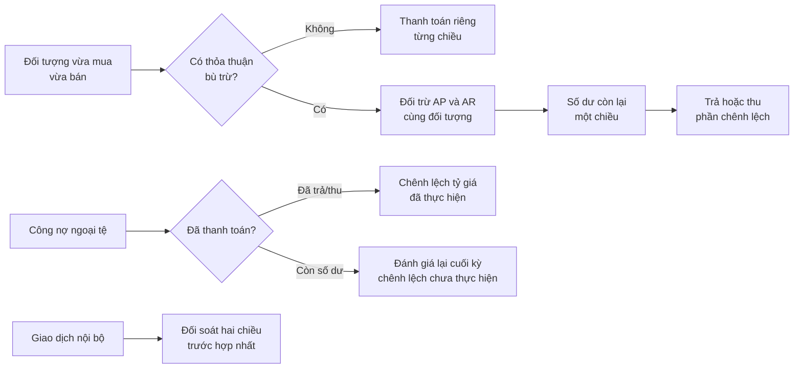

# 3000 Đối trừ công nợ, netting & đa tiền tệ

Hai việc dùng chung cho cả AP và AR, và cả hai đều dễ sai vì **cùng một nghiệp vụ nhưng hai chế độ kế toán khác nhau**.

**Netting** là xử lý khi một đối tượng vừa là khách vừa là nhà cung cấp. **Đa tiền tệ** là xử lý khi công nợ không bằng đồng tiền hạch toán.

## 0. Nguyên lý (áp dụng mọi ERP)

1. **Netting không phải là xóa nợ — đó là hai bút toán đối chiếu.** Giảm phải thu và giảm phải trả cùng lúc, số dư còn lại mới là khoản thực trả/thực thu.
2. **Netting không phải bù trừ pháp lý tự động.** Muốn bù trừ có hiệu lực, phải có thỏa thuận bù trừ (netting agreement) hai bên ký. Hệ thống ghi nhận, không tạo ra quyền.
3. **Số dư công nợ phải trình bày gộp theo từng bên, không bù trừ trên báo cáo tài chính** — trừ khi đủ điều kiện bù trừ theo chuẩn mực.
4. **Có hai loại chênh lệch tỷ giá, không được gộp:** chênh lệch **đã thực hiện** (khi thực trả/thực thu) và chênh lệch **chưa thực hiện** (đánh giá lại cuối kỳ). Bản chất và thời điểm ghi nhận khác nhau.
5. **Tỷ giá ghi nhận ban đầu chốt tại ngày phát sinh.** Chênh lệch chỉ phát sinh khi thanh toán hoặc đánh giá lại — không phải mỗi lần xem báo cáo.
6. **Giao dịch nội bộ tập đoàn phải đối soát hai chiều trước khi hợp nhất.** Nếu một bên ghi doanh thu nội bộ mà bên kia chưa ghi chi phí, loại trừ sẽ tạo ra chênh lệch không giải thích được.

## 1. Luồng vận hành



## 2. Ai làm gì ở module nào

| Việc | Kế toán AP | Kế toán AR | Kế toán tổng hợp | Ban điều hành |
|---|---|---|---|---|
| Ký thỏa thuận bù trừ với đối tác | ✅ đề xuất | ✅ đề xuất | — | ✅ duyệt |
| Thực hiện đối trừ | ✅ sở hữu | ✅ sở hữu | Kiểm tra kết quả | — |
| Đối soát giao dịch nội bộ | ✅ phía mua | ✅ phía bán | ✅ chủ trì hợp nhất | — |
| Xử lý chênh lệch tỷ giá đã thực hiện | ✅ sở hữu | ✅ sở hữu | — | — |
| Đánh giá lại cuối kỳ | — | — | ✅ sở hữu | — |
| Quyết định chính sách tỷ giá | — | — | ✅ đề xuất | ✅ duyệt |

## 3. Hạch toán

### A. Netting với cùng một đối tượng

Khi khách A vừa mua hàng của doanh nghiệp (phải thu) vừa bán hàng cho doanh nghiệp (phải trả):

- Giảm phải thu khách hàng A (Có tài khoản phải thu).
- Giảm phải trả nhà cung cấp A (Nợ tài khoản phải trả).
- Chênh lệch còn lại: hoặc thu thêm, hoặc trả thêm.

**Điều kiện bắt buộc:** có thỏa thuận bù trừ bằng văn bản. Không có thỏa thuận thì phải thanh toán hai chiều riêng, dù cùng một đối tượng.

### B. Hai loại chênh lệch tỷ giá

| Loại | Phát sinh khi nào | Ghi nhận vào đâu |
|---|---|---|
| **Đã thực hiện** (Realized) | Khi thực trả hoặc thực thu ngoại tệ | Lãi/lỗ tỷ giá trong kỳ thanh toán |
| **Chưa thực hiện** (Unrealized) | Khi đánh giá lại số dư cuối kỳ | Lãi/lỗ tỷ giá, có thể hoàn nhập kỳ sau |

Hai loại này **không được gộp** vì bản chất khác nhau: loại thứ nhất đã chốt, loại thứ hai chỉ là ước tính theo tỷ giá cuối kỳ và sẽ đảo khi thanh toán thực tế.

### C. Giao dịch nội bộ tập đoàn

Bên bán ghi doanh thu nội bộ và giá vốn; bên mua ghi tài sản hoặc chi phí và công nợ nội bộ. Khi hợp nhất, cả doanh thu, giá vốn và công nợ nội bộ đều phải loại trừ. Nếu hai bên ghi lệch số hoặc lệch ngày, phần chênh lệch phải được đối soát **trước** khi hợp nhất, không để công cụ hợp nhất tự cân bằng.

## 4. Điểm chạm & rủi ro

- **Số dư phải trả**: [AP: Nguyên lý & tài khoản](../../5-ke-toan/cong-no/1000-ap-nguyen-ly-va-tai-khoan.md)
- **Số dư phải thu**: [AR: Nguyên lý & tài khoản](./2000-ar-nguyen-ly-va-tai-khoan.md)
- **Chi tiền ngoại tệ**: [AP: Thanh toán & Cash Out](./1020-ap-thanh-toan-va-cash-out.md)
- **Thu tiền ngoại tệ**: [AR: Thu tiền & nhắc nợ](./2020-ar-thu-tien-va-dunning.md)
- **Sổ cái đa tiền tệ và hợp nhất**: [Sổ cái & báo cáo tài chính](../ke-toan-tong-hop/2000-so-cai-va-bao-cao-tai-chinh.md)
- **Bán nội bộ giữa các công ty**: [Mô hình bán đặc thù](../../4-ban-hang/2030-mo-hinh-ban-dac-thu.md)

**Rủi ro chính:**

- **Netting không có thỏa thuận** — bù trừ không có hiệu lực pháp lý.
- **Gộp chênh lệch tỷ giá đã thực hiện và chưa thực hiện** — báo cáo lãi lỗ sai.
- **Đánh giá lại mỗi tháng dù chính sách là hàng quý** — chi phí và công sức vô ích.
- **Không đối soát nội bộ trước hợp nhất** — công cụ hợp nhất tự cân bằng, che mất lỗi.
- **Dùng tỷ giá hiện tại cho giao dịch cũ** — số liệu thay đổi mỗi lần xem báo cáo.

## 5. Triển khai tham chiếu ERP

### A. Ánh xạ khái niệm

| Khái niệm | Oracle EBS R12 | Epicor ERP | SAP S/4HANA | Odoo |
|---|---|---|---|---|
| Netting AP/AR cùng đối tượng | Netting (AR/AP Netting) | `Netting` / Manual | AP-AR Netting (`F-44` clearing) | `account.partial.reconcile` |
| Thỏa thuận bù trừ | Netting Agreement | Contract | Clearing agreement | Không native |
| Chênh lệch tỷ giá đã thực hiện | Realized Gain/Loss | `ExchangeRate` trên Payment | Realized FX (`F-28`/`F-53`) | `currency_exchange` journal |
| Đánh giá lại cuối kỳ | Revaluation (`F100`-like) | `Currency Revaluation` | Foreign Currency Valuation (`FAGL_FC_VAL`) | `account.move` tùy biến |
| Đối soát nội bộ | Intercompany Reconciliation | `Intercompany` | IC Reconciliation / `ICR` | Không native |
| Loại trừ khi hợp nhất | Consolidation | `Consolidation` | Group Reporting | Không native |

### B. Hệ thống tự xây — thiết kế tối thiểu

```sql
CREATE TABLE Netting_Agreement (
    Agreement_ID     BIGINT IDENTITY PRIMARY KEY,
    Party_ID         VARCHAR(50) NOT NULL,   -- vừa là khách vừa là NCC
    Valid_From       DATE NOT NULL,
    Valid_To         DATE NULL,
    Max_Netting      DECIMAL(18,2) NULL,
    Signed_Doc       VARCHAR(100) NULL,      -- số văn bản thỏa thuận
    Status           VARCHAR(20) NOT NULL    -- ACTIVE | EXPIRED
);

CREATE TABLE Netting_Transaction (
    Netting_ID       BIGINT IDENTITY PRIMARY KEY,
    Agreement_ID     BIGINT NOT NULL,
    Netting_Date     DATE NOT NULL,
    AP_Amount        DECIMAL(18,2) NOT NULL, -- giảm phải trả
    AR_Amount        DECIMAL(18,2) NOT NULL, -- giảm phải thu
    Net_Settled      DECIMAL(18,2) NOT NULL, -- phần chênh còn lại
    Approved_By      VARCHAR(50) NOT NULL
);

CREATE TABLE FX_Revaluation_Line (
    Reval_ID         BIGINT IDENTITY PRIMARY KEY,
    Period_ID        VARCHAR(10) NOT NULL,
    Doc_Type         VARCHAR(20) NOT NULL,   -- AP | AR
    Doc_No           VARCHAR(30) NOT NULL,
    Currency         VARCHAR(3) NOT NULL,
    Amount_Foreign   DECIMAL(18,2) NOT NULL,
    Rate_Original    DECIMAL(18,6) NOT NULL,
    Rate_Closing     DECIMAL(18,6) NOT NULL,
    Diff_Amount      DECIMAL(18,2) NOT NULL,
    Reversed_In      VARCHAR(10) NULL        -- kỳ hoàn nhập (nếu chính sách yêu cầu)
);
```

Bốn ràng buộc bắt buộc:

1. **`Netting_Transaction` chỉ được tạo khi `Agreement.Status = 'ACTIVE'`** và ngày nằm trong khoảng hiệu lực.
2. **`Net_Settled = AP_Amount - AR_Amount`** — kiểm tra ở tầng dữ liệu, không nhập tay.
3. **`FX_Revaluation_Line` phải lưu cả `Rate_Original` và `Rate_Closing`** để kiểm chứng lại bất kỳ lúc nào.
4. **Đánh giá lại không được áp cho chứng từ đã thanh toán** — chỉ áp cho số dư còn mở.

### C. Truy vấn kiểm soát

**Đối tượng vừa có phải thu vừa có phải trả nhưng không có thỏa thuận bù trừ:**

```sql
SELECT a.Party_ID,
       SUM(a.Open_AR) AS Phai_Thu,
       SUM(a.Open_AP) AS Phai_Tra
FROM (
    SELECT Customer_ID AS Party_ID, Amount_Open AS Open_AR, 0 AS Open_AP
    FROM AR_Open_Item WHERE Status <> 'CLEARED'
    UNION ALL
    SELECT Vendor_ID, 0, Amount_Open
    FROM AP_Open_Item WHERE Status <> 'CLEARED'
) a
GROUP BY a.Party_ID
HAVING SUM(a.Open_AR) > 0 AND SUM(a.Open_AP) > 0
   AND NOT EXISTS (
       SELECT 1 FROM Netting_Agreement na
       WHERE na.Party_ID = a.Party_ID AND na.Status = 'ACTIVE');
```

**Đối trừ vượt hạn mức thỏa thuận:**

```sql
SELECT n.Netting_ID, n.Agreement_ID, na.Max_Netting,
       n.AP_Amount, n.AR_Amount,
       CASE WHEN n.AP_Amount < n.AR_Amount THEN n.AP_Amount ELSE n.AR_Amount END AS Netting_Amount
FROM Netting_Transaction n
JOIN Netting_Agreement na ON na.Agreement_ID = n.Agreement_ID
WHERE na.Max_Netting IS NOT NULL
  AND CASE WHEN n.AP_Amount < n.AR_Amount THEN n.AP_Amount ELSE n.AR_Amount END > na.Max_Netting;
```

**Chênh lệch tỷ giá chưa thực hiện còn treo từ kỳ trước:**

```sql
SELECT Period_ID, Doc_Type, SUM(Diff_Amount) AS Unrealized_Balance
FROM FX_Revaluation_Line
WHERE Reversed_In IS NULL
GROUP BY Period_ID, Doc_Type
ORDER BY Period_ID DESC;
```

**Giao dịch nội bộ lệch hai chiều trước hợp nhất:**

```sql
SELECT sellerDoc AS Doc_No,
       seller.Amount AS Phia_Ban,
       ISNULL(buyer.Amount, 0) AS Phia_Mua,
       seller.Amount - ISNULL(buyer.Amount, 0) AS Chenh_Lech
FROM Intercompany_Doc seller
LEFT JOIN Intercompany_Doc buyer
       ON buyer.Doc_No = seller.Doc_No AND buyer.Side = 'BUY'
WHERE seller.Side = 'SELL'
  AND ISNULL(buyer.Amount, 0) <> seller.Amount;
```

**Epicor — hóa đơn ngoại tệ còn số dư và tỷ giá ban đầu:**

```sql
SELECT ah.InvoiceNum, ah.InvoiceDate, v.VendorID,
       ah.DocInvoiceAmt, ah.ExchangeRate,
       ah.DocInvoiceAmt * ah.ExchangeRate AS Amount_Base,
       ah.DocInvoiceAmt - ISNULL(ah.DocAmountPaid, 0) AS Open_Foreign
FROM Erp.APInvHed ah
JOIN Erp.Vendor v ON v.Company = ah.Company AND v.VendorNum = ah.VendorNum
WHERE ah.Company = 'YOUR_COMPANY_CODE'
  AND ah.CurrencyCode <> 'USD'          -- đồng tiền hạch toán
  AND ah.DocInvoiceAmt > ISNULL(ah.DocAmountPaid, 0)
ORDER BY ah.InvoiceDate;
```

## 6. Bẫy thực chiến & Checklist

| # | Bẫy | Triệu chứng | Cách phòng tránh |
|---|---|---|---|
| 1 | Bù trừ không có thỏa thuận | Bù trừ không có hiệu lực pháp lý | Bảng `Netting_Agreement` có văn bản đính kèm |
| 2 | Bù trừ trên báo cáo tài chính | Trình bày sai quy định | Báo cáo gộp, chỉ bù trừ khi đủ điều kiện |
| 3 | Gộp chênh lệch tỷ giá đã/chưa thực hiện | Lãi lỗ sai, không hoàn nhập được | Hai bảng và hai tài khoản riêng |
| 4 | Đánh giá lại cả chứng từ đã thanh toán | Số liệu nhảy sau khi đã chốt | Chỉ áp cho số dư còn mở |
| 5 | Không hoàn nhập chênh lệch đánh giá lại | Kỳ sau ghi trùng lãi/lỗ | Chính sách hoàn nhập rõ ràng |
| 6 | Không đối soát nội bộ trước hợp nhất | Công cụ hợp nhất tự cân, che lỗi | Báo cáo đối soát hai chiều bắt buộc |
| 7 | Dùng tỷ giá hiện tại cho giao dịch cũ | Báo cáo thay đổi mỗi lần xem | Chốt tỷ giá tại ngày phát sinh |
| 8 | Đối trừ vượt hạn mức thỏa thuận | Bù trừ nhiều hơn được phép | Kiểm tra `Max_Netting` |
| 9 | Không phân biệt đối tượng trùng tên | Bù trừ nhầm hai pháp nhân khác nhau | Bù trừ theo mã đối tác, không theo tên |
| 10 | Netting làm mất dấu vết hóa đơn gốc | Không đối chiếu được với đối tác | `Netting_Transaction` tham chiếu từng chứng từ |

**Checklist trước go-live:**

- [ ] Có bảng thỏa thuận bù trừ và không bù trừ được khi không có thỏa thuận (đã test).
- [ ] Báo cáo tài chính trình bày gộp, không bù trừ tùy tiện.
- [ ] Chênh lệch tỷ giá đã thực hiện và chưa thực hiện ở hai tài khoản riêng.
- [ ] Đánh giá lại chỉ áp số dư còn mở (đã test).
- [ ] Chính sách hoàn nhập chênh lệch đánh giá lại đã thống nhất.
- [ ] Có báo cáo đối soát giao dịch nội bộ trước hợp nhất.
- [ ] Tỷ giá chốt tại ngày phát sinh (đã test).
- [ ] Kiểm tra hạn mức bù trừ (đã test).
- [ ] Netting lưu tham chiếu từng chứng từ gốc.

## Xem thêm

- [Tổng quan Công nợ](../../5-ke-toan/cong-no/0000-tong-quan-cong-no.md)
- [AP: Thanh toán & Cash Out](./1020-ap-thanh-toan-va-cash-out.md)
- [AR: Thu tiền & nhắc nợ](./2020-ar-thu-tien-va-dunning.md)
- [Sổ cái & báo cáo tài chính](../ke-toan-tong-hop/2000-so-cai-va-bao-cao-tai-chinh.md)
- [Báo cáo công nợ (Aging & Cashflow)](./3010-bao-cao-cong-no-aging-cashflow.md)

<div align="center" style={{color: 'var(--ifm-color-primary)'}}>
  <strong>Chúc các bạn thành công và vui vẻ!</strong>
</div>
