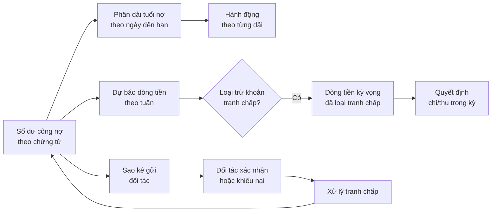

# 3010 Báo cáo công nợ (Aging & Cashflow)

Báo cáo công nợ không phải để "biết mình đang nợ bao nhiêu" — con số đó ai cũng biết. Nó để trả lời ba câu khó hơn: **tiền nào sắp vào, tiền nào sắp ra, và khoản nào đang có rủi ro không thu được**.

## 0. Nguyên lý (áp dụng mọi ERP)

1. **Tuổi nợ tính từ ngày đến hạn, không từ ngày phát sinh.** Hóa đơn ngày 1/1 với điều khoản 60 ngày thì hôm nay 20/2 vẫn chưa quá hạn, dù đã 50 ngày.
2. **Aging phải phân dải, không chỉ "quá hạn / chưa quá hạn".** Dải 1–30, 31–60, 61–90, trên 90 ngày — vì mỗi dải cần hành động khác nhau.
3. **Dự báo dòng tiền dựa trên ngày đến hạn, không ngày phát sinh.** Hai hóa đơn cùng ngày nhưng điều khoản khác nhau sẽ về tiền ở hai tuần khác nhau.
4. **Phải trừ khoản đã có tranh chấp khỏi dự báo.** Khoản nợ khách đang khiếu nại không thể xem là "sắp thu".
5. **Sao kê gửi đối tác là công cụ phòng ngừa, không phải thủ tục.** Gửi đều đặn thì tranh chấp phát hiện sớm; gửi khi đã quá hạn thì thành đòi nợ.
6. **Số liệu aging phải khớp sổ cái.** Báo cáo quản trị lệch sổ cái thì không ai tin, và nhóm quay lại dùng Excel.

## 1. Luồng vận hành



## 2. Ai làm gì ở module nào

| Việc | Kế toán AR | Kế toán AP | Kinh doanh | Trưởng tín dụng | Ban điều hành |
|---|---|---|---|---|---|
| Chạy báo cáo aging | ✅ phía thu | ✅ phía trả | Đọc để nhắc khách | ✅ đọc | ✅ đọc |
| Gửi sao kê cho khách | ✅ sở hữu | — | Hỗ trợ giải thích | — | — |
| Đối chiếu sao kê với nhà cung cấp | — | ✅ sở hữu | Hỗ trợ | — | — |
| Dự báo dòng tiền | Cung cấp số thu | Cung cấp số chi | — | — | ✅ quyết định |
| Xử lý tranh chấp | ✅ chủ trì | ✅ chủ trì | ✅ làm việc với đối tác | Giám sát | ✅ duyệt xóa nợ |
| Trích lập dự phòng | ✅ sở hữu | — | — | ✅ đề xuất | ✅ duyệt |

## 3. Hạch toán

Báo cáo aging không sinh bút toán, nhưng là **cơ sở trích lập dự phòng** — và trích lập thì có bút toán.

Ba điểm cần nhớ:

1. **Cùng một công thức aging áp cho cả AP và AR**, nhưng ý nghĩa hành động khác nhau: AR quá hạn là rủi ro mất tiền, AP quá hạn là rủi ro mất uy tín tín dụng.
2. **Dự phòng nợ khó đòi tính trên dải tuổi nợ**, không trên tổng dư nợ. Mỗi dải có tỷ lệ khác nhau theo chính sách doanh nghiệp.
3. **Dòng tiền dự báo trừ khoản tranh chấp và khoản đang xử lý pháp lý** — nếu không, kế hoạch dòng tiền lạc quan giả.

Bản đồ tài khoản ở [Hạch toán & tài khoản trung gian](../../5-ke-toan/ke-toan-tong-hop/1000-hach-toan-va-tai-khoan-trung-gian.md).

## 4. Điểm chạm & rủi ro

- **Số dư phải thu theo khách**: [AR: Nguyên lý & tài khoản](./2000-ar-nguyen-ly-va-tai-khoan.md)
- **Nhắc nợ theo cấp độ**: [AR: Thu tiền & nhắc nợ](./2020-ar-thu-tien-va-dunning.md)
- **Số dư phải trả và kế hoạch chi**: [AP: Thanh toán & Cash Out](./1020-ap-thanh-toan-va-cash-out.md)
- **Đa tiền tệ trong báo cáo**: [Đối trừ công nợ, netting & đa tiền tệ](./3000-cong-no-doi-tru-netting-va-tien-te.md)
- **Khóa sổ và đối chiếu sổ phụ**: [Đóng kỳ & đối soát sổ phụ](../ke-toan-tong-hop/2010-dong-ky-va-doi-soat-so-phu.md)

**Rủi ro chính:**

- **Aging tính từ ngày phát sinh** — báo cáo báo quá hạn sai, làm phiền khách đúng hạn.
- **Chỉ có hai dải** — không phân biệt nợ 35 ngày với nợ 300 ngày.
- **Dự báo dòng tiền gồm khoản tranh chấp** — kế hoạch chi tiêu lạc quan giả.
- **Không gửi sao kê định kỳ** — tranh chấp phát hiện muộn, khó đòi.
- **Báo cáo không khớp sổ cái** — mất uy tín, quay lại Excel.
- **Không phân biệt nội bộ và bên ngoài** — dòng tiền tập đoàn bị thổi phồng.

## 5. Triển khai tham chiếu ERP

### A. Ánh xạ khái niệm

| Khái niệm | Oracle EBS R12 | Epicor ERP | SAP S/4HANA | Odoo |
|---|---|---|---|---|
| Aging phải thu | `AR Aging Report` (7 buckets) | `AR Aging` | `S_ALR_87012178` / FBL5N | `Aged Receivable` |
| Aging phải trả | `AP Trial Balance` | `AP Aging` | `S_ALR_87012085` / FBL1N | `Aged Payable` |
| Sao kê công nợ | Statement of Account | `Statement` | `F.27` (dunning list) | `Customer Statement` |
| Dự báo dòng tiền | Cash Forecasting | `Cash Flow` | `Cash Management` (FF7A) | Không native |
| Tranh chấp công nợ | Dispute Management | `Case Entry` | Dispute Management (FI-AR) | Không native |
| Dự phòng nợ khó đòi | Provision Report | `Bad Debt` | FI-AR allowance | `account.move` tùy biến |

### B. Hệ thống tự xây — công thức aging

```sql
-- Phân dải tuổi nợ theo ngày đến hạn (dùng cho cả AR và AR)
CREATE OR REPLACE VIEW v_aging_buckets AS
SELECT Customer_ID AS Party_ID,
       Invoice_No  AS Doc_No,
       Due_Date,
       Amount_Open,
       CASE
           WHEN DATEDIFF(DAY, Due_Date, GETDATE()) <= 0  THEN 'Chua_den_han'
           WHEN DATEDIFF(DAY, Due_Date, GETDATE()) <= 30 THEN 'Qua_1_30'
           WHEN DATEDIFF(DAY, Due_Date, GETDATE()) <= 60 THEN 'Qua_31_60'
           WHEN DATEDIFF(DAY, Due_Date, GETDATE()) <= 90 THEN 'Qua_61_90'
           ELSE 'Qua_90'
       END AS Aging_Bucket
FROM AR_Open_Item
WHERE Doc_Type = 'INVOICE' AND Status <> 'CLEARED';
```

### C. Truy vấn kiểm soát

**Bảng aging theo khách — cơ sở trích lập và dự báo:

```sql
SELECT Party_ID,
       SUM(CASE WHEN Aging_Bucket = 'Chua_den_han' THEN Amount_Open ELSE 0 END) AS Chua_Den_Han,
       SUM(CASE WHEN Aging_Bucket = 'Qua_1_30'      THEN Amount_Open ELSE 0 END) AS Qua_1_30,
       SUM(CASE WHEN Aging_Bucket = 'Qua_31_60'     THEN Amount_Open ELSE 0 END) AS Qua_31_60,
       SUM(CASE WHEN Aging_Bucket = 'Qua_61_90'     THEN Amount_Open ELSE 0 END) AS Qua_61_90,
       SUM(CASE WHEN Aging_Bucket = 'Qua_90'        THEN Amount_Open ELSE 0 END) AS Qua_90,
       SUM(Amount_Open) AS Tong_Du_No
FROM v_aging_buckets
GROUP BY Party_ID
ORDER BY Qua_90 DESC, Tong_Du_No DESC;
```

**Dự báo dòng tiền thu theo tuần — loại trừ khoản tranh chấp:**

```sql
SELECT DATEADD(WEEK, DATEDIFF(WEEK, 0, Due_Date), 0) AS Tuan_Bat_Dau,
       SUM(Amount_Open) AS Du_Kien_Thu
FROM AR_Open_Item
WHERE Doc_Type = 'INVOICE'
  AND Status <> 'CLEARED'
  AND Doc_No NOT IN (SELECT Doc_No FROM AR_Dispute WHERE Status = 'OPEN')
  AND Due_Date BETWEEN GETDATE() AND DATEADD(MONTH, 3, GETDATE())
GROUP BY DATEADD(WEEK, DATEDIFF(WEEK, 0, Due_Date), 0)
ORDER BY Tuan_Bat_Dau;
```

**Đối chiếu tổng aging với số dư sổ cái — phải khớp:**

```sql
SELECT (SELECT SUM(Amount_Open) FROM AR_Open_Item
        WHERE Doc_Type IN ('INVOICE','CREDIT_MEMO') AND Status <> 'CLEARED') AS Aging_Total,
       (SELECT SUM(Debit) - SUM(Credit) FROM GL_Journal
        WHERE Account_ID = '131') AS GL_Balance,
       (SELECT SUM(Amount_Open) FROM AR_Open_Item
        WHERE Doc_Type IN ('INVOICE','CREDIT_MEMO') AND Status <> 'CLEARED')
     - (SELECT SUM(Debit) - SUM(Credit) FROM GL_Journal
        WHERE Account_ID = '131') AS Diff;
```

**Khoản tranh chấp đang mở ảnh hưởng dự báo:**

```sql
SELECT d.Doc_No, d.Customer_ID, d.Amount, d.Open_Date,
       DATEDIFF(DAY, d.Open_Date, GETDATE()) AS Days_Open, d.Reason
FROM AR_Dispute d
WHERE d.Status = 'OPEN'
ORDER BY d.Amount DESC;
```

**Sao kê công nợ của một khách — dữ liệu để gửi đối chiếu:**

```sql
SELECT Doc_No, Doc_Type, Doc_Date, Due_Date, Amount_Open,
       CASE WHEN Due_Date < GETDATE()
            THEN DATEDIFF(DAY, Due_Date, GETDATE()) ELSE 0 END AS Days_Overdue
FROM AR_Open_Item
WHERE Customer_ID = @Customer_ID
  AND Status <> 'CLEARED'
ORDER BY Doc_Date, Doc_No;
```

**Epicor — aging phải trả theo nhà cung cấp và dải tuổi:**

```sql
SELECT v.VendorID, v.Name,
       SUM(CASE WHEN DATEDIFF(DAY, ah.DueDate, GETDATE()) <= 0 THEN ah.DocInvoiceAmt - ISNULL(ah.DocAmountPaid,0) ELSE 0 END) AS Chua_Den_Han,
       SUM(CASE WHEN DATEDIFF(DAY, ah.DueDate, GETDATE()) BETWEEN 1 AND 30 THEN ah.DocInvoiceAmt - ISNULL(ah.DocAmountPaid,0) ELSE 0 END) AS Qua_1_30,
       SUM(CASE WHEN DATEDIFF(DAY, ah.DueDate, GETDATE()) BETWEEN 31 AND 60 THEN ah.DocInvoiceAmt - ISNULL(ah.DocAmountPaid,0) ELSE 0 END) AS Qua_31_60,
       SUM(CASE WHEN DATEDIFF(DAY, ah.DueDate, GETDATE()) > 60 THEN ah.DocInvoiceAmt - ISNULL(ah.DocAmountPaid,0) ELSE 0 END) AS Qua_60
FROM Erp.APInvHed ah
JOIN Erp.Vendor v ON v.Company = ah.Company AND v.VendorNum = ah.VendorNum
WHERE ah.Company = 'YOUR_COMPANY_CODE'
  AND ah.Posted = 1
  AND ah.DocInvoiceAmt > ISNULL(ah.DocAmountPaid, 0)
GROUP BY v.VendorID, v.Name
ORDER BY Qua_60 DESC;
```

## 6. Bẫy thực chiến & Checklist

| # | Bẫy | Triệu chứng | Cách phòng tránh |
|---|---|---|---|
| 1 | Aging tính từ ngày phát sinh | Báo quá hạn sai, làm phiền khách đúng hạn | Luôn tính từ `Due_Date` |
| 2 | Chỉ có dải quá hạn / chưa quá hạn | Không phân biệt nợ 35 ngày và 300 ngày | Tối thiểu 4 dải tuổi nợ |
| 3 | Dự báo gồm khoản tranh chấp | Kế hoạch chi tiêu lạc quan giả | Loại trừ khoản đang tranh chấp |
| 4 | Không gửi sao kê định kỳ | Tranh chấp phát hiện muộn | Gửi hàng tháng, có xác nhận |
| 5 | Báo cáo lệch sổ cái | Mất uy tín báo cáo | Đối chiếu tự động với tài khoản tổng hợp |
| 6 | Gộp nội bộ và bên ngoài | Dòng tiền tập đoàn bị thổi phồng | Tách báo cáo nội bộ / bên ngoài |
| 7 | Quy đổi ngoại tệ bằng tỷ giá hiện tại | Số liệu thay đổi mỗi lần xem | Dùng tỷ giá chốt cuối kỳ cho báo cáo |
| 8 | Không theo dõi ngày tranh chấp mở | Tranh chấp kéo dài không ai xử lý | Báo cáo tuổi tranh chấp |
| 9 | Dự phòng tính trên tổng dư nợ | Trích lập quá hoặc thiếu | Tính theo từng dải tuổi nợ |
| 10 | Không khớp số với đối tác | Tranh chấp khi kiểm toán | Sao kê có xác nhận định kỳ |

**Checklist trước go-live:**

- [ ] Aging tính từ `Due_Date` (đã đối chiếu tay một khách).
- [ ] Có ít nhất 4 dải tuổi nợ.
- [ ] Dự báo dòng tiền loại trừ khoản tranh chấp (đã test).
- [ ] Sao kê gửi định kỳ có xác nhận (đã có mẫu).
- [ ] Đối chiếu tổng aging với sổ cái, kết quả = 0 (đã test).
- [ ] Báo cáo nội bộ tách khỏi bên ngoài.
- [ ] Ngoại tệ dùng tỷ giá chốt cuối kỳ cho báo cáo.
- [ ] Có báo cáo tuổi tranh chấp đang mở.
- [ ] Dự phòng tính theo dải tuổi nợ, có tỷ lệ từng dải.
- [ ] Đã test: dải Qua_90 hiển thị đúng khoản nợ 120 ngày.

## Xem thêm

- [Tổng quan Công nợ](../../5-ke-toan/cong-no/0000-tong-quan-cong-no.md)
- [AR: Thu tiền & nhắc nợ](./2020-ar-thu-tien-va-dunning.md)
- [AP: Thanh toán & Cash Out](./1020-ap-thanh-toan-va-cash-out.md)
- [AP: Bẫy & kiểm soát](./9000-ap-bay-va-kiem-soat.md)
- [Đóng kỳ & đối soát sổ phụ](../ke-toan-tong-hop/2010-dong-ky-va-doi-soat-so-phu.md)

<div align="center" style={{color: 'var(--ifm-color-primary)'}}>
  <strong>Chúc các bạn thành công và vui vẻ!</strong>
</div>
