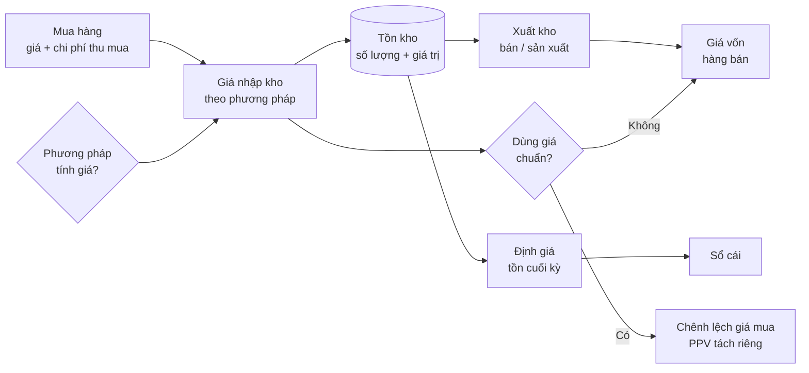
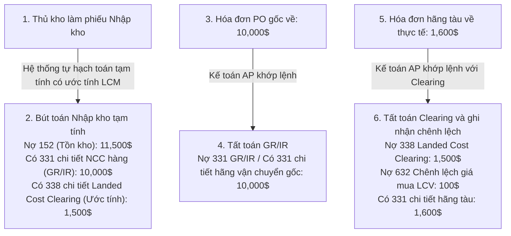
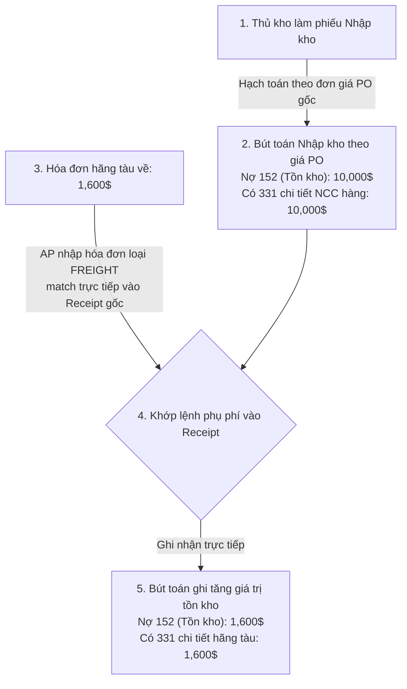

# 1010 Giá vốn & định giá tồn kho

Giá vốn là con số quyết định lãi lỗ, và nó là con số **dễ bị điều chỉnh nhất** vì cùng một lô hàng có thể ra nhiều giá vốn khác nhau tùy phương pháp. Chọn phương pháp sai hoặc trộn nhiều phương pháp trong cùng một mã hàng làm báo cáo lãi lỗ mất ý nghĩa.

## 0. Nguyên lý (áp dụng mọi ERP)

1. **Phương pháp tính giá là chính sách của doanh nghiệp, không phải tùy chọn của người nhập liệu.** Chọn một lần, áp cho toàn bộ mã hàng thuộc nhóm đó, có ngày hiệu lực.
2. **Giá vốn = số lượng xuất × đơn giá theo phương pháp.** Sai ở đơn giá thì lãi kỳ này và kỳ sau lệch ngược chiều nhau — vì tổng giá vốn theo thời gian phải bằng tổng giá mua.
3. **Giá chuẩn (standard cost) không phải giá thực.** Nó là giá kế hoạch; phần chênh lệch với giá thực phải được tách và phân tích, không được gộp vào tồn kho.
4. **Chi phí thu mua phải vào giá trị hàng, không vào chi phí kỳ.** Vận chuyển, thuế nhập khẩu, phí thông quan thuộc về giá trị lô hàng — ghi thẳng vào chi phí kỳ làm giá vốn thấp giả.
5. **Tồn kho cuối kỳ phải có cách xác định giá trị rõ ràng**, và giá trị đó phải khớp với sổ cái của tài khoản tồn kho.
6. **Đánh giá lại trị giá hàng tồn (nếu có) là quyết định quản trị**, không phải kết quả tự động của hệ thống.

## 1. Luồng vận hành



## 2. Ai làm gì ở module nào

| Việc | Kho | Mua hàng | Kế toán giá vốn | Kế toán tổng hợp |
|---|---|---|---|---|
| Cung cấp số lượng nhập xuất | ✅ sở hữu | — | — | — |
| Cung cấp đơn giá và chi phí thu mua | — | ✅ cung cấp giá PO | ✅ phân bổ landed cost | — |
| Chọn phương pháp tính giá | Cung cấp nhóm hàng | — | ✅ sở hữu | Duyệt chính sách |
| Tính giá vốn khi xuất kho | Ghi số lượng | — | ✅ kiểm tra giá | Nhận bút toán |
| Định giá tồn kho cuối kỳ | Cung cấp số liệu kiểm kê | — | ✅ sở hữu | ✅ duyệt |
| Phân tích chênh lệch giá | — | Giải trình PPV | ✅ sở hữu | — |

## 3. Hạch toán

Bản đồ tài khoản ở [Hạch toán & tài khoản trung gian](../../5-ke-toan/ke-toan-tong-hop/1000-hach-toan-va-tai-khoan-trung-gian.md).

### A. Bốn phương pháp phổ biến

| Phương pháp | Cách tính | Phù hợp với | Điểm yếu |
|---|---|---|---|
| FIFO | Lô nhập trước ra trước | Hàng có hạn dùng, thông dụng | Phức tạp khi nhiều lô, giá vốn không phản ánh giá hiện hành |
| Bình quân gia quyền | Bình quân sau mỗi lần nhập hoặc cuối kỳ | Hàng ổn định, cùng loại | Phải tính lại toàn bộ khi có nhập mới |
| Giá tiêu chuẩn | Giá kế hoạch cố định, chênh lệch tách riêng | Sản xuất hàng loạt, kiểm soát chặt | Cần cập nhật giá chuẩn định kỳ |
| Thực tế đích danh | Giá đúng lô đã xuất | Hàng đắt tiền, ít, có định danh | Không dùng được cho hàng số lượng lớn |

> Chế độ kế toán Việt Nam thường dùng FIFO hoặc bình quân gia quyền; LIFO không được áp dụng theo chuẩn mực hiện hành.

### B. Chênh lệch giá mua (PPV)

Khi dùng giá tiêu chuẩn, hàng nhập kho theo giá chuẩn còn hóa đơn về theo giá thực. Phần chênh lệch ghi vào **tài khoản chênh lệch giá mua (PPV)** — tách khỏi giá trị tồn kho và tách khỏi giá vốn hàng bán.

Ba điều cần nhớ:

1. **PPV là chỉ tiêu quản trị** — phân tích theo nhà cung cấp, nhóm hàng, kỳ.
2. **PPV không được gộp vào giá vốn từng đơn vị hàng** — nếu gộp, giá vốn thay đổi theo từng lô mua.
3. **Cuối kỳ phải xử lý PPV** — phân bổ vào giá vốn hoặc giữ lại theo chính sách, không để treo vô hạn.

### C. Chi phí thu mua phân bổ (landed cost)

Chi phí vận chuyển, bảo hiểm, thuế nhập khẩu, phí thông quan phải phân bổ vào giá trị hàng. Ba cách phân bổ phổ biến:

- **Theo giá trị hàng**: dễ, phù hợp khi chi phí tỷ lệ với giá trị.
- **Theo trọng lượng/thể tích**: phù hợp khi chi phí vận chuyển tỷ lệ với khối lượng.
- **Theo số lượng**: phù hợp khi chi phí tỷ lệ với số đơn vị.

Chọn cách nào cũng được, nhưng phải **nhất quán** và phải là **một tham số cấu hình**, không nhập tay từng lô.

## 4. Điểm chạm & rủi ro

- **Tài khoản trung gian và chênh lệch**: [Hạch toán & tài khoản trung gian](../../5-ke-toan/ke-toan-tong-hop/1000-hach-toan-va-tai-khoan-trung-gian.md)
- **Định giá và báo cáo kho**: [Định giá & báo cáo kho](../../1-kho/3010-dinh-gia-va-bao-cao-kho.md)
- **Giao dịch xuất kho sinh giá vốn**: [Giao dịch nhập, xuất & chuyển](../../1-kho/2000-giao-dich-nhap-xuat-chuyen.md)
- **Chênh lệch giá thành sản xuất**: [Giá thành sản xuất](../../3-san-xuat/2020-gia-thanh-san-xuat.md)
- **Đóng kỳ và đối soát tồn kho**: [Đóng kỳ & đối soát sổ phụ](./2010-dong-ky-va-doi-soat-so-phu.md)

**Rủi ro chính:**

- **Trộn nhiều phương pháp trong một mã hàng** — giá vốn không xác định được.
- **Ghi chi phí thu mua vào chi phí kỳ** — giá vốn thấp giả, lãi kỳ nhập phồng.
- **PPV treo không xử lý** — tồn kho và sổ cái lệch.
- **Giá chuẩn không cập nhật** — chênh lệch luôn bất lợi, báo cáo mất uy tín.
- **Không đối chiếu giá trị tồn kho với sổ cái** — lệch phát hiện muộn.

## 5. Triển khai tham chiếu ERP

### A. Ánh xạ khái niệm

| Khái niệm | Oracle EBS R12 | Epicor ERP | SAP S/4HANA | Odoo |
|---|---|---|---|---|
| Phương pháp tính giá | `CST_ITEM_COSTS` (Cost Method trên Item) | `Part.CostMethod` | Material Ledger / Valuation Variant | `product.categ_id.property_cost_method` |
| Giá vốn khi xuất | `CST_TRANSACTIONS` | `PartTran.MtlUnitCost` | `MSEG` + `ACDOCA` | `stock.valuation.layer` |
| Chênh lệch giá mua (PPV) | `CST_VARIANCES` (PPV) | `PPV Account` trên Product Group | Price Difference (`PRD`) | Price Difference Account |
| Chi phí thu mua (landed cost) | Landed Cost Management (LCM) | `LandedCost` | Landed cost condition | `stock.landed.cost` |
| Định giá cuối kỳ | Cost Update / Period Close | `Cost Adjustment` | Material Ledger closing | `stock.valuation.layer` report |

### B. Hệ thống tự xây — thiết kế tối thiểu

```sql
CREATE TABLE Item_Cost_Policy (
    Item_ID          VARCHAR(50) PRIMARY KEY,
    Cost_Method      VARCHAR(20) NOT NULL,  -- FIFO | WEIGHTED_AVG | STANDARD | SPECIFIC
    Std_Cost         DECIMAL(18,4) NULL,    -- bắt buộc nếu STANDARD
    PPV_Account      VARCHAR(20) NULL,      -- bắt buộc nếu STANDARD
    Effective_From   DATE NOT NULL
);

CREATE TABLE Landed_Cost (
    LC_ID            BIGINT IDENTITY PRIMARY KEY,
    PO_No            VARCHAR(30) NOT NULL,
    Cost_Type        VARCHAR(20) NOT NULL,  -- FREIGHT | INSURANCE | DUTY | CUSTOMS
    Amount           DECIMAL(18,2) NOT NULL,
    Allocation_Basis VARCHAR(20) NOT NULL,  -- VALUE | WEIGHT | QTY
    Allocated_At     DATETIME NULL
);
```

Bốn ràng buộc bắt buộc:

1. **`Cost_Method` NOT NULL và không đổi được** sau khi mã hàng đã có giao dịch.
2. **`STANDARD` bắt buộc có `Std_Cost` và `PPV_Account`.**
3. **Landed cost phải được phân bổ trước khi tính giá vốn lô đó** — chặn xuất kho nếu chưa phân bổ.
4. **PPV cuối kỳ phải có quyết định xử lý** — phân bổ hoặc treo có lý do.

### C. Truy vấn kiểm soát

**Mã hàng chưa khai phương pháp tính giá:**

```sql
SELECT i.Item_ID
FROM Item_Inventory_Attribute i
LEFT JOIN Item_Cost_Policy c ON c.Item_ID = i.Item_ID
WHERE c.Item_ID IS NULL;
```

**Mã hàng dùng giá chuẩn nhưng thiếu tài khoản PPV:**

```sql
SELECT Item_ID, Cost_Method, Std_Cost, PPV_Account
FROM Item_Cost_Policy
WHERE Cost_Method = 'STANDARD' AND (PPV_Account IS NULL OR Std_Cost IS NULL);
```

**Lô đã nhập nhưng chưa phân bổ chi phí thu mua:**

```sql
SELECT po.PO_No, po.Vendor_ID, po.Total_Value
FROM PO_Header po
WHERE po.Status = 'RECEIVED'
  AND NOT EXISTS (SELECT 1 FROM Landed_Cost lc WHERE lc.PO_No = po.PO_No AND lc.Allocated_At IS NOT NULL);
```

**Giá trị tồn kho theo sổ kho so với sổ cái:**

```sql
SELECT (SELECT SUM(Qty * Unit_Cost) FROM Inventory_Transaction WHERE Is_Logical = 0) AS Stock_Value_Subledger,
       (SELECT SUM(Debit) - SUM(Credit) FROM GL_Journal WHERE Account_ID LIKE '15%') AS Stock_Value_GL,
       (SELECT SUM(Qty * Unit_Cost) FROM Inventory_Transaction WHERE Is_Logical = 0)
     - (SELECT SUM(Debit) - SUM(Credit) FROM GL_Journal WHERE Account_ID LIKE '15%') AS Diff;
```

**PPV theo nhà cung cấp — tìm nguồn chênh lệch:**

```sql
SELECT Vendor_ID, COUNT(*) AS So_Dong,
       SUM(CASE WHEN Amount > 0 THEN Amount ELSE 0 END) AS Bat_Loi,
       SUM(CASE WHEN Amount < 0 THEN -Amount ELSE 0 END) AS Co_Loi,
       SUM(Amount) AS Net_PPV
FROM PPV_Transaction
WHERE Trx_Date >= DATEADD(MONTH, -6, GETDATE())
GROUP BY Vendor_ID
ORDER BY Bat_Loi DESC;
```

**Epicor — mã hàng dùng giá chuẩn và giá vốn thực tế xuất kho:**

```sql
SELECT p.PartNum, p.CostMethod, p.StdMaterialCost,
       pt.TranType, pt.MtlUnitCost, pt.TranQty
FROM Erp.Part p
LEFT JOIN Erp.PartTran pt ON pt.Company = p.Company AND pt.PartNum = p.PartNum
WHERE p.Company = 'YOUR_COMPANY_CODE'
  AND p.CostMethod = 'S'
  AND pt.TranDate >= DATEADD(MONTH, -1, GETDATE())
ORDER BY p.PartNum, pt.TranDate;
```

## 6. Bẫy thực chiến & Checklist

| # | Bẫy | Triệu chứng | Cách phòng tránh |
|---|---|---|---|
| 1 | Trộn phương pháp trong một mã hàng | Giá vốn không xác định được | `Cost_Method` chốt một lần, khóa sau giao dịch đầu |
| 2 | Ghi chi phí thu mua vào chi phí kỳ | Giá vốn thấp giả, lãi kỳ nhập phồng | Landed cost phân bổ vào giá trị hàng |
| 3 | Không phân bổ landed cost trước khi xuất | Giá vốn lô đó thiếu chi phí | Chặn xuất kho nếu chưa phân bổ |
| 4 | Trộn PPV vào giá vốn đơn vị | Giá vốn biến động theo từng lô mua | PPV tách tài khoản riêng |
| 5 | Giá chuẩn không cập nhật | Chênh lệch luôn bất lợi | Rà soát giá chuẩn định kỳ |
| 6 | PPV treo cuối kỳ | Tồn kho và sổ cái lệch | Chính sách xử lý PPV rõ ràng |
| 7 | Không đối chiếu giá trị tồn với GL | Lệch phát hiện khi kiểm toán | Báo cáo đối chiếu hằng tháng |
| 8 | Dùng LIFO cho báo cáo thuế VN | Sai chuẩn mực | Chỉ dùng FIFO / bình quân / đích danh |
| 9 | Định giá tồn cuối kỳ bằng giá bán | Giá trị tồn sai hoàn toàn | Chỉ theo phương pháp đã chọn |
| 10 | Đổi phương pháp giữa năm | Báo cáo không so sánh được | Đổi vào đầu kỳ, có duyệt và giải trình |

**Checklist trước go-live:**

- [ ] 100% mã hàng có phương pháp tính giá (đã chạy truy vấn, 0 dòng).
- [ ] Mã dùng `STANDARD` có `Std_Cost` và `PPV_Account`.
- [ ] Landed cost bắt buộc phân bổ trước khi xuất (đã test chặn).
- [ ] PPV tách tài khoản riêng, không gộp giá vốn.
- [ ] Có chính sách xử lý PPV cuối kỳ.
- [ ] Đối chiếu giá trị tồn kho sổ kho vs sổ cái, kết quả = 0 (đã test).
- [ ] Giá chuẩn có lịch rà soát định kỳ.
- [ ] Phương pháp chỉ đổi vào đầu kỳ, có giải trình.
- [ ] Đã test một lô: nhập 100 với landed cost → xuất 50 → giá vốn đúng.

---

## 7. Phân bổ chi phí mua hàng vào giá trị tồn kho (Landed Cost)

> Chi phí vận chuyển, hải quan, bảo hiểm phải **vốn hoá vào giá trị hàng**, không ghi thẳng vào chi phí kỳ. Ghi vào chi phí kỳ làm giá vốn thấp giả và lãi kỳ nhập bị thổi phồng — khoản chênh sẽ lộ ra khi bán hết lô hàng.


### 1. Bản chất nghiệp vụ & Hai kiến trúc xử lý Landed Cost

### Vấn đề cốt lõi:
Hóa đơn dịch vụ vận chuyển quốc tế hoặc phí hải quan thường về trễ hơn rất nhiều (từ vài tuần đến một tháng) so với thời điểm nguyên vật liệu thô đã được thủ kho nhập kho vật lý và đưa vào sản xuất.

Nếu hệ thống tự xây (In-house) chỉ thực hiện hạch toán đơn giản:
* Tại thời điểm nhập kho: Ghi nhận giá trị tài sản kho theo đơn giá PO gốc (ví dụ: Nợ 152 / Có 331 là 10,000 USD).
* Tại thời điểm hóa đơn vận chuyển về: Hạch toán thẳng số tiền 1,500 USD này vào tài khoản chi phí quản lý hoặc chi phí bán hàng trong kỳ.
* *Hậu quả:* Doanh nghiệp sẽ đánh giá sai lệch hoàn toàn giá thành sản xuất (Product Costing), bóp méo biên lợi nhuận gộp và vi phạm quy định kiểm toán tài chính vì chi phí mua hàng không được vốn hóa trực tiếp vào nguyên giá tài sản tồn kho đầu vào.

### Kiến trúc A — Có module LCM (ước tính trước, trung gian Clearing)

Với các hệ thống có triển khai LCM chuyên biệt, ERP tạo một bút toán **ước tính chi phí (Estimated Landed Cost)** ngay tại thời điểm nhập kho, thông qua tài khoản trung gian phân bổ, sau đó tất toán và ghi nhận chênh lệch khi hóa đơn thực tế về:



### Kiến trúc B — Không có module LCM (Match phụ phí trực tiếp vào Receipt)

Với các hệ thống không triển khai LCM riêng — trường hợp phổ biến — không có bút toán ước tính hay tài khoản trung gian độc lập. Thay vào đó, hóa đơn phụ phí (cước vận chuyển/hải quan) được khớp lệnh trực tiếp vào giao dịch nhận hàng gốc (`RECEIVE` transaction) thông qua kiểu đối soát **Match to Receipt** với loại dòng `FREIGHT` hoặc `MISCELLANEOUS`, không phải `ITEM`:



Ưu điểm của Kiến trúc B là đơn giản, không cần thiết kế thêm tài khoản trung gian hay chạy tiến trình ước tính/tất toán riêng. Nhược điểm là giá trị tồn kho của lô hàng sẽ **biến động sau khi đã nhập kho** — nếu một phần hàng đã xuất dùng trước khi hóa đơn phụ phí về, hệ thống bắt buộc phải xử lý phần chênh lệch không còn tồn kho để gánh (xem Mục 6, lỗi số 2).

---

### 2. Bảng so sánh và Ánh xạ giải pháp giữa các hệ thống

| Nghiệp vụ thiết kế | Oracle EBS R12.2.10 (có LCM) | Oracle EBS R12.2.10 (không LCM — Match to Receipt) | Epicor ERP | Hệ thống tự xây (In-house) |
| :--- | :--- | :--- | :--- | :--- |
| **Bản chất hạch toán** | LCM Post-Receipt Valuation Adjustment | AP Invoice Match to Receipt, line type `FREIGHT`/`MISCELLANEOUS` | Landed Cost Disbursement Entry | Tùy chọn theo quy mô: chạy tiến trình ước tính/tất toán, hoặc match phụ phí trực tiếp |
| **Xử lý chênh lệch** | CST Purchase Price Variance (PPV/IPV) | Không phát sinh Clearing riêng — giá trị tồn kho được cộng dồn trực tiếp bằng phụ phí thực nhận | PartTran ADJ-PUR Transaction | Hạch toán tự động vào tài khoản chênh lệch giá hoặc cộng dồn trực tiếp vào giá trị kho |
| **Tài khoản trung gian** | Landed Cost Absorption Account (riêng biệt) | Không cần — hạch toán thẳng vào TK Tồn kho và TK công nợ chi tiết theo Vendor | Landed Cost Clearing Account | Có thể có hoặc không tùy kiến trúc lựa chọn |

---

### 3. Điểm giao thoa & Tham chiếu chéo (Cross-linking) sang các phân hệ khác

* **Tham chiếu tờ khai hải quan:** Kế toán giá thành thực hiện phân bổ dựa trên thông tin tờ khai hải quan và điều kiện thương mại quốc tế (Incoterms) khai báo trên chứng từ nhập khẩu.
* **Điều chỉnh giá trị kho:** Sau khi hoàn thành phân bổ thực tế, giá trị hàng trong kho được cập nhật và tính lại đơn giá bình quân; xem [6000 Định giá & báo cáo kho](../../1-kho/3010-dinh-gia-va-bao-cao-kho.md).
* **Tính toán giá thành sản phẩm:** Đơn giá nguyên vật liệu sau khi đã phân bổ đủ chi phí thu mua là căn cứ để tính chi phí sản xuất; xem [8000 Giá thành sản xuất](../../3-san-xuat/2020-gia-thanh-san-xuat.md).

---

### 4. Hướng dẫn luồng thiết lập (Setup Flow) chi tiết trên hệ thống

### A. Trên Oracle EBS R12.2.10 — Có triển khai LCM (Post-Receipt)

1. **Cấu hình Tài khoản trung gian (Landed Cost Absorption Account):**
    * *Đường dẫn:* `Purchasing Super User > Setup > Organizations > Receiving Options`
    * *Nghiệp vụ:* Khai báo tài khoản trung gian hấp thụ chi phí để làm cầu nối hạch toán giữa phân hệ PO và phân hệ AP khi có hóa đơn cước vận chuyển.
2. **Khớp hóa đơn dịch vụ vận chuyển (AP Invoice Match to LCM):**
    * *Đường dẫn:* `Payables Super User > Invoices > Entry > Invoices`
    * *Nghiệp vụ:* Tạo hóa đơn AP cho hãng tàu vận chuyển. Chọn loại đối chiếu là `Match to LCM Shipment` (tham chiếu đến mã lô hàng nhập khẩu LCM đã tạo tại bài viết `5030`).
3. **Chạy chương trình tính toán và cập nhật giá vốn (CST Processor):**
    * *Nghiệp vụ:* Sau khi hóa đơn được duyệt, hệ thống tự động chạy chương trình `Landed Cost Integration` và `Cost Processor` để so khớp giữa chi phí ước tính ban đầu và chi phí thực tế trên hóa đơn, tự động sinh bút toán điều chỉnh giá vốn tài sản tồn kho trong kỳ.

### B. Trên Oracle EBS R12.2.10 — Không triển khai LCM (Match to Receipt trực tiếp)

1. **Nhập hóa đơn phụ phí (AP Invoice Entry):**
    * *Đường dẫn:* `Payables Super User > Invoices > Entry > Invoices`
    * *Nghiệp vụ:* Tạo hóa đơn AP cho hãng vận chuyển/hải quan. Chọn nút `Match`, sau đó chọn `Match to Receipt` thay vì `Match to PO`.
2. **Chỉ định loại dòng phụ phí:**
    * *Nghiệp vụ:* Tại dòng hóa đơn, gán `Line Type = FREIGHT` (cước vận chuyển) hoặc `MISCELLANEOUS` (phí hải quan, bảo hiểm, phụ phí khác), tham chiếu trực tiếp đến `Receipt Number` và dòng nhận hàng cụ thể (`rcv_transaction_id`). Hệ thống tự động cộng dồn phần phụ phí này vào giá trị tồn kho của lô hàng tương ứng khi kế toán chạy tiến trình `Receipt Accounting` / `Cost Processor` định kỳ.
3. **Kiểm soát điều kiện tồn kho còn lại:**
    * *Nghiệp vụ:* Trước khi cho phép match phụ phí, hệ thống nên kiểm tra số lượng On-hand còn lại của lô hàng nhận đó — nếu đã xuất dùng một phần hoặc toàn bộ, phần phụ phí tương ứng với số lượng đã xuất cần được kết chuyển sang giá vốn hàng bán (xem Mục 6).

### C. Trên Epicor ERP (Landed Cost Disbursement Entry)

1. **Nhập hóa đơn chi phí dịch vụ AP (AP Invoice Entry):**
    * *Đường dẫn:* `Financial Management > Accounts Payable > General Operations > AP Invoice Entry`
    * *Nghiệp vụ:* Nhập hóa đơn của nhà cung cấp dịch vụ (ví dụ: hãng tàu). Chọn dòng hóa đơn là `Landed Cost` để chỉ định đây là chi phí phân bổ cho lô hàng nhập khẩu.
2. **Thực hiện phân bổ chi phí thực tế (Landed Cost Disbursement):**
    * *Đường dẫn:* `Material Management > Purchase Management > General Operations > Landed Cost Disbursement Entry`
    * *Nghiệp vụ:* Chọn Container hàng nhập khẩu tương ứng, chọn hóa đơn AP dịch vụ vừa nhập ở bước 1.
    * *Ghi nhận:* Nhấn `Disburse`. Hệ thống sẽ tính toán chênh lệch và tự tạo giao dịch điều chỉnh giá trị nhập kho loại `ADJ-PUR` trong sổ chi tiết tồn kho PartTran.

---

### 5. Truy vấn SQL đối soát cấu trúc tổ chức (SQL Database Audit Queries)

### A. Cho Oracle EBS R12.2.10 — Hệ thống không triển khai LCM (Match to Receipt)

Query dưới đây phù hợp với các hệ thống **không sử dụng module LCM**: tính đơn giá thực tế của từng dòng nhận hàng bằng cách cộng dồn trực tiếp toàn bộ hóa đơn phụ phí (loại `FREIGHT`/`MISCELLANEOUS`) đã được match vào giao dịch Receipt gốc, thay vì dựa vào cặp bảng `inl_ship_headers_all`/`inl_ship_lines_all` của LCM (vốn chỉ tồn tại khi hệ thống có bật module này):

```sql
SELECT 
    hou.name                          AS operating_unit,
    rsh.receipt_num                   AS receipt_number,
    pha.segment1                      AS po_number,
    msib.segment1                     AS item_code,
    rt.quantity                       AS received_qty,
    -- Đơn giá gốc trên đơn mua hàng (Ước tính ban đầu)
    rt.po_unit_price                  AS po_estimated_unit_cost,
    -- Tính đơn giá thực tế = (Tiền hàng PO + Tiền phụ phí AP đã match) / Số lượng nhận
    ( (rt.quantity * rt.po_unit_price) + NVL(ap_costs.total_charge_amount, 0) ) 
        / DECODE(rt.quantity, 0, 1, rt.quantity) AS actual_landed_unit_cost,
    -- Chi phí chênh lệch trên mỗi đơn vị sản phẩm (Variance)
    (NVL(ap_costs.total_charge_amount, 0) / DECODE(rt.quantity, 0, 1, rt.quantity)) AS landed_variance_per_unit
FROM 
    rcv_transactions rt
INNER JOIN 
    rcv_shipment_headers rsh ON rt.shipment_header_id = rsh.shipment_header_id
INNER JOIN 
    rcv_shipment_lines rsl ON rt.shipment_line_id = rsl.shipment_line_id
INNER JOIN 
    po_headers_all pha ON rt.po_header_id = pha.po_header_id
INNER JOIN 
    hr_operating_units hou ON pha.org_id = hou.organization_id
LEFT JOIN 
    mtl_system_items_b msib ON rsl.item_id = msib.inventory_item_id 
                            AND msib.organization_id = rt.organization_id
LEFT JOIN (
    SELECT 
        ail.rcv_transaction_id,
        SUM(ail.amount) AS total_charge_amount
    FROM 
        ap_invoice_lines_all ail
    WHERE 
        ail.line_type_lookup_code IN ('FREIGHT', 'MISCELLANEOUS') 
        AND ail.match_type IN ('ITEM_TO_RECEIPT', 'OTHER_TO_RECEIPT')
    GROUP BY 
        ail.rcv_transaction_id
) ap_costs ON rt.transaction_id = ap_costs.rcv_transaction_id
WHERE 
    rt.transaction_type = 'RECEIVE' 
    AND rt.routing_header_id IS NOT NULL
ORDER BY 
    rsh.receipt_num DESC;
```

> **Lưu ý chọn đúng query theo kiến trúc hệ thống:** Nếu hệ thống có triển khai module LCM đầy đủ (bảng `inl_ship_headers_all`/`inl_ship_lines_all` tồn tại và có dữ liệu), dùng cách tiếp cận dựa trên các bảng đó để so sánh chi phí ước tính (`est_unit_landed_cost`) với chi phí thực tế. Nếu hệ thống không triển khai LCM — trường hợp phổ biến — dùng query dựa trên `rcv_transactions` kết hợp `ap_invoice_lines_all` như trên, vì đây là cách duy nhất phản ánh đúng cách chi phí phụ phí được ghi nhận vào hệ thống.

### B. Cho Epicor ERP (Truy vấn cơ sở dữ liệu SQL Server)

Query dưới đây quét qua sổ chi tiết giao dịch tồn kho `PartTran` trong Epicor để lọc ra các giao dịch điều chỉnh giá trị nhập kho loại `ADJ-PUR` phát sinh từ nghiệp vụ phân bổ chi phí Landed Cost:

```sql
SELECT 
    pt.Company,
    pt.TranNum                    AS Transaction_Num,
    pt.TranDate                   AS Transaction_Date,
    pt.PartNum                    AS Part_Number,
    pt.TranType                   AS Transaction_Type, -- 'ADJ-PUR' đại diện cho giao dịch điều chỉnh giá trị do phân bổ Landed Cost
    pt.PONum                      AS PO_Number,
    pt.PackSlip                   AS Receipt_Packing_Slip,
    pt.TranQty                    AS Adjusted_Qty,
    pt.MtlUnitCost                AS Original_PO_Cost,
    pt.LclMtlUnitCost             AS New_Landed_Material_Cost,
    -- Phần chênh lệch chi phí được điều chỉnh phân bổ cộng dồn trên mỗi đơn vị
    (pt.LclMtlUnitCost - pt.MtlUnitCost) AS Landed_Cost_Adjustment_Per_Unit
FROM 
    Erp.PartTran pt
WHERE 
    pt.Company = 'YOUR_COMPANY_CODE'
    AND pt.TranType = 'ADJ-PUR' -- Chỉ lọc các giao dịch điều chỉnh chi phí mua hàng
ORDER BY 
    pt.TranDate DESC, pt.TranNum DESC;
```

---

### 6. Giải pháp khắc phục lỗi phổ biến & Cảnh báo cho Hệ thống tự xây (In-house)

Nếu đội ngũ đang tự xây dựng (In-house) mô-đun Giá thành kế toán, các điểm thiết kế sau cần được đặc biệt lưu ý để tránh các bẫy lỗi hệ thống nghiêm trọng:

1. **Bẫy lỗi sửa đổi thô bạo giá trị lịch sử nhập kho (Data Corruption Pitfall):**
    * *Triệu chứng:* Khi hóa đơn hãng tàu về phát sinh thêm chi phí 1,500 USD, lập trình viên viết câu lệnh SQL để cập nhật trực tiếp (Update) đơn giá trong bảng lịch sử nhập kho cũ từ 10$ thành 13.5$. Việc này làm sai lệch toàn bộ số liệu báo cáo tài chính đã khóa sổ của các tuần trước và làm vỡ luồng đối chiếu công nợ của kế toán.
    * *Giải pháp khắc phục:* Tuyệt đối không sửa đổi trực tiếp dữ liệu lịch sử. Giá trị chi phí phân bổ Landed Cost phải được ghi nhận dưới dạng một **giao dịch điều chỉnh giá trị độc lập** (ví dụ: giao dịch loại `ADJ-PUR` trong Epicor hoặc bút toán match phụ phí riêng biệt trong Oracle). Giao dịch này ghi nhận ngày hạch toán tại ngày hiện tại (kỳ kế toán hiện tại) và ghi tăng giá trị tài sản kho thông qua tài khoản đối chiếu chênh lệch, giữ nguyên vẹn tính lịch sử của chứng từ gốc.

2. **Lỗi bỏ sót việc phân bổ chi phí đối với hàng đã xuất kho tiêu dùng trước đó:**
    * *Triệu chứng:* Nguyên vật liệu đã được xuất dùng hết ngoài xưởng sản xuất (On-hand = 0). Sau đó hóa đơn chi phí vận chuyển mới về. Nếu hệ thống tự xây cố gắng phân bổ chi phí này vào giá trị tồn kho của mã vật tư đó, hệ thống sẽ bị lỗi do không còn số lượng tồn kho để gánh chi phí, dẫn đến việc hạch toán sai lệch. Đây là rủi ro **đặc biệt cao đối với kiến trúc không LCM (Kiến trúc B)**, vì phụ phí thường về sau một khoảng thời gian dài, đủ để một phần hoặc toàn bộ lô hàng đã được xuất dùng.
    * *Giải pháp:* Thiết kế logic tự động kết chuyển chênh lệch (Variance Forwarding). Trước khi match phụ phí vào Receipt, hệ thống phải kiểm tra số lượng On-hand thực tế còn lại của lô hàng đó. Nếu số lượng còn lại nhỏ hơn số lượng nhận kho ban đầu, phần phụ phí tương ứng với tỷ lệ đã xuất dùng phải được tự động kết chuyển trực tiếp vào Giá vốn hàng bán (TK 632 - COGS Account) thay vì cố cộng dồn toàn bộ vào giá trị tồn kho hiện có.

3. **Lỗi lệch số dư tài khoản trung gian cuối kỳ (chỉ áp dụng với Kiến trúc A - có LCM):**
    * *Triệu chứng:* Tài khoản trung gian Landed Cost Clearing bị treo số dư lớn cuối kỳ do kế toán AP nhập hóa đơn cước vận chuyển thực tế lệch nhiều so với số tiền thủ kho tạm tính ban đầu trên PO mà không có bước hạch toán xử lý chênh lệch.
    * *Giải pháp:* Hệ thống phải tự động tính toán phần chênh lệch giữa hóa đơn thực tế và tạm tính (Landed Cost Variance - LCV). Khoản chênh lệch này phải được hệ thống tự động hạch toán ghi nhận vào tài khoản chênh lệch để triệt tiêu hoàn toàn số dư tài khoản trung gian về không tại thời điểm duyệt hóa đơn. **Lưu ý:** nếu hệ thống chọn Kiến trúc B (không LCM) như trường hợp thực tế đang triển khai, lỗi này không phát sinh vì không có tài khoản trung gian nào cần tất toán — phụ phí được cộng dồn thẳng vào giá trị tồn kho ngay khi match, nên cần tập trung kiểm soát rủi ro ở lỗi số 2 thay vì lỗi này.
    
## Xem thêm

- [Tổng quan Kế toán chung](../../5-ke-toan/0000-tong-quan-ke-toan.md)
- [Hạch toán & tài khoản trung gian](../../5-ke-toan/ke-toan-tong-hop/1000-hach-toan-va-tai-khoan-trung-gian.md)
- [Định giá & báo cáo kho](../../1-kho/3010-dinh-gia-va-bao-cao-kho.md)
- [Giá thành sản xuất](../../3-san-xuat/2020-gia-thanh-san-xuat.md)
- [Đóng kỳ & đối soát sổ phụ](./2010-dong-ky-va-doi-soat-so-phu.md)

<div align="center" style={{color: 'var(--ifm-color-primary)'}}>
  <strong>Chúc các bạn thành công và vui vẻ!</strong>
</div>
