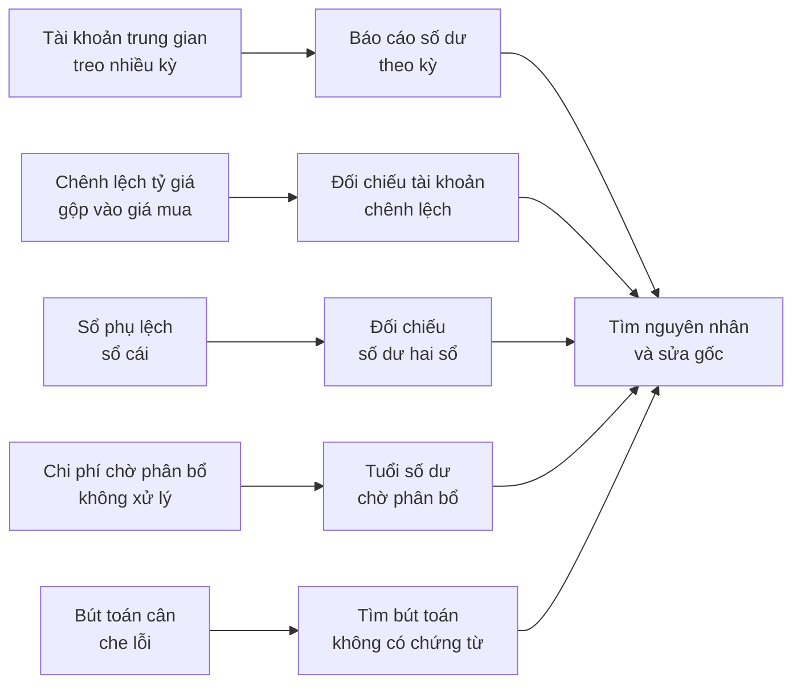

# 9000 Bẫy kế toán

Các lỗi trong bài này đều **không báo lỗi khi xảy ra**. Sổ vẫn cân, báo cáo vẫn ra số, chỉ khi đối chiếu hoặc kiểm toán mới phát hiện — và thường đã tích lũy nhiều kỳ.

## 0. Nguyên lý (áp dụng mọi ERP)

1. **Sổ phụ và sổ cái lệch nhau là bệnh, không phải sai số.** Mọi chênh lệch đều có nguyên nhân cụ thể: ghi thiếu một bên, ghi sai tài khoản, hoặc có giao dịch không qua sổ phụ.
2. **Tài khoản trung gian có số dư nghĩa là còn giao dịch chưa hoàn tất.** Không phải "sai số bình thường" và không được xóa bằng bút toán cân cho đẹp.
3. **Ba loại chênh lệch dễ bị gộp nhầm:** chênh lệch giá mua, chênh lệch tỷ giá, chênh lệch giá thành. Mỗi loại thuộc một tài khoản và một người chịu trách nhiệm khác nhau.
4. **Bút toán cân cho đẹp là cách che lỗi nhanh nhất và nguy hiểm nhất.** Nó làm số liệu khớp nhưng xóa mất dấu vết nguyên nhân.
5. **Mỗi bẫy phải có truy vấn phát hiện.** Mô tả lỗi mà không tìm được trong dữ liệu thật thì không dùng được.

## 1. Luồng vận hành



## 2. Ai làm gì ở module nào

| Bẫy | Kế toán tổng hợp | Kế toán AP/AR | Kho | Sản xuất | Người phát hiện sớm nhất |
|---|---|---|---|---|---|
| Trung gian treo | ✅ chủ trì | ✅ cung cấp dữ liệu | Xác nhận số thực nhận | — | Kế toán cuối kỳ |
| Chênh lệch tỷ giá gộp nhầm | ✅ sở hữu tài khoản | ✅ cung cấp chứng từ | — | — | Kế toán |
| Sổ phụ lệch sổ cái | ✅ sở hữu đối chiếu | ✅ kiểm tra phân hệ mình | ✅ kiểm tra giao dịch | ✅ kiểm tra WIP | Kế toán cuối kỳ |
| Chi phí chờ phân bổ | ✅ sở hữu | — | — | — | Kế toán |
| Bút toán cân cho đẹp | ✅ sở hữu | — | — | — | Kiểm toán |

## 3. Hạch toán

Bài này không định nghĩa lại tài khoản — bản đồ duy nhất ở [Hạch toán & tài khoản trung gian](../../5-ke-toan/ke-toan-tong-hop/1000-hach-toan-va-tai-khoan-trung-gian.md).

Nguyên tắc chung khi xử lý bất kỳ chênh lệch nào:

1. **Tìm nguyên nhân trước, ghi bút toán sau.** Bút toán điều chỉnh phải có chứng từ giải trình.
2. **Không bao giờ cân bằng bằng tài khoản trung gian.** Dùng đúng tài khoản của bản chất chênh lệch.
3. **Điều chỉnh vào kỳ hiện tại**, không mở lại kỳ đã khóa — trừ khi có quy trình đặc biệt được duyệt.

## 4. Điểm chạm & rủi ro

- **Tài khoản trung gian và PPV/IPV** (bài gốc): [Hạch toán & tài khoản trung gian](../../5-ke-toan/ke-toan-tong-hop/1000-hach-toan-va-tai-khoan-trung-gian.md)
- **Giá vốn và chênh lệch định giá**: [Giá vốn & định giá tồn kho](./1010-gia-von-va-dinh-gia-ton-kho.md)
- **Thuế và tài sản cố định**: [Thuế & tài sản cố định](../tai-san-co-dinh/1000-tai-san-co-dinh-va-khau-hao.md)
- **Sổ cái và báo cáo tài chính**: [Sổ cái & báo cáo tài chính](./2000-so-cai-va-bao-cao-tai-chinh.md)
- **Đóng kỳ và đối soát sổ phụ**: [Đóng kỳ & đối soát sổ phụ](./2010-dong-ky-va-doi-soat-so-phu.md)
- **Chênh lệch tỷ giá công nợ**: [Đối trừ công nợ, netting & đa tiền tệ](../cong-no/3000-cong-no-doi-tru-netting-va-tien-te.md)

## 5. Triển khai tham chiếu ERP

### A. Năm bẫy lớn và cách phát hiện

**Bẫy 1 — Tài khoản trung gian treo nhiều kỳ**

```sql
SELECT Period_ID, SUM(Debit) - SUM(Credit) AS Balance
FROM GL_Journal
WHERE Account_ID = 'GR_IR_CLEARING'
GROUP BY Period_ID
HAVING ABS(SUM(Debit) - SUM(Credit)) > 0.01
ORDER BY Period_ID DESC;
```

Nguyên nhân thường gặp: hàng đã nhận nhưng hóa đơn mãi không về; hóa đơn về nhưng không đối chiếu; chênh lệch giá chưa được xử lý. Xử lý theo [Hạch toán & tài khoản trung gian](../../5-ke-toan/ke-toan-tong-hop/1000-hach-toan-va-tai-khoan-trung-gian.md).

**Bẫy 2 — Chênh lệch tỷ giá bị gộp vào chênh lệch giá mua**

```sql
-- Tìm giao dịch ngoại tệ nhưng không có dòng chênh lệch tỷ giá tương ứng
SELECT i.Invoice_No, i.Currency, i.Amount_Foreign, i.Exchange_Rate,
       i.Amount_Base, p.Payment_Date, p.Exchange_Rate AS Pay_Rate
FROM AR_Invoice i
JOIN AR_Receipt_Apply a ON a.Invoice_ID = i.Invoice_ID
JOIN AR_Receipt p       ON p.Receipt_ID = a.Receipt_ID
WHERE i.Currency <> 'VND'
  AND p.Exchange_Rate <> i.Exchange_Rate
  AND NOT EXISTS (
      SELECT 1 FROM GL_Journal g
      WHERE g.Source_Doc = i.Invoice_No AND g.Account_Type = 'FX_GAIN_LOSS');
```

**Bẫy 3 — Sổ phụ lệch sổ cái**

```sql
-- Đối chiếu tổng sổ phụ kho với tài khoản tồn kho trên GL
SELECT (SELECT SUM(Qty_Base * Unit_Cost) FROM Inventory_Transaction WHERE Is_Logical = 0) AS Subledger_Value,
       (SELECT SUM(Debit) - SUM(Credit) FROM GL_Journal
        WHERE Account_ID IN ('152','155','156')) AS GL_Value,
       (SELECT SUM(Qty_Base * Unit_Cost) FROM Inventory_Transaction WHERE Is_Logical = 0)
     - (SELECT SUM(Debit) - SUM(Credit) FROM GL_Journal
        WHERE Account_ID IN ('152','155','156')) AS Diff;
```

```sql
-- Đối chiếu phải thu: sổ phụ AR vs tài khoản 131
SELECT (SELECT SUM(Amount_Open) FROM AR_Open_Item WHERE Status <> 'CLEARED') AS AR_Subledger,
       (SELECT SUM(Debit) - SUM(Credit) FROM GL_Journal WHERE Account_ID = '131') AS GL_131,
       (SELECT SUM(Amount_Open) FROM AR_Open_Item WHERE Status <> 'CLEARED')
     - (SELECT SUM(Debit) - SUM(Credit) FROM GL_Journal WHERE Account_ID = '131') AS Diff;
```

**Bẫy 4 — Chi phí chờ phân bổ tồn đọng**

```sql
SELECT Account_ID, SUM(Debit) - SUM(Credit) AS Unallocated,
       DATEDIFF(DAY, MIN(Posting_Date), GETDATE()) AS Days_Oldest
FROM GL_Journal
WHERE Account_ID IN ('242','142')       -- chi phí trả trước
  AND Status = 'OPEN'
GROUP BY Account_ID
HAVING ABS(SUM(Debit) - SUM(Credit)) > 1000;
```

**Bẫy 5 — Bút toán cân cho đẹp, không có chứng từ**

```sql
SELECT j.Journal_ID, j.Account_ID, j.Amount, j.Posted_By, j.Posting_Date
FROM GL_Journal j
WHERE j.Source_Doc IS NULL
  AND j.Entry_Type = 'MANUAL'
  AND j.Account_ID IN ('3388','1388','811','711')   -- tài khoản dễ bị dùng để cân
ORDER BY j.Posting_Date DESC;
```

**Epicor — giao dịch kho không có bút toán GL tương ứng:**

```sql
SELECT pt.Company, pt.PartNum, pt.TranType, pt.TranQty, pt.TranDate
FROM Erp.PartTran pt
WHERE pt.Company = 'YOUR_COMPANY_CODE'
  AND pt.TranDate >= DATEADD(MONTH, -1, GETDATE())
  AND pt.TranType IN ('PUR-STK','MFG-STK','STK-CUS','STK-MTL')
  AND NOT EXISTS (
      SELECT 1 FROM Erp.GLJrnDtl g
      WHERE g.Company = pt.Company AND g.SourceModule = 'IM'
        AND g.SourceDocumentNum = CAST(pt.SysRowID AS VARCHAR(50)));
```

> Lưu ý: tên trường bảng GL của Epicor có thể khác theo phiên bản — đối chiếu với schema 10.2 trước khi dùng.

### B. Nhịp chạy kiểm soát

| Truy vấn | Tần suất | Người chịu trách nhiệm |
|---|---|---|
| Số dư tài khoản trung gian | Trước mỗi kỳ khóa sổ | Kế toán tổng hợp |
| Chênh lệch tỷ giá chưa ghi nhận | Hằng tháng | Kế toán |
| Đối chiếu sổ phụ vs sổ cái (kho, AR, AP) | Trước mỗi kỳ khóa sổ | Kế toán tổng hợp |
| Chi phí chờ phân bổ | Hằng quý | Kế toán tổng hợp |
| Bút toán thủ công không chứng từ | Hằng tháng | Kiểm soát nội bộ |

## 6. Bẫy thực chiến & Checklist

| # | Bẫy | Triệu chứng | Cách phòng tránh |
|---|---|---|---|
| 1 | Trung gian treo không ai xử lý | Tài sản và nợ cùng sai | Báo cáo số dư theo kỳ, xử lý trước khóa sổ |
| 2 | Gộp chênh lệch tỷ giá vào chênh lệch giá mua | Báo cáo giá vốn sai bản chất | Tách tài khoản FX riêng |
| 3 | Gộp chênh lệch giá thành vào chi phí kỳ | Lãi lỗ sai, không phân tích được | Chênh lệch vào tài khoản riêng, có người phân tích |
| 4 | Sổ phụ lệch sổ cái không đối chiếu | Lệch tích lũy nhiều kỳ | Đối chiếu tự động trước khóa sổ |
| 5 | Dùng tài khoản trung gian để cân bút toán | Số dư trung gian không bao giờ về 0 | Chặn bút toán thủ công vào tài khoản trung gian |
| 6 | Chi phí chờ phân bổ tồn đọng | Tài sản ảo trên bảng cân đối | Báo cáo tuổi số dư chờ phân bổ |
| 7 | Điều chỉnh vào kỳ đã khóa | Sổ đã chốt bị lệch | Chặn theo lịch kỳ, xử lý ở kỳ hiện tại |
| 8 | Bút toán thủ công không chứng từ | Không giải trình được khi kiểm toán | Bắt buộc chứng từ + phê duyệt |
| 9 | Không phân biệt nội bộ và bên ngoài khi hợp nhất | Báo cáo tập đoàn thổi phồng | Đối soát nội bộ trước hợp nhất |
| 10 | Tin báo cáo "trông hợp lý" | Lỗi tồn tại nhiều quý | Truy vấn kiểm soát theo lịch ở §5.B |

**Checklist trước go-live:**

- [ ] Có báo cáo số dư tài khoản trung gian theo kỳ (đã chạy, xác định ngưỡng cảnh báo).
- [ ] Chênh lệch tỷ giá ghi tách khỏi chênh lệch giá mua (đã test ngoại tệ).
- [ ] Chênh lệch giá thành ghi tách khỏi chi phí kỳ (đã test).
- [ ] Có đối chiếu sổ phụ kho / AR / AP với sổ cái trước mỗi kỳ khóa sổ.
- [ ] Chặn bút toán thủ công vào tài khoản trung gian (đã test).
- [ ] Có báo cáo tuổi chi phí chờ phân bổ.
- [ ] Chặn điều chỉnh vào kỳ đã khóa (đã test).
- [ ] Bút toán thủ công bắt buộc có chứng từ và phê duyệt.
- [ ] Có đối soát nội bộ trước hợp nhất.
- [ ] Đã test: ghi một bút toán cân bằng bằng 3388 → hệ thống chặn.

---

## 7. Bẫy current cost: join vào bảng giá hiện hành thay vì giá tại thời điểm

Một mặt hàng sản xuất có giá nguyên liệu đầu vào tăng dần theo quý: Quý 1 là 3.0, Quý 2 là 3.2, Quý 3 là 4.0. Nhưng báo cáo join Job sản xuất với bảng Item để lấy giá lại hiển thị **đúng một con số 4.0 cho cả ba quý**, kể cả những Job đã đóng sổ từ Quý 1.

Giá Quý 1 và Quý 2 không hề biến mất — hệ thống vẫn lưu đầy đủ. Nguyên nhân là **báo cáo đang join sai bảng**.

### Gốc rễ: hai loại bảng giá luôn tồn tại song song

ERP nào cũng có hai kiểu bảng liên quan đến giá, tồn tại song song:

| Loại bảng | Đặc điểm | Ví dụ thực tế |
|---|---|---|
| **Master / Snapshot table** | Chỉ giữ **giá hiện hành duy nhất** — bị ghi đè mỗi lần cập nhật | `Part.Cost` (Epicor), `CST_ITEM_COSTS` (Oracle EBS), `MBEW` (SAP) |
| **Transaction / Ledger table** | Giữ **giá tại đúng thời điểm phát sinh giao dịch** — không bao giờ bị ghi đè | `JobMtl/JobOpr` (Epicor), `WIP_TRANSACTION_ACCOUNTING_LINES` (Oracle EBS), `COEP` (SAP), `InventTrans` (Dynamics) |

Đây không phải thiếu sót trong thiết kế phần mềm mà là nguyên tắc **bắt buộc** của bất kỳ hệ thống kế toán nào: sổ sách của quá khứ không được phép tự đổi theo thời gian. Nếu giá của một Job đã đóng ở Quý 1 tự động "nhảy" theo giá hiện tại, toàn bộ báo cáo tài chính đã công bố trước đó trở nên vô nghĩa.

### Cái bẫy nằm ở đâu khi viết SQL

Câu query gây ra sai lệch:

```sql
-- SAI: luôn ra giá hiện hành, không phải giá lúc Job thực sự chạy
SELECT job.job_number, item_cost.current_cost
FROM job
JOIN item_cost ON item_cost.item_id = job.item_id
```

So với cách viết đúng:

```sql
-- ĐÚNG: lấy giá đã "đóng băng" ngay trên dòng giao dịch
SELECT job.job_number, txn.transaction_date, txn.unit_cost_at_that_time
FROM job
JOIN job_transaction txn ON txn.job_id = job.job_id
```

Sự khác biệt chỉ nằm ở **join vào bảng nào** — nhưng hậu quả là toàn bộ báo cáo lịch sử bị "đồng bộ hóa nhầm" về giá hiện tại.

**Phép thử nhanh:** chạy lại đúng query đó sau 3 tháng. Nếu kết quả của các Job *cũ* thay đổi theo giá mới hiện tại thì query đang join sai bảng.

### Nhìn cụ thể qua Oracle EBS

Oracle EBS phân vai bảng rõ ràng:

| Nhu cầu | Bảng nên dùng |
|---|---|
| Giá hiện hành của Item | `CST_ITEM_COSTS`, `CST_ITEM_COST_DETAILS` |
| Giá thực tế đã ghi nhận cho 1 Job tại thời điểm chạy | `WIP_TRANSACTION_ACCOUNTING_LINES` |
| Lịch sử các lần thay đổi Standard Cost | `CST_STANDARD_COST_UPDATES` + `CST_STD_COST_UPDATE_ITM` |
| Chênh lệch giữa thực tế và chuẩn (Variance) | `WIP_PERIOD_BALANCES` |

```sql
-- Lịch sử thay đổi giá chuẩn của 1 Item
SELECT csui.NEW_ITEM_COST, csu.LAST_UPDATE_DATE
FROM CST_STANDARD_COST_UPDATES csu
JOIN CST_STD_COST_UPDATE_ITM csui 
    ON csui.STANDARD_COST_UPDATE_ID = csu.STANDARD_COST_UPDATE_ID
WHERE csui.INVENTORY_ITEM_ID = :item_id
AND csu.ORGANIZATION_ID = :org_id
ORDER BY csu.LAST_UPDATE_DATE
```

Ngay cả "giá chuẩn" của Item cũng có bảng lịch sử riêng — không cần suy ngược từ Variance để đoán lại giá quá khứ, chỉ cần biết đúng bảng để tra.

### Các ERP lớn dùng chung một kiến trúc gốc

Oracle EBS, Epicor, SAP và Microsoft Dynamics AX **dùng chung một kiến trúc gốc**, chỉ khác tên bảng:

| Khái niệm | Oracle EBS | Epicor | SAP | Microsoft Dynamics AX |
|---|---|---|---|---|
| Danh mục Item/Part | `MTL_SYSTEM_ITEMS_B` | Part | Material Master (`MARA`) | `InventTable` |
| BOM (nguyên liệu) | `BOM_COMPONENTS_B` | Method of Manufacturing → Materials | `STKO`/`STPO` | `BOM`/`BOMTable` |
| Routing (công đoạn) | `BOM_OPERATION_SEQUENCES` | Method of Manufacturing → Operations | `PLKO`/`AFVC` | `RouteTable` |
| Lệnh sản xuất (Job/Order) | `WIP_ENTITIES` | `JobHead` | `AFKO`/`AFPO` | `ProdTable` |
| Giá hiện hành (bị ghi đè) | `CST_ITEM_COSTS` | `Part.Cost` | `MBEW` | Item Price hiện hành |
| Giá theo thời điểm (không ghi đè) | `WIP_TRANSACTION_ACCOUNTING_LINES` | `JobMtl`/`JobOpr` | `COEP` | `InventTrans` |
| Lịch sử giá chuẩn | `CST_STANDARD_COST_UPDATES` | Cost History | Costing Run (`CK11N`) | Cost Version theo kỳ |

Nói cách khác: **dùng ERP nào cũng vậy, nếu report join thẳng Job/Order vào bảng Item Master để lấy giá thì đều dính đúng lỗi này.** Đây không phải sự trùng hợp của các nhà cung cấp phần mềm mà là hệ quả tất yếu của nguyên tắc kế toán.

### Vì sao Job thực tế không bao giờ khớp 100% với BOM chuẩn

Khi tạo Job/Order từ BOM, hệ thống **copy (snapshot)** toàn bộ BOM + Routing tại đúng thời điểm đó thành một bản riêng gắn với Job. Sau đó người vận hành có thể sửa trực tiếp trên Job — đổi nguyên liệu thay thế do thiếu hàng, thêm bớt công đoạn — mà không ảnh hưởng ngược lại BOM gốc.

Đó là lý do Job thực tế và BOM chuẩn gần như không bao giờ khớp tuyệt đối. Điều này có chủ đích trong thiết kế ERP, để linh hoạt xử lý phát sinh sản xuất thực tế.

### Mức độ dễ dính bẫy phụ thuộc phương pháp tính giá

Mức độ "dễ dính bẫy current cost" phụ thuộc vào **phương pháp tính giá (Costing Method)** đang áp dụng:

**Standard Costing** — giá được thiết lập trước theo kỳ, mọi chênh lệch tách riêng thành Variance. Vì có bảng lịch sử update giá đi kèm, đây là phương pháp tương đối an toàn nếu viết report đúng cách.

**Actual Costing (FIFO/LIFO/Lot-specific)** — mỗi giao dịch tự mang giá riêng theo đúng lô hàng, không có khái niệm "giá hiện hành" chung để nhầm lẫn.

**Moving Average Cost** — **dễ dính bẫy nhất**. Giá được tính lại bình quân mỗi lần nhập kho, và field lưu giá chỉ là **một cột duy nhất liên tục bị cập nhật** (như `Part.Cost` ở Epicor). Không có thêm bảng lưu lịch sử giá tại từng thời điểm thì không cách nào tra lại chính xác giá quá khứ.

**Backflush Costing** — dồn chi phí về thời điểm hoàn thành sản phẩm, dùng cho sản xuất liên tục. Đây là dạng xấp xỉ có chủ đích, cần hiểu rõ độ trễ khi phân tích chi tiết.

### Một kỳ báo cáo, nhiều giá — lấy giá nào?

Nếu trong một năm một Item đổi giá 3–4 lần thì không tồn tại "một giá đúng duy nhất" cho cả kỳ — chỉ có **giá đúng cho đúng mục đích sử dụng**:

| Mục đích báo cáo | Cách xử lý phù hợp |
|---|---|
| Xem biến động giá theo thời gian | Hiển thị đúng từng mốc giá, đúng ngày hiệu lực — không gộp thành 1 số |
| Xem giá vốn của 1 giao dịch cụ thể | Lấy đúng giá tại transaction đó |
| So sánh hiệu quả chi phí giữa các kỳ | Weighted Average theo sản lượng thực tế, không phải trung bình cộng đơn giản |
| Xem giá trị tồn kho tại 1 thời điểm chốt kỳ | Giá hiệu lực đúng tại ngày chốt đó |

```sql
-- Weighted Average theo sản lượng thực tế trong kỳ
SELECT 
    SUM(txn.material_amount) / SUM(txn.quantity) AS weighted_avg_cost
FROM job_transaction txn
WHERE txn.item_id = :item_id
AND txn.transaction_date BETWEEN :tu_ngay AND :den_ngay
```

Nguyên tắc xuyên suốt: **dữ liệu hiển thị phải đúng với giao dịch đã thực sự xảy ra tại đúng thời điểm — không suy diễn, không làm tròn cho đẹp, không gán một giá đại diện nếu bản chất có nhiều giá khác nhau.**

### Giá mua và giá bán: bài toán current cost lặp lại ở cả hai phía

Giá mua (chi phí đầu vào) và giá bán (giá ra thị trường) là hai nhánh khác nhau nhưng liên kết chặt với nhau — giá nguyên liệu tăng thường kéo theo áp lực tăng giá bán, dù giá bán còn phụ thuộc cạnh tranh, hợp đồng và nhu cầu thị trường chứ không chỉ riêng chi phí.

Khi phân tích **margin** (lợi nhuận gộp), bài toán "point-in-time" lặp lại trên **cả hai trục cùng lúc**:

```
Margin thực tế 1 đơn hàng = Giá bán tại thời điểm bán − Giá vốn tại thời điểm sản xuất/xuất kho
```

Nếu báo cáo margin lấy nhầm giá bán theo Price List hiện tại và giá vốn theo Standard Cost hiện tại — thay vì lấy đúng giá đã chốt tại từng transaction — sai số dồn theo cả hai chiều, khiến con số margin cuối cùng lệch xa hơn cả việc chỉ sai một phía.

### Các lưu ý khác

- **Cost Rollup không tự lan truyền**: giá nguyên liệu đổi không tự động cập nhật giá thành phẩm cấp trên (multi-level BOM) cho đến khi chạy lại Cost Rollup.
- **Job đã đóng không bị ảnh hưởng bởi giá đổi sau này** — đúng nguyên tắc, nhưng dễ gây hiểu lầm nếu ai đó kỳ vọng ngược lại.
- **Tỷ giá ngoại tệ** với nguyên liệu nhập khẩu tạo thêm 1 chiều biến động ngoài đơn giá gốc.
- **Lệch ngày hiệu lực giữa BOM/Routing và giá** dễ gây sai lệch cost trong khoảng giao thời mà không ai để ý.
- **Actual Costing theo Lot/Serial** khiến "giá của Item" có thể tồn tại nhiều mức song song cùng lúc, không chỉ biến động theo thời gian.
- **Overhead phân bổ theo %** không cố định như nhiều người tưởng — nó tự đổi theo khi Material Cost thay đổi.

### Nguyên lý rộng hơn: point-in-time value

Nguyên lý "point-in-time value" chính là khái niệm **Slowly Changing Dimension (SCD)** quen thuộc trong Data Warehouse, áp dụng cho mọi dữ liệu biến động theo thời gian: giá vàng, tỷ giá, giá cổ phiếu. Cần biết "giá trị tại một thời điểm quá khứ" thì câu trả lời không bao giờ nằm ở "giá trị hiện tại", mà phải nằm ở dữ liệu có gắn timestamp.

### Checklist khi viết báo cáo costing

- Xác định rõ Costing Method đang dùng (Standard/Actual/Moving Average) — mỗi loại có rủi ro khác nhau
- Xác định rõ bảng nào là *current*, bảng nào là *historical* trước khi viết query
- Tự kiểm tra: chạy lại query sau vài tháng, kết quả dữ liệu cũ có đổi theo giá mới không?
- Có bảng lưu lịch sử thay đổi giá chuẩn để tra cứu độc lập
- Xác định rõ mục đích báo cáo trước khi chọn cách tổng hợp giá
- Khi tính margin, lấy đúng giá bán và giá vốn tại đúng transaction — không join ngược về bảng "giá hiện hành" ở cả 2 phía

---

Không có công thức đúng tuyệt đối cho việc lấy giá trong báo cáo — chỉ có nguyên tắc bất biến: dữ liệu hiển thị phải phản ánh đúng giao dịch thực tế tại đúng thời điểm, và cách tổng hợp phải phù hợp với câu hỏi mà báo cáo đang trả lời. Nguyên tắc này không đổi dù dùng Oracle EBS, Epicor, SAP, Microsoft Dynamics hay bất kỳ ERP nào khác, vì nó đến từ bản chất kế toán chứ không từ cách một phần mềm cụ thể được thiết kế.


## Xem thêm

- [Tổng quan Kế toán](../../5-ke-toan/index.mdx)
- [Hạch toán & tài khoản trung gian](../../5-ke-toan/ke-toan-tong-hop/1000-hach-toan-va-tai-khoan-trung-gian.md)
- [Giá vốn & định giá tồn kho](./1010-gia-von-va-dinh-gia-ton-kho.md)
- [Đóng kỳ & đối soát sổ phụ](./2010-dong-ky-va-doi-soat-so-phu.md)
- [Báo cáo công nợ (Aging & Cashflow)](../cong-no/3010-bao-cao-cong-no-aging-cashflow.md)

<div align="center" style={{color: 'var(--ifm-color-primary)'}}>
  <strong>Chúc các bạn thành công và vui vẻ!</strong>
</div>
