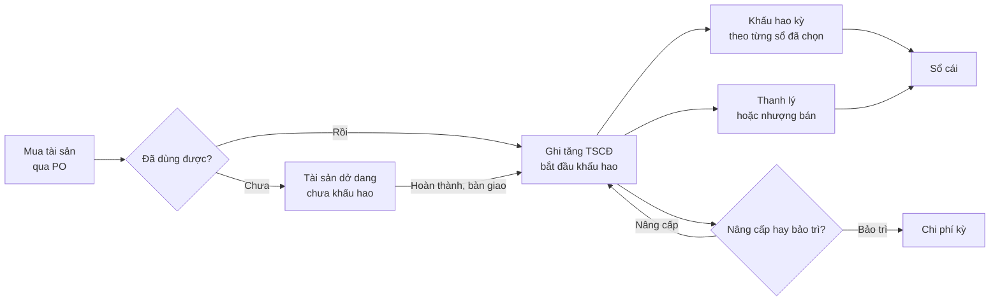

# Tài sản cố định & khấu hao

Tài sản cố định có một nguyên tắc riêng: **giá trị ghi sổ không nhất thiết bằng giá trị đã trả** — tài sản không khấu hao từ ngày trả tiền mà **từ ngày dùng được**.

## Nguyên lý (áp dụng mọi ERP)

1. **Khấu hao bắt đầu từ ngày đưa vào sử dụng, không từ ngày mua hoặc ngày nhận hóa đơn.** Tài sản mua tháng 12 dùng từ tháng 1 thì khấu hao từ tháng 1.
2. **Nguyên giá hình thành đủ thì mới bắt đầu khấu hao.** Tài sản đang lắp đặt, đang xây dựng chưa đưa vào dùng phải nằm ở tài khoản tài sản dở dang, không khấu hao.
3. **Giá trị còn lại không xuống dưới giá trị thu hồi ước tính.** Sai nguyên tắc này làm chi phí khấu hao cao giả về cuối vòng đời tài sản.
4. **Thanh lý tài sản sinh hai kết quả độc lập:** chênh lệch giữa giá bán và giá trị còn lại (lãi/lỗ thanh lý) và thuế GTGT đầu ra trên giá bán.
5. **Một tài sản có thể có nhiều sổ khấu hao** (kế toán, thuế, quản trị) với thời gian hữu dụng khác nhau. Hệ thống phải tách được, không được gộp.

## 1. Luồng vận hành



## 2. Ai làm gì ở module nào

| Việc | Mua hàng | Kho | Kế toán TSCĐ | Ban điều hành |
|---|---|---|---|---|
| Mua và nhận tài sản | ✅ đặt PO | ✅ nhận và bàn giao | Ghi nhận chứng từ | — |
| Đưa tài sản vào sử dụng | — | ✅ bàn giao | ✅ sở hữu | — |
| Duyệt ghi tăng TSCĐ | — | — | Đề xuất | ✅ duyệt |
| Chạy khấu hao kỳ | — | — | ✅ sở hữu | — |
| Duyệt thanh lý | — | Xác nhận xuất tài sản | ✅ lập hồ sơ | ✅ duyệt |

## 3. Hạch toán

Bản đồ tài khoản ở [Hạch toán & tài khoản trung gian](../ke-toan-tong-hop/1000-hach-toan-va-tai-khoan-trung-gian.md).

### Vòng đời tài sản cố định

| Giai đoạn | Nguyên tắc |
|---|---|
| Ghi tăng | Nguyên giá = giá mua chưa thuế + chi phí trực tiếp để đưa vào sử dụng |
| Đang lắp đặt | Nằm ở tài sản dở dang, **chưa khấu hao** |
| Đưa vào dùng | Bắt đầu khấu hao từ thời điểm này |
| Khấu hao định kỳ | Theo thời gian hữu dụng và phương pháp của từng sổ |
| Nâng cấp | Làm tăng nguyên giá nếu đủ điều kiện; nếu chỉ bảo trì thì vào chi phí kỳ |
| Thanh lý | Lãi/lỗ = giá bán − giá trị còn lại; kèm thuế GTGT đầu ra trên giá bán |

## 4. Điểm chạm & rủi ro

- **Mua tài sản qua PO**: [Mô hình mua đặc thù](../../2-mua-hang/2030-mo-hinh-mua-dac-thu.md)
- **Thuế trên hóa đơn mua tài sản**: [Thuế & hóa đơn điện tử](../thue/1000-thue-va-hoa-don-dien-tu.md)
- **Khấu hao vào giá thành**: [Giá thành sản xuất](../../3-san-xuat/2020-gia-thanh-san-xuat.md)
- **Đóng kỳ và khóa sổ**: [Đóng kỳ & đối soát sổ phụ](../ke-toan-tong-hop/2010-dong-ky-va-doi-soat-so-phu.md)

**Rủi ro chính:**

- **Khấu hao từ ngày mua thay vì ngày dùng** — chi phí sai kỳ.
- **Khấu hao tài sản đang lắp đặt** — chi phí phát sinh trước khi tài sản tạo ra lợi ích.
- **Không tách sổ khấu hao kế toán và thuế** — một trong hai báo cáo luôn sai.
- **Thanh lý không ghi thuế đầu ra** — thiếu nghĩa vụ thuế.
- **Nâng cấp bảo trì ghi tăng nguyên giá** — khấu hao phân bổ lại không đúng.

## 5. Triển khai tham chiếu ERP

### A. Ánh xạ khái niệm

| Khái niệm | Oracle EBS R12 | Epicor ERP | SAP S/4HANA | Odoo |
|---|---|---|---|---|
| Tài sản cố định | `FA_ADDITIONS_B`, `FA_BOOKS` | `Erp.Asset` | `ANLA`, `ANLB` (Depreciation Areas) | `account.asset` |
| Sổ khấu hao | `FA_BOOK_CONTROLS` | `Asset Book` | Depreciation Area | Không native (một sổ) |
| Thanh lý | `FA_RETIREMENTS` | `Asset Disposal` | Retirement (`ABAON`) | `account.asset` disposal |

### B. Hệ thống tự xây — thiết kế tối thiểu

```sql
CREATE TABLE Fixed_Asset (
    Asset_ID         VARCHAR(50) PRIMARY KEY,
    Description      NVARCHAR(200) NOT NULL,
    Cost_Original    DECIMAL(18,2) NOT NULL,
    In_Service_Date  DATE NULL,             -- NULL = chưa đưa vào dùng
    Useful_Life_Months INT NOT NULL,
    Salvage_Value    DECIMAL(18,2) NOT NULL DEFAULT 0,
    Accum_Depreciation DECIMAL(18,2) NOT NULL DEFAULT 0,
    Status           VARCHAR(20) NOT NULL   -- CIP | IN_SERVICE | DISPOSED
);

CREATE TABLE Asset_Depreciation_Book (
    Asset_ID         VARCHAR(50) NOT NULL,
    Book_Type        VARCHAR(20) NOT NULL,  -- ACCOUNTING | TAX | MANAGERIAL
    Useful_Life_Months INT NOT NULL,
    Method           VARCHAR(20) NOT NULL,  -- STRAIGHT_LINE | DECLINING
    PRIMARY KEY (Asset_ID, Book_Type)
);
```

Ba ràng buộc bắt buộc:

1. **`In_Service_Date` NULL thì không được sinh khấu hao**, dù đã ghi tăng.
2. **Khấu hao không vượt `Cost_Original - Salvage_Value`.**
3. **Thanh lý bắt buộc ghi thuế đầu ra trên giá bán** (nếu có thuế).

### C. Truy vấn kiểm soát

**Tài sản đã ghi tăng nhưng chưa đưa vào sử dụng quá 90 ngày:**

```sql
SELECT Asset_ID, Description, Cost_Original
FROM Fixed_Asset
WHERE In_Service_Date IS NULL
  AND Status = 'CIP'
  AND Asset_ID IN (SELECT Asset_ID FROM Asset_Acquisition WHERE Acq_Date < DATEADD(DAY, -90, GETDATE()));
```

**Giá trị khấu hao luỹ kế vượt nguyên giá khấu hao:**

```sql
SELECT Asset_ID, Cost_Original, Salvage_Value, Accum_Depreciation
FROM Fixed_Asset
WHERE Accum_Depreciation > Cost_Original - Salvage_Value;
```

**Tài sản có hai sổ khấu hao nhưng thời gian hữu dụng trùng nhau (nghi nhập trùng):**

```sql
SELECT a.Asset_ID, a.Book_Type, a.Useful_Life_Months, b.Book_Type, b.Useful_Life_Months
FROM Asset_Depreciation_Book a
JOIN Asset_Depreciation_Book b ON b.Asset_ID = a.Asset_ID AND b.Book_Type > a.Book_Type
WHERE a.Useful_Life_Months = b.Useful_Life_Months;
```

**Epicor — tài sản chưa có ngày đưa vào sử dụng:**

```sql
SELECT a.AssetNum, a.Description, a.AcquisitionCost, a.InServiceDate
FROM Erp.Asset a
WHERE a.Company = 'YOUR_COMPANY_CODE'
  AND (a.InServiceDate IS NULL OR a.InServiceDate > GETDATE())
  AND a.Active = 1;
```

## 6. Bẫy thực chiến & Checklist

| # | Bẫy | Triệu chứng | Cách phòng tránh |
|---|---|---|---|
| 1 | Khấu hao từ ngày mua | Chi phí sai kỳ | Chỉ khấu hao từ `In_Service_Date` |
| 2 | Khấu hao tài sản đang lắp đặt | Chi phí trước khi tài sản tạo lợi ích | Tài sản dở dang không khấu hao |
| 3 | Khấu hao vượt giá trị phải khấu hao | Giá trị còn lại âm | Chặn ở mức `Cost - Salvage` |
| 4 | Gộp sổ kế toán và sổ thuế | Một trong hai báo cáo sai | Bảng sổ khấu hao tách theo loại |
| 5 | Thanh lý không ghi thuế đầu ra | Thiếu nghĩa vụ thuế | Bắt buộc `Tax_Amount` khi thanh lý |
| 6 | Nâng cấp bảo trì ghi tăng nguyên giá | Nguyên giá tăng sai, khấu hao phân bổ lại không đúng | Chỉ ghi tăng khi nâng cấp làm tăng lợi ích |

**Checklist trước go-live:**

- [ ] Khấu hao chỉ sinh từ ngày đưa vào sử dụng (đã test).
- [ ] Tài sản dở dang không khấu hao.
- [ ] Chặn khấu hao vượt `Cost - Salvage` (đã test).
- [ ] Có sổ khấu hao tách theo kế toán và thuế.
- [ ] Thanh lý có thuế đầu ra trên giá bán.
- [ ] Nâng cấp phân biệt với bảo trì.

## Xem thêm

- [Tổng quan Kế toán](../index.mdx)
- [Thuế & hóa đơn điện tử](../thue/1000-thue-va-hoa-don-dien-tu.md)
- [Giá vốn & định giá tồn kho](../ke-toan-tong-hop/1010-gia-von-va-dinh-gia-ton-kho.md)
- [Đóng kỳ & đối soát sổ phụ](../ke-toan-tong-hop/2010-dong-ky-va-doi-soat-so-phu.md)

<div align="center" style={{color: 'var(--ifm-color-primary)'}}>
  <strong>Chúc các bạn thành công và vui vẻ!</strong>
</div>
