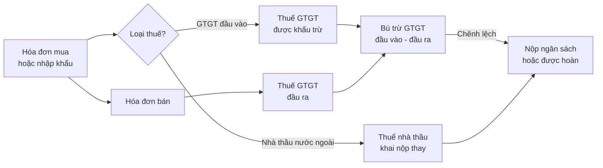

# 1000 Thuế & hóa đơn điện tử

Thuế là phần **giá trị doanh nghiệp thu hộ hoặc nộp thay**, không phải giá trị hàng hóa. Nguyên tắc duy nhất cần nhớ: **giá trị ghi sổ không nhất thiết bằng số tiền đã trả** — hóa đơn có thuế tách khỏi giá trị hàng.

## 0. Nguyên lý (áp dụng mọi ERP)

1. **Thuế GTGT là thuế gián thu — doanh nghiệp không chịu, chỉ thu hộ.** Thuế đầu vào được khấu trừ với thuế đầu ra; chỉ chênh lệch mới phải nộp hoặc được hoàn.
2. **Thuế tách khỏi giá trị tài sản và chi phí.** Hàng nhập kho ghi giá trị chưa thuế; thuế vào tài khoản thuế đầu vào được khấu trừ. Gộp thuế vào giá trị hàng làm tăng giá vốn giả.
3. **Điều kiện khấu trừ phải kiểm tra trước khi ghi sổ**: hóa đơn hợp lệ, có chứng từ thanh toán không dùng tiền mặt với hóa đơn trên ngưỡng, và hàng/dịch vụ đã thực nhận.
4. **Thuế nhà thầu (thuế đối với nhà cung cấp nước ngoài) có thể do bên mua khai nộp thay.** Đây là khoản phải trả ngân sách, không phải chi phí của nhà cung cấp.
5. **Hóa đơn điện tử có yêu cầu pháp lý riêng** (mã cơ quan thuế, chữ ký số, huỷ và điều chỉnh theo quy định) — hệ thống phải lưu cả trạng thái pháp lý chứ không chỉ lưu số tiền.

## 1. Luồng vận hành



## 2. Ai làm gì ở module nào

| Việc | Mua hàng | Kho | Kế toán thuế | Ban điều hành |
|---|---|---|---|---|
| Cung cấp hóa đơn và thuế suất | ✅ cung cấp | — | ✅ kiểm tra và ghi nhận | — |
| Xác định khấu trừ thuế đầu vào | — | — | ✅ sở hữu | — |
| Khai nộp thuế nhà thầu | ✅ làm việc với NCC | — | ✅ sở hữu | — |
| Xác nhận hàng đã nhận | — | ✅ sở hữu | Đọc để kiểm điều kiện khấu trừ | — |
| Kê khai và nộp thuế kỳ | — | — | ✅ lập | ✅ duyệt |

## 3. Hạch toán

Bản đồ tài khoản ở [Hạch toán & tài khoản trung gian](../ke-toan-tong-hop/1000-hach-toan-va-tai-khoan-trung-gian.md).

### A. Điều kiện khấu trừ thuế GTGT đầu vào

Ba điều kiện phải thoả **đồng thời**:

1. Có hóa đơn GTGT hợp pháp hoặc chứng từ nộp thuế.
2. Có chứng từ thanh toán không dùng tiền mặt với hóa đơn từ ngưỡng quy định.
3. Hàng hóa, dịch vụ đã thực tế nhận (có phiếu nhận hoặc biên bản nghiệm thu).

Thiếu một điều kiện thì thuế không được khấu trừ — khoản đó trở thành chi phí hoặc giá trị tài sản.

### B. Thuế nhà thầu

Khi mua dịch vụ từ nhà cung cấp nước ngoài, doanh nghiệp Việt Nam thường phải **khai nộp thay** hai loại thuế: thuế GTGT và thuế thu nhập doanh nghiệp (hoặc thuế nhà thầu).

Điểm cần nhớ: **khoản nộp thay là nghĩa vụ của doanh nghiệp với ngân sách, không phải chi phí trả cho nhà cung cấp.** Hạch toán nhầm làm sai cả công nợ lẫn chi phí.

### C. Hóa đơn điện tử

| Trạng thái | Ý nghĩa | Ảnh hưởng kế toán |
|---|---|---|
| `ISSUED` | Đã phát hành hợp lệ | Được ghi nhận doanh thu / chi phí |
| `ADJUSTED` | Đã điều chỉnh bằng hóa đơn mới | Phải ghi bút toán điều chỉnh theo hóa đơn thay thế |
| `CANCELLED` | Đã huỷ | Không được ghi nhận; nếu đã ghi thì phải đảo |

## 4. Điểm chạm & rủi ro

- **Hóa đơn đầu vào**: [AP: Nhận hóa đơn & đối tất tạm ứng](../cong-no/1010-ap-nhan-hoa-don-va-doi-tat-tam-ung.md)
- **Hóa đơn đầu ra**: [AR: Xuất hóa đơn & hạn mức tín dụng](../cong-no/2010-ar-xuat-hoa-don-va-han-muc-tin-dung.md)
- **Thuế trên tài sản cố định**: [Tài sản cố định & khấu hao](../tai-san-co-dinh/1000-tai-san-co-dinh-va-khau-hao.md)
- **Đóng kỳ và khóa sổ thuế**: [Đóng kỳ & đối soát sổ phụ](../ke-toan-tong-hop/2010-dong-ky-va-doi-soat-so-phu.md)

**Rủi ro chính:**

- **Gộp thuế vào giá trị hàng** — giá vốn và nguyên giá TSCĐ cao giả.
- **Khấu trừ thuế khi chưa đủ điều kiện** — bị truy thu và phạt.
- **Thuế nhầm là chi phí của NCC** — sai cả công nợ và chi phí.
- **Không gắn hóa đơn điện tử với trạng thái pháp lý** — không chứng minh được hóa đơn hợp lệ.

## 5. Triển khai tham chiếu ERP

### A. Ánh xạ khái niệm

| Khái niệm | Oracle EBS R12 | Epicor ERP | SAP S/4HANA | Odoo |
|---|---|---|---|---|
| Thuế GTGT | E-Business Tax (EBTax) | Tax Connect | Tax Procedure | `account.tax` |
| Thuế nhà thầu | Withholding Tax / Self-assessed | `Tax` + AP adjustment | Withholding Tax | `account.tax` tùy biến |
| Hóa đơn điện tử | EBS + tích hợp nhà cung cấp HĐĐT | `eInvoicing` | Integration với nhà cung cấp | Tích hợp module localization |

### B. Hệ thống tự xây — thiết kế tối thiểu

```sql
CREATE TABLE Tax_Invoice (
    Tax_Inv_ID       BIGINT IDENTITY PRIMARY KEY,
    Doc_Type         VARCHAR(20) NOT NULL,  -- AP | AR
    Doc_No           VARCHAR(30) NOT NULL,
    Tax_Type         VARCHAR(20) NOT NULL,  -- VAT_IN | VAT_OUT | WITHHOLDING
    Tax_Rate         DECIMAL(6,2) NOT NULL,
    Tax_Base         DECIMAL(18,2) NOT NULL,
    Tax_Amount       DECIMAL(18,2) NOT NULL,
    Deductible       BIT NOT NULL DEFAULT 1,
    Deduct_Reason    VARCHAR(50) NULL,      -- lý do không được khấu trừ
    EInvoice_Status  VARCHAR(20) NULL       -- ISSUED | ADJUSTED | CANCELLED
);
```

Ràng buộc bắt buộc: **`Deductible = 0` bắt buộc có `Deduct_Reason`.**

### C. Truy vấn kiểm soát

**Thuế đầu vào không được khấu trừ nhưng không có lý do:**

```sql
SELECT Doc_No, Tax_Type, Tax_Amount
FROM Tax_Invoice
WHERE Deductible = 0 AND (Deduct_Reason IS NULL OR Deduct_Reason = '');
```

## 6. Bẫy thực chiến & Checklist

| # | Bẫy | Triệu chứng | Cách phòng tránh |
|---|---|---|---|
| 1 | Gộp thuế vào giá trị hàng | Giá vốn và nguyên giá TSCĐ cao giả | Tách thuế, ghi vào tài khoản thuế được khấu trừ |
| 2 | Khấu trừ thuế khi chưa có chứng từ thanh toán | Bị truy thu khi kiểm tra | Kiểm đủ 3 điều kiện trước khi đánh dấu khấu trừ |
| 3 | Thuế nhầm là chi phí của NCC | Sai cả công nợ và chi phí | Ghi là khoản phải nộp ngân sách |
| 4 | Không gắn hóa đơn điện tử với trạng thái pháp lý | Không chứng minh được hóa đơn hợp lệ | Lưu `EInvoice_Status` |
| 5 | Không đối chiếu thuế đầu vào với hàng đã nhận | Khấu trừ hàng chưa về | Kiểm phiếu nhận trước khi duyệt khấu trừ |

**Checklist trước go-live:**

- [ ] Thuế tách khỏi giá trị hàng (đã test một hóa đơn).
- [ ] Ba điều kiện khấu trừ được kiểm tra (đã test chặn khi thiếu chứng từ).
- [ ] Thuế nhà thầu ghi đúng là khoản phải nộp ngân sách.
- [ ] Hóa đơn điện tử lưu trạng thái pháp lý.

## Xem thêm

- [Tổng quan Kế toán](../index.mdx)
- [Tài sản cố định & khấu hao](../tai-san-co-dinh/1000-tai-san-co-dinh-va-khau-hao.md)
- [Hạch toán & tài khoản trung gian](../ke-toan-tong-hop/1000-hach-toan-va-tai-khoan-trung-gian.md)
- [Đóng kỳ & đối soát sổ phụ](../ke-toan-tong-hop/2010-dong-ky-va-doi-soat-so-phu.md)

<div align="center" style={{color: 'var(--ifm-color-primary)'}}>
  <strong>Chúc các bạn thành công và vui vẻ!</strong>
</div>
