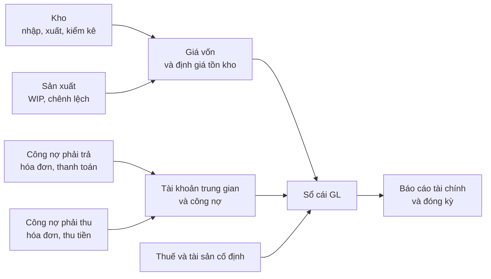

# Tổng quan Kế toán chung

Kế toán chung là **nơi mọi phân hệ khác đổ về**. Kho ghi số lượng, sản xuất ghi chi phí, mua và bán ghi công nợ — nhưng chỉ ở đây người ta mới biết doanh nghiệp lãi hay lỗ, và tài sản đáng giá bao nhiêu.

Bài này mô tả vị trí của khối kế toán trong toàn bộ hệ thống, và ranh giới với các khối khác.

## Bốn luồng chảy vào kế toán

**Đọc sơ đồ:** kế toán không tạo ra giao dịch gốc — nó **nhận** rồi hạch toán. Vì vậy mọi sai sót ở phân hệ trước đều thành sai số ở đây, và không thể sửa bằng bút toán mà không che mất nguyên nhân.

## Sáu câu hỏi kế toán chung phải trả lời

| Câu hỏi | Bài chi tiết |
|---|---|
| Khoản nợ tạm thời nằm ở tài khoản nào, tất toán khi nào? | [Hạch toán & tài khoản trung gian](./1000-hach-toan-va-tai-khoan-trung-gian.md) |
| Giá trị hàng tồn và giá vốn tính theo phương pháp nào? | [Giá vốn & định giá tồn kho](./2000-gia-von-va-dinh-gia-ton-kho.md) |
| Thuế GTGT, thuế nhà thầu và tài sản cố định hạch toán ra sao? | [Thuế & tài sản cố định](./3000-thue-va-tai-san-co-dinh.md) |
| Hệ thống tài khoản, kỳ kế toán và báo cáo tài chính thiết kế thế nào? | [Sổ cái & báo cáo tài chính](./4000-so-cai-va-bao-cao-tai-chinh.md) |
| Làm sao để sổ phụ và sổ cái khớp trước khi khóa sổ? | [Đóng kỳ & đối soát sổ phụ](./5000-dong-ky-va-doi-soat-so-phu.md) |
| Những lỗi nào khiến sổ sách sai mà không ai phát hiện? | [Bẫy kế toán](./9000-bay-ke-toan.md) |

## Ranh giới trách nhiệm

| Việc | Kho | Mua / Bán hàng | Công nợ | Kế toán chung |
|---|---|---|---|---|
| Ghi giao dịch gốc | ✅ | ✅ chứng từ | ✅ hóa đơn | — |
| Chọn tài khoản hạch toán | Cung cấp nhóm hàng | — | Cung cấp đối tác | ✅ sở hữu |
| Chốt phương pháp tính giá | — | — | — | ✅ sở hữu |
| Hạch toán thuế | — | — | Cung cấp hóa đơn | ✅ sở hữu |
| Khóa sổ và lập báo cáo | — | — | — | ✅ sở hữu |

Nguyên tắc: **kế toán chung không sửa số liệu phân hệ khác** — nó yêu cầu phân hệ nguồn sửa, hoặc hạch toán điều chỉnh có giải trình.

## Kế toán chung liên quan gì tới các phần khác

- **Kho** cung cấp giá trị nhập xuất và số liệu kiểm kê: [Giao dịch nhập, xuất & chuyển](../1-kho/3000-giao-dich-nhap-xuat-chuyen.md)
- **Sản xuất** cung cấp chi phí WIP và chênh lệch giá thành: [Giá thành sản xuất](../3-san-xuat/thuc-thi/8000-gia-thanh-san-xuat.md)
- **Mua hàng** cung cấp hóa đơn đầu vào: [Đối soát hóa đơn & 3-Way Match](../2-mua-hang/5000-doi-soat-hoa-don-va-3-way-match.md)
- **Bán hàng** cung cấp hóa đơn đầu ra và giá vốn: [Giao hàng & xuất kho](../4-ban-hang/3000-giao-hang-va-xuat-kho.md)
- **Công nợ** cung cấp số dư AP/AR: [Tổng quan Công nợ](../5-cong-no/0000-tong-quan-cong-no.md)

## Bắt đầu đọc từ đâu

Nếu triển khai từ đầu, đọc theo thứ tự 1000 → 9000. Nếu đang xử lý sự cố:

- Số dư tài khoản trung gian không về 0 → [Hạch toán & tài khoản trung gian](./1000-hach-toan-va-tai-khoan-trung-gian.md)
- Giá vốn lệch so với sổ kho → [Giá vốn & định giá tồn kho](./2000-gia-von-va-dinh-gia-ton-kho.md)
- Thuế đầu vào bị bác khấu trừ → [Thuế & tài sản cố định](./3000-thue-va-tai-san-co-dinh.md)
- Sổ phụ và sổ cái lệch nhau → [Đóng kỳ & đối soát sổ phụ](./5000-dong-ky-va-doi-soat-so-phu.md)
- Lãi lỗ báo cáo không khớp thực tế → [Bẫy kế toán](./9000-bay-ke-toan.md)

  <strong>Chúc các bạn thành công và vui vẻ!</strong>

