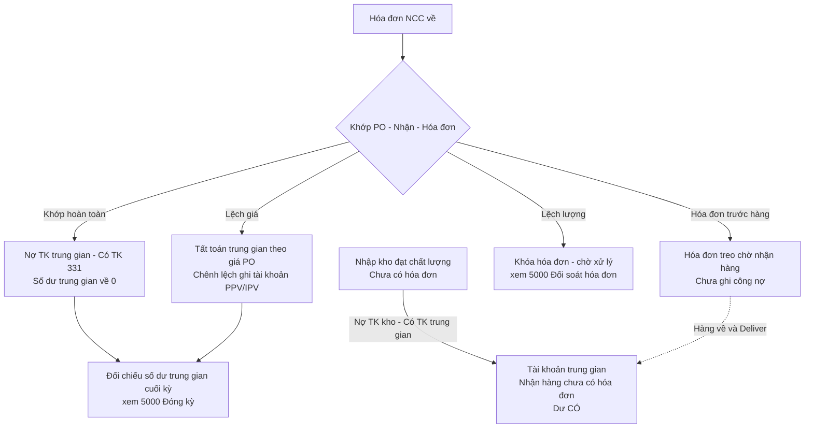

# 1000 Hạch toán & tài khoản trung gian

Đây là **bài gốc** về tài khoản trung gian. Mọi bài khác (nhận hàng, đối soát hóa đơn, AP, giá vốn, đóng kỳ) chỉ được **dẫn link** về đây, không định nghĩa lại — đây là cách chống trùng và chống mâu thuẫn số hiệu tài khoản.

---

## 0. Nguyên lý (áp dụng mọi ERP)

1. **Mọi sự kiện kinh tế phải được ghi nhận đúng kỳ phát sinh, kể cả khi chứng từ chưa đủ.** Hàng đã về kho nhưng chưa có hóa đơn vẫn là tài sản của doanh nghiệp và vẫn là nghĩa vụ phải trả → phải ghi nhận ngay, không chờ hóa đơn.
2. **Nhưng chưa đủ căn cứ để ghi công nợ chính thức**, vì giá và số lượng trên hóa đơn có thể khác PO/phiếu nhận. Vì vậy cần một **tài khoản trung gian** hứng khoản chênh lệch tiềm tàng này.
3. **Tài khoản trung gian phải tự triệt tiêu về 0** khi hóa đơn khớp. Số dư khác 0 kéo dài = có giao dịch chưa hoàn tất, không phải "sai số bình thường".
4. **Số dư tài khoản trung gian là chỉ báo sức khỏe vận hành:** dư Có lớn = hàng về nhiều mà hóa đơn về chậm; dư Nợ = hóa đơn về trước hàng, hoặc chênh lệch giá chưa xử lý.
5. **Chuẩn quốc tế có sẵn khái niệm này** (GR/IR Clearing), nên khi làm với SAP/Oracle/Epicor bạn chỉ cần ánh xạ; khi tự xây bạn phải **tự thiết kế** và thống nhất với kiểm toán/thuế trước khi go-live.

## 1. Luồng vận hành



## 2. Ai làm gì ở module nào

| Bước | Mua hàng (PO) | Kho (INV) | Sản xuất (MFG) | Bán hàng (OM) | Kế toán (AP/GL) |
|---|---|---|---|---|---|
| Phát sinh khoản trung gian | Cung cấp giá PO | ✅ ghi giao dịch Deliver | — | — | ✅ sinh bút toán tự động từ sổ phụ kho |
| Khớp và tất toán | ✅ duyệt sai lệch giá/lượng | Cung cấp số lượng đã nhận | — | — | ✅ chạy matching, ghi 331 |
| Xử lý chênh lệch giá | Đàm phán lại với NCC | — | — | — | ✅ ghi PPV/IPV, không để trung gian treo |
| Đối chiếu cuối kỳ | — | — | ✅ phân tích số dư, xử lý tồn đọng |
| Cấu hình tài khoản | — | Chỉ định tài khoản kho theo nhóm vật tư | — | — | ✅ sở hữu cấu hình tài khoản trung gian |

## 3. Hạch toán

### A. Bản đồ tài khoản trung gian dùng chung (chốt tại đây)

| Nghiệp vụ | Bút toán chuẩn | Ghi chú triển khai VN | Ghi chú quốc tế |
|---|---|---|---|
| Nhập kho, chưa có hóa đơn | Nợ **152/156** — Có **TK trung gian** | TT200 **không có tài khoản chuẩn**. Thông lệ: dùng tiểu khoản chi tiết của **3388** hoặc **331** mở tiết theo PO/phiếu nhận chưa có hóa đơn. **Phải thống nhất với kiểm toán/thuế.** | GR/IR Clearing |
| Hóa đơn khớp | Nợ **TK trung gian** — Có **331** | Số dư trung gian về 0 | Invoice Receipt |
| Hóa đơn trước hàng | Nợ **TK trung gian** (chi tiết "chờ nhận hàng") — Có **331** | Khoản này là **tài sản đã mua chưa về** hoặc khoản chờ kết chuyển, không phải chi phí | GR/IR debit |
| Lệch giá khi nhận (giá tiêu chuẩn) | Nợ **152** theo giá chuẩn; phần lệch ghi **PPV** — Có **TK trung gian** theo giá PO | Tách riêng, không gộp vào giá trị kho | Purchase Price Variance |
| Lệch giá khi có hóa đơn | Nợ **TK trung gian** theo giá PO; phần lệch ghi **IPV** — Có **331** theo giá hóa đơn | Không để trung gian treo phần lệch | Invoice Price Variance |
| Trả lại hàng NCC | Nợ **TK trung gian/331** — Có **152** | Đảo bút toán nhập kho tương ứng phần trả | RTV reversal |

> **Quan trọng:** trong toàn bộ tài liệu này, **chỉ bảng trên** là nơi định nghĩa tài khoản trung gian. Các bài [4000 Nhận hàng](../2-mua-hang/4000-nhan-hang-va-kiem-qc.md), [5000 Đối soát hóa đơn](../2-mua-hang/5000-doi-soat-hoa-don-va-3-way-match.md), [AP 1000](../5-cong-no/ap/1000-ap-nguyen-ly-va-tai-khoan.md) đều dẫn về đây.

### B. Nguyên tắc tất toán

1. Tất toán theo **từng dòng chứng từ**, không tất toán gộp theo nhà cung cấp — nếu không, không thể truy vết khoản treo thuộc PO nào.
2. Tất toán đúng **giá trị đã ghi nhận ở phiếu nhận**, phần lệch đẩy sang tài khoản chênh lệch đã cấu hình.
3. Chênh lệch tỷ giá (PO ngoại tệ) **không** ghi vào tài khoản trung gian, mà ghi vào lãi/lỗ tỷ giá — xem [Đối trừ công nợ, netting & đa tiền tệ](../5-cong-no/8000-cong-no-doi-tru-netting-va-tien-te.md).
4. Thuế GTGT đầu vào **không** đi qua tài khoản trung gian; chỉ so khớp trên giá trị trước thuế — xem [3000 Thuế & tài sản cố định](./3000-thue-va-tai-san-co-dinh.md).

## 4. Điểm chạm & rủi ro

- Thiết kế tài khoản thực tế khi triển khai → [Cách đọc tài liệu](../0-nen-tang/0000-cach-doc-tai-lieu.md) và [2000 Tổ chức & Pháp nhân](../0-nen-tang/1000-to-chuc-va-phap-nhan.md).
- Sinh bút toán nhận hàng → [4000 Nhận hàng & kiểm tra chất lượng](../2-mua-hang/4000-nhan-hang-va-kiem-qc.md).
- Khớp lệnh và tất toán → [5000 Đối soát hóa đơn & 3-Way Match](../2-mua-hang/5000-doi-soat-hoa-don-va-3-way-match.md).
- Đối chiếu số dư trung gian cuối kỳ → [5000 Đóng kỳ & đối soát sổ phụ](./5000-dong-ky-va-doi-soat-so-phu.md).
- **Rủi ro chính:** (1) chọn 3388 cho tất cả khoản trung gian làm lẫn với phải trả khác; (2) tất toán gộp theo NCC làm mất truy vết; (3) không tách PPV/IPV làm trung gian treo vĩnh viễn.

## 5. Triển khai tham chiếu ERP

| Nội dung | Oracle EBS R12 | Epicor ERP | SAP S/4HANA | Odoo |
|---|---|---|---|---|
| Bút toán nhận hàng chưa hóa đơn | Subledger Accounting (SLA) + `Receiving Inspection Account` / `AP Accrual` | `COS/WIP` + GL Control Account theo Product Group | GR/IR Clearing Account (WRX) | Stock Interim (Received) |
| Bút toán hóa đơn | `Payables > Invoices` tạo SLA entry | `AP Invoice Entry` → Post | MIRO → Nợ WRX / Có Kreditor | Vendor Bill → Product Category accounts |
| Tài khoản chênh lệch giá | `IPV Account` trong Purchasing Options | `PPV Account` trên Product Group | Price Difference (PRD) | Price Difference Account |
| Đối chiếu số dư | GR/IR Clearing Report | AP/GL Reconciliation | MR11 (GR/IR maintenance) | Feature phụ trợ / tùy biến |

**Truy vấn kiểm soát (Epicor — nhận hàng chưa có hóa đơn):**

```sql
SELECT rd.Company, rd.PONum, rd.POLine, rd.PartNum,
       rd.OurQty AS QtyReceived, rd.ReceiptDate,
       DATEDIFF(DAY, rd.ReceiptDate, GETDATE()) AS DaysOpen
FROM Erp.RcvDtl rd
WHERE rd.Company = 'YOUR_COMPANY_CODE'
  AND rd.Invoiced = 0
  AND rd.Voided = 0
ORDER BY DaysOpen DESC;
```

**Truy vấn kiểm soát (Oracle EBS — GR/IR chưa khớp):**

```sql
SELECT pha.segment1 AS po_number, pla.line_num AS po_line,
       rt.quantity AS qty_received, rsh.receipt_num, rsh.receipt_date,
       ROUND(SYSDATE - rsh.receipt_date) AS days_open
FROM rcv_transactions rt
JOIN rcv_shipment_headers rsh ON rt.shipment_header_id = rsh.shipment_header_id
JOIN rcv_shipment_lines rsl ON rt.shipment_line_id = rsl.shipment_line_id
JOIN po_lines_all pla ON rsl.po_line_id = pla.po_line_id
JOIN po_headers_all pha ON pla.po_header_id = pha.po_header_id
WHERE rt.transaction_type = 'DELIVER'
  AND NOT EXISTS (
      SELECT 1 FROM ap_invoice_lines_all ail
      WHERE ail.rcv_transaction_id = rt.transaction_id
  )
ORDER BY days_open DESC;
```

## 6. Bẫy thực chiến & Checklist

| # | Bẫy | Triệu chứng | Cách phòng tránh |
|---|---|---|---|
| 1 | Dùng một tiểu khoản 3388 cho mọi khoản trung gian | Không phân biệt được "nhận hàng chưa hóa đơn" với "phải trả khác" | Mở tiết riêng, đặt tên rõ, gắn dimension PO/phiếu nhận |
| 2 | Tất toán gộp theo nhà cung cấp | Số dư trung gian về 0 nhưng không biết khoản nào còn treo | Tất toán theo dòng chứng từ |
| 3 | Ghi nhận công nợ 331 ngay khi nhập kho | Khi hóa đơn lệch giá phải sửa lại 331, mất audit trail | Dùng tài khoản trung gian, không dùng 331 |
| 4 | Chênh lệch giá không được hạch toán | Trung gian treo vĩnh viễn, cân đối kho và GL lệch | Cấu hình PPV/IPV và xử lý khi duyệt hóa đơn |
| 5 | Gộp chênh lệch tỷ giá vào chênh lệch giá | Báo cáo giá vốn sai, sai bản chất chi phí | Tách tài khoản lãi/lỗ tỷ giá |
| 6 | Không có báo cáo tuổi khoản trung gian | Khoản treo 1 năm chỉ phát hiện khi kiểm toán | Đưa báo cáo "GR/IR aging" vào checklist đóng kỳ |

**Checklist trước go-live:**

- [ ] Đã thống nhất bằng văn bản với kiểm toán/kế toán trưởng về tài khoản trung gian sử dụng.
- [ ] Đã tách tài khoản PPV (khi nhận) và IPV (khi có hóa đơn).
- [ ] Đã tách tài khoản chênh lệch tỷ giá.
- [ ] Báo cáo tuổi số dư trung gian đã có và nằm trong checklist đóng kỳ.
- [ ] Đã chạy thử kịch bản: nhận trước → hóa đơn lệch giá → tất toán về 0 + ghi IPV.

## Xem thêm

- [4000 - Nhận hàng & kiểm tra chất lượng](../2-mua-hang/4000-nhan-hang-va-kiem-qc.md)
- [5000 - Đối soát hóa đơn & 3-Way Match](../2-mua-hang/5000-doi-soat-hoa-don-va-3-way-match.md)
- [AP 1000 - Nguyên lý & tài khoản](../5-cong-no/ap/1000-ap-nguyen-ly-va-tai-khoan.md)
- [2000 - Giá vốn & định giá tồn kho](./2000-gia-von-va-dinh-gia-ton-kho.md)
- [5000 - Đóng kỳ & đối soát sổ phụ](./5000-dong-ky-va-doi-soat-so-phu.md)

<div align="center" style={{color: 'var(--ifm-color-primary)'}}>
  <strong>Chúc các bạn thành công và vui vẻ!</strong>
</div>
