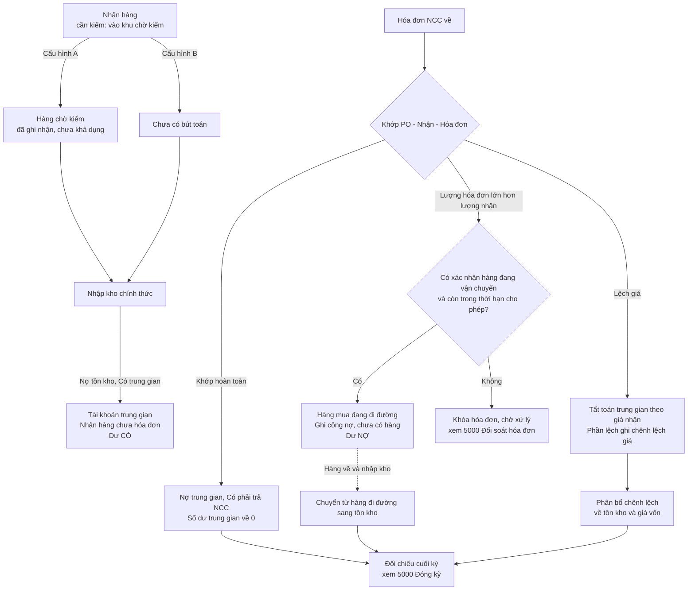
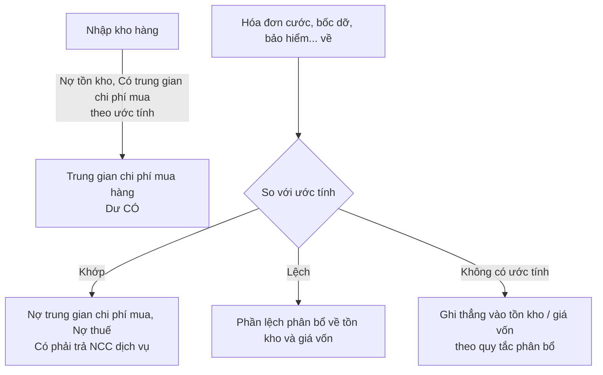

# 1000 Hạch toán & tài khoản trung gian

Đây là **bài gốc** về các tài khoản trung gian. Mọi bài khác (nhận hàng, đối soát hóa đơn, AP, kho, giá vốn, đóng kỳ) chỉ **dẫn link** về đây và không định nghĩa lại. Đó là cách chống trùng và chống mâu thuẫn trong cách hạch toán.

> **Về số hiệu tài khoản:** bài này định nghĩa tài khoản **theo chức năng** (ví dụ "tài khoản nhận hàng chưa hóa đơn"). Số hiệu cụ thể phụ thuộc hệ thống tài khoản doanh nghiệp đang áp dụng. Từ năm tài chính bắt đầu từ 01/01/2026, chế độ kế toán doanh nghiệp theo Thông tư 99/2025/TT-BTC (thay Thông tư 200/2014). Cột "số hiệu tham khảo" chỉ là thông lệ cũ, **phải được kế toán trưởng đối chiếu với Phụ lục tài khoản hiện hành** trước khi cấu hình vào ERP.
>
> **Về thuế và hóa đơn:** các ghi chú về thuế GTGT, hóa đơn điều chỉnh, hóa đơn trả hàng chỉ nêu nguyên tắc vận hành, **không trích điều khoản cụ thể**. Cách xử lý phải được kế toán trưởng hoặc chuyên gia thuế xác nhận theo quy định hóa đơn, chứng từ và thuế hiện hành.

---

## 0. Nguyên lý (áp dụng mọi ERP)

1. **Sự kiện kinh tế phải được ghi nhận đúng kỳ phát sinh, kể cả khi chứng từ chưa đủ.** Hàng đã về nhưng chưa có hóa đơn vẫn là tài sản của doanh nghiệp và vẫn là nghĩa vụ phải trả, nên phải ghi nhận ngay, không chờ hóa đơn.
2. **Chưa đủ căn cứ để ghi công nợ chính thức.** Giá và số lượng trên hóa đơn có thể khác PO và phiếu nhận. Vì vậy cần một **tài khoản trung gian** hứng khoản chưa chốt này.
3. **Tài khoản trung gian phải tự triệt tiêu về 0** khi hóa đơn khớp. Số dư khác 0 kéo dài là dấu hiệu có giao dịch chưa hoàn tất, không phải "sai số bình thường".
4. **Số dư tài khoản trung gian là chỉ báo vận hành, và mỗi chiều có một tài khoản riêng:**
   - **Trung gian nhận hàng chưa hóa đơn, dư Có:** hàng về nhiều, hóa đơn về chậm.
   - **Hàng mua đang đi đường, dư Nợ:** hóa đơn về trước, hàng chưa về (đã có xác nhận hàng đang vận chuyển).
   - **Dư Nợ bất thường của tài khoản trung gian nhận hàng chưa hóa đơn:** hóa đơn vượt số đã nhận mà chưa được phân loại (chưa xác nhận đi đường), hoặc chênh lệch giá chưa xử lý. Đây là khoản **phải điều tra**, không phải trạng thái bình thường.
5. **Giá tiêu chuẩn là công cụ vận hành, không phải kết quả cuối cùng.** ERP có thể nhận hàng theo giá tiêu chuẩn và tách PPV/IPV, nhưng báo cáo theo chế độ kế toán cần giá thực tế. Cuối kỳ, chênh lệch phải được **phân bổ** về tồn kho và giá vốn (xem [2000](./2000-gia-von-va-dinh-gia-ton-kho.md)); không được để treo thành một tài khoản chi phí vĩnh viễn. **Điều kiện để dùng giá tiêu chuẩn:** giá chuẩn phải xấp xỉ giá thực tế, được rà soát định kỳ (ít nhất mỗi kỳ hoặc khi PPV/IPV vượt ngưỡng) và cập nhật khi lệch đáng kể, theo chuẩn mực kế toán về hàng tồn kho hiện hành. Giá chuẩn lệch xa thực tế khiến việc phân bổ cuối kỳ biến thành điều chỉnh lớn.
6. **Hai chiều lệch pha, hai tài khoản khác nhau.** Hàng về trước hóa đơn là một chiều (nghĩa vụ chưa có chứng từ); hóa đơn về trước hàng là chiều ngược lại (có công nợ, chưa có hàng). Không gộp hai chiều vào một tài khoản vì số dư sẽ bù trừ và che mất vấn đề.
7. **Chi phí mua hàng (cước, bốc dỡ, bảo hiểm, thuế nhập khẩu...) là một luồng trung gian thứ ba.** Hóa đơn của các chi phí này thường về sau hàng nhiều ngày hoặc nhiều tuần, nên cũng cần ghi ước tính và tất toán riêng, không trộn với khoản tiền hàng (xem mục 3F).
8. **Không bù trừ khi trình bày báo cáo tài chính.** Số dư Có và số dư Nợ của các tài khoản trung gian được trình bày riêng (xem mục 3G).
9. **Khi tự xây, phải tự thiết kế** và thống nhất bằng văn bản với kế toán trưởng và kiểm toán trước go-live. Khi dùng SAP/Oracle/Epicor/Odoo thì ánh xạ vào cơ chế có sẵn.

## 1. Luồng vận hành



**Tiêu chí phân biệt "hóa đơn trước hàng" và "lệch lượng":** cả hai đều có lượng hóa đơn lớn hơn lượng đã nhận. Chỉ được ghi **hàng mua đang đi đường** khi có bằng chứng hàng đang vận chuyển (thông báo giao hàng, vận đơn, xác nhận của bộ phận mua hàng) và chưa quá thời hạn cho phép (ví dụ 15 hay 30 ngày, do doanh nghiệp quy định). Thiếu bằng chứng, hoặc quá thời hạn, hóa đơn bị **khóa chờ xử lý** và không ghi công nợ.

Luồng của chi phí mua hàng (landed cost):



## 2. Ai làm gì ở module nào

| Bước | Mua hàng (PO) | Kho & QC | Kế toán (AP/GL) |
|---|---|---|---|
| Phát sinh khoản trung gian | Cung cấp giá PO | ✅ ghi giao dịch nhập kho chính thức ([Kho 3000](../1-kho/3000-giao-dich-nhap-xuat-chuyen.md)); QC quyết định hàng đạt hay loại | ✅ nhận bút toán tự động từ sổ phụ kho |
| Khớp và tất toán | ✅ duyệt sai lệch giá, lượng | Cung cấp số lượng đã nhận, đã nhập kho | ✅ chạy matching, ghi công nợ |
| Xử lý chênh lệch giá | Đàm phán lại với NCC | — | ✅ ghi PPV/IPV, phân bổ cuối kỳ, không để trung gian treo |
| Hóa đơn trước hàng | ✅ theo dõi giao hàng, xác nhận hàng đang vận chuyển | — | ✅ ghi hàng đi đường, theo dõi tuổi |
| Chi phí mua hàng (landed cost) | ✅ cung cấp ước tính cước, điều kiện giao hàng | Cung cấp trọng lượng, thể tích, số lượng để phân bổ | ✅ ghi ước tính, tất toán, phân bổ |
| Dịch vụ đã nhận chưa hóa đơn | ✅ xác nhận đã nghiệm thu | — | ✅ ghi chi phí phải trả, đảo khi có hóa đơn |
| Đóng sớm / hủy PO còn lệch | ✅ lập đề nghị đóng, nêu lý do | Xác nhận số lượng thực nhận | ✅ xử lý khoản treo (mục 3E) |
| Đối chiếu cuối kỳ | Giải trình các khoản treo | Giải trình hàng chờ kiểm, chờ nhập kho | ✅ phân tích số dư, xử lý tồn đọng |
| Cấu hình tài khoản | — | Chỉ định tài khoản kho theo nhóm vật tư | ✅ **sở hữu** cấu hình toàn bộ tài khoản trung gian |

## 3. Hạch toán

### A. Nguyên tắc đặt tài khoản

1. Mỗi chức năng một tài khoản (hoặc một tiểu khoản riêng). Danh sách chức năng nằm ở bảng B.
2. **Khoản "nhận hàng chưa hóa đơn" mặc định đặt ở tài khoản phải trả khác, mở chi tiết riêng,** không đặt trong phải trả người bán. Lý do: số dư phải trả người bán chỉ chứa nợ đã có hóa đơn, nên đối chiếu số dư với nhà cung cấp khớp. Đổi lại cần quy tắc trình bày trên báo cáo tài chính (mục 3G). Phương án thay thế (dùng chi tiết của phải trả người bán với giá tạm tính) cũng dùng được nếu kế toán trưởng chọn và ghi vào tài liệu thiết kế; điều quan trọng là **chọn một và nhất quán**.
3. Thuế GTGT đầu vào **không đi qua tài khoản trung gian.** Hàng về chưa hóa đơn thì chưa ghi thuế; thuế chỉ ghi khi có hóa đơn hợp lệ. Đối soát chỉ so khớp trên giá trị trước thuế (xem [3000](./3000-thue-va-tai-san-co-dinh.md)).
4. **Trung gian chi phí mua hàng là tài khoản riêng**, tách khỏi trung gian nhận hàng chưa hóa đơn (nguyên lý 7), vì đối tượng đối chiếu khác nhau (NCC hàng và NCC dịch vụ vận chuyển, hải quan, bảo hiểm).

### B. Bản đồ bút toán (chốt tại đây)

| # | Nghiệp vụ | Bút toán (theo chức năng) | Số hiệu tham khảo `*` | Ghi chú |
|---|---|---|---|---|
| 1 | Nhập kho chính thức, chưa có hóa đơn (hàng đạt) | Nợ **tồn kho** — Có **trung gian nhận hàng chưa hóa đơn** | 152/156 — phải trả khác chi tiết (hoặc phải trả người bán chi tiết) | Cấu hình B; với cấu hình A xem mục C |
| 2 | Hóa đơn khớp hoàn toàn | Nợ **trung gian** + Nợ **thuế GTGT đầu vào** — Có **phải trả người bán** | 133 — 331 | Số dư trung gian của dòng đó về 0 |
| 3 | Lệch giá, dùng **giá tiêu chuẩn** khi nhận | Nợ **tồn kho** theo giá chuẩn, phần lệch ghi **PPV** — Có **trung gian** theo giá PO | | PPV phát sinh lúc nhận |
| 4 | Lệch giá khi có hóa đơn (**giá tiêu chuẩn**) | Nợ **trung gian** theo giá đã ghi lúc nhận; Nợ/Có **IPV** theo phần lệch; Nợ **thuế** — Có **phải trả người bán** theo giá hóa đơn | | IPV phát sinh lúc có hóa đơn |
| 5 | Lệch giá khi có hóa đơn (**giá thực tế**, bình quân) | Nợ **trung gian**; Nợ/Có **tồn kho** (hoặc **giá vốn** nếu hàng đã xuất) theo phần lệch; Nợ **thuế** — Có **phải trả người bán** | | Không cần tài khoản IPV riêng |
| 6 | **Hóa đơn trước hàng** (có xác nhận hàng đang vận chuyển) | Nợ **hàng mua đang đi đường** + Nợ **thuế GTGT đầu vào** (hoặc **thuế chờ khấu trừ**, xem ghi chú) — Có **phải trả người bán** | 151 — 133 — 331 | Khi hàng về: Nợ **tồn kho** — Có **hàng đang đi đường** (và không tạo thêm trung gian). **Thuế:** nếu hóa đơn xuất sớm hơn thời điểm chuyển giao và chưa đủ điều kiện khấu trừ theo quy định hiện hành, theo dõi ở tiểu khoản **thuế đầu vào chờ khấu trừ**, chuyển sang thuế khấu trừ khi đủ điều kiện |
| 7 | Trả hàng NCC **trước** khi có hóa đơn | Nợ **trung gian** — Có **tồn kho** | | Giảm khoản nhận chưa hóa đơn |
| 8 | Trả hàng NCC **sau** khi hóa đơn đã khớp | Nợ **phải trả người bán** — Có **tồn kho** và đảo **thuế**, đảo chênh lệch giá nếu có | | Cách đảo thuế phụ thuộc hình thức chứng từ (NCC xuất hóa đơn điều chỉnh/giảm, hay bên mua lập chứng từ trả hàng theo quy định). **Không hard-code**: ghi theo chứng từ thực tế và đã được kế toán trưởng/chuyên gia thuế xác nhận cho từng trường hợp |
| 9 | Dịch vụ đã nghiệm thu, chưa hóa đơn | Nợ **chi phí** (hoặc tài sản) — Có **chi phí phải trả** | 335 | Đảo khi có hóa đơn, rồi ghi như hóa đơn thường |
| 10 | Chuyển kho giữa hai pháp nhân, hoặc khác tài khoản tồn kho | Nợ **tồn kho bên nhận** (hoặc phải thu / phải trả nội bộ) — Có **tồn kho bên chuyển** | | Chỉ phát sinh khi đổi pháp nhân hoặc đổi tài khoản; xem [Kho 3000](../1-kho/3000-giao-dich-nhap-xuat-chuyen.md) |
| 11 | Chuyển kho có hàng đang vận chuyển | Nợ **hàng chuyển đang đi đường** — Có **tồn kho bên chuyển**; khi nhận: Nợ **tồn kho bên nhận** — Có **hàng chuyển đang đi đường** | | Hàng đi đường nội bộ, khác hàng mua đang đi đường |
| 12 | Drop-ship (không qua kho) | Không có bút toán tồn kho. Trung gian và giá vốn ghi theo luồng nghiệp vụ mua và bán | | Giao dịch kho ảo, xem [Kho 3000](../1-kho/3000-giao-dich-nhap-xuat-chuyen.md) |
| 13 | Điều chỉnh kiểm kê | Thiếu: Nợ **thiếu chờ xử lý** — Có **tồn kho**. Thừa: Nợ **tồn kho** — Có **thừa chờ xử lý** | | Sau duyệt; xử lý khoản chờ theo [5000](./5000-dong-ky-va-doi-soat-so-phu.md) và [Kho 5000](../1-kho/5000-kiem-ke-va-dieu-chinh.md) |
| 14 | Nhập kho, **ước tính chi phí mua hàng** (cước, bốc dỡ, bảo hiểm, thuế nhập khẩu phải nộp...) | Nợ **tồn kho** — Có **trung gian chi phí mua hàng** theo số ước tính | | Chỉ áp dụng khi doanh nghiệp chọn ghi ước tính; xem mục F |
| 15 | Hóa đơn chi phí mua hàng về | Nợ **trung gian chi phí mua hàng** (đúng bằng số ước tính) + Nợ **thuế** — Có **phải trả NCC dịch vụ**; phần lệch (nhiều hoặc ít hơn ước tính): Nợ/Có **tồn kho** (hoặc **giá vốn** nếu hàng đã xuất) | | Không có ước tính trước: ghi thẳng Nợ **tồn kho/giá vốn** theo quy tắc phân bổ. Giá tiêu chuẩn: phần lệch ghi tài khoản chênh lệch chi phí mua, phân bổ cuối kỳ |
| 16 | Tất toán trung gian chi phí mua hàng treo (không còn hóa đơn nào sẽ về) | Nợ/Có **trung gian chi phí mua hàng** — Có/Nợ **tồn kho / giá vốn** (hoặc chi phí) | | Phải có chứng từ, lý do, người duyệt (mục E) |

`*` Số hiệu là thông lệ theo hệ thống tài khoản cũ, **chỉ để định hướng**; xác nhận lại với Phụ lục hiện hành.

> **Quan trọng:** trong toàn bộ tài liệu, chỉ bảng này định nghĩa cách hạch toán các khoản trung gian. Các bài [Nhận hàng](../2-mua-hang/4000-nhan-hang-va-kiem-qc.md), [Đối soát hóa đơn](../2-mua-hang/5000-doi-soat-hoa-don-va-3-way-match.md), [AP 1000](../5-cong-no/ap/1000-ap-nguyen-ly-va-tai-khoan.md) đều dẫn về đây.

### C. Hai cấu hình ghi nhận khi nhận hàng cần kiểm

Chi tiết nghiệp vụ nằm ở [4000 Nhận hàng](../2-mua-hang/4000-nhan-hang-va-kiem-qc.md). Phần hạch toán:

| Sự kiện | Cấu hình A: ghi nhận khi nhận | Cấu hình B: ghi nhận khi nhập kho |
|---|---|---|
| **Nhận vào khu chờ kiểm** | Nợ **hàng chờ kiểm** — Có **trung gian**. Hàng thuộc tài sản nhưng không khả dụng | Không có bút toán |
| **Nhập kho chính thức (hàng đạt)** | Nợ **tồn kho** — Có **hàng chờ kiểm** | Nợ **tồn kho** — Có **trung gian** (bút toán #1) |
| **Hàng bị loại, trả NCC (chưa hóa đơn)** | Đảo: Nợ **trung gian** — Có **hàng chờ kiểm** | Không có gì để đảo |
| **Hàng bị loại, huỷ hoặc đặc cách** | Theo quyết định xử lý: huỷ ghi chi phí/đòi bồi thường; đặc cách thì nhập kho như hàng đạt | Như bên trái nhưng bắt đầu từ lúc nhập kho |
| **Cuối kỳ còn hàng chờ kiểm** | Đã có trong sổ; cần đối chiếu tài khoản hàng chờ kiểm | **Cần bút toán cắt kỳ** để ghi nhận hàng đã nhận chưa nhập kho |

**Quy tắc chung:** cấu hình được chọn một lần, kế toán trưởng ký duyệt, ghi vào tài liệu thiết kế; không cho mỗi kho tự chọn. Hàng chờ kiểm và hàng bị loại **không khả dụng** dù có được ghi nhận về giá trị hay không.

### D. Ví dụ số

PO 100 cái, giá 10. Nhận và nhập kho 100 cái. Hóa đơn giá **11**, thuế 10%.

**Trường hợp 1 — giá tiêu chuẩn = 10 (không có PPV):**

| Bước | Bút toán |
|---|---|
| Nhập kho | Nợ tồn kho 1.000 — Có trung gian 1.000 |
| Hóa đơn | Nợ trung gian 1.000; Nợ IPV 100; Nợ thuế 110 — Có phải trả người bán 1.210 |
| Cuối kỳ | Phân bổ IPV 100 về tồn kho và giá vốn theo tỷ lệ hàng còn lại và hàng đã bán |

**Trường hợp 2 — giá tiêu chuẩn = 9 (có PPV khi nhận):**

| Bước | Bút toán |
|---|---|
| Nhập kho | Nợ tồn kho 900; Nợ PPV 100 — Có trung gian 1.000 |
| Hóa đơn | Nợ trung gian 1.000; Nợ IPV 100; Nợ thuế 110 — Có phải trả người bán 1.210 |
| Cuối kỳ | Phân bổ PPV 100 và IPV 100 về tồn kho và giá vốn |

**Trường hợp 3 — giá thực tế (bình quân):**

| Bước | Bút toán |
|---|---|
| Nhập kho | Nợ tồn kho 1.000 — Có trung gian 1.000 |
| Hóa đơn | Nợ trung gian 1.000; Nợ tồn kho 100 (hoặc giá vốn nếu đã xuất); Nợ thuế 110 — Có phải trả người bán 1.210 |
| Cuối kỳ | Không cần phân bổ thêm, chênh lệch đã nằm trong giá trị tồn kho / giá vốn |

Sau hóa đơn, số dư trung gian của dòng PO này về 0 ở cả ba trường hợp.

**Trường hợp 4 — chi phí mua hàng (giá thực tế), ước tính cước 50, hóa đơn cước về sau là 60, thuế suất giả định 10%:**

| Bước | Bút toán |
|---|---|
| Nhập kho (tiền hàng) | Nợ tồn kho 1.000 — Có trung gian nhận hàng chưa hóa đơn 1.000 |
| Nhập kho (ước tính cước) | Nợ tồn kho 50 — Có trung gian chi phí mua hàng 50 |
| Hóa đơn cước | Nợ trung gian chi phí mua hàng 50; Nợ tồn kho 10 (hoặc giá vốn nếu đã xuất); Nợ thuế 6 — Có phải trả NCC vận chuyển 66 |

Sau hóa đơn cước, số dư trung gian chi phí mua hàng của lô này về 0. Phần lệch 10 nằm trong giá trị tồn kho / giá vốn, không cần tài khoản riêng.

### E. Nguyên tắc tất toán và theo dõi

1. Tất toán theo **từng dòng chứng từ** (PO + dòng + phiếu nhận), không tất toán gộp theo nhà cung cấp, nếu không sẽ không truy vết được khoản treo thuộc PO nào.
2. Tất toán đúng **giá trị đã ghi nhận ở phiếu nhận**; phần lệch đẩy sang tài khoản chênh lệch đã cấu hình rồi được phân bổ cuối kỳ.
3. **Ngoại tệ:** chênh lệch tỷ giá (PO ngoại tệ) **không** ghi vào tài khoản trung gian mà ghi vào lãi/lỗ tỷ giá, xem [Đối trừ công nợ, netting & đa tiền tệ](../5-cong-no/8000-cong-no-doi-tru-netting-va-tien-te.md). Với số dư nhận hàng chưa hóa đơn bằng ngoại tệ: khoản này là nghĩa vụ phải trả bằng ngoại tệ nên thông thường được **đánh giá lại cuối kỳ** như khoản mục tiền tệ có gốc ngoại tệ; chênh lệch ghi lãi/lỗ tỷ giá, **không điều chỉnh giá trị tồn kho đã nhận**. Kế toán trưởng chốt chính sách này bằng văn bản; đánh giá lại và đảo ngược đầu kỳ sau phải chạy theo từng dòng chứng từ.
4. **Tuổi khoản treo:** khoản nhận chưa hóa đơn (và trung gian chi phí mua hàng) quá hạn quy định (ví dụ 60 hay 90 ngày) phải đưa vào danh sách xử lý. Nguyên nhân có thể là hóa đơn thất lạc, NCC chưa xuất, giá chưa chốt hoặc hàng đã trả mà chưa đảo.
5. **Không tự động xóa khoản treo.** Mọi bút toán tất toán thủ công hay xử lý khoản treo lâu phải có chứng từ, lý do và người duyệt.
6. **PO đã đóng (short close / cancel / force close) nhưng còn lệch Nhận - Hóa đơn:** nguyên nhân thường là nhận thừa do dung sai bao bì mà NCC không tính tiền, hoặc hàng hỏng sau nhận và hai bên thỏa thuận không xuất hóa đơn phần đó. Quy trình:
   - Báo cáo kiểm soát (mục 5) **không được ẩn** các dòng này; phải đánh dấu "PO đã đóng, còn lệch".
   - Mua hàng xác nhận lý do và có thỏa thuận với NCC (nếu cần); kế toán lập bút toán **write-off** có chứng từ, lý do, người duyệt:
     - NCC không tính tiền phần nhận thừa: ghi giảm trung gian đối ứng giảm giá trị tồn kho (hoặc ghi nhận thu nhập khác nếu hàng không còn trong kho, theo chính sách đã duyệt).
     - Hàng hỏng, không xuất hóa đơn: đối ứng giảm giá trị tồn kho đã ghi tương ứng, hoặc chi phí/khoản đòi bồi thường nếu có.
   - Sau write-off, dòng PO đó phải về 0 ở cả trung gian và báo cáo kiểm soát.

### F. Chi phí mua hàng (landed cost)

1. **Phạm vi:** cước vận chuyển, bốc dỡ, bảo hiểm, phí thông quan, thuế nhập khẩu và các chi phí trực tiếp đưa hàng về địa điểm và trạng thái hiện tại, theo chuẩn mực hàng tồn kho. Thuế GTGT hàng nhập khẩu và các khoản được hoàn lại không thuộc giá trị hàng.
2. **Hai cách ghi, chọn một cho từng nhóm chi phí và ghi vào thiết kế:**
   - **Ghi ước tính khi nhập kho** (bút toán #14), tất toán khi hóa đơn về (#15). Phù hợp khi chi phí lớn, dự báo được (cước theo bảng giá, thuế nhập khẩu theo tờ khai).
   - **Ghi khi hóa đơn về** (không ước tính): chi phí được phân bổ vào tồn kho và giá vốn tại thời điểm đó; hàng đã xuất thì phần tương ứng vào giá vốn.
3. **Quy tắc phân bổ về từng dòng hàng**, thống nhất theo nhóm chi phí: theo giá trị, số lượng, trọng lượng hoặc thể tích. Quy tắc phải cố định và có ghi trong thiết kế; không đổi giữa chừng cho cùng một lô.
4. **Một hóa đơn chi phí có thể phục vụ nhiều phiếu nhận** (một container nhiều PO). Hệ thống phải cho phép gắn một hóa đơn chi phí vào nhiều phiếu nhận và phân bổ, nếu không trung gian chi phí mua hàng sẽ treo.
5. **Hóa đơn chi phí quá lệch so với ước tính** (vượt ngưỡng do doanh nghiệp quy định) phải được mua hàng duyệt trước khi tất toán.
6. Trung gian chi phí mua hàng chịu **cùng quy tắc tuổi khoản treo và tất toán** như mục E; đây là tài khoản dễ treo vĩnh viễn nhất khi không có báo cáo tuổi.

### G. Trình bày báo cáo tài chính

1. **Không bù trừ** số dư Nợ và số dư Có của các tài khoản trung gian khi lập báo cáo tài chính cuối kỳ.
2. **Số dư Có** (nhận hàng chưa hóa đơn, trung gian chi phí mua hàng, chi phí phải trả dịch vụ): trình bày ở **nợ phải trả**, cùng nhóm phải trả người bán hoặc chi phí phải trả, tùy phương án đã chốt ở mục A.2 và theo hướng dẫn trình bày hiện hành.
3. **Số dư Nợ** (hàng mua đang đi đường, hàng chờ kiểm theo cấu hình A): trình bày ở **tài sản**, thuộc hàng tồn kho.
4. **Thuế đầu vào chờ khấu trừ** (nếu có) trình bày theo đúng tính chất thuế, không gộp vào hàng tồn kho.
5. Số dư Nợ bất thường của trung gian nhận hàng chưa hóa đơn (nguyên lý 4) phải được phân loại và giải trình trước khi lập báo cáo, không đẩy thẳng ra báo cáo.

## 4. Điểm chạm & rủi ro

- Cơ cấu tổ chức, pháp nhân, sổ cái → [Nền tảng 1000 Tổ chức & pháp nhân](../0-nen-tang/1000-to-chuc-va-phap-nhan.md).
- Sinh bút toán nhận hàng và hai cấu hình ghi nhận → [4000 Nhận hàng & kiểm tra chất lượng](../2-mua-hang/4000-nhan-hang-va-kiem-qc.md).
- Khớp lệnh và tất toán → [5000 Đối soát hóa đơn & 3-Way Match](../2-mua-hang/5000-doi-soat-hoa-don-va-3-way-match.md).
- Giao dịch kho sinh bút toán (chuyển kho, drop-ship, điều chỉnh) → [Kho 3000](../1-kho/3000-giao-dich-nhap-xuat-chuyen.md).
- Phân bổ chênh lệch giá và chi phí mua hàng về tồn kho và giá vốn → [2000 Giá vốn & định giá tồn kho](./2000-gia-von-va-dinh-gia-ton-kho.md).
- Đối chiếu số dư trung gian cuối kỳ → [5000 Đóng kỳ & đối soát sổ phụ](./5000-dong-ky-va-doi-soat-so-phu.md).
- **Rủi ro chính:** (1) không chốt rõ khoản nhận chưa hóa đơn nằm ở phải trả người bán hay phải trả khác, dẫn tới đối chiếu NCC lệch; (2) gộp hai chiều lệch pha (hàng trước hóa đơn, hóa đơn trước hàng) vào một tài khoản; (3) để PPV/IPV treo thành chi phí vĩnh viễn thay vì phân bổ; (4) tất toán gộp theo NCC làm mất truy vết; (5) cấu hình ghi nhận khi nhận / khi nhập kho không thống nhất giữa các kho; (6) dùng số hiệu cũ mà chưa đối chiếu hệ thống tài khoản hiện hành; (7) trung gian chi phí mua hàng treo vĩnh viễn; (8) ghi thuế đầu vào khi hóa đơn xuất sớm mà chưa đủ điều kiện khấu trừ; (9) bù trừ số dư Nợ - Có khi lập báo cáo.

## 5. Triển khai tham chiếu ERP

> **Lưu ý:** cấu hình tài khoản và tên báo cáo thay đổi theo phiên bản. Ô đánh dấu `*` cần xác nhận trên hệ thống thật.

| Nội dung | Oracle EBS R12 | Epicor ERP | SAP S/4HANA | Odoo |
|---|---|---|---|---|
| Trung gian nhận hàng chưa hóa đơn | Tài khoản Receiving Inspection (hàng chờ kiểm) và AP Accrual (nhận chưa hóa đơn), qua Subledger Accounting | Tài khoản nhận chưa hóa đơn theo cấu hình GL control `*` | GR/IR Clearing Account (khóa giao dịch WRX) | Stock Interim (Received) |
| Bút toán hóa đơn | `Payables > Invoices`, sinh bút toán qua SLA | AP Invoice Entry rồi Post | MIRO: Nợ GR/IR — Có nhà cung cấp | Vendor Bill theo tài khoản của Product Category |
| Chênh lệch giá | Tài khoản PPV và IPV (vị trí cấu hình theo phiên bản) `*` | PPV theo cấu hình `*` | Price Difference (khóa giao dịch PRD) | Price Difference Account |
| Hóa đơn trước hàng | Hóa đơn chờ nhận hàng (matching hold) `*` | `*` | MIRO có thể ghi trước, nằm trong GR/IR dư Nợ | Bill trước receipt |
| Chi phí mua hàng (landed cost) | Landed Cost Management `*` | `*` | Chi phí giao hàng dự kiến (planned delivery costs) trên PO, ghi vào tài khoản chênh lệch/accrual theo cấu hình `*` | Landed Costs (gắn hóa đơn chi phí vào phiếu nhận, chọn cách phân bổ) |
| Báo cáo đối chiếu | Uninvoiced Receipts Report, Accrual Reconciliation Report | Báo cáo hàng nhận chưa hóa đơn `*` | MR11 (xử lý GR/IR), MB5S (danh sách số dư GR/IR) | Báo cáo tùy biến |

### Truy vấn kiểm soát (hệ thống tự xây, lược đồ giả định)

Logic theo **số lượng**, không dựa vào sự tồn tại của dòng, để xử lý được hóa đơn một phần. Giá trị lấy theo **giá đã ghi lúc nhận** (không dùng giá PO hiện tại), có trừ **hàng trả NCC trước hóa đơn** (bút toán #7), tuổi khoản treo tính theo phần nhận còn mở (giả định hóa đơn tất toán theo thứ tự nhận cũ trước, tức FIFO). Với ERP lớn, hãy ưu tiên báo cáo chuẩn trong bảng trên hoặc áp cùng logic lên bảng giao dịch của hệ thống đó.

> Cú pháp bên dưới là **T-SQL** (SQL Server). Với PostgreSQL: thay `GETDATE()` bằng `CURRENT_DATE`, `DATEDIFF(DAY, a, b)` bằng `(b - a)`. Với cấu hình A, `Receipt_Line` gồm cả dòng nhận vào khu chờ kiểm; với cấu hình B chỉ gồm dòng nhập kho chính thức.

```sql
/* Lược đồ giả định:
   PO_Line(PO_Num, PO_Line, Item_ID, PO_Unit_Price, PO_Line_Status)
   Receipt_Line(Receipt_Line_ID, PO_Num, PO_Line, Qty_Received, Qty_Returned_Pre_Invoice,
                Receipt_Unit_Price, Receipt_Date)   -- giá đã ghi sổ lúc nhận
   Invoice_Line(Invoice_Line_ID, PO_Num, PO_Line, Qty_Invoiced, Invoice_Unit_Price, Invoice_Date) */

-- 1. Nhận chưa hóa đơn: số dư Có của trung gian, kèm tuổi khoản treo và cờ PO đã đóng
WITH rcpt AS (
    SELECT r.PO_Num, r.PO_Line, r.Receipt_Line_ID, r.Receipt_Date, r.Receipt_Unit_Price,
           r.Qty_Received - ISNULL(r.Qty_Returned_Pre_Invoice, 0) AS Qty_Net,
           SUM(r.Qty_Received - ISNULL(r.Qty_Returned_Pre_Invoice, 0))
               OVER (PARTITION BY r.PO_Num, r.PO_Line
                     ORDER BY r.Receipt_Date, r.Receipt_Line_ID
                     ROWS UNBOUNDED PRECEDING) AS Cum_Qty
    FROM Receipt_Line r
),
inv AS (
    SELECT PO_Num, PO_Line, SUM(Qty_Invoiced) AS Qty_Invoiced
    FROM Invoice_Line GROUP BY PO_Num, PO_Line
),
open_rcpt AS (
    SELECT c.*,
           CASE WHEN c.Cum_Qty - ISNULL(i.Qty_Invoiced, 0) <= 0 THEN 0
                WHEN c.Cum_Qty - ISNULL(i.Qty_Invoiced, 0) >= c.Qty_Net THEN c.Qty_Net
                ELSE c.Cum_Qty - ISNULL(i.Qty_Invoiced, 0) END AS Qty_Open
    FROM rcpt c
    LEFT JOIN inv i ON i.PO_Num = c.PO_Num AND i.PO_Line = c.PO_Line
)
SELECT p.PO_Num, p.PO_Line, p.Item_ID, p.PO_Line_Status,
       SUM(o.Qty_Open)                          AS Qty_Uninvoiced,
       SUM(o.Qty_Open * o.Receipt_Unit_Price)   AS Value_Uninvoiced,
       DATEDIFF(DAY, MIN(CASE WHEN o.Qty_Open > 0 THEN o.Receipt_Date END), GETDATE()) AS Days_Open,
       CASE WHEN p.PO_Line_Status IN ('CANCELLED', 'CLOSED')
            THEN 'PO DA DONG, CON LECH - CAN WRITE-OFF' ELSE '' END AS Warning
FROM PO_Line p
JOIN open_rcpt o ON o.PO_Num = p.PO_Num AND o.PO_Line = p.PO_Line
GROUP BY p.PO_Num, p.PO_Line, p.Item_ID, p.PO_Line_Status
HAVING SUM(o.Qty_Open) > 0
ORDER BY Days_Open DESC;

-- 2. Hóa đơn trước hàng: số dư Nợ (hàng mua đang đi đường), giá theo hóa đơn
SELECT p.PO_Num, p.PO_Line, p.Item_ID, p.PO_Line_Status,
       i.Qty_Invoiced - ISNULL(r.Qty_Net, 0) AS Qty_Invoiced_Not_Received,
       (i.Qty_Invoiced - ISNULL(r.Qty_Net, 0)) * (i.Invoice_Amount / i.Qty_Invoiced) AS Value_In_Transit
FROM PO_Line p
JOIN (SELECT PO_Num, PO_Line, SUM(Qty_Invoiced) AS Qty_Invoiced,
             SUM(Qty_Invoiced * Invoice_Unit_Price) AS Invoice_Amount
      FROM Invoice_Line GROUP BY PO_Num, PO_Line) i
  ON i.PO_Num = p.PO_Num AND i.PO_Line = p.PO_Line
LEFT JOIN (SELECT PO_Num, PO_Line,
                  SUM(Qty_Received - ISNULL(Qty_Returned_Pre_Invoice, 0)) AS Qty_Net
           FROM Receipt_Line GROUP BY PO_Num, PO_Line) r
  ON r.PO_Num = p.PO_Num AND r.PO_Line = p.PO_Line
WHERE i.Qty_Invoiced - ISNULL(r.Qty_Net, 0) > 0;
```

**Đối chiếu với sổ cái:**

- Tổng `Value_Uninvoiced` của truy vấn 1 phải bằng số dư Có của tài khoản nhận chưa hóa đơn.
- Tổng `Value_In_Transit` của truy vấn 2 chỉ khớp số dư tài khoản hàng đang đi đường **với phần đã được xác nhận hàng đang vận chuyển**; phần còn lại là hóa đơn đang bị khóa chờ xử lý (mục 1), phải liệt kê riêng.
- Chênh lệch còn lại là khoản chưa giải trình (ví dụ chênh lệch giá chưa phân bổ, bút toán thủ công, đánh giá lại ngoại tệ).
- Các dòng có cảnh báo "PO đã đóng" phải được xử lý theo mục 3E.6, không được lọc bỏ khỏi báo cáo.

## 6. Bẫy thực chiến & Checklist

| # | Bẫy | Triệu chứng | Cách phòng tránh |
|---|---|---|---|
| 1 | Không chốt khoản nhận chưa hóa đơn nằm ở đâu (phải trả người bán hay phải trả khác) | Đối chiếu số dư NCC lệch với sổ cái, hoặc phải trả khác lẫn nhiều khoản | Chọn một phương án, ghi vào tài liệu thiết kế, mở chi tiết theo PO/phiếu nhận |
| 2 | Tất toán gộp theo nhà cung cấp | Số dư trung gian về 0 nhưng không biết khoản nào còn treo | Tất toán theo dòng chứng từ |
| 3 | Gộp hóa đơn trước hàng và hàng trước hóa đơn vào một tài khoản | Số dư bù trừ, che mất cả hai vấn đề | Hàng đi đường và trung gian là hai tài khoản riêng |
| 4 | Ghi công nợ chính thức ngay khi nhập kho | Hóa đơn lệch giá phải sửa lại công nợ, mất audit trail | Dùng tài khoản trung gian cho khoản chưa có hóa đơn |
| 5 | PPV/IPV không được hạch toán | Trung gian treo vĩnh viễn, kho và GL lệch | Cấu hình PPV/IPV và xử lý khi duyệt hóa đơn |
| 6 | PPV/IPV không được phân bổ cuối kỳ | Báo cáo không theo giá thực tế; giá vốn và tồn kho sai | Quy trình phân bổ cuối kỳ về tồn kho và giá vốn |
| 7 | Gộp chênh lệch tỷ giá vào chênh lệch giá | Báo cáo giá vốn sai, sai bản chất chi phí | Tách tài khoản lãi/lỗ tỷ giá |
| 8 | Ghi thuế đầu vào khi chưa có hóa đơn hợp lệ, hoặc khi hóa đơn xuất sớm mà chưa đủ điều kiện khấu trừ | Thuế khấu trừ sai kỳ, rủi ro khi quyết toán | Chỉ ghi thuế ở bước hóa đơn; hóa đơn trước hàng thì theo dõi thuế chờ khấu trừ theo quy định hiện hành |
| 9 | Trả hàng NCC dùng chung một bút toán cho mọi trường hợp | Sai công nợ hoặc thuế khi hóa đơn đã khớp | Tách trước / sau hóa đơn (bút toán #7 và #8); với #8 ghi theo hình thức chứng từ thực tế |
| 10 | Không có báo cáo tuổi khoản trung gian | Khoản treo 1 năm chỉ phát hiện khi kiểm toán | Báo cáo tuổi nằm trong checklist đóng kỳ |
| 11 | Tự xóa khoản treo bằng bút toán thủ công | Mất truy vết, rủi ro gian lận | Bắt buộc chứng từ, lý do, người duyệt |
| 12 | Dùng số hiệu tài khoản cũ khi chưa đối chiếu hệ thống hiện hành | Báo cáo sai khoản mục, bị kiểm toán điều chỉnh | Kế toán trưởng đối chiếu từng số hiệu trước go-live |
| 13 | Không có trung gian cho chi phí mua hàng, hoặc trộn với trung gian tiền hàng | Cước về sau hàng nhiều tuần làm giá vốn kỳ trước sai; không biết khoản nào treo | Tài khoản riêng (bút toán #14–#16), báo cáo tuổi riêng |
| 14 | Báo cáo kiểm soát lọc bỏ dòng PO đã đóng | Khoản lệch của PO đã đóng biến mất khỏi báo cáo, trung gian vẫn dư | Giữ dòng, thêm cảnh báo, xử lý write-off theo mục 3E.6 |
| 15 | Giá tiêu chuẩn không được rà soát | PPV/IPV phình to, phân bổ cuối kỳ biến thành điều chỉnh lớn | Ngưỡng PPV/IPV và chu kỳ rà soát giá chuẩn (nguyên lý 5) |
| 16 | SQL đối chiếu dùng giá PO hiện tại, không trừ hàng trả trước hóa đơn | Tổng truy vấn không khớp sổ cái, nghi sai trong khi do truy vấn | Dùng giá lúc nhận, trừ #7 như mẫu mục 5 |
| 17 | Hóa đơn lượng lớn hơn nhận đều ghi hàng đi đường, không cần bằng chứng | Hàng đi đường chứa cả hóa đơn sai, hóa đơn gian | Chỉ ghi khi có xác nhận vận chuyển và trong thời hạn; còn lại khóa chờ xử lý |
| 18 | Bù trừ số dư Nợ - Có của các tài khoản trung gian khi lập báo cáo | Phải trả và hàng tồn kho đều bị trình bày thấp | Quy tắc trình bày mục 3G |
| 19 | Không đánh giá lại số dư nhận chưa hóa đơn bằng ngoại tệ | Phải trả sai giá trị cuối kỳ, lãi/lỗ tỷ giá thiếu | Chốt chính sách ở mục 3E.3, chạy theo dòng chứng từ |

**Checklist trước go-live:**

- [ ] Kế toán trưởng đã đối chiếu từng tài khoản trong bảng B với hệ thống tài khoản đang áp dụng và ký duyệt.
- [ ] Đã chốt nơi ghi khoản nhận chưa hóa đơn và cách trình bày trên báo cáo tài chính (mục 3G).
- [ ] Đã chốt cấu hình A hay B cho hàng cần kiểm (khớp [4000](../2-mua-hang/4000-nhan-hang-va-kiem-qc.md)).
- [ ] Đã chốt chính sách hóa đơn trước hàng: tiêu chí và thời hạn xác nhận hàng đang vận chuyển, hàng đi đường hay khóa chờ xử lý, điều kiện ghi thuế hoặc thuế chờ khấu trừ.
- [ ] Đã chốt cách xử lý hóa đơn khi trả hàng sau hóa đơn (bút toán #8), có xác nhận của kế toán trưởng/chuyên gia thuế.
- [ ] Đã tách PPV (khi nhận) và IPV (khi có hóa đơn), kèm quy trình phân bổ cuối kỳ.
- [ ] Đã chốt điều kiện dùng giá tiêu chuẩn, ngưỡng PPV/IPV và chu kỳ rà soát giá chuẩn.
- [ ] Đã chốt cách ghi chi phí mua hàng (ước tính hay khi hóa đơn về) và quy tắc phân bổ theo nhóm chi phí.
- [ ] Đã tách tài khoản lãi/lỗ tỷ giá và chốt chính sách đánh giá lại số dư nhận chưa hóa đơn bằng ngoại tệ.
- [ ] Báo cáo tuổi số dư trung gian (hàng và chi phí mua hàng) và hàng đi đường đã có, nằm trong checklist đóng kỳ.
- [ ] Số dư tài khoản trung gian khớp với truy vấn đối chiếu (mục 5), kể cả các dòng PO đã đóng.
- [ ] Đã có quy trình write-off khoản treo của PO đã đóng, có chứng từ, lý do và người duyệt.
- [ ] Đã chạy thử đủ 4 kịch bản ở mục 3D (giá chuẩn bằng PO, giá chuẩn khác PO, giá thực tế, có chi phí mua hàng) và kiểm tra số dư trung gian về 0.
- [ ] Đã chạy thử: hóa đơn trước hàng → hàng về → số dư hàng đi đường về 0; hóa đơn lượng lớn hơn nhận nhưng thiếu xác nhận vận chuyển → bị khóa; trả hàng trước và sau hóa đơn.

## Xem thêm

- [4000 - Nhận hàng & kiểm tra chất lượng](../2-mua-hang/4000-nhan-hang-va-kiem-qc.md)
- [5000 - Đối soát hóa đơn & 3-Way Match](../2-mua-hang/5000-doi-soat-hoa-don-va-3-way-match.md)
- [Kho 3000 - Giao dịch nhập, xuất & chuyển kho](../1-kho/3000-giao-dich-nhap-xuat-chuyen.md)
- [AP 1000 - Nguyên lý & tài khoản](../5-cong-no/ap/1000-ap-nguyen-ly-va-tai-khoan.md)
- [2000 - Giá vốn & định giá tồn kho](./2000-gia-von-va-dinh-gia-ton-kho.md)
- [5000 - Đóng kỳ & đối soát sổ phụ](./5000-dong-ky-va-doi-soat-so-phu.md)

<div align="center" style={{color: 'var(--ifm-color-primary)'}}>
  <strong>Chúc các bạn thành công và vui vẻ!</strong>
</div>