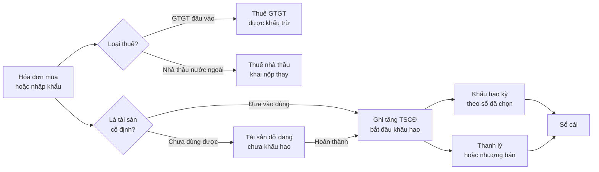

# 3000 Thuế & tài sản cố định

Hai chủ đề tưởng không liên quan nhưng cùng bị ảnh hưởng bởi một nguyên tắc: **giá trị ghi sổ không nhất thiết bằng giá trị đã trả**. Hóa đơn có thuế tách khỏi giá trị hàng; tài sản cố định không khấu hao từ ngày trả tiền mà từ ngày dùng được.

## 0. Nguyên lý (áp dụng mọi ERP)

### Thuế

1. **Thuế GTGT là thuế gián thu — doanh nghiệp không chịu, chỉ thu hộ.** Thuế đầu vào được khấu trừ với thuế đầu ra; chỉ chênh lệch mới phải nộp hoặc được hoàn.
2. **Thuế tách khỏi giá trị tài sản và chi phí.** Hàng nhập kho ghi giá trị chưa thuế; thuế vào tài khoản thuế đầu vào được khấu trừ. Gộp thuế vào giá trị hàng làm tăng giá vốn giả.
3. **Điều kiện khấu trừ phải kiểm tra trước khi ghi sổ**: hóa đơn hợp lệ, có chứng từ thanh toán không dùng tiền mặt với hóa đơn trên ngưỡng, và hàng/dịch vụ đã thực nhận.
4. **Thuế nhà thầu (thuế đối với nhà cung cấp nước ngoài) có thể do bên mua khai nộp thay.** Đây là khoản phải trả ngân sách, không phải chi phí của nhà cung cấp.
5. **Hóa đơn điện tử có yêu cầu pháp lý riêng** (mã cơ quan thuế, chữ ký số, huỷ và điều chỉnh theo quy định) — hệ thống phải lưu cả trạng thái pháp lý chứ không chỉ lưu số tiền.

### Tài sản cố định

6. **Khấu hao bắt đầu từ ngày đưa vào sử dụng, không từ ngày mua hoặc ngày nhận hóa đơn.** Tài sản mua tháng 12 dùng từ tháng 1 thì khấu hao từ tháng 1.
7. **Nguyên giá hình thành đủ thì mới bắt đầu khấu hao.** Tài sản đang lắp đặt, đang xây dựng chưa đưa vào dùng phải nằm ở tài khoản tài sản dở dang, không khấu hao.
8. **Giá trị còn lại không xuống dưới giá trị thu hồi ước tính.** Sai nguyên tắc này làm chi phí khấu hao cao giả về cuối vòng đời tài sản.
9. **Thanh lý tài sản sinh hai kết quả độc lập:** chênh lệch giữa giá bán và giá trị còn lại (lãi/lỗ thanh lý) và thuế GTGT đầu ra trên giá bán.
10. **Một tài sản có thể có nhiều sổ khấu hao** (kế toán, thuế, quản trị) với thời gian hữu dụng khác nhau. Hệ thống phải tách được, không được gộp.

## 1. Luồng vận hành



## 2. Ai làm gì ở module nào

| Việc | Mua hàng | Kho | Kế toán thuế | Kế toán TSCĐ | Ban điều hành |
|---|---|---|---|---|---|
| Cung cấp hóa đơn và thuế suất | ✅ cung cấp | — | ✅ kiểm tra và ghi nhận | — | — |
| Xác định khấu trừ thuế đầu vào | — | — | ✅ sở hữu | — | — |
| Khai nộp thuế nhà thầu | ✅ làm việc với NCC | — | ✅ sở hữu | — | — |
| Xác nhận hàng đã nhận | — | ✅ sở hữu | Đọc để kiểm điều kiện khấu trừ | — | — |
| Đưa tài sản vào sử dụng | — | ✅ nhận và bàn giao | — | ✅ sở hữu | — |
| Duyệt ghi tăng TSCĐ | — | — | — | Đề xuất | ✅ duyệt |
| Chạy khấu hao kỳ | — | — | — | ✅ sở hữu | — |
| Duyệt thanh lý | — | Xác nhận xuất tài sản | — | ✅ lập hồ sơ | ✅ duyệt |

## 3. Hạch toán

Bản đồ tài khoản ở [Hạch toán & tài khoản trung gian](./1000-hach-toan-va-tai-khoan-trung-gian.md).

### A. Điều kiện khấu trừ thuế GTGT đầu vào

Ba điều kiện phải thoả **đồng thời**:

1. Có hóa đơn GTGT hợp pháp hoặc chứng từ nộp thuế.
2. Có chứng từ thanh toán không dùng tiền mặt với hóa đơn từ ngưỡng quy định.
3. Hàng hóa, dịch vụ đã thực tế nhận (có phiếu nhận hoặc biên bản nghiệm thu).

Thiếu một điều kiện thì thuế không được khấu trừ — khoản đó trở thành chi phí hoặc giá trị tài sản.

### B. Thuế nhà thầu

Khi mua dịch vụ từ nhà cung cấp nước ngoài, doanh nghiệp Việt Nam thường phải **khai nộp thay** hai loại thuế: thuế GTGT và thuế thu nhập doanh nghiệp (hoặc thuế nhà thầu).

Điểm cần nhớ: **khoản nộp thay là nghĩa vụ của doanh nghiệp với ngân sách, không phải chi phí trả cho nhà cung cấp.** Hạch toán nhầm làm sai cả công nợ lẫn chi phí.

### C. Vòng đời tài sản cố định

| Giai đoạn | Nguyên tắc |
|---|---|
| Ghi tăng | Nguyên giá = giá mua chưa thuế + chi phí trực tiếp để đưa vào sử dụng |
| Đang lắp đặt | Nằm ở tài sản dở dang, **chưa khấu hao** |
| Đưa vào dùng | Bắt đầu khấu hao từ thời điểm này |
| Khấu hao định kỳ | Theo thời gian hữu dụng và phương pháp của từng sổ |
| Nâng cấp | Làm tăng nguyên giá nếu đủ điều kiện; nếu chỉ bảo trì thì vào chi phí kỳ |
| Thanh lý | Lãi/lỗ = giá bán − giá trị còn lại; kèm thuế GTGT đầu ra trên giá bán |

## 4. Điểm chạm & rủi ro

- **Hóa đơn đầu vào**: [AP: Nhận hóa đơn & đối tất tạm ứng](../5-cong-no/ap/2000-ap-nhan-hoa-don-va-doi-tat-tam-ung.md)
- **Hóa đơn đầu ra**: [AR: Xuất hóa đơn & hạn mức tín dụng](../5-cong-no/ar/6000-ar-xuat-hoa-don-va-han-muc-tin-dung.md)
- **Mua tài sản qua PO**: [Mô hình mua đặc thù](../2-mua-hang/6000-mo-hinh-mua-dac-thu.md)
- **Khấu hao vào giá thành**: [Giá thành sản xuất](../3-san-xuat/thuc-thi/8000-gia-thanh-san-xuat.md)
- **Đóng kỳ và khóa sổ thuế**: [Đóng kỳ & đối soát sổ phụ](./5000-dong-ky-va-doi-soat-so-phu.md)

**Rủi ro chính:**

- **Gộp thuế vào giá trị hàng** — giá vốn và nguyên giá TSCĐ cao giả.
- **Khấu trừ thuế khi chưa đủ điều kiện** — bị truy thu và phạt.
- **Khấu hao từ ngày mua thay vì ngày dùng** — chi phí sai kỳ.
- **Khấu hao tài sản đang lắp đặt** — chi phí phát sinh trước khi tài sản tạo ra lợi ích.
- **Không tách sổ khấu hao kế toán và thuế** — một trong hai báo cáo luôn sai.
- **Thanh lý không ghi thuế đầu ra** — thiếu nghĩa vụ thuế.

## 5. Triển khai tham chiếu ERP

### A. Ánh xạ khái niệm

| Khái niệm | Oracle EBS R12 | Epicor ERP | SAP S/4HANA | Odoo |
|---|---|---|---|---|
| Thuế GTGT | E-Business Tax (EBTax) | Tax Connect | Tax Procedure | `account.tax` |
| Thuế nhà thầu | Withholding Tax / Self-assessed | `Tax` + AP adjustment | Withholding Tax | `account.tax` tùy biến |
| Hóa đơn điện tử | EBS + tích hợp nhà cung cấp HĐĐT | `eInvoicing` | Integration với nhà cung cấp | Tích hợp module localization |
| Tài sản cố định | `FA_ADDITIONS_B`, `FA_BOOKS` | `Erp.Asset` | `ANLA`, `ANLB` (Depreciation Areas) | `account.asset` |
| Sổ khấu hao | `FA_BOOK_CONTROLS` | `Asset Book` | Depreciation Area | Không native (một sổ) |
| Thanh lý | `FA_RETIREMENTS` | `Asset Disposal` | Retirement (`ABAON`) | `account.asset` disposal |

### B. Hệ thống tự xây — thiết kế tối thiểu

```sql
CREATE TABLE Tax_Invoice (
    Tax_Inv_ID       BIGINT IDENTITY PRIMARY KEY,
    Doc_Type         VARCHAR(20) NOT NULL,  -- AP | AR
    Doc_No           VARCHAR(30) NOT NULL,
    Tax_Type         VARCHAR(20) NOT NULL,  -- VAT_IN | VAT_OUT | WITHHOLDING
    Tax_Rate         DECIMAL(6,2) NOT NULL,
    Tax_Base         DECIMAL(18,2) NOT NULL,
    Tax_Amount       DECIMAL(18,2) NOT NULL,
    Deductible       BIT NOT NULL DEFAULT 1,
    Deduct_Reason    VARCHAR(50) NULL,      -- lý do không được khấu trừ
    EInvoice_Status  VARCHAR(20) NULL       -- ISSUED | ADJUSTED | CANCELLED
);

CREATE TABLE Fixed_Asset (
    Asset_ID         VARCHAR(50) PRIMARY KEY,
    Description      NVARCHAR(200) NOT NULL,
    Cost_Original    DECIMAL(18,2) NOT NULL,
    In_Service_Date  DATE NULL,             -- NULL = chưa đưa vào dùng
    Useful_Life_Months INT NOT NULL,
    Salvage_Value    DECIMAL(18,2) NOT NULL DEFAULT 0,
    Accum_Depreciation DECIMAL(18,2) NOT NULL DEFAULT 0,
    Status           VARCHAR(20) NOT NULL   -- CIP | IN_SERVICE | DISPOSED
);

CREATE TABLE Asset_Depreciation_Book (
    Asset_ID         VARCHAR(50) NOT NULL,
    Book_Type        VARCHAR(20) NOT NULL,  -- ACCOUNTING | TAX | MANAGERIAL
    Useful_Life_Months INT NOT NULL,
    Method           VARCHAR(20) NOT NULL,  -- STRAIGHT_LINE | DECLINING
    PRIMARY KEY (Asset_ID, Book_Type)
);
```

Bốn ràng buộc bắt buộc:

1. **`In_Service_Date` NULL thì không được sinh khấu hao**, dù đã ghi tăng.
2. **Khấu hao không vượt `Cost_Original - Salvage_Value`.**
3. **`Deductible = 0` bắt buộc có `Deduct_Reason`.**
4. **Thanh lý bắt buộc ghi `Tax_Amount` đầu ra trên giá bán** (nếu có thuế).

### C. Truy vấn kiểm soát

**Thuế đầu vào không được khấu trừ nhưng không có lý do:**

```sql
SELECT Doc_No, Tax_Type, Tax_Amount
FROM Tax_Invoice
WHERE Deductible = 0 AND (Deduct_Reason IS NULL OR Deduct_Reason = '');
```

**Tài sản đã ghi tăng nhưng chưa đưa vào sử dụng quá 90 ngày:**

```sql
SELECT Asset_ID, Description, Cost_Original
FROM Fixed_Asset
WHERE In_Service_Date IS NULL
  AND Status = 'CIP'
  AND Asset_ID IN (SELECT Asset_ID FROM Asset_Acquisition WHERE Acq_Date < DATEADD(DAY, -90, GETDATE()));
```

**Giá trị khấu hao luỹ kế vượt nguyên giá khấu hao:**

```sql
SELECT Asset_ID, Cost_Original, Salvage_Value, Accum_Depreciation
FROM Fixed_Asset
WHERE Accum_Depreciation > Cost_Original - Salvage_Value;
```

**Tài sản có hai sổ khấu hao nhưng thời gian hữu dụng trùng nhau (nghi nhập trùng):**

```sql
SELECT a.Asset_ID, a.Book_Type, a.Useful_Life_Months, b.Book_Type, b.Useful_Life_Months
FROM Asset_Depreciation_Book a
JOIN Asset_Depreciation_Book b ON b.Asset_ID = a.Asset_ID AND b.Book_Type > a.Book_Type
WHERE a.Useful_Life_Months = b.Useful_Life_Months;
```

**Epicor — tài sản chưa có ngày đưa vào sử dụng:**

```sql
SELECT a.AssetNum, a.Description, a.AcquisitionCost, a.InServiceDate
FROM Erp.Asset a
WHERE a.Company = 'YOUR_COMPANY_CODE'
  AND (a.InServiceDate IS NULL OR a.InServiceDate > GETDATE())
  AND a.Active = 1;
```

## 6. Bẫy thực chiến & Checklist

| # | Bẫy | Triệu chứng | Cách phòng tránh |
|---|---|---|---|
| 1 | Gộp thuế vào giá trị hàng | Giá vốn và nguyên giá TSCĐ cao giả | Tách thuế, ghi vào tài khoản thuế được khấu trừ |
| 2 | Khấu trừ thuế khi chưa có chứng từ thanh toán | Bị truy thu khi kiểm tra | Kiểm đủ 3 điều kiện trước khi đánh dấu khấu trừ |
| 3 | Thuế nhầm là chi phí của NCC | Sai cả công nợ và chi phí | Ghi là khoản phải nộp ngân sách |
| 4 | Khấu hao từ ngày mua | Chi phí sai kỳ | Chỉ khấu hao từ `In_Service_Date` |
| 5 | Khấu hao tài sản đang lắp đặt | Chi phí trước khi tài sản tạo lợi ích | Tài sản dở dang không khấu hao |
| 6 | Khấu hao vượt giá trị phải khấu hao | Giá trị còn lại âm | Chặn ở mức `Cost - Salvage` |
| 7 | Gộp sổ kế toán và sổ thuế | Một trong hai báo cáo sai | Bảng sổ khấu hao tách theo loại |
| 8 | Thanh lý không ghi thuế đầu ra | Thiếu nghĩa vụ thuế | Bắt buộc `Tax_Amount` khi thanh lý |
| 9 | Nâng cấp bảo trì ghi tăng nguyên giá | Nguyên giá tăng sai, khấu hao phân bổ lại không đúng | Chỉ ghi tăng khi nâng cấp làm tăng lợi ích |
| 10 | Không gắn hóa đơn điện tử với trạng thái pháp lý | Không chứng minh được hóa đơn hợp lệ | Lưu `EInvoice_Status` |

**Checklist trước go-live:**

- [ ] Thuế tách khỏi giá trị hàng (đã test một hóa đơn).
- [ ] Ba điều kiện khấu trừ được kiểm tra (đã test chặn khi thiếu chứng từ).
- [ ] Thuế nhà thầu ghi đúng là khoản phải nộp ngân sách.
- [ ] Khấu hao chỉ sinh từ ngày đưa vào sử dụng (đã test).
- [ ] Tài sản dở dang không khấu hao.
- [ ] Chặn khấu hao vượt `Cost - Salvage` (đã test).
- [ ] Có sổ khấu hao tách theo kế toán và thuế.
- [ ] Thanh lý có thuế đầu ra trên giá bán.
- [ ] Nâng cấp phân biệt với bảo trì.
- [ ] Hóa đơn điện tử lưu trạng thái pháp lý.

## Xem thêm

- [Tổng quan Kế toán chung](./0000-tong-quan-ke-toan.md)
- [Hạch toán & tài khoản trung gian](./1000-hach-toan-va-tai-khoan-trung-gian.md)
- [Giá vốn & định giá tồn kho](./2000-gia-von-va-dinh-gia-ton-kho.md)
- [Sổ cái & báo cáo tài chính](./4000-so-cai-va-bao-cao-tai-chinh.md)
- [Đóng kỳ & đối soát sổ phụ](./5000-dong-ky-va-doi-soat-so-phu.md)

<div align="center" style={{color: 'var(--ifm-color-primary)'}}>
  <strong>Chúc các bạn thành công và vui vẻ!</strong>
</div>

<div align="center" style={{color: 'var(--ifm-color-primary)'}}>
  <strong>Chúc các bạn thành công và vui vẻ!</strong>
</div>
