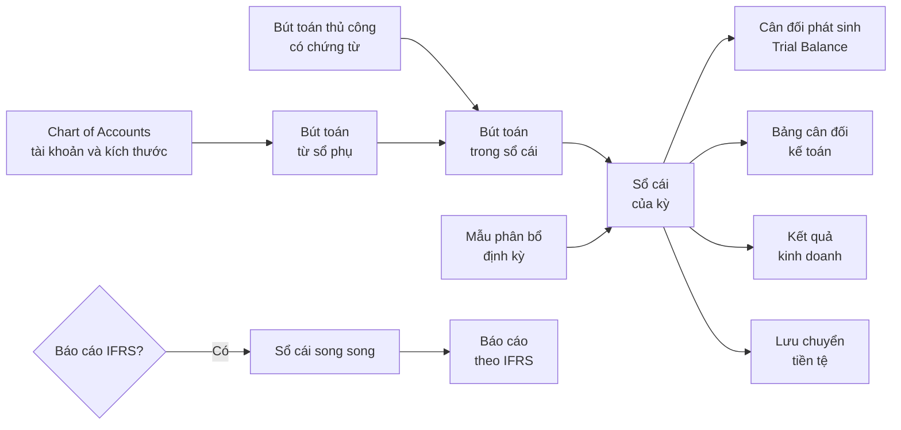

# 4000 Sổ cái & báo cáo tài chính

Sổ cái là **nơi mọi bút toán hội tụ**, và báo cáo tài chính là sản phẩm cuối cùng. Thiết kế hệ thống tài khoản sai thì không báo cáo nào đúng, dù mọi bút toán đều cân.

## 0. Nguyên lý (áp dụng mọi ERP)

1. **Hệ thống tài khoản là kiến trúc, không phải danh sách.** Tài khoản phải đủ để lên được Bảng cân đối và Kết quả kinh doanh mà không phải sửa lại, và không quá nhiều đến mức người nhập liệu phải đoán.
2. **Kích thước phân tích (chi nhánh, trung tâm chi phí, dự án) tách khỏi tài khoản.** Gộp hết vào mã tài khoản làm bùng nổ số tài khoản và không đổi được khi cơ cấu tổ chức thay đổi.
3. **Sổ cái song song cho nhiều chuẩn mực.** Doanh nghiệp có thể phải báo cáo theo cả chuẩn Việt Nam và IFRS — hai bộ sổ độc lập, không trung chuyển bằng tay.
4. **Mỗi bút toán thủ công đều phải có chứng từ và người duyệt.** Bút toán thủ công là nơi dễ che sai sót nhất, nên phải kiểm soát chặt hơn cả bút toán tự động.
5. **Bút toán phân bổ và định kỳ phải có mẫu, không nhập lại mỗi tháng.** Nhập lại tay dẫn đến sai số và quên.
6. **Báo cáo tài chính không phải bảng tính.** Nó là **truy vấn từ sổ cái** theo một bản đồ dòng báo cáo được cấu hình.

## 1. Luồng vận hành



## 2. Ai làm gì ở module nào

| Việc | Kế toán tổng hợp | Kế toán trưởng | Ban điều hành | Kiểm toán độc lập |
|---|---|---|---|---|
| Thiết kế và thay đổi tài khoản | ✅ đề xuất | ✅ duyệt | — | — |
| Cấu hình kỳ kế toán | ✅ sở hữu | ✅ duyệt | — | — |
| Nhập bút toán thủ công | ✅ sở hữu | ✅ duyệt theo hạn mức | — | — |
| Thiết lập mẫu bút toán định kỳ | ✅ sở hữu | ✅ duyệt | — | — |
| Lập báo cáo tài chính | ✅ sở hữu | ✅ soát xét | ✅ ký duyệt | — |
| Kiểm toán báo cáo | Cung cấp số liệu | Trả lời | — | ✅ thực hiện |
| Công bố và nộp báo cáo | ✅ thực hiện | ✅ ký | ✅ chịu trách nhiệm | — |

**Ranh giới cốt lõi:** người **nhập bút toán** không được **duyệt** bút toán đó; người **lập báo cáo** không được là người **ký công bố**.

## 3. Hạch toán

Bản đồ tài khoản trung gian và nguyên tắc tất toán ở [Hạch toán & tài khoản trung gian](./1000-hach-toan-va-tai-khoan-trung-gian.md).

### A. Ba lớp của hệ thống tài khoản

| Lớp | Vai trò | Ví dụ |
|---|---|---|
| Tài khoản tổng hợp | Lên báo cáo tài chính | Tồn kho, Phải thu, Doanh thu |
| Tài khoản chi tiết | Lên báo cáo quản trị | Tồn kho theo nhóm hàng |
| Kích thước phân tích | Phân tích đa chiều | Chi nhánh, trung tâm chi phí, dự án |

Điểm quan trọng: **tài khoản quyết định dòng báo cáo**, kích thước quyết định **cắt dọc báo cáo**. Trộn hai lớp vào một mã là lỗi kiến trúc.

### B. Kỳ kế toán

Có hai kỳ khác nhau, không được nhầm:

- **Kỳ hạch toán** — kỳ kế toán của một bút toán, quyết định báo cáo nào sẽ chứa nó.
- **Kỳ kho hàng** — kỳ khóa sổ của kho, có thể đóng/mở độc lập với kế toán.

Một doanh nghiệp thường đóng kỳ kho sớm hơn kỳ kế toán, để kế toán còn thời gian xử lý.

### C. Bút toán thủ công

Ba quy tắc bắt buộc:

1. **Phải có chứng từ nguồn** — không có bút toán "điều chỉnh cho tròn sổ".
2. **Phải có người duyệt khác người nhập** khi vượt ngưỡng giá trị.
3. **Mọi thay đổi phải được lưu vết** — ai sửa, lúc nào, trước và sau khi sửa.

### D. Sổ cái song song

Khi doanh nghiệp phải báo cáo theo nhiều chuẩn mực, mỗi chuẩn mực là một **sổ độc lập**, có tài khoản riêng và bút toán điều chỉnh riêng. Không dùng một sổ rồi điều chỉnh bằng bảng Excel — sai một ô là cả báo cáo sai.

## 4. Điểm chạm & rủi ro

- **Bút toán từ phân hệ nguồn**: [Hạch toán & tài khoản trung gian](./1000-hach-toan-va-tai-khoan-trung-gian.md)
- **Giá vốn vào kết quả kinh doanh**: [Giá vốn & định giá tồn kho](./2000-gia-von-va-dinh-gia-ton-kho.md)
- **Thuế phải nộp**: [Thuế & tài sản cố định](./3000-thue-va-tai-san-co-dinh.md)
- **Khóa sổ và đối chiếu trước báo cáo**: [Đóng kỳ & đối soát sổ phụ](./5000-dong-ky-va-doi-soat-so-phu.md)
- **Sai số thường gặp trong sổ cái**: [Bẫy kế toán](./9000-bay-ke-toan.md)

**Rủi ro chính:**

- **Tài khoản quá chi tiết** — bùng nổ số mã, người dùng phải đoán khi nhập.
- **Gộp kích thước vào mã tài khoản** — không đổi được khi cơ cấu thay đổi.
- **Bút toán thủ công không chứng từ** — nơi che sai sót.
- **Cùng người nhập và duyệt bút toán** — không ai kiểm chéo.
- **Bút toán định kỳ nhập lại mỗi tháng** — sai số và sót.
- **Báo cáo lập riêng bằng Excel** — không khớp sổ cái, kiểm toán không chấp nhận.
- **Sổ song song điều chỉnh thủ công** — sai một ô là sai cả báo cáo.

## 5. Triển khai tham chiếu ERP

### A. Ánh xạ khái niệm

| Khái niệm | Oracle EBS R12 | Epicor ERP | SAP S/4HANA | Odoo |
|---|---|---|---|---|
| Hệ thống tài khoản | Accounting Flexfield (`GL_CODE_COMBINATIONS`) | `Erp.GLAccount` | Chart of Accounts (`SKA1`/`SKB1`) | `account.account` |
| Kích thước phân tích | Segments trên Flexfield | GL Segments | Financial Dimensions / Cost Center | `analytic_account` |
| Kỳ kế toán | `GL_PERIOD_STATUSES` | `Fiscal Period` | Fiscal Year Variant (`T009`) | `account.period` |
| Sổ cái song song | Secondary Ledger (`GL_LEDGERS`) | Multiple Books | Parallel Ledger | Không native (multi-company) |
| Bút toán thủ công | `GL_JE_HEADERS` / `GL_JE_LINES` | `Erp.GLJrnHed` / `GLJrnDtl` | `BKPF` / `BSEG` | `account.move` type `entry` |
| Bút toán định kỳ | Recurring Journal | Recurring Journal | Recurring Entry (`FBD1`) | Không native |
| Báo cáo tài chính | FSG (Financial Statement Generator) | Financial Reports | Financial Statement Version (`OB58`) | `account.report` |

### B. Hệ thống tự xây — thiết kế tối thiểu

```sql
CREATE TABLE GL_Account (
    Account_ID       VARCHAR(20) PRIMARY KEY,
    Account_Name     NVARCHAR(200) NOT NULL,
    Account_Type     VARCHAR(20) NOT NULL,  -- ASSET | LIABILITY | EQUITY | REVENUE | EXPENSE
    Parent_Account   VARCHAR(20) NULL,
    Is_Posting       BIT NOT NULL DEFAULT 1, -- 1 = được hạch toán vào
    Is_Active        BIT NOT NULL DEFAULT 1,
    Report_Line      VARCHAR(20) NULL        -- map sang dòng báo cáo
);

CREATE TABLE GL_Dimension (
    Dimension_ID     VARCHAR(20) NOT NULL,
    Dimension_Value  VARCHAR(50) NOT NULL,
    Description      NVARCHAR(200) NULL,
    PRIMARY KEY (Dimension_ID, Dimension_Value)
);

CREATE TABLE GL_Fiscal_Period (
    Period_ID        VARCHAR(10) PRIMARY KEY,  -- ví dụ 2026-01
    Start_Date       DATE NOT NULL,
    End_Date         DATE NOT NULL,
    Status           VARCHAR(10) NOT NULL,     -- OPEN | CLOSED | PERMANENTLY_CLOSED
    Closed_At        DATETIME NULL,
    Closed_By        VARCHAR(50) NULL
);

CREATE TABLE GL_Journal_Line (
    JE_ID            BIGINT NOT NULL,
    Line_No          INT NOT NULL,
    Account_ID       VARCHAR(20) NOT NULL,
    Cost_Center      VARCHAR(20) NULL,
    Project_Code     VARCHAR(30) NULL,
    Debit            DECIMAL(18,2) NOT NULL DEFAULT 0,
    Credit           DECIMAL(18,2) NOT NULL DEFAULT 0,
    Period_ID        VARCHAR(10) NOT NULL,
    Source           VARCHAR(20) NOT NULL,   -- AP | AR | INV | MFG | MANUAL
    PRIMARY KEY (JE_ID, Line_No)
);
```

Bốn ràng buộc bắt buộc:

1. **`Is_Posting = 0` thì không được hạch toán vào** — chỉ dùng để gộp báo cáo.
2. **Mỗi bút toán phải cân `SUM(Debit) = SUM(Credit)`.**
3. **Không ghi được vào `GL_Fiscal_Period` có `Status = CLOSED`.**
4. **`Source = MANUAL` bắt buộc có `Approved_By` khác người tạo.**

### C. Truy vấn kiểm soát

**Tài khoản chi tiết đang bị hạch toán trực tiếp — báo cáo sẽ lệch:**

```sql
SELECT j.Account_ID, COUNT(*) AS So_But_Toan, SUM(j.Debit + j.Credit) AS Tong_PS
FROM GL_Journal_Line j
JOIN GL_Account a ON a.Account_ID = j.Account_ID
WHERE a.Is_Posting = 0
GROUP BY j.Account_ID;
```

**Bút toán không cân:**

```sql
SELECT JE_ID, SUM(Debit) AS Tong_No, SUM(Credit) AS Tong_Co,
       SUM(Debit) - SUM(Credit) AS Chenh_Lech
FROM GL_Journal_Line
GROUP BY JE_ID
HAVING ABS(SUM(Debit) - SUM(Credit)) > 0.01;
```

**Bút toán ghi vào kỳ đã đóng:**

```sql
SELECT j.JE_ID, j.Period_ID, p.Status, COUNT(*) AS So_Dong
FROM GL_Journal_Line j
JOIN GL_Fiscal_Period p ON p.Period_ID = j.Period_ID
WHERE p.Status = 'CLOSED'
GROUP BY j.JE_ID, j.Period_ID, p.Status;
```

**Bút toán thủ công do cùng người tạo và duyệt:**

```sql
SELECT JE_ID, Created_By, Approved_By, Total_Amount
FROM GL_Journal_Header
WHERE Source = 'MANUAL' AND Created_By = Approved_By;
```

**Cân đối phát sinh theo tài khoản — kiểm tra tổng phát sinh bằng 0:**

```sql
SELECT SUM(Debit) AS Tong_No, SUM(Credit) AS Tong_Co,
       SUM(Debit) - SUM(Credit) AS Chenh_Lech
FROM GL_Journal_Line
WHERE Period_ID = @Period_ID;
```

**Epicor — bút toán thủ công trong kỳ và người duyệt:**

```sql
SELECT h.JournalNum, h.Posted, h.EntryDate, h.Description
FROM Erp.GLJrnHed h
WHERE h.Company = 'YOUR_COMPANY_CODE'
  AND h.SourceModule <> 'GL'      -- bút toán tự sinh khác với thủ công
  AND h.EntryDate >= DATEADD(MONTH, -1, GETDATE())
ORDER BY h.EntryDate DESC;
```

## 6. Bẫy thực chiến & Checklist

| # | Bẫy | Triệu chứng | Cách phòng tránh |
|---|---|---|---|
| 1 | Tài khoản quá chi tiết | Hàng nghìn mã, nhập liệu chọn sai | Tài khoản tổng hợp + kích thước phân tích |
| 2 | Gộp chi nhánh vào mã tài khoản | Đổi cơ cấu tổ chức phải đổi cả sổ | Dùng dimension, không dùng mã |
| 3 | Hạch toán vào tài khoản tổng hợp | Báo cáo chi tiết mất cân đối | `Is_Posting` chặn ở tầng dữ liệu |
| 4 | Bút toán thủ công không chứng từ | Không giải trình được với kiểm toán | Bắt buộc đính kèm chứng từ |
| 5 | Cùng người nhập và duyệt bút toán | Sai sót không ai phát hiện | SoD, ngưỡng duyệt theo giá trị |
| 6 | Bút toán định kỳ nhập lại mỗi kỳ | Sai số, sót bút toán | Mẫu bút toán định kỳ tự chạy |
| 7 | Ghi vào kỳ đã đóng | Sổ cái đã chốt bị thay đổi | Chặn theo `Status` của kỳ |
| 8 | Lập báo cáo bằng Excel | Không khớp sổ cái | Báo cáo từ truy vấn sổ cái |
| 9 | Sổ song song điều chỉnh tay | Sai một ô, sai cả báo cáo | Bút toán tự động giữa hai sổ |
| 10 | Không ánh xạ tài khoản sang dòng báo cáo | Báo cáo thiếu dòng, phải sửa tay | `Report_Line` bắt buộc cho tài khoản posting |

**Checklist trước go-live:**

- [ ] 100% tài khoản posting có `Report_Line` (đã chạy truy vấn, 0 dòng).
- [ ] Tài khoản tổng hợp không nhận hạch toán (đã test chặn).
- [ ] Mọi bút toán cân (đã test, 0 dòng lệch).
- [ ] Chặn ghi vào kỳ `CLOSED` (đã test).
- [ ] Bút toán thủ công bắt buộc chứng từ và người duyệt khác.
- [ ] Bút toán định kỳ có mẫu, tự chạy.
- [ ] Báo cáo lấy từ sổ cái, không từ Excel.
- [ ] Có sổ song song nếu báo cáo theo nhiều chuẩn mực.
- [ ] Đã test: Trial Balance tổng Nợ = tổng Có.

## Xem thêm

- [Tổng quan Kế toán chung](./0000-tong-quan-ke-toan.md)
- [Hạch toán & tài khoản trung gian](./1000-hach-toan-va-tai-khoan-trung-gian.md)
- [Thuế & tài sản cố định](./3000-thue-va-tai-san-co-dinh.md)
- [Đóng kỳ & đối soát sổ phụ](./5000-dong-ky-va-doi-soat-so-phu.md)
- [Bẫy kế toán](./9000-bay-ke-toan.md)

<div align="center" style={{color: 'var(--ifm-color-primary)'}}>
  <strong>Chúc các bạn thành công và vui vẻ!</strong>
</div>
