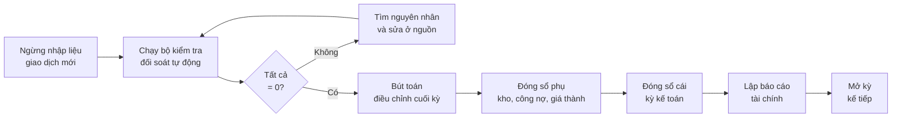

# 5000 Đóng kỳ & đối soát sổ phụ

Khóa sổ là hành động **không thể hoàn tác nhẹ nhàng**: sau khi đóng, mọi sửa chữa phải đi qua bút toán điều chỉnh ở kỳ sau và để lại dấu vết với kiểm toán. Vì vậy mọi việc đối chiếu phải xong **trước** khi bấm đóng.

## 0. Nguyên lý (áp dụng mọi ERP)

1. **Sổ phụ phải khớp sổ cái trước khi đóng kỳ.** Kho, công nợ, giá thành đều là sổ phụ; tài khoản tương ứng trên sổ cái là tổng của chúng. Lệch nghĩa là có giao dịch ghi thiếu hoặc ghi sai bên.
2. **Đóng theo thứ tự: sổ phụ trước, sổ cái sau.** Khoá sổ cái khi sổ phụ còn mở sẽ khóa luôn khả năng sửa lỗi.
3. **Mỗi kỳ chỉ đóng một lần, và phải có người chịu trách nhiệm.** Không có chuyện "mở lại để sửa cho đẹp".
4. **Đóng kỳ kho và kỳ kế toán là hai việc khác nhau**, thường lệch nhau vài ngày để kế toán có thời gian xử lý.
5. **Checklist phải được chạy bằng máy, không bằng trí nhớ.** Một truy vấn tự động trả về 0 dòng tốt hơn một người nhớ kiểm 20 thứ.
6. **Chênh lệch phải được giải thích và lưu lại lý do**, kể cả khi đã xử lý xong.

## 1. Luồng vận hành



## 2. Ai làm gì ở module nào

| Bước | Kho | Kế toán công nợ | Kế toán giá thành | Kế toán tổng hợp | Kế toán trưởng |
|---|---|---|---|---|---|
| Khóa nhập liệu kỳ | ✅ kho | ✅ công nợ | ✅ giá thành | ✅ sổ cái | ✅ quyết định |
| Đối chiếu sổ phụ kho | ✅ sở hữu | — | — | Nhận kết quả | — |
| Đối chiếu sổ phụ công nợ | — | ✅ sở hữu | — | Nhận kết quả | — |
| Đối chiếu WIP và giá thành | — | — | ✅ sở hữu | Nhận kết quả | — |
| Bút toán điều chỉnh cuối kỳ | Đề xuất | Đề xuất | Đề xuất | ✅ lập | ✅ duyệt |
| Đóng sổ phụ | ✅ thực hiện | ✅ thực hiện | ✅ thực hiện | — | — |
| Đóng sổ cái | — | — | — | ✅ thực hiện | ✅ duyệt |
| Mở kỳ tiếp theo | — | — | — | ✅ thực hiện | ✅ duyệt |

## 3. Hạch toán

Đóng kỳ không sinh bút toán — trừ các bút toán điều chỉnh cuối kỳ. Bản đồ tài khoản ở [Hạch toán & tài khoản trung gian](./1000-hach-toan-va-tai-khoan-trung-gian.md).

### A. Bảy điểm đối chiếu bắt buộc

| # | Đối chiếu | Sổ phụ | Sổ cái |
|---|---|---|---|
| 1 | Giá trị tồn kho | Sổ kho (số lượng × đơn giá) | Tài khoản tồn kho (152/155/156) |
| 2 | Công nợ phải thu | Sổ chi tiết khách hàng | Tài khoản phải thu (131) |
| 3 | Công nợ phải trả | Sổ chi tiết nhà cung cấp | Tài khoản phải trả (331) |
| 4 | Tài khoản trung gian nhận hàng | GR/IR chưa khớp | GR/IR clearing |
| 5 | WIP | Lệnh sản xuất chưa đóng | Tài khoản dở dang (154) |
| 6 | Tài sản cố định | Sổ tài sản | Nguyên giá và hao mòn lũy kế |
| 7 | Thuế | Tờ khai thuế | Tài khoản thuế (1331/3331) |

### B. Thứ tự đóng kỳ

1. Đóng kho — chốt số lượng và giá trị tồn.
2. Đóng công nợ — chốt số dư AP/AR.
3. Đóng giá thành — chốt WIP và chênh lệch.
4. Chạy đối chiếu toàn bộ bảy điểm.
5. Đóng sổ cái.
6. Mở kỳ kế tiếp.

## 4. Điểm chạm & rủi ro

- **Giá vốn và tồn kho**: [Giá vốn & định giá tồn kho](./2000-gia-von-va-dinh-gia-ton-kho.md)
- **Số dư công nợ**: [Tổng quan Công nợ](../5-cong-no/0000-tong-quan-cong-no.md)
- **WIP và chênh lệch**: [Giá thành sản xuất](../3-san-xuat/thuc-thi/8000-gia-thanh-san-xuat.md)
- **Tài khoản trung gian treo**: [Hạch toán & tài khoản trung gian](./1000-hach-toan-va-tai-khoan-trung-gian.md)
- **Hệ thống tài khoản và kỳ**: [Sổ cái & báo cáo tài chính](./4000-so-cai-va-bao-cao-tai-chinh.md)

**Rủi ro chính:**

- **Đóng sổ cái trước sổ phụ** — mất khả năng sửa lỗi sổ phụ.
- **Bỏ qua đối chiếu vì "tháng trước khớp"** — lệch tích lũy nhiều kỳ.
- **Không có checklist tự động** — sót bước, phụ thuộc trí nhớ.
- **Mở lại kỳ đã đóng để sửa** — mất dấu vết kiểm toán.
- **Chênh lệch không giải thích** — kiểm toán không chấp nhận.
- **Không khóa nhập liệu trước khi đối chiếu** — số liệu thay đổi giữa chừng.

## 5. Triển khai tham chiếu ERP

### A. Ánh xạ khái niệm

| Khái niệm | Oracle EBS R12 | Epicor ERP | SAP S/4HANA | Odoo |
|---|---|---|---|---|
| Kỳ kế toán | `GL_PERIOD_STATUSES` | `Fiscal Period` | Fiscal Year Variant period | `account.period` |
| Kỳ kho | `ORG_ACCT_PERIODS` | `Inventory Period` | MM Period (`MMPV`) | Không native |
| Khóa sổ phụ | `Open/Close Period` | `Close Period` | Period-end closing (MM/FI) | Lock date |
| Đối soát sổ phụ → GL | Subledger Accounting (SLA) reconciliation | `GL Reconciliation` | `FAGLF101` / account balance | `account.report` đối chiếu |
| Đóng năm | Year End Close | `Year End` | `F.16` / Carry Forward | `account.fiscal.year` close |

### B. Hệ thống tự xây — bảng kiểm tra đóng kỳ

```sql
CREATE TABLE Period_Close_Check (
    Check_ID         VARCHAR(20) PRIMARY KEY,
    Check_Name       NVARCHAR(200) NOT NULL,
    Query_Text       NVARCHAR(MAX) NOT NULL,  -- truy vấn phải trả về 0 dòng
    Is_Blocking      BIT NOT NULL DEFAULT 1,  -- 1 = chặn đóng kỳ nếu chưa pass
    Last_Run_At      DATETIME NULL,
    Last_Run_Result  INT NULL                 -- số dòng trả về (0 = pass)
);
```

Bốn ràng buộc bắt buộc:

1. **`Is_Blocking = 1` mà `Last_Run_Result > 0` thì không cho đóng kỳ.**
2. **Khóa nhập liệu trước khi chạy checklist** — nếu không, số liệu thay đổi trong lúc kiểm.
3. **Mọi lần đóng kỳ phải lưu lại kết quả checklist** — ai chạy, khi nào, kết quả.
4. **Mở lại kỳ phải có duyệt cấp cao và ghi lý do.**

### C. Truy vấn kiểm soát

**Đối chiếu giá trị tồn kho sổ kho với sổ cái:**

```sql
SELECT (SELECT SUM(Qty * Unit_Cost) FROM Inventory_Transaction WHERE Is_Logical = 0) AS Subledger_Value,
       (SELECT SUM(Debit) - SUM(Credit) FROM GL_Journal_Line
        WHERE Account_ID LIKE '15%' AND Period_ID <= @Period) AS GL_Value,
       (SELECT SUM(Qty * Unit_Cost) FROM Inventory_Transaction WHERE Is_Logical = 0)
     - (SELECT SUM(Debit) - SUM(Credit) FROM GL_Journal_Line
        WHERE Account_ID LIKE '15%' AND Period_ID <= @Period) AS Diff;
```

**Đối chiếu công nợ phải thu với sổ cái:**

```sql
SELECT (SELECT SUM(Amount_Open) FROM AR_Open_Item WHERE Status <> 'CLEARED') AS Subledger_AR,
       (SELECT SUM(Debit) - SUM(Credit) FROM GL_Journal_Line
        WHERE Account_ID LIKE '131%' AND Period_ID <= @Period) AS GL_AR;
```

**Tài khoản trung gian còn số dư:**

```sql
SELECT Period_ID, SUM(Debit) - SUM(Credit) AS Balance
FROM GL_Journal_Line
WHERE Account_ID = 'GR_IR_CLEARING' AND Period_ID <= @Period
GROUP BY Period_ID
HAVING ABS(SUM(Debit) - SUM(Credit)) > 0.01;
```

**Lệnh sản xuất còn WIP chưa đóng:**

```sql
SELECT WO_No, Item_ID, Status,
       (SELECT ISNULL(SUM(Qty_Issued * Unit_Cost), 0)
        FROM WO_Material_Txn m WHERE m.WO_ID = w.WO_ID) AS WIP_Value
FROM Work_Order w
WHERE w.Status IN ('RELEASED', 'IN_PROGRESS', 'PARTIAL');
```

**Chạy toàn bộ checklist đóng kỳ:**

```sql
-- Mỗi dòng trả về số dòng mà truy vấn tương ứng tìm thấy (0 = pass)
SELECT c.Check_ID, c.Check_Name, c.Is_Blocking, c.Last_Run_At, c.Last_Run_Result
FROM Period_Close_Check c
WHERE c.Is_Blocking = 1 AND ISNULL(c.Last_Run_Result, -1) <> 0;
```

**Epicor — kỳ kế toán và trạng thái:**

```sql
SELECT FiscalYear, FiscalPeriod, StartDate, EndDate, Closed
FROM Erp.FiscalPeriod
WHERE Company = 'YOUR_COMPANY_CODE'
ORDER BY FiscalYear DESC, FiscalPeriod DESC;
```

## 6. Bẫy thực chiến & Checklist

| # | Bẫy | Triệu chứng | Cách phòng tránh |
|---|---|---|---|
| 1 | Đóng sổ cái trước sổ phụ | Không sửa được lỗi sổ phụ | Thứ tự: kho → công nợ → giá thành → GL |
| 2 | Không khóa nhập liệu trước khi kiểm | Số liệu đổi giữa lúc đối chiếu | Khóa kỳ trước, rồi chạy checklist |
| 3 | Checklist chạy tay theo trí nhớ | Sót bước, lệch phát hiện muộn | Bảng `Period_Close_Check` tự động |
| 4 | Bỏ qua đối chiếu vì tháng trước khớp | Lệch tích lũy nhiều kỳ | Bảy điểm đối chiếu phải chạy mỗi kỳ |
| 5 | Mở lại kỳ đã đóng không duyệt | Không truy được ai sửa | Mở lại phải có duyệt cấp cao + lý do |
| 6 | Chênh lệch xử lý bằng bút toán cho tròn | Che mất nguyên nhân | Phải tìm nguyên nhân ở nguồn |
| 7 | Không đối chiếu thuế với tờ khai | Sai nghĩa vụ thuế | Đưa thuế vào bảy điểm đối chiếu |
| 8 | Không đối chiếu TSCĐ | Nguyên giá lệch giữa sổ tài sản và GL | Sổ tài sản là một điểm đối chiếu |
| 9 | WIP treo qua nhiều kỳ | Giá thành kỳ này và kỳ sau đều sai | Báo cáo WIP aging, xử lý trước đóng kỳ |
| 10 | Không lưu kết quả checklist | Không chứng minh được đã kiểm | Lưu ai chạy, khi nào, kết quả |

**Checklist trước go-live:**

- [ ] Khóa nhập liệu kỳ trước khi chạy checklist (đã test).
- [ ] Bảy điểm đối chiếu đều có truy vấn tự động.
- [ ] Checklist blocking chặn đóng kỳ khi còn dòng lỗi (đã test).
- [ ] Thứ tự đóng: kho → công nợ → giá thành → GL.
- [ ] Mở lại kỳ cần duyệt cấp cao + lý do (đã test).
- [ ] Kết quả checklist được lưu lại.
- [ ] Đối chiếu thuế với tờ khai nằm trong checklist.
- [ ] Đối chiếu TSCĐ nằm trong checklist.
- [ ] Có báo cáo WIP aging.
- [ ] Đã test một kỳ: chạy đủ 7 điểm, tất cả = 0 rồi mới đóng.

## Xem thêm

- [Tổng quan Kế toán chung](./0000-tong-quan-ke-toan.md)
- [Hạch toán & tài khoản trung gian](./1000-hach-toan-va-tai-khoan-trung-gian.md)
- [Giá vốn & định giá tồn kho](./2000-gia-von-va-dinh-gia-ton-kho.md)
- [Sổ cái & báo cáo tài chính](./4000-so-cai-va-bao-cao-tai-chinh.md)
- [Bẫy kế toán](./9000-bay-ke-toan.md)

<div align="center" style={{color: 'var(--ifm-color-primary)'}}>
  <strong>Chúc các bạn thành công và vui vẻ!</strong>
</div>
