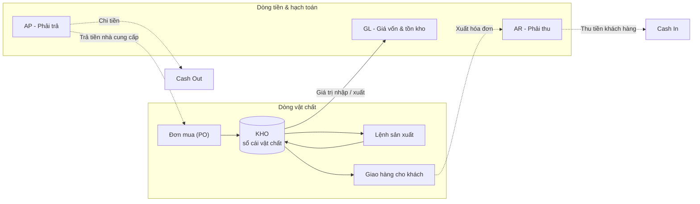

import DocCardList from '@theme/DocCardList';

# ERP Nghiệp vụ

Tài liệu được tổ chức theo **quy trình vận hành thật** chứ không theo module phần mềm: người đi làm vận hành một quy trình, không vận hành một module. Mỗi quy trình là một dòng chảy xuyên qua nhiều phân hệ, và **kho nằm ở trung tâm** — mọi giao dịch vật chất đều ghi vào kho, mọi con số tài chính đều lấy từ kho.

## Bản đồ dòng vật chất và dòng tiền

**Đọc sơ đồ này thế nào:** hàng chảy qua kho (P2P → kho → sản xuất → kho → O2C), còn tiền chảy ngược chiều (AP chi ra ở đầu vào, AR thu vào ở đầu ra). Khối kế toán là nơi ghi nhận giá trị của cả hai dòng.

## Sáu khối tài liệu

| Khối | Vai trò | Đọc khi nào |
|---|---|---|
| **[0. Nền tảng](./0-nen-tang/0000-cach-doc-tai-lieu.md)** | Tổ chức, pháp nhân, dữ liệu nền, chứng từ, kiểm soát, thuật ngữ, UOM | **Đọc trước tiên**, một lần |
| **[1. Kho](./1-kho/0000-tong-quan-kho.md)** | Sổ cái vật chất: cấu trúc, giao dịch, giữ hàng, kiểm kê, định giá | Khi cần biết "hàng ghi vào sổ kho thế nào" |
| **[2. Mua hàng](./2-mua-hang/0000-tong-quan-p2p.md)** | Procure-to-Pay: nhu cầu → PO → nhận hàng → khớp hóa đơn | Khi làm đầu vào |
| **[3. Sản xuất](./3-san-xuat/0000-tong-quan-san-xuat.md)** | Plan-to-Produce: kỹ thuật → thực thi → giá thành | Khi làm sản xuất |
| **[4. Bán hàng](./4-ban-hang/0000-tong-quan-o2c.md)** | Order-to-Cash: đơn → giao → hóa đơn → RMA | Khi làm đầu ra |
| **[5. Kế toán](./5-ke-toan/0000-tong-quan-ke-toan.md)** | Ba nhóm: **công nợ (AP/AR)**, **tổng hợp (GL)**, **thuế & tài sản cố định** | Khi làm công nợ, hạch toán, khóa sổ |

## Đọc theo hai đường

**Theo quy trình** — khi bạn đang xử lý một công việc cụ thể: đi từ khối tương ứng ở bảng trên, theo các bài chi tiết 1000 → 9000 bên trong khối.

**Theo khái niệm** — khi bạn cần tra một định nghĩa: mỗi khái niệm (tài khoản trung gian, quy đổi UOM, khớp lệnh 2/3/4 chiều, quy trình nhận hàng 3 bước, giá vốn, đóng kỳ) có đúng một bài gốc, nêu ở dòng "Xem thêm" của bài liên quan.

## Cấu trúc một bài

Mỗi bài chi tiết đi theo cùng một khung: **0. Nguyên lý** (áp dụng mọi ERP) → **1. Luồng vận hành** → **2. Ai làm gì ở module nào** → **3. Hạch toán** → **4. Điểm chạm & rủi ro** → **5. Triển khai tham chiếu ERP** (SAP, Oracle EBS, Epicor, Odoo) → **6. Bẫy thực chiến & Checklist**. Nhờ vậy bài nào cũng đọc được độc lập mà không cần đọc lại từ đầu.

<DocCardList />

  <strong>Chúc các bạn thành công và vui vẻ!</strong>

