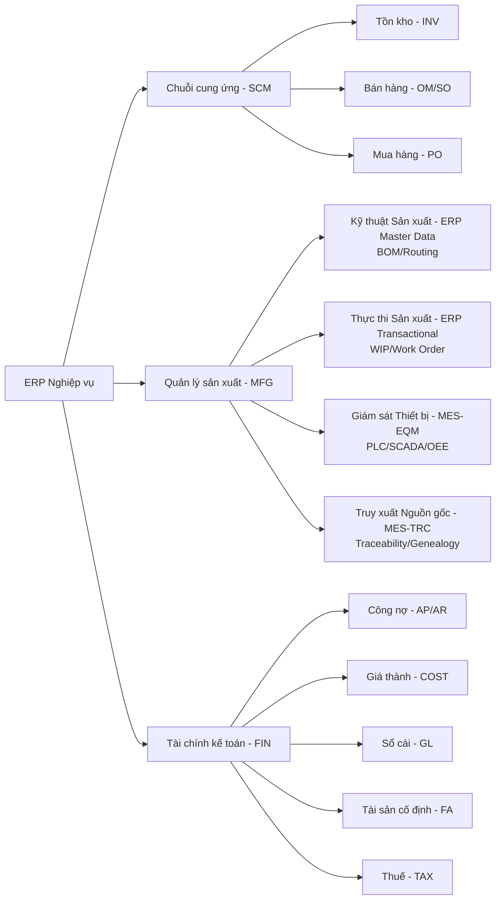

import DocCardList from '@theme/DocCardList';

# ERP Nghiệp vụ

Tài liệu này tổng hợp kiến thức và kinh nghiệm triển khai thực tế các nghiệp vụ ERP, tổ chức theo 3 phân hệ chính. Cách chia này tương ứng với chuẩn phân loại module của các hệ thống ERP lớn trên thị trường, giúp bạn dễ dàng đối chiếu khi làm việc với SAP, Oracle EBS hay Epicor.

## Tương quan phân hệ với các ERP phổ biến

| Phân hệ trong tài liệu | SAP | Oracle EBS | Epicor |
|---|---|---|---|
| **Chuỗi cung ứng (SCM)** | MM (Materials Management) | SCM (Supply Chain Management) | Supply Chain Management |
| **Quản lý sản xuất (MFG)** | PP (Production Planning) | Manufacturing | Production Management |
| **Tài chính kế toán (FIN)** | FI-CO (Financial Accounting / Controlling) | Financials | Finance |

## Sơ đồ 3 phân hệ

## Danh mục tài liệu

<DocCardList />